## Agenda

- Rückblick & Lernziele
- Einstieg: Brand im Rechenzentrum
- Warum Resilienz messen?
- Resilienz als Systemfunktion: die Degradationskurve
- Kennzahlen: RTO, RPO, MTTR, MTBF – und Verfügbarkeit
- Modelle aus Frameworks (NIST, ISO, BSI, ENISA)
- Messmethoden, KPIs und Reifegrade
- Fallbeispiele & Übung: Resilienz bewerten
- Kernpunkte & Ausblick

## Rückblick Sitzung 1

::: columns
::: {.column width="56%"}
- Resilienz = Widerstands-, Erholungs- **und** Lernfähigkeit – nicht Unverwundbarkeit.
- Safety ≠ Security – beides beeinflusst Resilienz.
- Vier Prinzipien: Redundanz, Diversität, Wiederherstellbarkeit, Adaptivität.
- Die Resilienzkurve: Abfall flacher, Erholung schneller, danach besser.
- Kupferberg: **Ein Backup, das nie getestet wurde, ist eine Hoffnung.**
:::
::: {.column width="40%"}
{fig-alt="Dose mit Springknete als Bild für Elastizität"}
:::
:::

::: notes
Kurz abfragen: Wer erinnert sich an Ariane 5, Kupferberg, Maersk? Heute machen wir aus der Resilienzkurve von Sitzung 1 eine Messgröße. Kupferberg ist die Brücke zum GitLab-Fall später in dieser Sitzung.
:::

## Lernziele

Nach dieser Sitzung können Sie …

- erklären, warum Resilienz **messbar** gemacht werden muss,
- die Kennzahlen **RTO, RPO, MTTR und MTBF** definieren und als Ziel- oder Messwert einordnen,
- Resilienzmodelle in **NIST, ISO/IEC 27031, BSI 200-4 und ENISA** verorten,
- die **Degradations- und Wiederherstellungskurve** eines Systems qualitativ beschreiben,
- erste **Reifegrad- und KPI-basierte Bewertungen** realer IT-Systeme vornehmen.

::: notes
Lernziele 1:1 aus dem Skript. Prüfungsfragen stehen am Ende des Skripts und auf der Lernseite – RTO/RPO und Reifegradmodelle sind Klassiker.
:::

## Einstieg: Brand im Rechenzentrum

::: columns
::: {.column width="56%"}
- **10. März 2021, Straßburg:** Das Rechenzentrum SBG2 von OVHcloud brennt vollständig aus, SBG1 wird beschädigt
- Betroffen u. a. data.gouv.fr und die Website des Centre Pompidou
- Manche Kunden hatten ihr Backup im **selben Gebäude** wie die Produktion – beides war weg
- 2023 verurteilt ein französisches Handelsgericht OVHcloud zu Schadensersatz, weil Backups nicht wie vereinbart getrennt lagen

**Frage:** Wie alt dürfen Ihre Daten nach einer Wiederherstellung sein?
:::
::: {.column width="40%"}
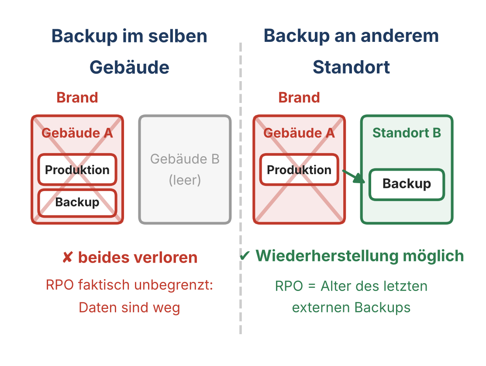{fig-alt="Links: Produktion und Backup im selben brennenden Gebäude, beides verloren. Rechts: Backup an anderem Standort, Wiederherstellung möglich."}
:::
:::

::: notes
Einstieg ohne Formeln: Ein Backup schützt nur vor den Ereignissen, die es nicht mit trifft. Die Frage nach dem Alter der Daten ist das RPO – Begriff noch nicht nennen, später auflösen. Die Klagen (u. a. Bluepad, Bati Courtage) drehten sich darum, wo die Sicherungen tatsächlich lagen. Rückbezug: Redundanz ohne räumliche Trennung ist dieselbe Falle wie Redundanz ohne Diversität (Ariane 5).
:::

## Warum Resilienz messen?

::: columns
::: {.column width="56%"}
- **Steuerung:** Management braucht Kennzahlen für Priorisierung und Budget.
- **Vergleichbarkeit** zwischen Systemen und Organisationen.
- **Frühwarnung:** Indikatoren für Krisenfähigkeit.
- **Nachweis:** In regulierten Domänen (KRITIS, Finanzaufsicht) wird quantifizierbare Belastbarkeit erwartet.

Was man nicht misst, kann man nicht verbessern – und nicht nachweisen.
:::
::: {.column width="40%"}
{fig-alt="Warnschild Alert Condition Red"}
:::
:::

::: notes
Drei Gründe aus dem Skript: Governance, Vergleichbarkeit/Reifegrad, Nachweisfähigkeit. Bezug zu DORA und NIS2 aus Sitzung 1: Regulierung verlangt Nachweise, nicht Absichtserklärungen.
:::

## Resilienz als Systemfunktion

::: columns
::: {.column width="56%"}
- Resilienz ist keine statische Eigenschaft, sondern **Verhalten unter Störung**.
- Systemleistung L(t) über die Zeit → „Degradationskurve“
- Zwei Schlüsselgrößen: **Tiefe des Ausfalls (Δ)** und **Wiederherstellungszeit (tR)**
- Ziel: Minimierung von Δ und tR

Resilienz zeigt sich nicht im Normalbetrieb, sondern in der Auslenkung. Die Kurve misst das Ergebnis, nicht den Weg.
:::
::: {.column width="40%"}
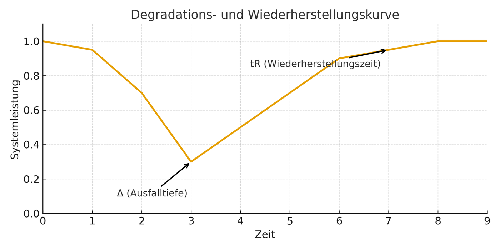{fig-alt="Degradations- und Wiederherstellungskurve"}
:::
:::

::: notes
Fünf Phasen: Normalbetrieb – Störung – degradierter Zustand – Recovery – Zielzustand. Vorteil: Technische, organisatorische und menschliche Maßnahmen werden vergleichbar – ob Backup, Failover oder Papierformular, die Kurve misst das Ergebnis.
:::

## Grafische Darstellung von RTO und RPO

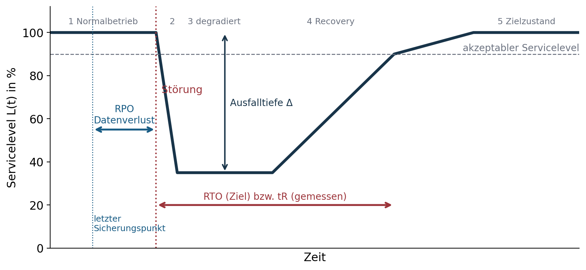{fig-alt="Schematische Kurve des Servicelevels über die Zeit mit RPO vor der Störung, RTO bis zum akzeptablen Servicelevel und Ausfalltiefe Δ."}

::: notes
RPO zeigt **zurück** – vom Störungszeitpunkt bis zum letzten Sicherungspunkt. RTO zeigt **nach vorn** – bis der akzeptable Servicelevel wieder erreicht ist. Auflösung der Einstiegsfrage: Bei OVHcloud war für manche Kunden das RPO faktisch unbegrenzt.
:::

## Resilienzmetriken in der IT

RTO und RPO sind Planungsziele, MTTR und MTBF beobachtete Messwerte.

| Kennzahl | Bedeutung | Beispiel |
|---|---|---|
| RTO | Recovery Time Objective – max. zulässige Wiederherstellungszeit | 2 h für Mailserver |
| RPO | Recovery Point Objective – max. Datenverlust zeitlich | 15 min |
| MTTR | Mean Time to Repair – durchschnittliche Reparaturzeit | 45 min |
| MTBF | Mean Time Between Failures – mittlere Zeit zwischen Fehlern | 30 Tage |

::: notes
Merkhilfe: RTO = „Wie lange dürfen wir offline sein?“, RPO = „Wie alt dürfen die Daten sein?“. RPO bestimmt die Backup-Frequenz bzw. Replikation, RTO die Wiederanlaufarchitektur.
:::

## Ziel vs. Messwert

::: columns
::: {.column width="56%"}
- **RTO / RPO:** normative bzw. vertragliche Anforderung – „Wie lange dürfen wir offline sein? Wie alt dürfen die Daten sein?“
- **MTTR / MTBF:** beobachtete Realwelt-Performance.
- MTBF misst Zuverlässigkeit, nicht Resilienz – ist aber entscheidend für die Risikoexposition.
- Normen fordern **Angemessenheit**, nicht absolute Minimierung.
:::
::: {.column width="40%"}
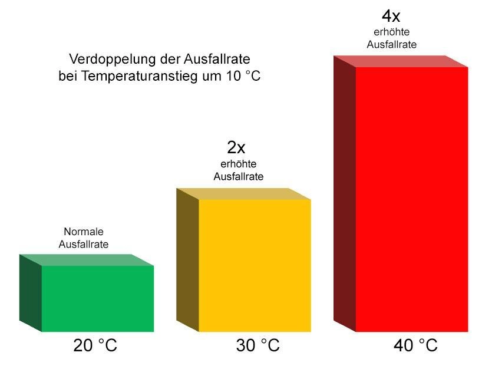{fig-alt="Balkendiagramm: Ausfallrate verdoppelt sich je 10 °C Temperaturanstieg"}
:::
:::

::: notes
Resilienz ist eine Optimierung unter Nebenbedingungen: Kosten, Regulatorik, Kritikalität. Das Diagramm zeigt: MTBF hängt von Betriebsbedingungen ab (Faustregel: Ausfallrate verdoppelt sich je 10 °C) – Zuverlässigkeit ist beeinflussbar, aber nie unendlich.
:::

## Verfügbarkeit: MTBF und MTTR zusammen

::: columns
::: {.column width="56%"}
| Verfügbarkeit | Ausfall pro Jahr |
|---|---|
| 99 % | ca. 3,7 Tage |
| 99,9 % | ca. 8,8 Stunden |
| 99,99 % | ca. 53 Minuten |
| 99,999 % | ca. 5 Minuten |
:::
::: {.column width="40%"}
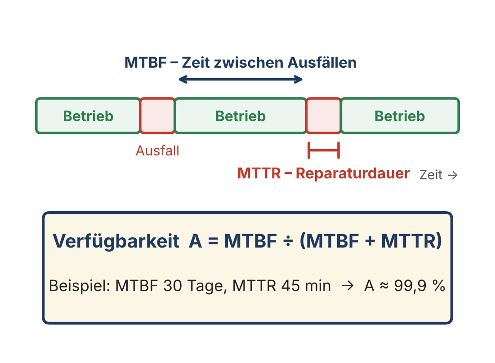{fig-alt="Zeitstrahl mit Betriebsphasen (MTBF) und kurzen Ausfällen (MTTR), darunter die Formel Verfügbarkeit gleich MTBF geteilt durch MTBF plus MTTR"}
:::
:::

::: notes
Zwei Hebel: seltener ausfallen (MTBF hoch) oder schneller zurückkommen (MTTR runter). Resilienz setzt am zweiten Hebel an. Achtung: Dieselbe Verfügbarkeit kann ein langer oder viele kurze Ausfälle sein – und sie sagt nichts über Datenverlust (RPO) oder Ausfalltiefe (Δ). Brücke zu SLOs aus Sitzung 1 (Regelkreis).
:::

## Ein RPO, das niemand prüfte: GitLab 2017

::: columns
::: {.column width="56%"}
- Am 31. Januar 2017 löscht ein Administrator versehentlich rund 300 GB auf der **Produktionsdatenbank** statt auf dem Replikat
- Vier Sicherungswege – drei versagen unbemerkt
- Rettung durch einen **zufälligen** Snapshot, 6 Stunden alt
- Ergebnis: ca. 6 h Datenverlust, ca. 18 h Ausfall von GitLab.com
- Ursache laut Postmortem: Niemand war für die Backups verantwortlich, niemand testete sie
:::
::: {.column width="40%"}
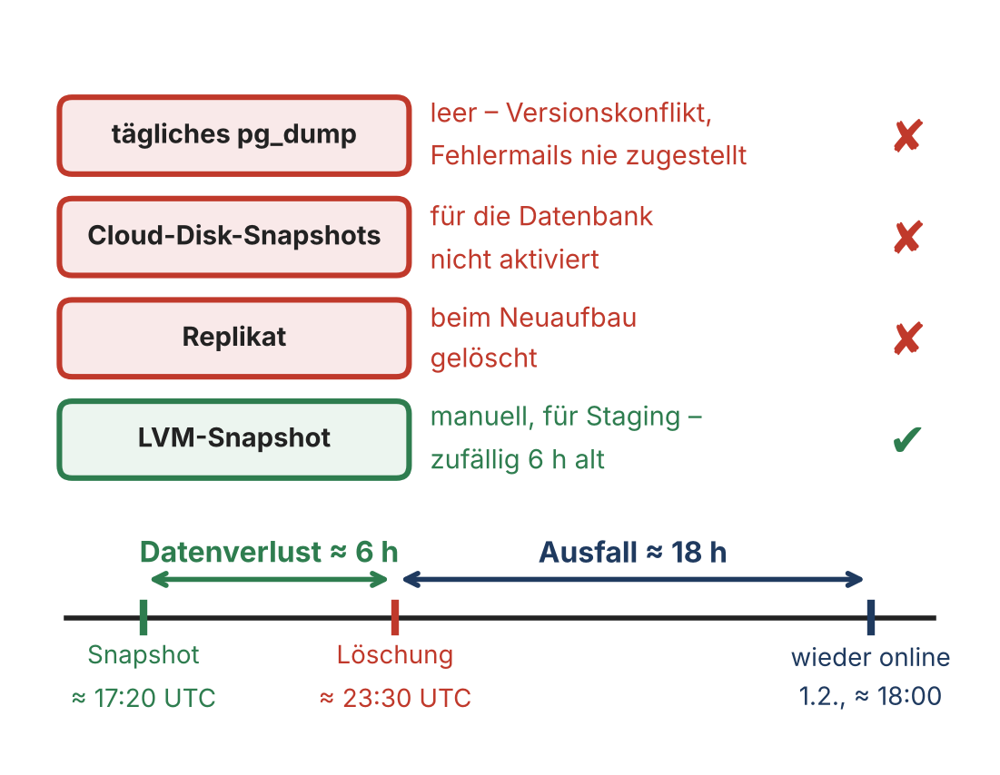{fig-alt="Vier Sicherungsverfahren, drei rot durchgestrichen, ein manueller Snapshot grün; darunter Zeitstrahl mit 6 Stunden Datenverlust und 18 Stunden Ausfall"}
:::
:::

::: notes
Rückbezug Kupferberg: „Schrödingers Backup“ in der Praxis. Das geplante RPO stand auf dem Papier, das tatsächliche ergab sich aus Zufall. pg_dump lief in falscher Version und erzeugte leere Sicherungen; die Fehlermails wurden wegen fehlender DMARC-Konfiguration abgewiesen. GitLab hat den Vorfall vorbildlich offen dokumentiert und live gestreamt – auch das ist Resilienz (Lernen). Messlehre: RPO-Ist nur durch Restore-Tests bekannt.
:::

## Modelle aus Frameworks

Frameworks liefern den Ordnungsrahmen, in dem Metriken geplant und bewertet werden.

| Framework | Fokus | Kernelemente |
|---|---|---|
| NIST SP 800-160 Vol. 2 | Cyber Resilience Engineering | Rev. 1: Anticipate, Withstand, Recover, Adapt |
| ISO/IEC 27031 | IKT-Bereitschaft für BC | Vorbereitung, Tests, Wiederherstellung |
| BSI-Standard 200-4 | Business Continuity Management | Stufenmodell, Szenarien, Notfallübungen |
| ENISA | Sektorale Resilienz (KRITIS) | Bedrohungsmodelle, Abhängigkeiten |

::: notes
Das Skript nennt für NIST auch die Begriffe der Lehrveranstaltung (Resist, Detect, Respond, Recover, Re-constitute, Adapt). Rev. 1 von 2021 formuliert die Ziele Anticipate, Withstand, Recover, Adapt – dieselben wie auf der Resilienzkurve in Sitzung 1. ISO/IEC 27031 ist 2025 neu erschienen. Siehe Quellen, Hinweise zur Aktualität.
:::

## Messgrößen und Frameworks

::: columns
::: {.column width="56%"}
**Messgrößen erzeugen Evidenz – Frameworks verankern sie strukturell.**

- NIST: Resilienz von Anfang an in Engineering und Architektur
- ISO/IEC 27031: Nachweis- und Testbarkeit statt Dokumentation
- BSI 200-4: bewertet **Organisationen**, nicht nur Systeme
- ENISA: Resilienz über Einzelsysteme hinaus – Lieferketten, KRITIS-Sektoren
:::
::: {.column width="40%"}
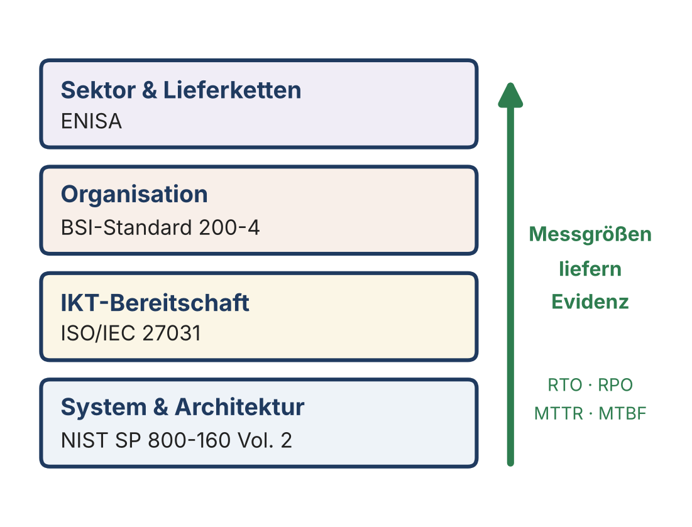{fig-alt="Vier Ebenen von System und Architektur (NIST) über IKT-Bereitschaft (ISO 27031) und Organisation (BSI 200-4) bis Sektor (ENISA), daneben ein Pfeil: Messgrößen liefern Evidenz"}
:::
:::

::: notes
Frameworks sind keine Alternative zu Messgrößen, sondern der Rahmen. Frage ans Plenum: Auf welcher Ebene wäre ein RTO für den Mailserver festgelegt, auf welcher die Übungsplanung?
:::

## Messmethoden & KPIs

::: columns
::: {.column width="56%"}
- **Technisch:** Monitoring, MTTR, Backup- und Restore-Tests
- **Organisatorisch:** BCM-KPIs, Audit-Indikatoren
- **Subjektiv:** Selbstbewertungen, Reifegradanalysen

Je weiter rechts, desto leichter zu erheben – und desto anfälliger für Schönfärberei.
:::
::: {.column width="40%"}
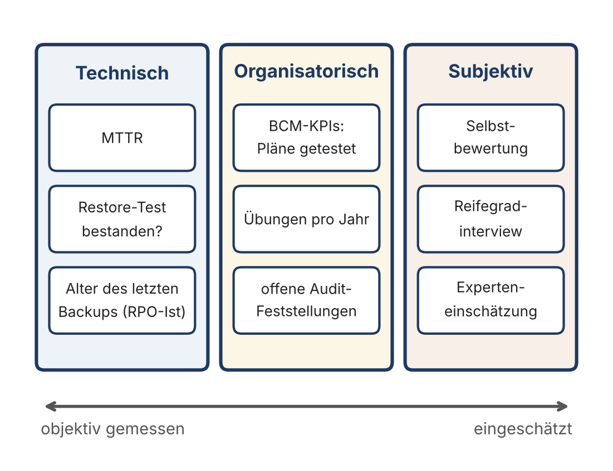{fig-alt="Drei Spalten mit Beispielen: technisch (MTTR, Restore-Test, Backup-Alter), organisatorisch (getestete Pläne, Übungen, Audit-Feststellungen), subjektiv (Selbstbewertung, Interview, Experteneinschätzung)"}
:::
:::

::: notes
Die Beispiele in der Grafik sind Vorschläge. Diskussion: Welche Kennzahl würden Sie der Geschäftsführung monatlich zeigen? Gute KPI-Sets mischen alle drei Ebenen.
:::

## Resilienzreife (Maturity)

::: columns
::: {.column width="56%"}
Typischer Entwicklungspfad in fünf Stufen:

1. **Ad hoc** – reaktive Einzelaktionen
2. **Definiert** – Prozesse existieren, wirken noch nicht zuverlässig
3. **Etabliert** – Rollen, Tests, Nachweise, KPIs verankert
4. **Gesteuert** – Messgrößen werden genutzt, Lessons Learned
5. **Optimiert** – kontinuierliche Verbesserung, Resilience by Design

Reifegrad = Fähigkeit *vor* dem Ereignis, nicht Performance danach.
:::
::: {.column width="40%"}
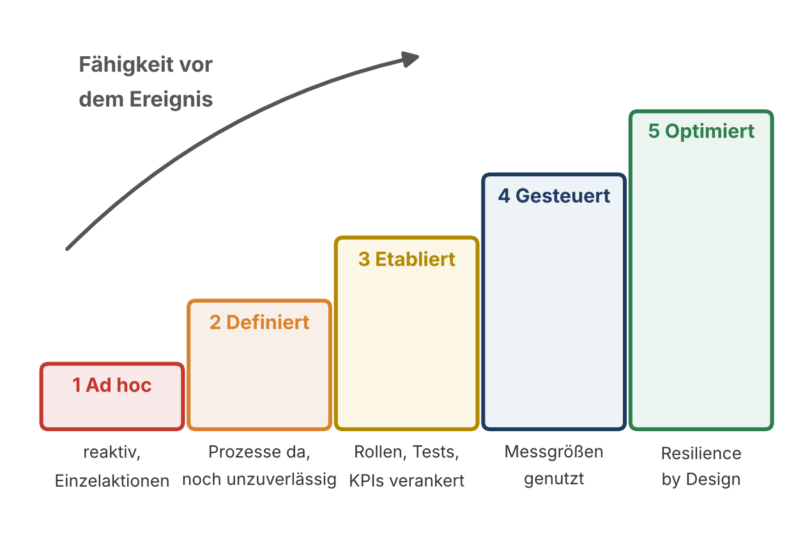{fig-alt="Treppe mit fünf Stufen: Ad hoc, Definiert, Etabliert, Gesteuert, Optimiert"}
:::
:::

::: notes
Stufenbezeichnungen jetzt wie im Skript (Abschnitt 5.2). Bekannte Varianten: CMMI (Initial, Managed, Defined, Quantitatively Managed, Optimizing). Der BSI-Standard 200-4 selbst kennt drei Stufen für den Aufbau: Reaktiv-, Aufbau- und Standard-BCMS – die fünfstufige Skala ist ein allgemeines Reifegradmodell.
:::

## Reifegrad und Metrik

::: columns
::: {.column width="56%"}
- RTO-Ziel existiert, Recovery-Test nie durchgeführt → geringer Reifegrad trotz Kennzahl.
- MTTR sinkt über die Zeit → Hinweis auf lernende Organisation.
- RPO definiert und Backups getestet → Evidenz statt Policy.

**Hoher Reifegrad ohne gemessene Recovery ist Papiersicherheit; gemessene MTTR ohne organisatorischen Rahmen ist Zufallssicherheit.**
:::
::: {.column width="40%"}
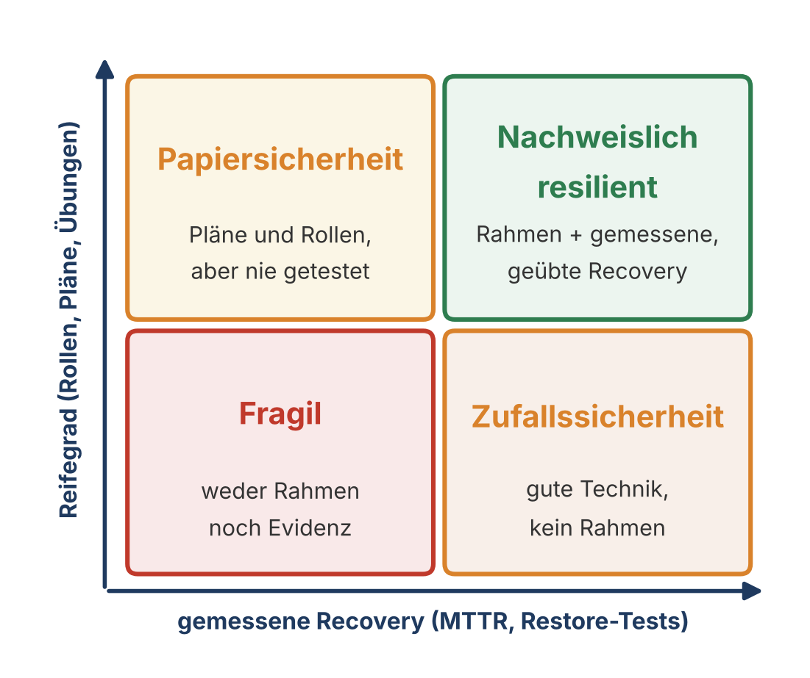{fig-alt="Vier-Felder-Matrix: Reifegrad gegen gemessene Recovery mit den Feldern Fragil, Papiersicherheit, Zufallssicherheit und Nachweislich resilient"}
:::
:::

::: notes
Matrix gemeinsam füllen: Wo lag GitLab 2017? (Gute Technik, kein Verantwortlicher, keine Tests – eher Zufallssicherheit, gerettet von einem Zufallssnapshot.) Wo eine Behörde mit dickem Notfallhandbuch, das nie geübt wurde? (Papiersicherheit.)
:::

## Fallbeispiel Cloud-Ausfall: AWS 2021

::: columns
::: {.column width="56%"}
- **7. Dezember 2021, Region us-east-1:** Eine automatisierte Skalierung überlastet das interne AWS-Netz
- Netz rund 7 h gestört, einzelne Dienste bis zu 11 h
- Laufende Instanzen arbeiten weiter – **neue** starten nicht; auch Monitoring und Statusseite sind beeinträchtigt
- Single-Region-Kunden offline, Multi-Region-Kunden schwenken um

**Architektur, nicht Plattform, entscheidet über Resilienz.**
:::
::: {.column width="40%"}
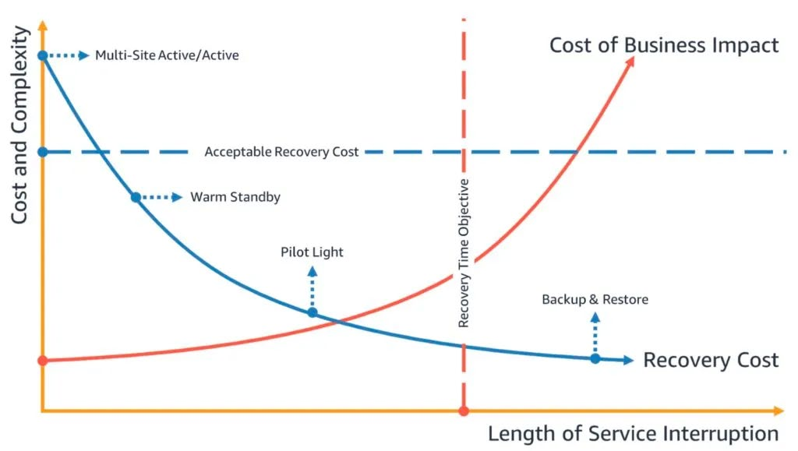{fig-alt="Diagramm: Kosten der Unterbrechung steigen, Wiederherstellungskosten sinken mit der Dauer"}
:::
:::

::: notes
Folienbeispiel aus der Vorlesung: RTO 3 h, RPO 30 min – Geo-Redundanz und Failover verkürzen beides. Grafik: Je kürzer das RTO, desto teurer die Architektur (Backup & Restore → Pilot Light → Warm Standby → Active/Active); der Schnittpunkt mit den Ausfallkosten bestimmt das angemessene RTO. Pointe für die Messbarkeit: Wenn das Monitoring mit ausfällt, misst man genau dann nichts. Wer erst im Ernstfall Kapazität hochfahren wollte, stand still.
:::

## Gleiche Störung, andere Kurve

::: columns
::: {.column width="56%"}
- **Ransomware in einer Kommunalverwaltung:** Totalausfall, mehrtägiger Notbetrieb, Restore nur aus Offline-Backups – niedrige Resilienz trotz vorhandener Backups
- **Multi-Region-Failover:** kurzer Einbruch, nach Minuten zurück
- **Cloud-Gaming-DDoS:** langsamer statt ausgefallen (Rate-Limiting, Warteschlangen) – Graceful Degradation statt Hard-Fail

Resilienz bewertet nicht, ob ein Ereignis eintritt, sondern wie ein System danach aussieht.
:::
::: {.column width="40%"}
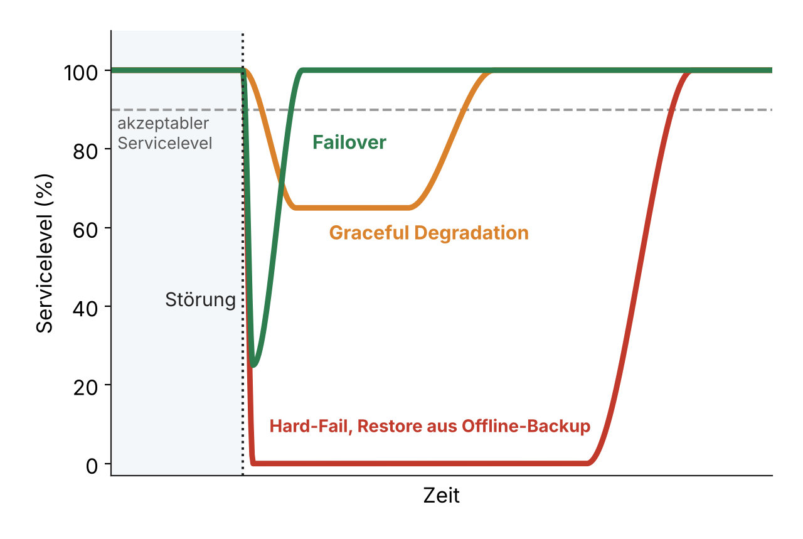{fig-alt="Drei Kurven nach derselben Störung: Hard-Fail mit langem Totalausfall, Failover mit kurzem Einbruch, Graceful Degradation mit flachem Einbruch"}
:::
:::

::: notes
Fälle aus dem Skript, Abschnitt 6. Frage: Welche Kurve hat die kleinste Fläche „fehlender Leistung“? Graceful Degradation kann trotz längerer Dauer weniger Schaden verursachen als ein kurzer Totalausfall – Δ und tR gehören zusammen betrachtet.
:::

## Übung: Resilienz bewerten

Gruppenarbeit (20–30 Minuten): Wählt ein bekanntes IT-System – Uni-E-Mail, Cloud-Speicher, Banking-App, Cloud-Gaming, Krankenhaus- oder Verwaltungs-IT, Smart Home.

1. **Metriken schätzen:** Welches RTO, welches RPO wäre angemessen? Ist die MTTR aus Statusseiten oder Incidents erkennbar?
2. **Reifegrad einordnen:** ad hoc oder vorbereitet? Hinweise auf Übungen, DR-Tests, Chaos Engineering? Single Points of Failure?
3. **Fazit:** resilient, bedingt resilient oder fragil – und warum?

Ergebnis: 1–2 Folien oder höchstens fünf Stichpunkte je Dimension.

::: notes
Ziel ist nicht perfekte Recherche, sondern Denken in Resilienzmetriken: der Unterschied zwischen gefühlt sicher und nachweislich resilient. Zwei bis drei Gruppen kurz vorstellen lassen, Ergebnisse in die Reifegrad-Matrix einordnen.
:::

## Bewertungsraster für die Übung

Das Raster hilft, die drei Schritte der Übung strukturiert festzuhalten.

| Dimension | Leitfrage | Ihre Einschätzung |
|---|---|---|
| RTO | Wie lange darf der Dienst ausfallen? | |
| RPO | Wie viel Datenverlust ist tolerierbar? | |
| MTTR | Wie schnell kam der Dienst bisher zurück? | |
| Reifegrad | Stufe 1–5, mit Begründung | |
| Matrix-Feld | Fragil, Papier-, Zufallssicherheit oder resilient? | |

::: notes
Raster als Vorlage für die Gruppen. Die Spalte „Ihre Einschätzung“ bleibt bewusst leer.
:::

## Kernpunkte

- Resilienz zeigt sich **nicht im Normalbetrieb**, sondern im Verlauf von Störung und Wiederherstellung.
- **RTO/RPO sind Zielgrößen, MTTR/MTBF Messgrößen** – beide sind notwendig.
- Frameworks (NIST, ISO, BSI, ENISA) schaffen Verbindlichkeit und Vergleichbarkeit.
- Reifegradmodelle bewerten die **Fähigkeit vor dem Ereignis**.
- Ein Ziel ohne Test ist Papier: Erst der Restore zeigt das echte RPO.

::: notes
Kernbotschaften aus dem Skript. Kurz zurück auf die Fälle: OVHcloud (RPO und Standort), GitLab (ungetestete Backups), AWS (Architektur entscheidet).
:::

## Ausblick & Hausaufgabe

**Nächste Sitzung:** Resilienz-Architekturen – Redundanz, Diversität, Wiederherstellbarkeit und Adaptivität in hybriden Systemen (On-Prem + Cloud).

**Hausaufgabe:** Recherchieren Sie ein reales IT-Ereignis (z. B. AWS-Ausfall, Ransomware-Vorfall, Rechenzentrumsbrand). Wie schnell wurde der Dienst wiederhergestellt (tR), welche Daten gingen verloren (RPO-Ist)? Zeichnen Sie die Kurve.

[Kapitel zum Termin](../../../termine/02.html) · [Skript](../../../skripte/Skript-02.html) · [Glossar](../../../glossar.html) · [Quellen](../../../quellen.html)

::: notes
Teaser Sitzung 3: Von der Messung zur Architektur – mit welchen Bausteinen verändert man die Form der Kurve?
:::
