## Agenda

- Rückblick & Lernziele
- Einstieg: Ein Update legt die Welt lahm
- Vier technische Resilienzprinzipien
- Redundanz – und ihre Grenzen
- Diversität gegen Kaskadenfehler
- Wiederherstellbarkeit: Recovery ≠ Backup
- Adaptivität und Chaos Engineering
- Hybridarchitekturen und ihre SPOFs
- Fallbeispiel & Übung: SPOFs finden
- Kernpunkte & Ausblick

## Rückblick Sitzung 2

::: columns
::: {.column width="56%"}
- Resilienz ist **messbar**: RTO und RPO als Zielgrößen, MTTR und MTBF als Messwerte.
- Die Degradationskurve zeigt Tiefe (Δ) und Dauer (tR) einer Störung.
- Frameworks (NIST, ISO/IEC 27031, BSI 200-4, ENISA) geben Ordnung und Verbindlichkeit.
- Reifegradmodelle bewerten die Fähigkeit **vor** dem Ereignis.

**Messung allein reicht nicht – Resilienz muss im Design entstehen.**
:::
::: {.column width="40%"}
{fig-alt="Schematische Kurve des Servicelevels über die Zeit mit RPO, RTO und Ausfalltiefe"}
:::
:::

::: notes
Kurz abfragen: Was ist der Unterschied zwischen RTO und RPO? Wer hat die Hausaufgabe gemacht und eine Kurve zu einem realen Vorfall gezeichnet? Ein bis zwei Kurven zeigen lassen. Überleitung: Letzte Woche haben wir gemessen, heute fragen wir, mit welchen Bausteinen man die Form der Kurve verändert.
:::

## Lernziele

Nach dieser Sitzung können Sie …

- die vier technischen Resilienzprinzipien **Redundanz, Diversität, Wiederherstellbarkeit und Adaptivität** erklären und voneinander abgrenzen,
- den Unterschied zwischen **Redundanz und Diversität** an einem Common-Mode-Failure begründen,
- erläutern, warum **Recovery eine Fähigkeit und kein Plan** ist,
- Chancen und Risiken **hybrider Architekturen** (On-Prem + Cloud) bewerten,
- **Single Points of Failure** in realen Systemen identifizieren und einem Gegenprinzip zuordnen.

::: notes
Lernziele aus Einleitung und Prüfungsfragen des Skripts abgeleitet. Die vier Prüfungsfragen stehen am Ende des Skripts: Redundanz vs. Diversität, Recovery als Fähigkeit, Hybrid-SPOFs, Rolle der Adaptivität.
:::

## Einstieg: Ein Update legt die Welt lahm

::: columns
::: {.column width="56%"}
- **19. Juli 2024:** CrowdStrike verteilt ein fehlerhaftes Konfigurations-Update für seinen Windows-Sensor
- Rund **8,5 Mio. Windows-Rechner** stürzen ab – laut Microsoft weniger als 1 % aller Windows-Geräte
- Flughäfen, Krankenhäuser, Banken und Sender stehen still; viele Rechner müssen **von Hand** repariert werden
- Hochverfügbare Cluster helfen nicht: Alle Knoten hatten **denselben Agenten**

**Frage:** Warum schützt Redundanz hier nicht?
:::
::: {.column width="40%"}
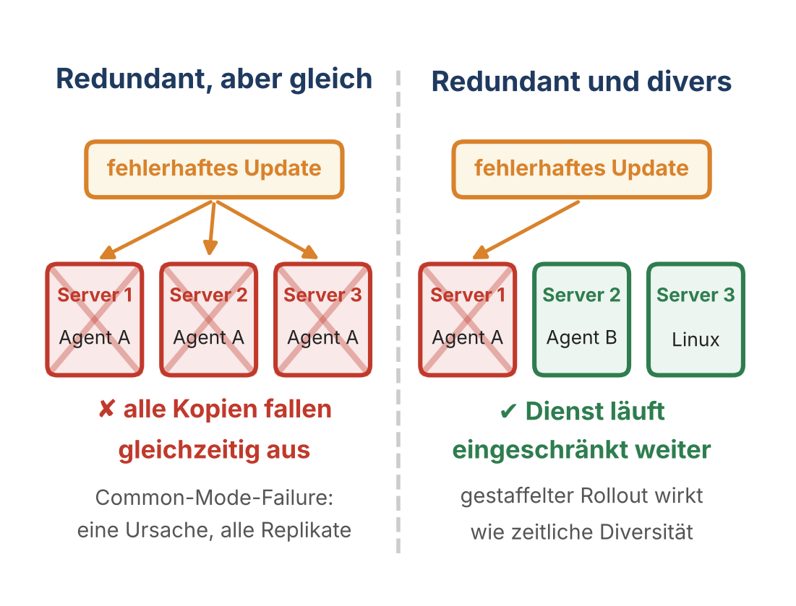{fig-alt="Links drei Server mit gleichem Agenten, alle durch ein Update ausgefallen. Rechts drei Server mit unterschiedlichen Agenten, nur einer ausgefallen."}
:::
:::

::: notes
Einstieg ohne Begriffe: Erst die Frage stellen, Antworten sammeln. Auflösung: Redundanz vervielfacht Komponenten – aber eben auch ihre gemeinsamen Fehler. Das ist ein Common-Mode-Failure, das Gegenprinzip heißt Diversität. Weniger als 1 % aller Windows-Geräte, aber konzentriert in Unternehmen mit hohem Sicherheitsanspruch – gerade die gut geschützten traf es. Linux- und macOS-Systeme waren nicht betroffen. Rückbezug zu Ariane 5 aus Sitzung 1: zwei identische Rechner, derselbe Softwarefehler.
:::

## Vier technische Resilienzprinzipien

::: columns
::: {.column width="56%"}
1. **Redundanz** – keine einzelnen Bruchpunkte
2. **Diversität** – keine gemeinsamen Fehlerursachen
3. **Wiederherstellbarkeit** – geübte, getestete Rückkehrfähigkeit
4. **Adaptivität** – dynamische Reaktion statt starrer Stabilität

Messgrößen machen Resilienz sichtbar – Prinzipien erzeugen sie im Design.
:::
::: {.column width="40%"}
{fig-alt="Vier Kacheln: Redundanz, Diversität, Wiederherstellbarkeit, Adaptivität"}
:::
:::

::: notes
Die Prinzipien gelten unabhängig von Technologie-Stack, Betriebsform und Anbieter. Sie sind der konstruktive Gegenpol zu den Messgrößen aus Sitzung 2. Heute gehen wir sie der Reihe nach durch, jeweils mit einem realen Fall, und wenden sie am Ende auf Hybridarchitekturen an.
:::

## Von der Messung zum Design

::: columns
::: {.column width="56%"}
- **Redundanz, Diversität, Adaptivität** machen den Einbruch flacher (kleineres Δ).
- **Wiederherstellbarkeit** macht die Erholung schneller (kürzeres tR).
- Keines der Prinzipien wirkt allein – erst das Zusammenspiel verändert die Kurve.

Resilienz entsteht im Design, nicht im Incident.
:::
::: {.column width="40%"}
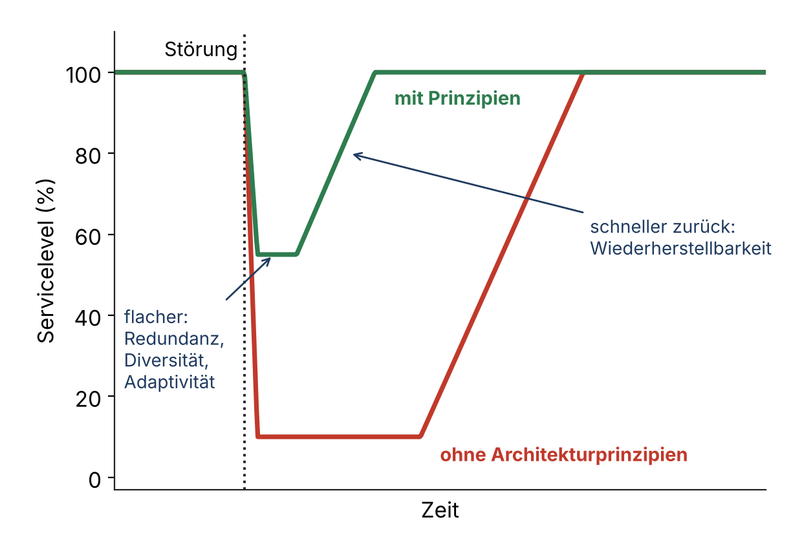{fig-alt="Zwei Resilienzkurven: ohne Architekturprinzipien tiefer Einbruch und langsame Erholung, mit Prinzipien flacher Einbruch und schnelle Erholung"}
:::
:::

::: notes
Brücke zur Degradationskurve aus Sitzung 2. Die Kurve misst das Ergebnis, die Prinzipien sind der Weg dorthin. Für die Übung später merken: Jeder SPOF bekommt ein Prinzip, das ihn adressiert.
:::

## Redundanz: On-Prem vs. Cloud

::: columns
::: {.column width="56%"}
**On-Prem:** Dual Power, USV, Diesel · redundante Core-Switches und ISP-Wege · Cluster (SQL AlwaysOn, VMware HA) · zweites RZ als Cold/Warm/Hot Standby

**Cloud:** Multi-AZ-Deployment · Load Balancing + Auto-Scaling · Cross-Region-Failover

On-Prem wird Redundanz vorgehalten (CapEx), in der Cloud gebucht (OpEx): **kaufbar, aber nicht automatisch vorhanden.**
:::
::: {.column width="40%"}
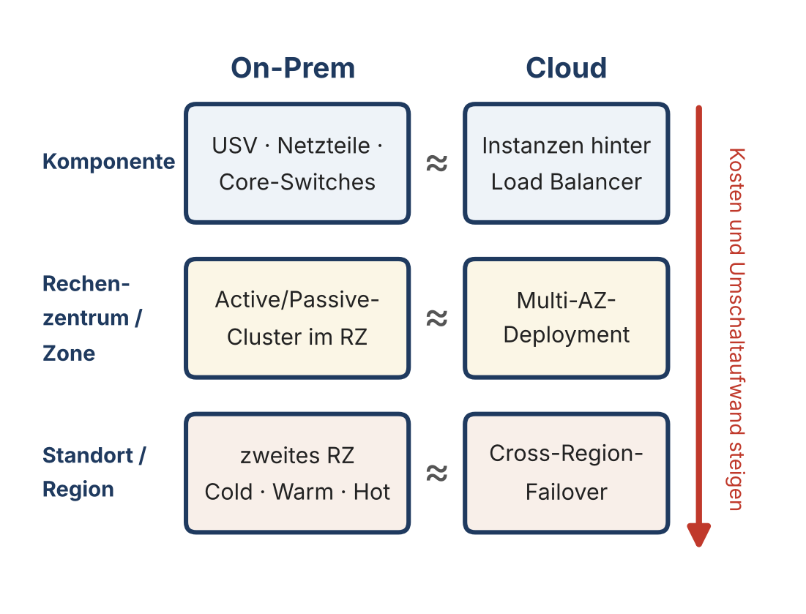{fig-alt="Redundanz auf drei Ebenen – Komponente, Rechenzentrum oder Zone, Standort oder Region – jeweils für On-Prem und Cloud"}
:::
:::

::: notes
Redundanz ist das älteste und grundlegendste Prinzip: Mehrfachvorhaltung kritischer Ressourcen. Die Ausfallsicherheit steigt mit dem Grad der Entkopplung. Cloud abstrahiert die physische Ebene: Multi-AZ ist eine Option in der Konfiguration – wer sie nicht wählt, hat sie nicht. Rückbezug AWS 2021 aus Sitzung 2: Single-Region-Kunden waren offline.
:::

## Grenzen der Redundanz

::: columns
::: {.column width="56%"}
Redundanz schützt nur gegen **komponentielle Ausfälle** – nicht gegen

- logische oder Konfigurationsfehler (CrowdStrike),
- konzertierte Angriffe (Ransomware, Wiper),
- gemeinsame Abhängigkeiten (zentrales AD),
- ungetestete Umschaltprozesse.

Zwei USVs im selben Brandabschnitt sind Redundanz ohne Isolation.
:::
::: {.column width="40%"}
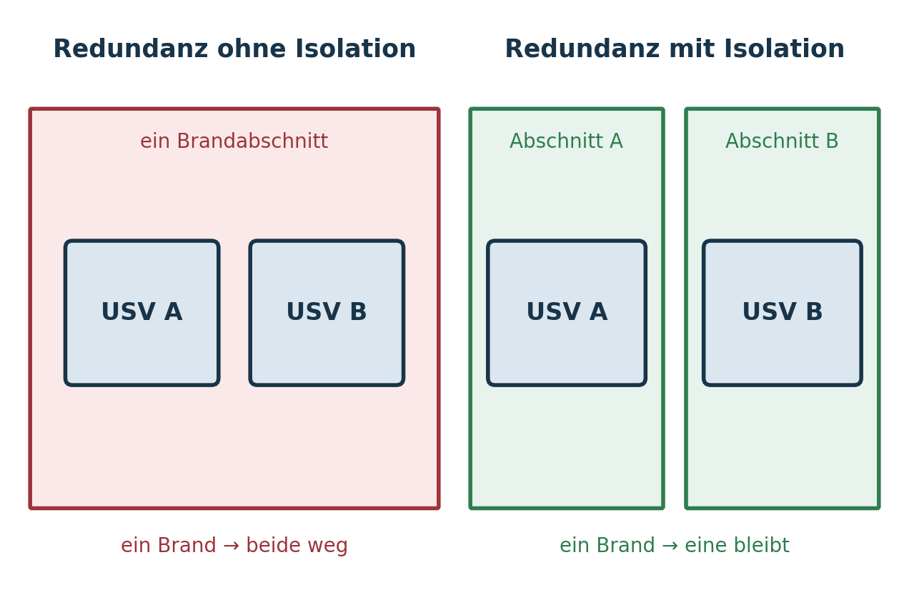{fig-alt="Zwei USVs im selben Brandabschnitt gegenüber zwei USVs in getrennten Abschnitten"}
:::
:::

::: notes
NIST SP 800-160 Vol. 2: Redundanz ohne getestete Umschaltung ist keine Resilienzfähigkeit, sondern nur eine strukturelle Reserve. Ransomware verschlüsselt Primär- und Replikatsystem gleichzeitig – Spiegelung repliziert auch den Schaden. Überleitung: Der nächste Fall zeigt, wie Redundanz an der Umschaltung scheitert.
:::

## Fallbeispiel: British Airways 2017

::: columns
::: {.column width="56%"}
- **27. Mai 2017, Pfingstwochenende:** Ein Techniker trennt im Rechenzentrum bei Heathrow die Stromversorgung
- Beim Wiederzuschalten beschädigt eine **Überspannung** die IT-Systeme
- Die Ausweichsysteme übernehmen nicht – Check-in, Gepäck und Flugplanung fallen aus
- **479 Flüge** allein am ersten Tag gestrichen, mindestens 75.000 Passagiere betroffen, Kosten geschätzt bis 100 Mio. €

**Redundanz war vorhanden – die Umschaltung hat versagt.**
:::
::: {.column width="40%"}
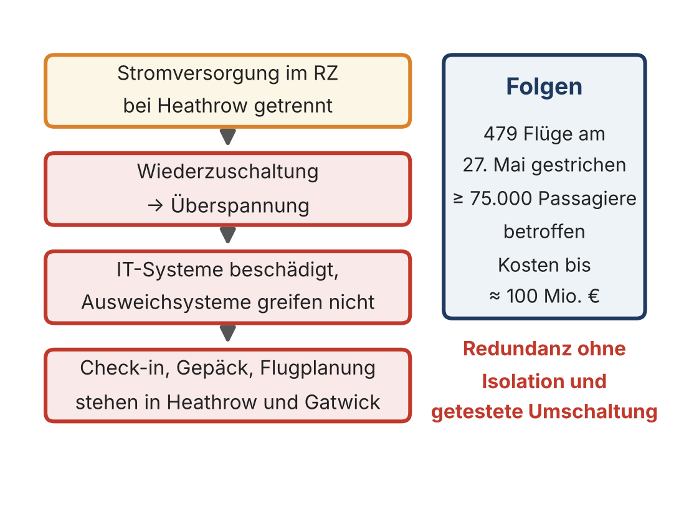{fig-alt="Kette: Stromversorgung getrennt, Überspannung bei Wiederzuschaltung, Systeme beschädigt, Flugbetrieb steht. Daneben die Folgen."}
:::
:::

::: notes
BA sprach von menschlichem Versagen. Warum die Ausweichsysteme nicht griffen, blieb öffentlich offen – BA verklagte später den RZ-Dienstleister, der Streit endete mit einem Vergleich. Lehre: Eine Umschaltung, die nie unter realistischen Bedingungen geübt wurde, ist eine Hypothese. Gute Prüfungsfrage: Welche zwei Grenzen der Redundanz zeigt der Fall? (Gemeinsame Abhängigkeit Strom, ungetestete Umschaltung.)
:::

## Diversität: Schutz vor Kaskadenfehlern

::: columns
::: {.column width="56%"}
Redundant, aber homogen = **gemeinsame Schwachstellen**. Diversität verhindert synchrone Ausfälle.

- **Komponenten:** verschiedene HSMs, CA-Stacks, Backup-Verfahren
- **Lieferanten:** Multi-Vendor-Firewalls, Multi-Cloud, mehrere IdPs
- **Technologie:** unterschiedliche Betriebssysteme, Container und VM, heterogener Storage
- **Zeit:** gestaffelte Rollouts (Canary) statt alles auf einmal
:::
::: {.column width="40%"}
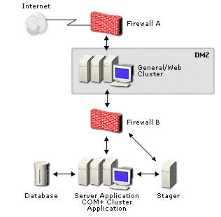{fig-alt="Netzdiagramm mit zwei hintereinander geschalteten Firewalls verschiedener Hersteller"}
:::
:::

::: notes
Diversität wirkt auf einer Metaebene: Sie entkoppelt die Fehlerursachen (Nicht-Korrelation). Zeitliche Diversität ist eine Ergänzung zum Skript und passt zu CrowdStrike: Der Hersteller hat als Konsequenz gestaffelte Auslieferung angekündigt – erst wenige Rechner, dann alle. Supply-Chain-Bezug: SolarWinds 2020 – Homogenität bei Hersteller und Prozess ist ein systemischer Verstärker.
:::

## Diversität kostet – und versichert

::: columns
::: {.column width="56%"}
- **Kosten:** mehr Know-how, mehr Verträge, mehr Integrationsaufwand
- **Nutzen:** Versicherung gegen seltene Ereignisse mit großer Wirkung
- Ein divers aufgebauter Stack wirkt wie ein **Brandschott** gegen seitliche Ausbreitung
- NIST SP 800-160 Vol. 2 und ISO/IEC 27031 behandeln Diversität als Architekturprinzip – als **Mechanismus der Risikostreuung**, nicht als Kostenfaktor

Mehr Vielfalt heißt nicht automatisch mehr Resilienz: Jede zusätzliche Technologie ist auch eine zusätzliche Fehlerquelle.
:::
::: {.column width="40%"}
{fig-alt="Vergleich: redundant und gleich gegenüber redundant und divers"}
:::
:::

::: notes
Diskussionsfrage: Hätte ein Unternehmen nach CrowdStrike auf zwei verschiedene EDR-Produkte setzen sollen? Pro: kein gemeinsamer Ausfall. Contra: doppelter Betrieb, doppelte Angriffsfläche, doppelter Schulungsaufwand. Realistischer Mittelweg: Diversität dort, wo der Ausfall existenziell wäre – etwa beim Notfallarbeitsplatz oder bei den Backup-Systemen.
:::

## Wiederherstellbarkeit: Recovery ≠ Backup

::: columns
::: {.column width="56%"}
- **Backup** ist ein Zustand, **Recovery** ein Prozess mit Zeit- und Qualitätszielen (RTO, RPO).
- Ein ungetestetes Backup ist kein Nachweis, sondern eine Hypothese.
- Technische Mittel: Infrastructure as Code, Snapshots und Immutable Backups, Runbooks und SOAR, Failover.
- Entscheidend ist die **Validierung durch Test und Metrik**.

Die meisten Resilienzversagen entstehen nicht durch fehlende Daten, sondern durch fehlgeschlagene Wiederanläufe.
:::
::: {.column width="40%"}
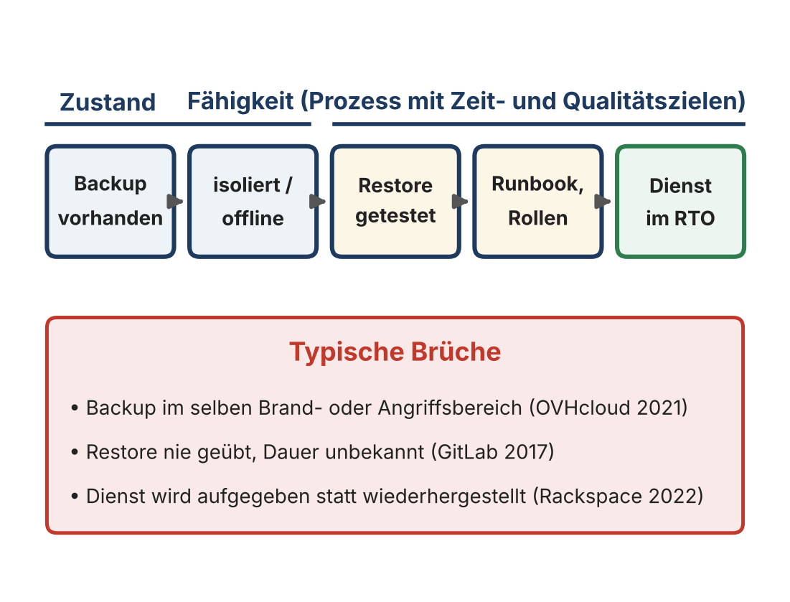{fig-alt="Kette von Backup vorhanden über isoliert, Restore getestet, Runbook und Rollen bis Dienst im RTO, darunter typische Brüche"}
:::
:::

::: notes
Die Kette liest sich von links nach rechts: Nur das erste Glied ist ein Zustand, alles andere ist Fähigkeit. Die Brüche unten sind alte Bekannte aus Sitzung 2: OVHcloud (Backup im selben Gebäude) und GitLab (Restore nie geübt). Der dritte Bruch – der Dienst wird gar nicht mehr hergestellt – kommt gleich als Fall.
:::

## Recovery ist eine Fähigkeit, kein Dokument

::: columns
::: {.column width="56%"}
BSI-Standard 200-4 und ISO/IEC 27031 verlangen

- **Recovery-Tests** statt bloßer Planexistenz,
- **regelmäßige Notfallübungen**,
- Verzahnung von **Technik und Prozess**,
- **Lessons-Learned-Zyklen**, die die Pläne anpassen.

Ein ungeübter Plan ist funktional gleichbedeutend mit keinem Plan.
:::
::: {.column width="40%"}
{fig-alt="Cartoon: Wir haben alles gesichert – nur nicht, wie man es wiederherstellt"}
:::
:::

::: notes
Viele Organisationen haben dicke Notfallhandbücher, aber keine geübten Wiederanlaufprozesse – Papiersicherheit aus der Reifegrad-Matrix von Sitzung 2. In die Runde fragen: Wer hat schon einmal erlebt, dass ein Restore geübt wurde – im Praktikum, im Job? Meist ist die Antwort ernüchternd.
:::

## Fallbeispiel: Rackspace 2022

::: columns
::: {.column width="56%"}
- **November 2022:** Microsoft veröffentlicht einen Patch für die Exchange-Lücke „ProxyNotShell“; Rackspace setzt aus Sorge vor Anmeldeproblemen nur Workarounds ein
- **2. Dezember 2022:** Die Ransomware-Gruppe Play umgeht die Workarounds und legt Hosted Exchange lahm
- **Januar 2023:** Rackspace stellt den Dienst **ein** und migriert die Kunden zu Microsoft 365

**Recovery ist auch eine Kostenentscheidung – manchmal lautet sie: Wir bauen nicht wieder auf.**
:::
::: {.column width="40%"}
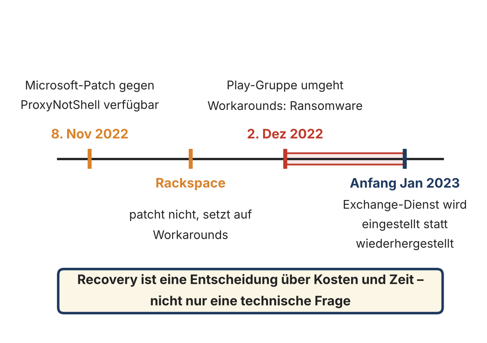{fig-alt="Zeitleiste: Patch im November, Angriff am 2. Dezember, Einstellung des Dienstes Anfang Januar"}
:::
:::

::: notes
Doppelte Lehre. Erstens Patch-Management: Ein Workaround ist keine Lösung. Zweitens Wiederherstellbarkeit: Für die Kunden war das RTO des alten Dienstes faktisch unendlich – er kam nie zurück. Die Migration war schon vorher geplant, der Angriff hat sie erzwungen. Frage: Was hätten Kunden selbst tun können? (Eigene Exportkopien, Exit-Strategie, vertraglich zugesicherte Wiederherstellung.)
:::

## Adaptivität: dynamische Resilienz

::: columns
::: {.column width="56%"}
Stabilität hält einen Zustand – Resilienz **konfiguriert sich unter Störung neu**.

- **Auto-Scaling** gegen Lastspitzen und Knotenverluste
- **Graceful Degradation**: Funktionen reduzieren statt Totalausfall
- **Feature Flags, Circuit Breaker, Canary Releases** zur kontrollierten Drosselung
- **Traffic Shifting, Anycast, Failover-Logik** zur Neuverteilung

Ergebnis: abgestufte Überlebensfähigkeit statt „an oder aus“.
:::
::: {.column width="40%"}
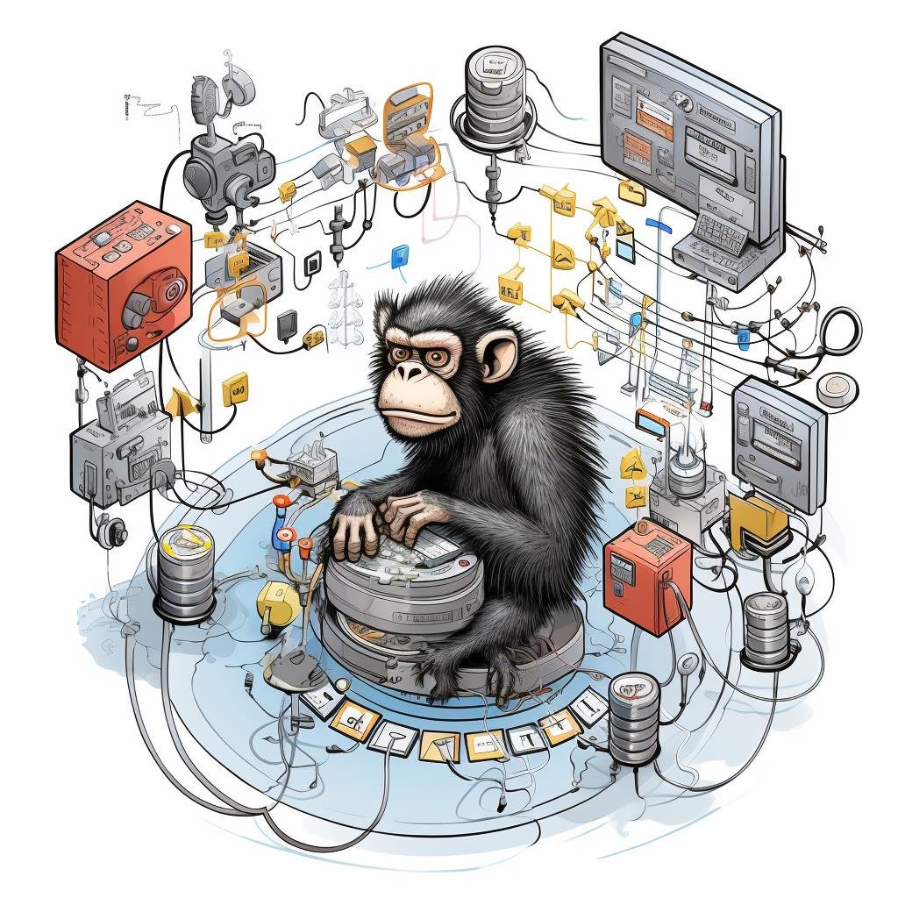{fig-alt="Affe zwischen Serverracks als Symbol für Chaos Engineering"}
:::
:::

::: notes
Rückbezug Sitzung 2: Cloud-Gaming-DDoS – langsamer statt ausgefallen, die flachste der drei Kurven. Circuit Breaker kurz erklären: Ein Dienst, der wiederholt nicht antwortet, wird vorübergehend nicht mehr aufgerufen – so reißt er die aufrufenden Dienste nicht mit.
:::

## Fallbeispiel: Netflix und Chaos Monkey

::: columns
::: {.column width="56%"}
- **21. April 2011:** Störung in einer Zone der AWS-Region US-East – viele bekannte Dienste offline
- Netflix läuft weiter, mit höherer Fehlerrate und Latenz: zustandslose Dienste, **drei aktive Zonen**, Reservekapazität
- **Chaos Monkey** beendet im Betrieb zufällig Instanzen – Ausfall wird Routine
- Aber: Einen **ganzen Zonenausfall** hatte niemand geübt – die Umleitung lief teils manuell

**Resilienz entsteht nicht durch Erwartung, sondern durch Exposition.**
:::
::: {.column width="40%"}
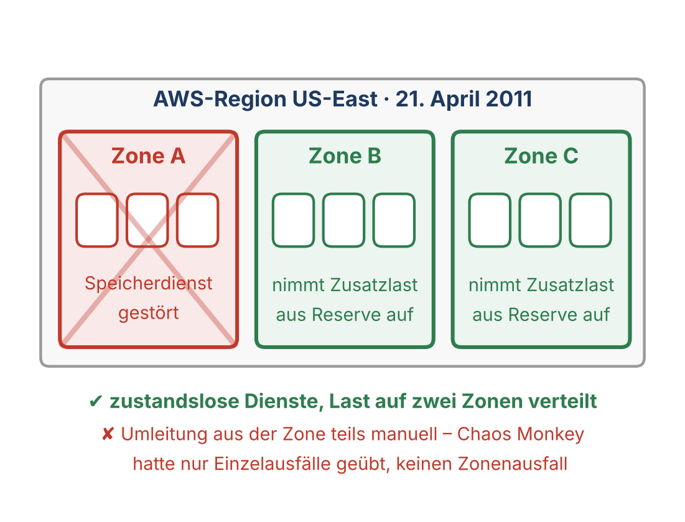{fig-alt="Drei Zonen einer AWS-Region, Zone A ausgefallen, Zonen B und C übernehmen die Last"}
:::
:::

::: notes
Netflix hat seine Lehren selbst veröffentlicht – ehrlich, inklusive der Schwächen. Bemerkenswert: keine spürbare Zunahme von Kundenanrufen. Und doch blieb eine Lücke, weil Chaos Monkey nur einzelne Instanzen beendete. Daraus entstand die „Simian Army“, unter anderem Chaos Gorilla für ganze Zonen. NIST SP 800-160 Vol. 2 ordnet adaptives Verhalten den Fähigkeiten respond, recover und adapt zu.
:::

## Grenzen der Adaptivität

::: columns
::: {.column width="56%"}
- Adaptivität ersetzt **weder Redundanz noch Diversität**.
- Ein adaptives System auf einem gemeinsamen Identitäts- oder Datensinglepoint adaptiert nur **innerhalb der Fragilität**.
- Automatik kann einen Fehler auch **verstärken** – AWS 2021 begann mit einer automatischen Skalierung.

Adaptivität ist ein Multiplikator, kein Ersatz.
:::
::: {.column width="40%"}
{fig-alt="Resilienzkurven ohne und mit Architekturprinzipien"}
:::
:::

::: notes
Der AWS-Ausfall aus Sitzung 2 ist das Gegenbeispiel: Eine automatische Skalierung im internen Netz löste den Ausfall aus. Automatismen brauchen Grenzen, Bremsen und einen Menschen, der eingreifen kann.
:::

## Hybridarchitekturen: Was ändert sich?

Hybrid erhöht den Suchraum der Fragilität – und den Werkzeugkasten der Resilienz.

| Prinzip | On-Prem | Cloud |
|---|---|---|
| Redundanz | Hardware-Duplikation | Region- und AZ-Abstraktion |
| Diversität | manuell geplant | Provider oder Multi-Cloud |
| Recovery | Runbooks + Menschen | IaC + Automatisierung |
| Adaptivität | begrenzt | nativ (Scaling, Traffic Shift) |

::: notes
Potenziale: Workload-Verlagerung zwischen On-Prem und Cloud, Diversifizierung der Ausführungsumgebung, Entkopplung über APIs und Message-Bus, Resilienz als Service. Aber: Cloud-Resilienz ersetzt keine RZ-Resilienz, sie ergänzt sie. Alles, was On-Prem resilient sein muss, gilt auch für die Cloud-Anteile – doppelte Resilienzlogik.
:::

## Hybrid-SPOFs: die Steuerungsebene

::: columns
::: {.column width="56%"}
Hybride Systeme scheitern selten an Rechenleistung, sondern an **zentralen Kopplungspunkten**:

- **Identity** (AD, IdP) als globaler Fail-Knopf
- **Netzwerk-Transit** (VPN, SD-WAN) als Engpass
- **Orchestrierung, CI/CD** als einzige Steuerungsschicht
- **Echtzeit-Datenkopplung** mit engen Synchronisationszwängen

Funktional verteilt, steuerungstechnisch monolithisch = fragil.
:::
::: {.column width="40%"}
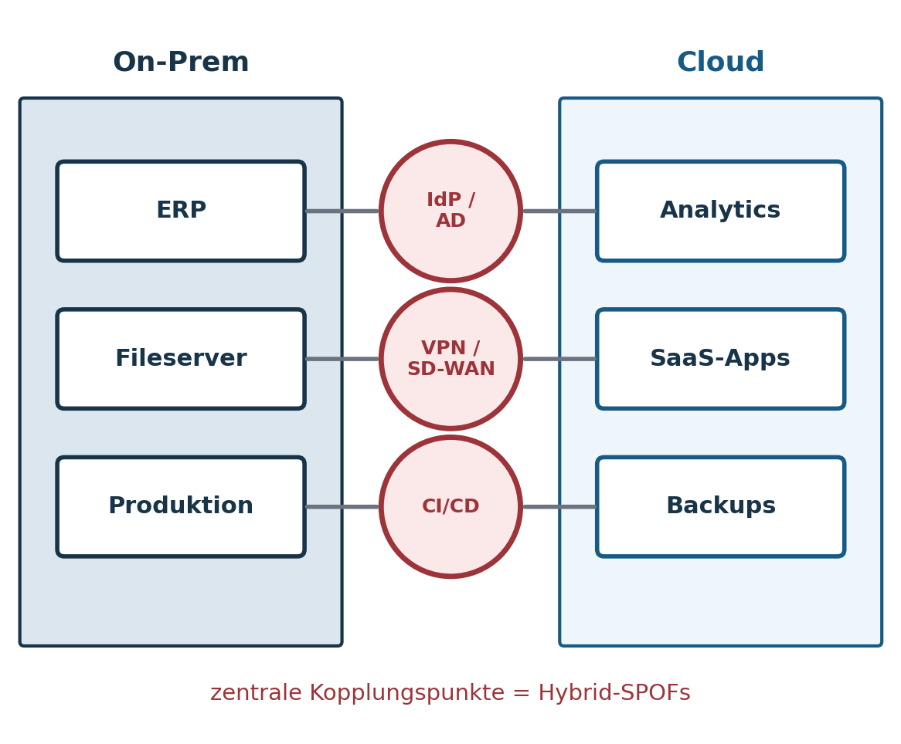{fig-alt="On-Prem- und Cloud-Systeme hängen an gemeinsamen Kopplungspunkten IdP, VPN und CI/CD"}
:::
:::

::: notes
SPOF-Suche muss über Systemgrenzen hinweg erfolgen: Identity, Netzwerk, Control Plane. Die Daten liegen verteilt, aber wer steuert, authentisiert und routet, ist oft eine einzige Instanz. Überleitung: Wie das im großen Maßstab aussieht, zeigt Facebook 2021.
:::

## Fallbeispiel: Facebook 2021

::: columns
::: {.column width="56%"}
- **4. Oktober 2021:** Ein Wartungsbefehl trennt versehentlich alle Backbone-Verbindungen; ein Fehler im Prüfwerkzeug stoppt ihn nicht
- Die DNS-Server ziehen ihre BGP-Routen zurück – **wie vorgesehen**
- Facebook, Instagram und WhatsApp sind rund **sechs Stunden** weltweit unerreichbar
- Auch interne Werkzeuge und Fernzugriff fallen aus – Techniker müssen **vor Ort** ins Rechenzentrum, Sicherheitsmaßnahmen verzögern den Zugang

**Der SPOF lag nicht in den Servern, sondern im Management-Pfad.**
:::
::: {.column width="40%"}
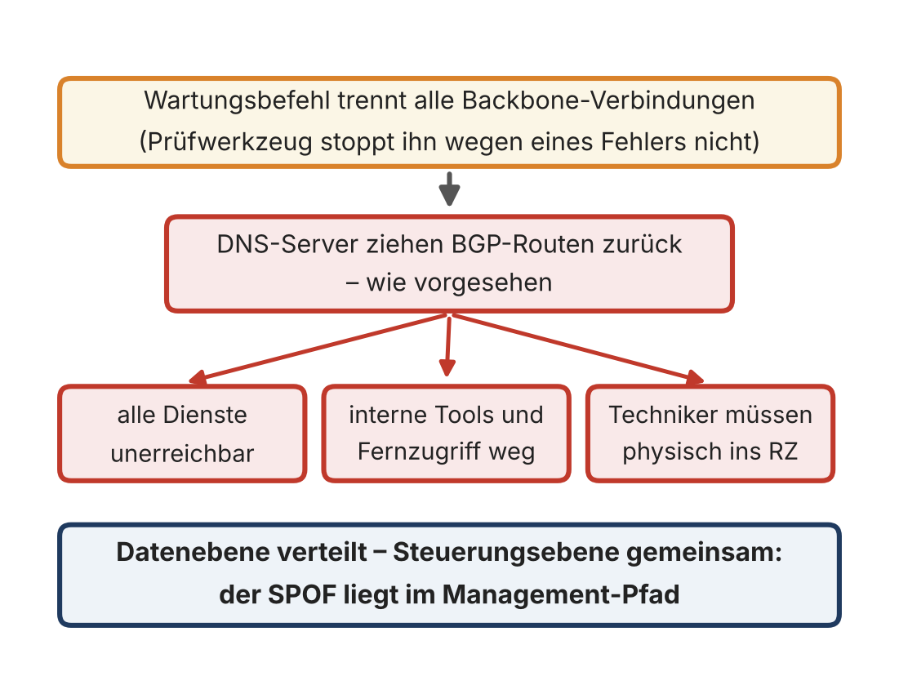{fig-alt="Kette: Wartungsbefehl trennt Backbone, DNS zieht Routen zurück, Folgen: Dienste unerreichbar, interne Tools weg, Techniker müssen ins Rechenzentrum"}
:::
:::

::: notes
Tausende redundante Server in vielen Rechenzentren – und doch ein gemeinsamer Fehlerpfad. Pointe: Das Sicherheitsdesign (DNS zieht sich bei Verbindungsverlust zurück, strenger Zutritt zu den RZ) hat die Wiederherstellung verlangsamt. Resilienz und Security können in Spannung stehen. Meta hat den Wiederanlauf bewusst schrittweise gefahren, weil die schlagartig zurückkehrende Last neue Ausfälle hätte auslösen können – Wiederherstellbarkeit braucht auch Lastmanagement.
:::

## Häufige Resilienz-Irrtümer in der Praxis

Jeder Irrtum verwechselt eine Komponente mit einer Fähigkeit – die Fälle zeigen es.

| Irrtum | Gegenbeispiel |
|---|---|
| „Wir sind in der Cloud, also sicher.“ | AWS 2021: Single-Region-Kunden offline |
| „Backup = Resilienz.“ | OVHcloud 2021, GitLab 2017 |
| „Cluster = Disaster Recovery.“ | CrowdStrike 2024: alle Knoten gleich |
| „Dokumentiert, aber nie getestet.“ | British Airways 2017 |
| „Wir haben ja ein Notfallteam.“ | Facebook 2021: kein Zugang ohne Netz |

::: notes
Tabelle gemeinsam erarbeiten: rechte Spalte erst abdecken und die Studierenden die Fälle zuordnen lassen. Jeder Irrtum verwechselt eine Komponente mit einer Fähigkeit.
:::

## Fallbeispiel: Hybrid-Störung

::: columns
::: {.column width="56%"}
**Szenario:** ERP läuft On-Prem · Reporting und Analytics laufen in der Cloud

**Vorfall:** AD-Domain-Controller On-Prem durch Ransomware kompromittiert

**Folgen:** Cloud-Analytics technisch verfügbar – aber kein Login möglich

- Was bleibt funktional, und warum?
- Wo sitzt der eigentliche SPOF?
- Welche Maßnahme hätte die Resilienz verbessert?
:::
::: {.column width="40%"}
{fig-alt="On-Prem- und Cloud-Systeme hängen an gemeinsamen Kopplungspunkten"}
:::
:::

::: notes
Lösungsskizze: Der SPOF ist die Identität, nicht das Rechenzentrum. Maßnahmen nach Prinzip: Redundanz (zweiter, isolierter DC; Cloud-IdP mit eigener Authentisierung), Diversität (Notfallkonten außerhalb des AD), Wiederherstellbarkeit (geübte AD-Forest-Recovery, Offline-Backup des AD), Adaptivität (Break-Glass-Zugang). Parallele zu Facebook: Steuerungsebene gemeinsam, Datenebene verteilt.
:::

## Übung: SPOFs identifizieren & zuordnen

Gruppen, 20–30 Minuten. Wählt ein reales System: Cloud-Drive, Banking-App, Campus-E-Mail, Smart-Home-Plattform, Krankenhaus-IT.

1. Identifiziert **mindestens drei SPOFs** (z. B. IdP, Netz-Backbone, zentraler Storage, CI/CD-Pipeline).
2. Ordnet jedem SPOF ein **Gegenprinzip** zu: Redundanz, Diversität, Wiederherstellbarkeit oder Adaptivität.
3. Formuliert pro SPOF **eine realistische Maßnahme** – praktisch plausibel, keine Wunschlösung.

Ergebnis: eine Folie oder ein 5-Punkte-Statement pro Gruppe.

::: notes
Resilienz beginnt nicht mit Technik, sondern mit dem Benennen des Bruchpunkts. Die fünf Fälle von heute können als Muster dienen. Zwei bis drei Gruppen vorstellen lassen; auf Doppelungen achten – fast jede Gruppe findet die Identität als SPOF.
:::

## Raster für die Übung

Das Raster hilft, die drei Schritte der Übung festzuhalten.

| SPOF | Warum Bruchpunkt? | Gegenprinzip | Maßnahme |
|---|---|---|---|
| 1 | | | |
| 2 | | | |
| 3 | | | |

::: notes
Raster als Vorlage für die Gruppen. Hinweis: Ein SPOF kann mehrere Prinzipien brauchen – dann das wirksamste wählen und begründen.
:::

## Kernpunkte

- Technische Resilienz entsteht aus dem **Zusammenspiel von vier Prinzipien**.
- **Redundanz** verhindert Einzelbruchpunkte, **Diversität** verhindert gemeinsame Ausfälle (CrowdStrike, BA).
- **Recovery ist eine Fähigkeit**: Backup ist Zustand, Wiederanlauf ist Prozess (Rackspace).
- **Adaptivität** reduziert den Wirkungsverlust – und muss geübt werden (Netflix).
- In Hybridarchitekturen liegt der SPOF oft in der **Steuerungsebene** (Facebook).

::: notes
Kernbotschaften aus Abschnitt 8 des Skripts. Die vier Prüfungsfragen am Ende des Skripts lassen sich alle mit den heutigen Fällen beantworten.
:::

## Ausblick & Hausaufgabe

**Nächste Sitzung:** Bedrohungen und Resilienzstrategien – wie lassen sich Angriffe auf Widerstands- und Recovery-Muster abbilden?

**Hausaufgabe:** Nehmen Sie Ihr System aus der Übung. Welcher Ihrer SPOFs wäre für einen Angreifer am attraktivsten – und warum?

[Kapitel zum Termin](../../../termine/03.html) · [Skript](../../../skripte/Skript-03.html) · [Glossar](../../../glossar.html) · [Quellen](../../../quellen.html)

::: notes
Teaser Sitzung 4: Heute ging es um Ausfälle durch Fehler. Nächstes Mal kommt der Gegner dazu, der gezielt den schwächsten Punkt sucht – genau die SPOFs von heute.
:::
