## Agenda

- Rückblick & Lernziele
- Einstieg: Die eigene Hochschule offline
- Resilienz ist relational – sechs Bedrohungsklassen
- Ransomware · DDoS · RZ- und Dienstleister-Ausfall
- Identity-Ausfall · Human Failure · Supply Chain
- Kommunikation, wenn die eigene IT schweigt
- Mapping: Threat → Capability
- Übung: Threat-to-Resilience-Mapping
- Kernpunkte & Ausblick

## Rückblick Sitzung 3

::: columns
::: {.column width="56%"}
- Vier technische Prinzipien: **Redundanz, Diversität, Wiederherstellbarkeit, Adaptivität**
- Redundanz schützt nicht vor Common-Mode-Failures (CrowdStrike 2024)
- Recovery ist eine Fähigkeit, kein Dokument (Rackspace 2022)
- In Hybridarchitekturen sitzt der SPOF oft in der Steuerungsebene (Facebook 2021)

**Bisher ging es um Fehler. Heute kommt der Gegner dazu.**
:::
::: {.column width="40%"}
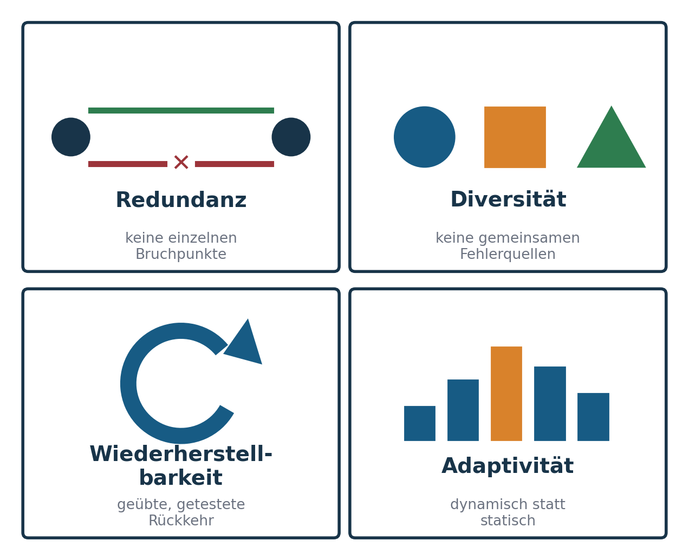{fig-alt="Vier Kacheln: Redundanz, Diversität, Wiederherstellbarkeit, Adaptivität"}
:::
:::

::: notes
Hausaufgabe aufgreifen: Welcher SPOF aus eurem System wäre für einen Angreifer am attraktivsten? Zwei bis drei Antworten sammeln – meist kommt die Identität oder ein zentraler Dienstleister. Genau das sind heute zwei der sechs Bedrohungsklassen. Überleitung: Ein Angreifer sucht nicht den Zufall, sondern den schwächsten Punkt.
:::

## Lernziele

Nach dieser Sitzung können Sie …

- erklären, warum Resilienz **relational** ist – resilient *gegen etwas*,
- sechs **Bedrohungsklassen** nach ihrem Wirkmechanismus unterscheiden,
- jeder Bedrohung die **Resilienzprinzipien** zuordnen, die ihren Effekt absorbieren (Threat → Capability),
- an realen Fällen begründen, warum **Dienstleister und Identität** versteckte Single Points of Failure sind,
- die **vorsorgliche Abschaltung** und die **Notkommunikation** als Resilienzentscheidungen bewerten.

::: notes
Die ersten drei Lernziele stammen aus dem Skript. Die letzten beiden sind Ergänzungen, die aus den heutigen Fällen folgen: KDZ/KGRZ 2026, Count+Care 2022 und die Hochschule Mainz 2025.
:::

## Einstieg: Die eigene Hochschule offline

::: columns
::: {.column width="56%"}
- **24. November 2025:** Die Hochschule Mainz fährt nach einem Cyberangriff ihre IT-Systeme herunter
- E-Mail nur eingeschränkt nutzbar, Ermittlungsbehörden eingebunden, **Krisenstab** eingerichtet
- Die **Präsenzlehre läuft weiter**; informiert wird über Campus2Go-App, Instagram und LinkedIn
- Wiederaufbau Schritt für Schritt: neue Zugangsdaten, **alle Geräte neu aufgesetzt**, kritische Bereiche zuerst

**Frage:** Was hat in diesen Wochen funktioniert – und warum?
:::
::: {.column width="40%"}
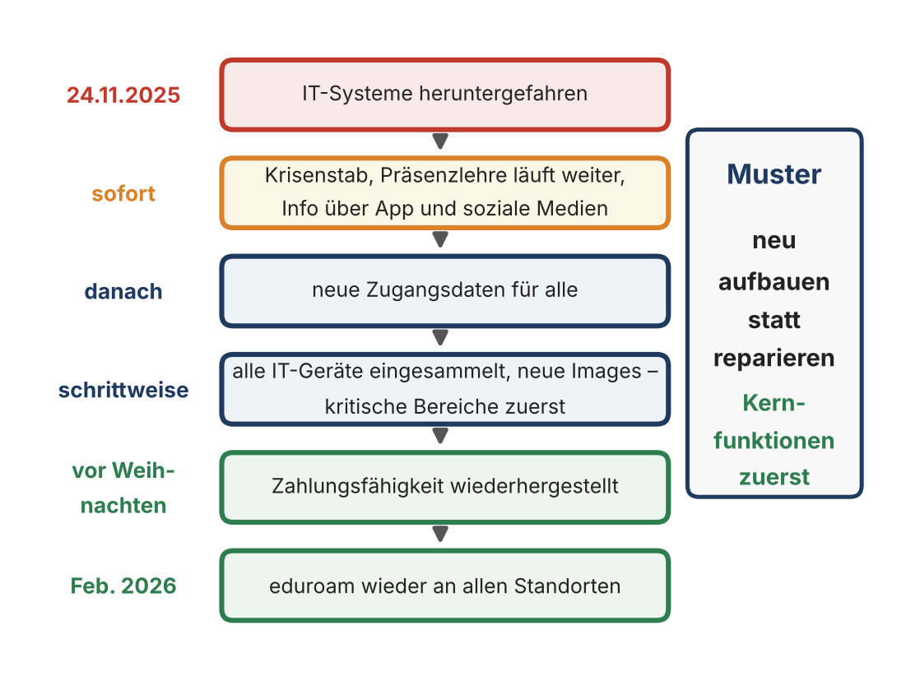{fig-alt="Zeitleiste: 24.11.2025 IT heruntergefahren, Krisenstab, neue Zugangsdaten, Geräte neu aufgesetzt, Zahlungsfähigkeit vor Weihnachten, eduroam im Februar 2026"}
:::
:::

::: notes
Nur die veröffentlichten Angaben der Hochschule (Meldungen vom 24.11.2025 und 17.02.2026) stehen auf der Folie. Alles Weitere mündlich. Fragen an die Studierenden: Wie habt ihr den Ausfall erlebt? Was lief weiter (Präsenzlehre, Information über Ersatzkanäle), was nicht (E-Mail, Geräte, WLAN)? Pointe: Die Hochschule ist nicht „nicht resilient“ – sie hat Kernfunktionen gehalten und systematisch neu aufgebaut. Genau das ist heute das Thema: Resilienz gegen eine konkrete Bedrohung.
:::

## Resilienz ist relational

::: columns
::: {.column width="56%"}
- Ein System ist nie „resilient an sich“, sondern **resilient gegen etwas**.
- Ohne Bedrohungsbezug bleiben Maßnahmen im Leeren.
- Das Mapping Bedrohung → Fähigkeit schafft **Priorisierung und Budgetfokus**.
- Ziel ist nicht Prävention, sondern **Funktionsfähigkeit trotz realer Ereignisse**.

Nicht die Bedrohung wird kontrolliert, sondern die Fähigkeit, ihren Effekt zu absorbieren.
:::
::: {.column width="40%"}
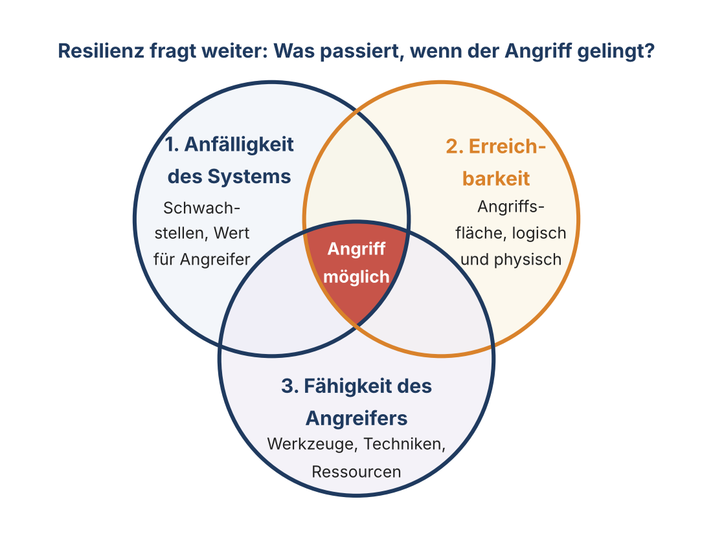{fig-alt="Drei überlappende Kreise: Anfälligkeit des Systems, Erreichbarkeit und Fähigkeit des Angreifers; in der gemeinsamen Schnittmenge ist ein Angriff möglich"}
:::
:::

::: notes
Bezug NIST SP 800-160 Vol. 2: Resilienzfähigkeiten werden funktional an Bedrohungsszenarien gekoppelt. Das Venn-Diagramm zeigt die klassische Sicht der Security: Angriff gelingt dort, wo Anfälligkeit, Zugang und Fähigkeit zusammenkommen. Resilienz fragt einen Schritt weiter: Was passiert, wenn er gelingt?
:::

## Sechs Bedrohungsklassen

::: columns
::: {.column width="56%"}
Entscheidend ist der **Wirkmechanismus**, nicht die Ursache:

- **Ransomware** zerstört Daten und Systeme
- **DDoS** verbraucht Kapazität
- **RZ- und Provider-Ausfall** nimmt die Umgebung
- **Identity-Ausfall** nimmt den Zugang
- **Human Failure** propagiert Fehler über Automatisierung
- **Supply Chain** importiert fremde Kompromittierung

:::
::: {.column width="40%"}
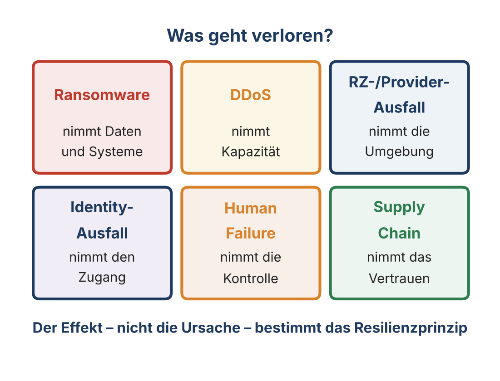{fig-alt="Sechs Kacheln: Ransomware nimmt Daten und Systeme, DDoS Kapazität, RZ-Ausfall die Umgebung, Identity-Ausfall den Zugang, Human Failure die Kontrolle, Supply Chain das Vertrauen"}
:::
:::

::: notes
Sie konvergieren im Effekt: Verlust von Verfügbarkeit, Nutzbarkeit, Steuerbarkeit oder Integrität. Wichtig: Nicht alle Klassen sind Angriffe. Human Failure und viele Provider-Ausfälle sind Fehler – für das Resilienzdesign ist das egal, es zählt der Effekt. Ab jetzt: zu jeder Klasse Wirkprinzip, Strategien und ein realer Fall.
:::

## Bedrohung 1: Ransomware

::: columns
::: {.column width="56%"}
**Wirkprinzip:** Verschlüsselung, Löschung oder Sabotage – bei seitlicher Ausbreitung auch von Replikaten und Backups

**Resilienzstrategien (nicht Prävention!)**

- Immutable- und Offline-Backups außerhalb des Blast Radius
- Netzwerk- und Domain-Segmentierung
- Gold-Images und **Clean-Room-Recovery**
- Recovery-Tests statt Papierpläne

**Zielgröße:** RTO und RPO niedrig halten – trotz kompromittierter Produktion
:::
::: {.column width="40%"}
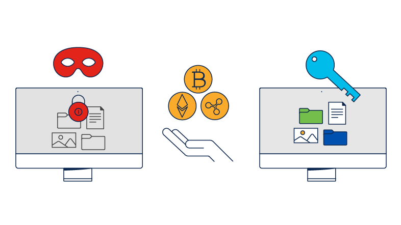{fig-alt="Ablauf Ransomware: Verschlüsselung, Lösegeld in Bitcoin, Schlüssel"}
:::
:::

::: notes
Prinzipbezug: Wiederherstellbarkeit ist hier die primäre Verteidigungslinie. Clean-Room-Recovery heißt: nicht auf kompromittierten Systemen reparieren, sondern in einer sauberen Umgebung neu aufbauen und erst dann zurückspielen. Rückbezug Maersk aus Sitzung 1: Ohne die eine saubere Kopie hätte es keinen Neustart gegeben.
:::

## Fallbeispiel: Wiederaufbau an der Hochschule Mainz

::: columns
::: {.column width="56%"}
- **Neue Zugangsdaten** für alle Beschäftigten, Lehrenden und Lehrbeauftragten
- **Alle IT-verwalteten Geräte** eingesammelt und mit neuen System-Images ausgerollt
- **Priorisierung:** systemrelevante Bereiche zuerst, dann die übrigen Abteilungen
- Zahlungsfähigkeit **vor Weihnachten**, eduroam im Februar 2026 wieder an allen Standorten
- Viele Abläufe laufen über **Monate** mit höherem organisatorischem Aufwand

**Neu aufbauen statt reparieren – das ist Clean-Room-Recovery.**
:::
::: {.column width="40%"}
{fig-alt="Zeitleiste des Wiederaufbaus an der Hochschule Mainz von November 2025 bis Februar 2026"}
:::
:::

::: notes
Angaben aus der Meldung der Hochschule vom 17.02.2026. Drei Lehren: Erstens, Recovery nach Ransomware heißt Neuaufbau – man vertraut keinem Gerät und keinem Passwort mehr. Zweitens, Priorisierung ist eine Managemententscheidung: Was ist systemrelevant? (Zahlungsfähigkeit, Personal, Prüfungsbetrieb.) Drittens, das RTO für „alles wieder normal“ liegt bei Monaten – das RTO für Kernfunktionen deutlich darunter. Resilienz misst sich an den Kernfunktionen. Details zu Ursache und Ablauf bewusst nur mündlich und nur, soweit öffentlich.
:::

## Bedrohung 2: DDoS und Lastangriffe

::: columns
::: {.column width="56%"}
**Wirkprinzip:** Der Dienst ist technisch intakt, aber nicht mehr nutzbar – Ressourcen werden schneller verbraucht, als sie bereitstehen

**Resilienzstrategien**

- Anycast-CDN und Traffic-Scrubbing
- Auto-Scaling und Rate-Limiting
- Graceful Degradation – nicht alles oder nichts
- API-Quotas und Circuit Breaker

**Ziel:** Dienst bleibt nutzbar – nicht perfekt, aber funktional
:::
::: {.column width="40%"}
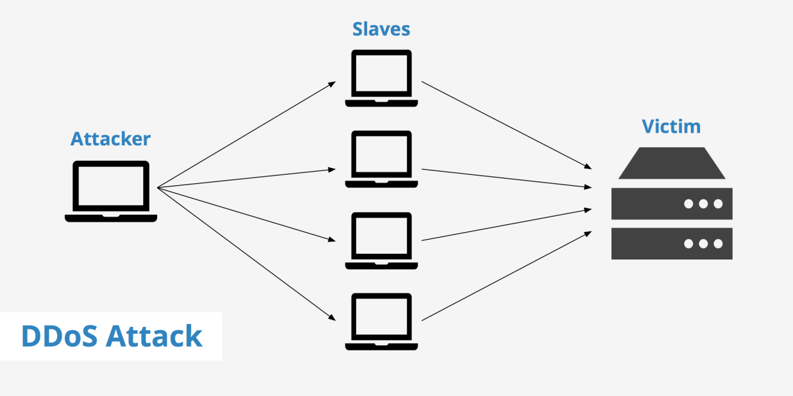{fig-alt="Angreifer steuert viele Rechner gegen einen Server"}
:::
:::

::: notes
Prinzipbezug: Adaptivität. Rückbezug Sitzung 2: Cloud-Gaming-DDoS – langsamer statt ausgefallen. Der folgende Fall zeigt eine Wendung: Nicht der eigene Server wird getroffen, sondern ein Dienst, von dem alle abhängen.
:::

## Fallbeispiel: Dyn und das Mirai-Botnetz 2016

::: columns
::: {.column width="56%"}
- **21. Oktober 2016:** Zwei Angriffswellen treffen den DNS-Anbieter Dyn, vor allem an der US-Ostküste
- Hauptquelle: das **Mirai-Botnetz** aus gekaperten IoT-Geräten – Dyn schätzt bis zu **100.000** Endpunkte
- Dienste wie Twitter, Spotify und Reddit sind für viele Nutzer **nicht erreichbar**
- Die Webserver selbst sind intakt – nur ihre **Namen lassen sich nicht auflösen**

**Wer nur einen DNS-Anbieter hat, teilt dessen Schicksal.**
:::
::: {.column width="40%"}
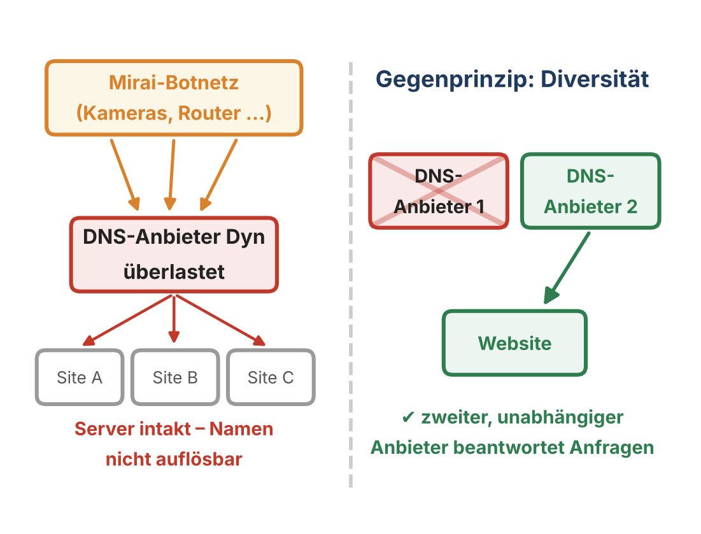{fig-alt="Links: Botnetz überlastet den DNS-Anbieter, drei Websites sind nicht erreichbar. Rechts: Mit zweitem DNS-Anbieter bleibt die Website erreichbar."}
:::
:::

::: notes
Doppelte Lehre. Erstens DDoS: Adaptivität und Scrubbing beim Anbieter. Zweitens Diversität beim Kunden: Ein zweiter, unabhängiger DNS-Anbieter hätte die Namen weiter aufgelöst. Dyn beschreibt außerdem einen „Retry Storm“: Legitime Wiederholungsanfragen ließen den Angriff größer erscheinen – auch normales Verhalten kann eine Störung verstärken. Und: Die Angriffswerkzeuge waren billige Kameras und Router – Sicherheit der anderen ist Teil der eigenen Resilienz.
:::

## Bedrohung 3: Rechenzentrums- und Dienstleister-Ausfall

::: columns
::: {.column width="56%"}
**Wirkprinzip:** Die Umgebung fällt von außen weg – Redundanz auf Anbieterebene bricht

**Resilienzstrategien**

- Multi-AZ- und Cross-Region-Deployment
- Multi-Cloud oder zweiter Betreiber für kritische Workloads
- lokaler Fallback für die Mindestfunktion
- Trennung von Steuer- und Ausführungsdomäne

**Lehrsatz:** Provider ≠ Resilienz – Architektur und Vertrag entscheiden
:::
::: {.column width="40%"}
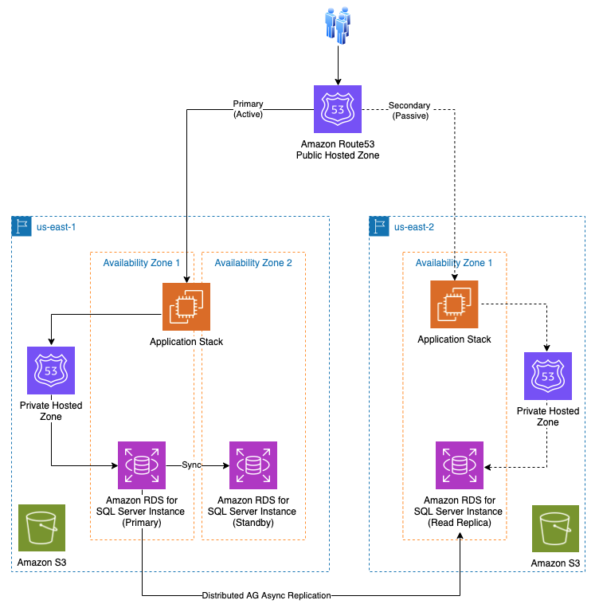{fig-alt="Architektur mit mehreren Cloud-Regionen und Failover"}
:::
:::

::: notes
Prinzipbezug: Redundanz plus Entkopplung. Rückbezug Sitzung 2 (AWS 2021, OVHcloud 2021) und Glossar: Multi-AZ schützt gegen den Ausfall eines Standorts, nicht gegen den Ausfall eines Anbieters. Der folgende Fall ist besonders, weil kein Angriff und kein Brand den Ausfall verursacht hat – sondern eine bewusste Entscheidung.
:::

## Fallbeispiel: KDZ Mainz und KGRZ Koblenz 2026

::: columns
::: {.column width="56%"}
- **27.09.2026:** Die kommunalen Rechenzentren in Mainz und Koblenz schalten zentrale Fachverfahren **vorsorglich ab** – wegen kritischer Lücken in Citrix NetScaler
- Betroffen: alle **194** hauptamtlichen Verwaltungen in Rheinland-Pfalz – Meldeamt, Kfz-Zulassung, Standesamt u. a. stehen still
- **29.09.:** nach Updates und Prüfung wieder in Betrieb, laut Betreibern kein erfolgreicher Angriff

**Ein gemeinsamer Dienstleister bündelt Effizienz – und das Ausfallrisiko.**
:::
::: {.column width="40%"}
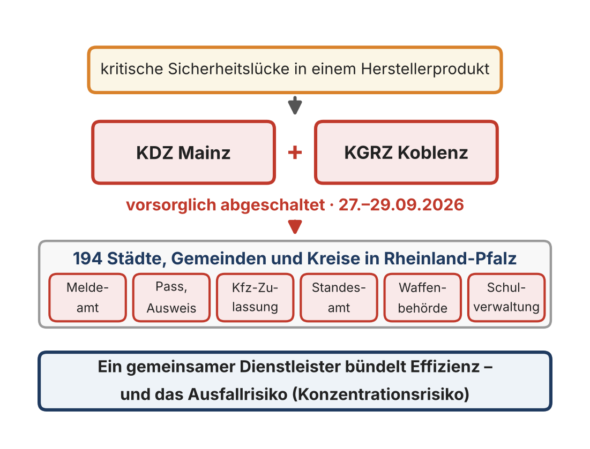{fig-alt="Herstellerlücke führt zur Abschaltung von KDZ Mainz und KGRZ Koblenz, darunter 194 Verwaltungen mit sechs ausgefallenen Fachverfahren"}
:::
:::

::: notes
Die Rechenzentren sind Betriebszentren des Zweckverbands ZIDKOR. Zwei Seiten derselben Medaille: Zentralisierung macht kleine Kommunen überhaupt erst professionell betreibbar – und schafft ein Konzentrationsrisiko. Das Land hat zusätzlich über Citrix erreichbare Dienste des Landesnetzes abgeschaltet. Frage: Ist ein zweitägiger, geplanter Ausfall ein Resilienzversagen oder eine Resilienzleistung? Überleitung zur nächsten Folie.
:::

## Abschalten als Resilienzentscheidung

::: columns
::: {.column width="56%"}
- **Weiterlaufen:** Dienst verfügbar, aber unbekanntes Risiko – Einbruch, Datenabfluss, wochenlanger Wiederaufbau
- **Abschalten:** geplanter Ausfall mit **absehbarer Dauer** – der Angreifer kommt nicht hinein
- Voraussetzung: ein **vorbereiteter Notbetrieb** und klare Entscheidungsrechte
- **Stadt Mainz, 21. Oktober 2026:** wegen einer kritischen PHP-Lücke Website vom Netz – Ämter, Telefon und E-Mail laufen weiter

**Ein kontrollierter Ausfall ist besser als ein unkontrollierter.**
:::
::: {.column width="40%"}
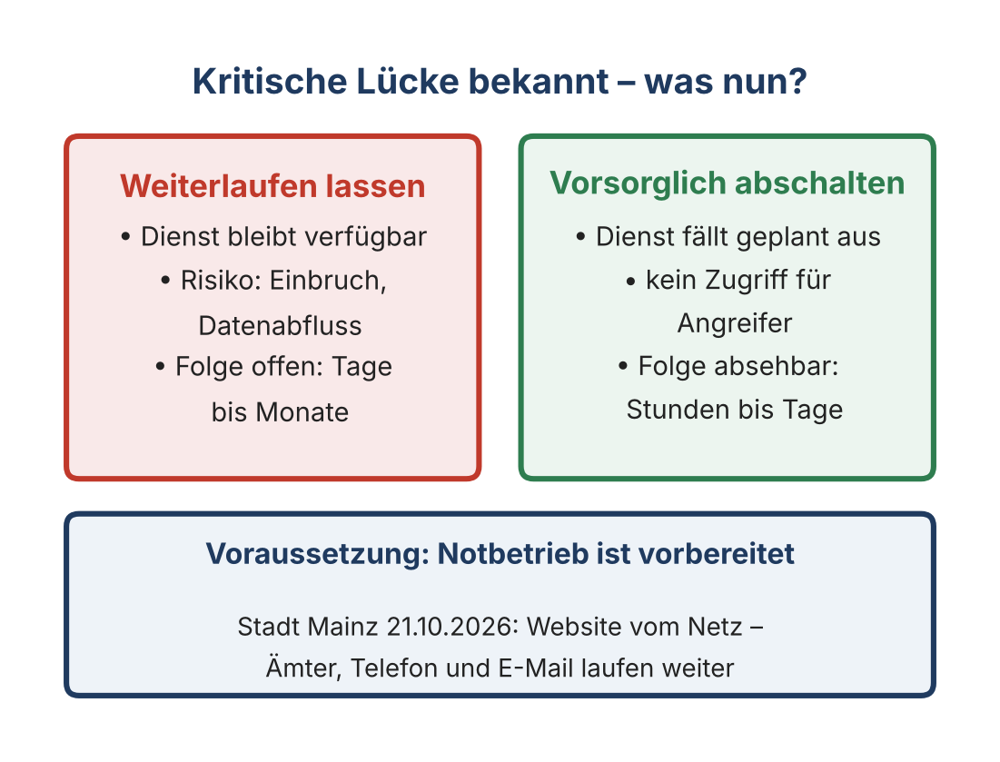{fig-alt="Abwägung: Weiterlaufen mit offenem Risiko gegenüber vorsorglicher Abschaltung mit absehbarer Dauer; darunter Voraussetzung Notbetrieb"}
:::
:::

::: notes
Ergänzung zur Vorlesung. Verbindung zur Resilienzkurve aus Sitzung 2: Die Abschaltung erzeugt bewusst einen kleinen, kurzen Einbruch, um einen tiefen, langen zu vermeiden. Und Graceful Degradation im Kleinen: Bei der Stadt Mainz fiel nur die Website, nicht der Bürgerservice. Diskussion: Wer darf so eine Entscheidung treffen – um drei Uhr nachts am Sonntag? Das führt direkt zu Sitzung 5 (Rollen, Governance).
:::

## Bedrohung 4: Identity-Ausfall

::: columns
::: {.column width="56%"}
**Wirkprinzip:** Systeme laufen – aber niemand kommt hinein (Lockout)

**Resilienzstrategien**

- Break-Glass-Accounts, lokal und offline
- zweiter unabhängiger IdP oder Fallback-Authentisierung
- Notfallzugang ohne Cloud-Abhängigkeit
- Minimierung globaler Koppelstellen

**Kernaussage:** Identity ist oft der versteckte Single Point of Failure
:::
::: {.column width="40%"}
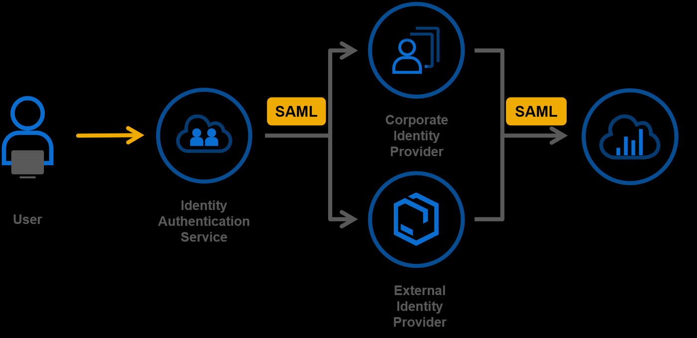{fig-alt="Anmeldefluss über einen zentralen Identity Provider mit SAML"}
:::
:::

::: notes
Prinzipbezug: Diversität und Recovery. Rückbezug Sitzung 3: Hybrid-Fallbeispiel, AD durch Ransomware kompromittiert, Cloud-Analytics technisch verfügbar, aber kein Login. Auch an der Hochschule Mainz waren neue Zugangsdaten der erste Schritt zurück. Jetzt ein Fall ganz ohne Angriff.
:::

## Fallbeispiel: Azure AD 2021

::: columns
::: {.column width="56%"}
- **15. März 2021, abends:** Ein automatischer Prozess entfernt einen Signierschlüssel, der als „behalten“ markiert war
- Anwendungen verwerfen damit signierte Tokens – Anmeldungen scheitern
- Betroffen: Teams, Exchange, Azure-Portal, Xbox und **Drittanwendungen** mit Azure-AD-Login
- Rollback nach rund zwei Stunden, Restwirkungen bis zum nächsten Morgen
- Die **Backup-Authentisierung half nicht**: Sie deckte nur die Ausgabe von Tokens ab, nicht ihre Prüfung

**Alles lief – nur der Zugang nicht.**
:::
::: {.column width="40%"}
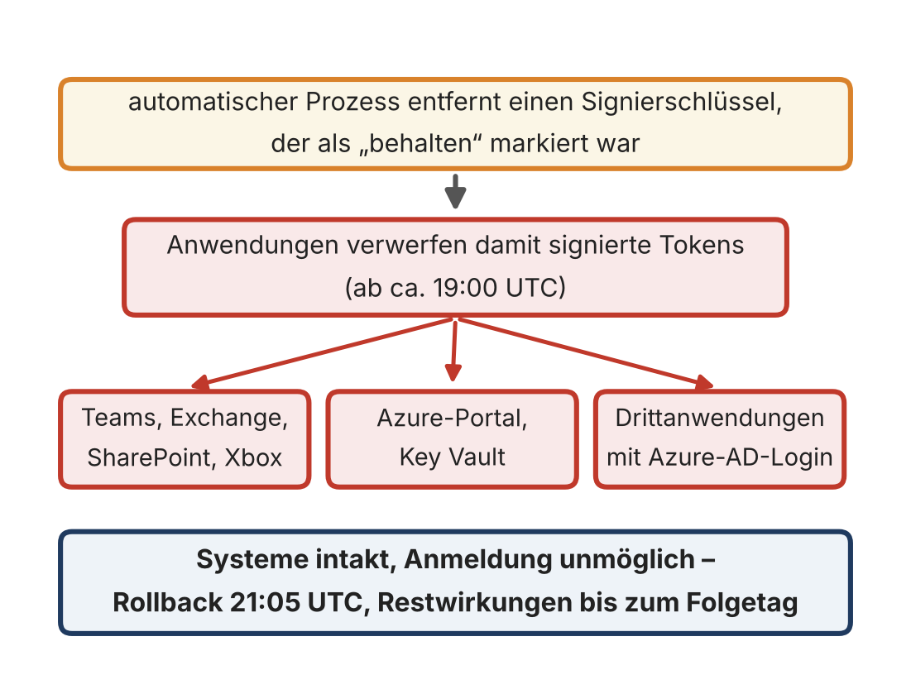{fig-alt="Kette: Automatik entfernt Signierschlüssel, Anwendungen verwerfen Tokens, Folgen für Microsoft-Dienste und Drittanwendungen"}
:::
:::

::: notes
Zeiten laut Microsoft: Beginn gegen 19:00 UTC, Rollback 21:05 UTC, Restwirkungen bis 09:25 UTC am Folgetag. Drei Lehren: Erstens, Identity ist ein globaler Fail-Knopf – Tausende Anwendungen anderer Firmen fielen mit. Zweitens, eine Rückfallebene muss genau den Fehlerfall abdecken, der eintritt. Drittens, Automatisierung braucht Leitplanken – Microsoft hat den sicheren Rollout auch für das Entfernen von Schlüsseln angekündigt. Gleichzeitig ein Human-Failure-Fall im weiteren Sinn – Überleitung.
:::

## Bedrohung 5: Human Failure und Fehlkonfiguration

::: columns
::: {.column width="56%"}
**Wirkprinzip:** Ein lokaler Fehler wird über Automatisierung systemisch (IaC, CI/CD, Admin-Werkzeuge)

**Resilienzstrategien**

- Vier-Augen-Prinzip und Separation of Duties
- Staging, Canary Deployment, Feature Flags
- Rollback- und Snapshot-Fähigkeit
- **Leitplanken im Werkzeug** und Post-Mortem-Kultur statt Schuldsuche

**Prinzipbezug:** Wiederherstellbarkeit und Governance
:::
::: {.column width="40%"}
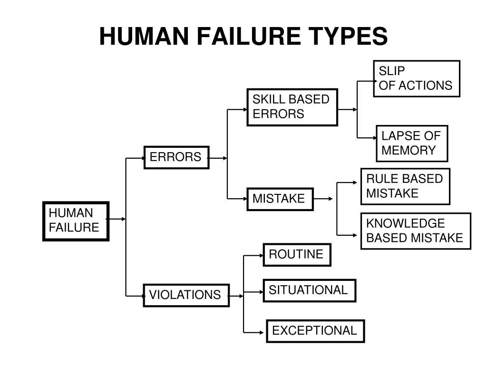{fig-alt="Baumdiagramm der Fehlerarten: Errors und Violations"}
:::
:::

::: notes
Das Baumdiagramm unterscheidet Fehler (Errors) von Regelverstößen (Violations). Für das Resilienzdesign gilt: Menschen machen Fehler – die Frage ist, ob das System sie auffängt. Leitplanken im Werkzeug sind eine Ergänzung zum Skript, sie folgen direkt aus dem nächsten Fall.
:::

## Fallbeispiel: AWS S3 2017

::: columns
::: {.column width="56%"}
- **28. Februar 2017:** Ein Techniker will per Befehl wenige Server eines S3-Teilsystems entfernen – **eine Eingabe ist falsch**
- Es fallen deutlich mehr Server weg; zwei Kernsubsysteme müssen **komplett neu starten**
- S3 in us-east-1 ist gut **vier Stunden** gestört, abhängige Dienste mit
- Pointe: Auch das **Status-Dashboard** hing an S3 und zeigte lange nichts an

**AWS änderte das Werkzeug, nicht nur die Schulung.**
:::
::: {.column width="40%"}
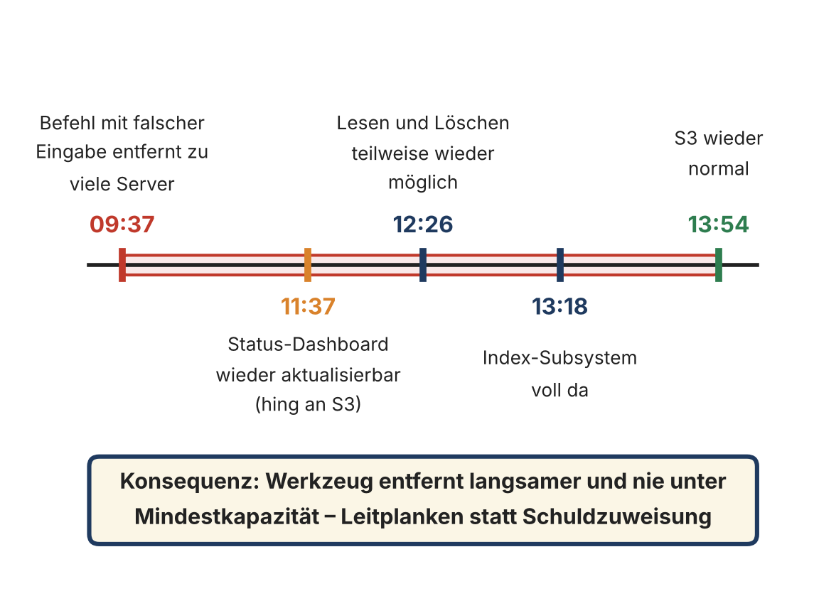{fig-alt="Zeitleiste in PST: 9:37 Befehl, 11:37 Dashboard, 12:26 teilweise wieder verfügbar, 13:18 Index-Subsystem, 13:54 S3 normal"}
:::
:::

::: notes
Konsequenzen laut AWS: Das Werkzeug entfernt Kapazität langsamer und nie unter eine Mindestgrenze, weitere Werkzeuge werden geprüft, das Index-Subsystem wird in kleinere Zellen geteilt, die Status-Konsole läuft in mehreren Regionen. Lehre: Der Mensch war autorisiert und folgte einem Playbook. Nicht der Mensch wird ausgetauscht, sondern das System bekommt Leitplanken. Das Status-Dashboard ist ein Vorgeschmack auf die Notkommunikation gleich.
:::

## Bedrohung 6: Supply-Chain-Angriff

::: columns
::: {.column width="56%"}
**Wirkprinzip:** Die Kompromittierung kommt über Dritte in die eigene Umgebung – über Software, Updates oder Dienstleister

**Resilienzstrategien**

- Lieferantendiversität, keine Monokultur in kritischen Abhängigkeiten
- Zero Trust for Dependencies
- kein Auto-Push bei kritischen Komponenten, Offline-Verifikation
- Recovery **unabhängig vom kompromittierten Lieferanten**

**Lehrsatz:** Resilienz ist das Sicherheitsnetz nach dem Vertrauensbruch
:::
::: {.column width="40%"}
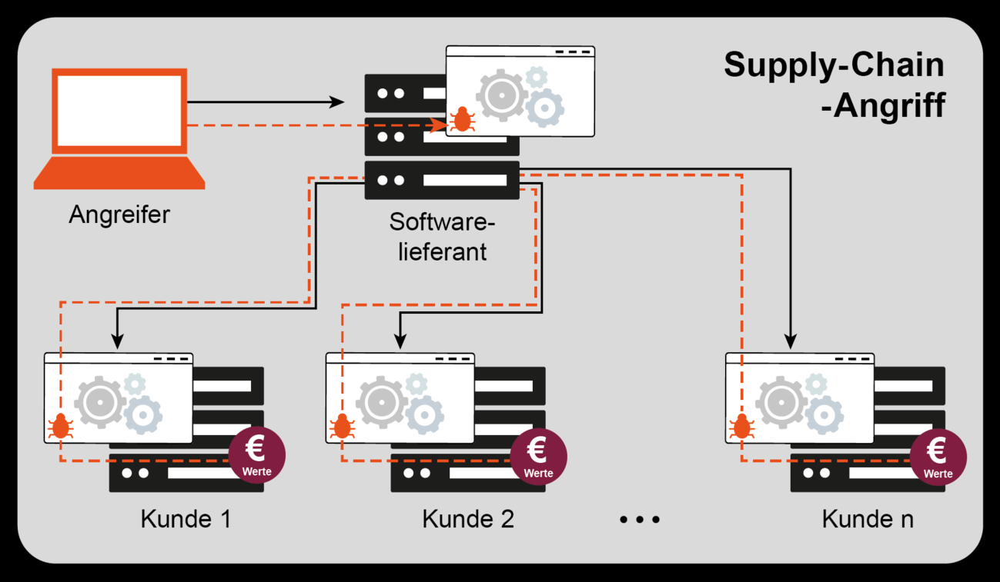{fig-alt="Angreifer kompromittiert Softwarelieferanten und damit mehrere Kunden"}
:::
:::

::: notes
Klassiker: SolarWinds 2020 – ein trojanisiertes, signiertes Update für eine Netzwerk-Management-Software erreichte Tausende Kunden, darunter US-Behörden. Software-Supply-Chain ist die eine Hälfte, der Dienstleister die andere. Der nächste Fall ist ein Dienstleister aus der Region.
:::

## Fallbeispiel: Count+Care und die Mainzer Stadtwerke 2022

::: columns
::: {.column width="56%"}
- **Juni 2022:** Ransomware-Angriff auf Count+Care, den IT-Dienstleister der Entega in Darmstadt
- Mitbetroffen: **Mainzer Stadtwerke** samt Nahverkehr, FES Frankfurt, HEAG, Kommunen in Südhessen
- Websites und E-Mail-Konten tausender Beschäftigter fallen aus; im Nahverkehr Ausfälle und eingeschränkter Ticketverkauf
- **Strom, Gas und Wasser laufen weiter**
- Im Juli veröffentlichen die Täter Kundendaten der Entega

**Der Angriff traf einen – ausgefallen sind viele.**
:::
::: {.column width="40%"}
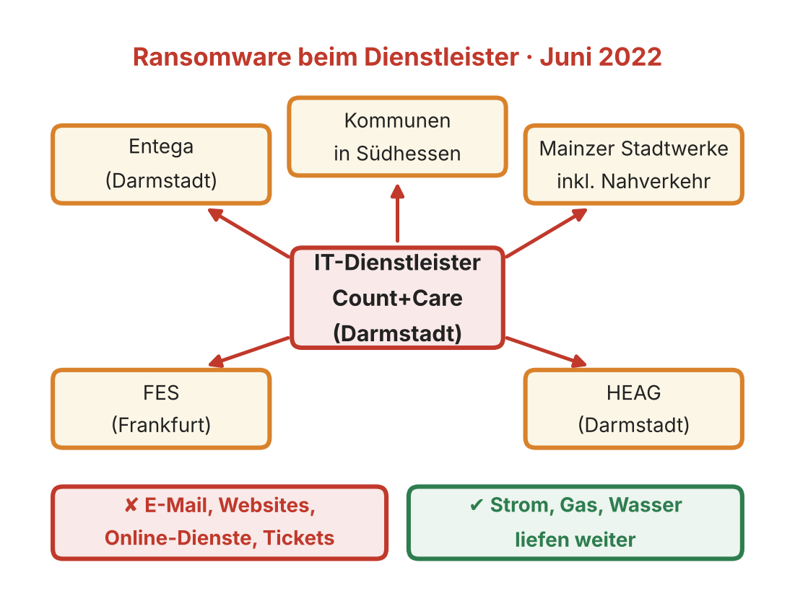{fig-alt="Count+Care in der Mitte, Pfeile zu Entega, Mainzer Stadtwerke, FES, HEAG und Kommunen; darunter: E-Mail und Websites ausgefallen, Versorgung lief weiter"}
:::
:::

::: notes
Lehren: Erstens, ein Dienstleister ist ein gemeinsamer Fehlerpfad für alle Kunden – wie KDZ/KGRZ, nur diesmal mit Angriff. Zweitens, Graceful Degradation: Die Versorgung als Kernfunktion war von der Büro-IT getrennt und lief weiter. Drittens, Vorsicht mit frühen Aussagen: Anfangs hieß es, Kundendaten seien nicht betroffen; im Juli bestätigte Entega die Veröffentlichung von Kundendaten. Krisenkommunikation braucht belastbare Aussagen. Die in der Presse genannte Lösegeldsumme ist offiziell nicht bestätigt – nicht als Fakt verwenden.
:::

## Kommunikation, wenn die eigene IT schweigt

::: columns
::: {.column width="56%"}
- Wer die eigene IT verliert, verliert meist auch **E-Mail, Website und Intranet**.
- **Mainzer Stadtwerke 2022:** neue Website unter Ersatzdomain und neue Kontakt-Mailadressen innerhalb weniger Tage
- **Hochschule Mainz 2025:** Information über App, Instagram und LinkedIn
- **AWS 2017:** Status über Twitter, weil das Dashboard selbst ausgefallen war

**Notkommunikation ist eine Resilienzfähigkeit – sie muss vorbereitet sein, bevor sie gebraucht wird.**
:::
::: {.column width="40%"}
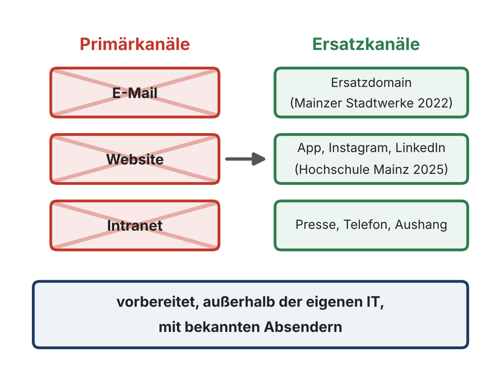{fig-alt="Ausgefallene Primärkanäle E-Mail, Website und Intranet; daneben Ersatzkanäle Ersatzdomain, App und soziale Medien, Presse und Telefon"}
:::
:::

::: notes
Ergänzung zur Vorlesung. Prinzipien: Diversität (Kanäle außerhalb der eigenen IT) und Redundanz (vorbereitete Ersatzdomain, Kontaktlisten auf Papier). Wichtig ist auch der bekannte Absender: In einer Krise ist jede neue Domain auch ein Phishing-Risiko – Angreifer nutzen Ausfälle gern für gefälschte Nachrichten. Brücke zu Sitzung 5 und 6: Kommunikation, Rollen und Krisenstab.
:::

## Framework-Abgleich: Threat → Resilience Capability

Die Bedrohung entscheidet nicht über das Tool, sondern über das Prinzip.

| Bedrohung | Resilienzprinzip | Fall | Normativer Bezug |
|---|---|---|---|
| Ransomware | Wiederherstellbarkeit, Diversität | HS Mainz 2025 | ISO/IEC 27031 · BSI 200-4 |
| DDoS | Adaptivität, Diversität | Dyn 2016 | ENISA DDoS Guidance |
| RZ-/Dienstleister-Ausfall | Redundanz, Entkopplung | KDZ/KGRZ 2026 | NIST SP 800-160 Vol. 2 |
| Identity-Ausfall | Diversität, Break-Glass | Azure AD 2021 | NIST CSF · Zero Trust |
| Human Failure | Wiederherstellbarkeit, Leitplanken | AWS S3 2017 | BSI 200-4 · IT-Grundschutz |
| Supply Chain | Diversität, Isolation | Count+Care 2022 | ENISA Supply Chain Guidance |

::: notes
Tabelle gemeinsam füllen: Spalte „Fall“ abdecken und zuordnen lassen. Die Normbezüge stammen aus dem Skript; die Zuordnung ist eine Orientierung, keine Normauslegung.
:::

## Was das Mapping zeigt

::: columns
::: {.column width="56%"}
- Verschiedene Bedrohungen adressieren **dasselbe Prinzip** (Ransomware und Human Failure → Recovery).
- Dasselbe Prinzip wirkt gegen **verschiedene Bedrohungen** (Diversität gegen DDoS-Abhängigkeit, Identity-Ausfall und Supply Chain).
- **Dienstleister und Identität** tauchen in fast allen Fällen als gemeinsamer Fehlerpfad auf.
- Nicht die Bedrohung wird kontrolliert, sondern die Fähigkeit, ihren Effekt zu absorbieren.
:::
::: {.column width="40%"}
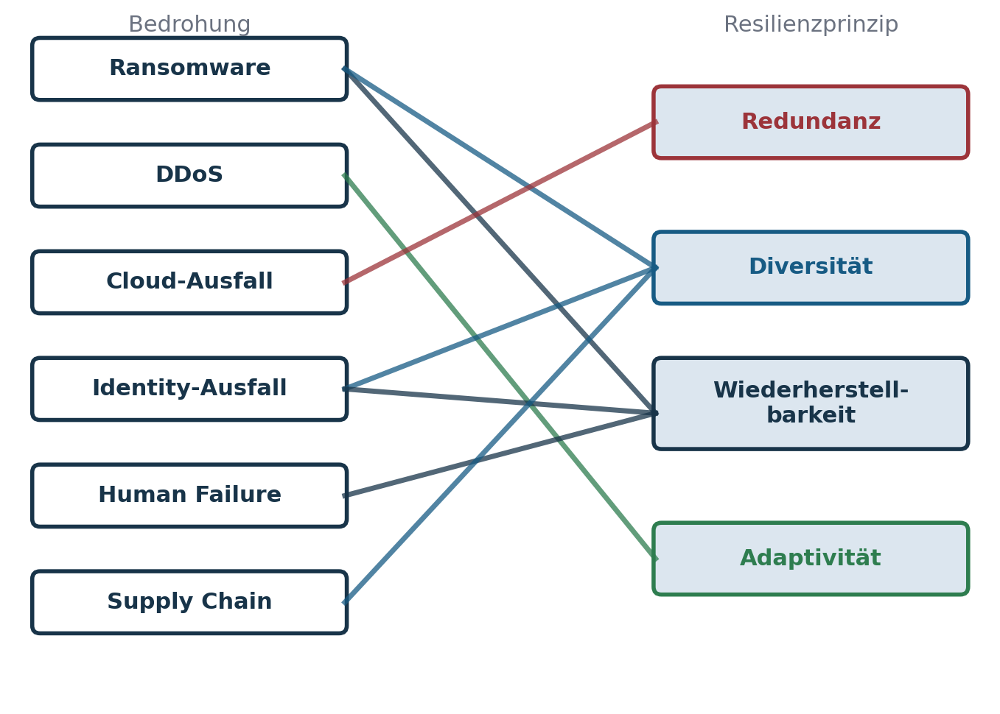{fig-alt="Linien von sechs Bedrohungen zu vier Resilienzprinzipien"}
:::
:::

::: notes
„Capability-based Resilience“ im Sinne von NIST SP 800-160 Vol. 2. Der dritte Punkt ist eine Beobachtung aus den heutigen Fällen: Dyn, KDZ/KGRZ, Azure AD und Count+Care sind alle gemeinsame Abhängigkeiten vieler Organisationen.
:::

## Übung: Threat-to-Resilience-Mapping

Gruppen, 15–20 Minuten. Wählt eine Bedrohung und einen der heutigen Fälle – oder einen eigenen Fall.

1. **Wirkmechanismus** in 1–2 Sätzen beschreiben
2. **Mindestens zwei Resilienzprinzipien** zuordnen und begründen
3. Je Prinzip **eine konkrete, realistische Maßnahme** nennen
4. **Kurzfazit:** resilient, bedingt resilient oder fragil – mit einem Satz Begründung

Ergebnis: eine Folie pro Gruppe, höchstens sechs Stichpunkte. Bewertet wird die Schärfe der Zuordnung, nicht die Menge der Maßnahmen.

::: notes
Varianten für die Gruppen: Hochschule Mainz aus Sicht der Studierenden (Was hätte euch geholfen?), eine Kommune im KDZ-Verbund, ein Kunde von Count+Care, ein SaaS-Anbieter mit Azure-AD-Login. Zwei bis drei Gruppen vorstellen lassen.
:::

## Raster für die Übung

Das Raster hält die vier Schritte fest.

| Wirkmechanismus | Prinzip | Maßnahme | Fazit |
|---|---|---|---|
| | 1. | | |
| | 2. | | |

::: notes
Hinweis: Wenn eine Maßnahme den Angriff verhindert, ist sie Prävention – gefragt ist, was hilft, wenn er gelingt.
:::

## Kernpunkte

- Resilienz ist **relational** – sie bewertet sich immer gegen eine konkrete Bedrohung.
- Sechs Bedrohungsklassen, unterschieden nach dem **Effekt**, nicht nach der Ursache.
- Nach Ransomware heißt Recovery **Neuaufbau** – mit Kernfunktionen zuerst (Hochschule Mainz).
- **Dienstleister, DNS und Identität** sind gemeinsame Fehlerpfade vieler Organisationen (KDZ/KGRZ, Count+Care, Dyn, Azure AD).
- Vorsorgliches Abschalten und Notkommunikation sind **Resilienzentscheidungen**, die vorbereitet sein müssen.

::: notes
Kernpunkte aus Abschnitt 7 des Skripts, ergänzt um die Lehren aus den Fällen. Die Prüfungsfragen am Ende des Skripts lassen sich alle mit den heutigen Fällen beantworten.
:::

## Ausblick & Hausaufgabe

**Nächste Sitzung:** Resilienz als Organisationsfähigkeit – Rollen, Prozesse, Übungen, Governance

**Hausaufgabe:** Stellen Sie sich vor, Ihre Organisation (Hochschule, Arbeitgeber, Verein) verliert morgen E-Mail und Website. Über welche Kanäle erfahren die Betroffenen davon – und wer entscheidet, was kommuniziert wird?

[Kapitel zum Termin](../../../termine/04.html) · [Skript](../../../skripte/Skript-04.html) · [Glossar](../../../glossar.html) · [Quellen](../../../quellen.html)

::: notes
Teaser Sitzung 5: Heute stand die Technik im Vordergrund. Aber jede Entscheidung von heute – abschalten, priorisieren, kommunizieren – hat jemand getroffen. Nächstes Mal geht es um diese Menschen und Strukturen.
:::
