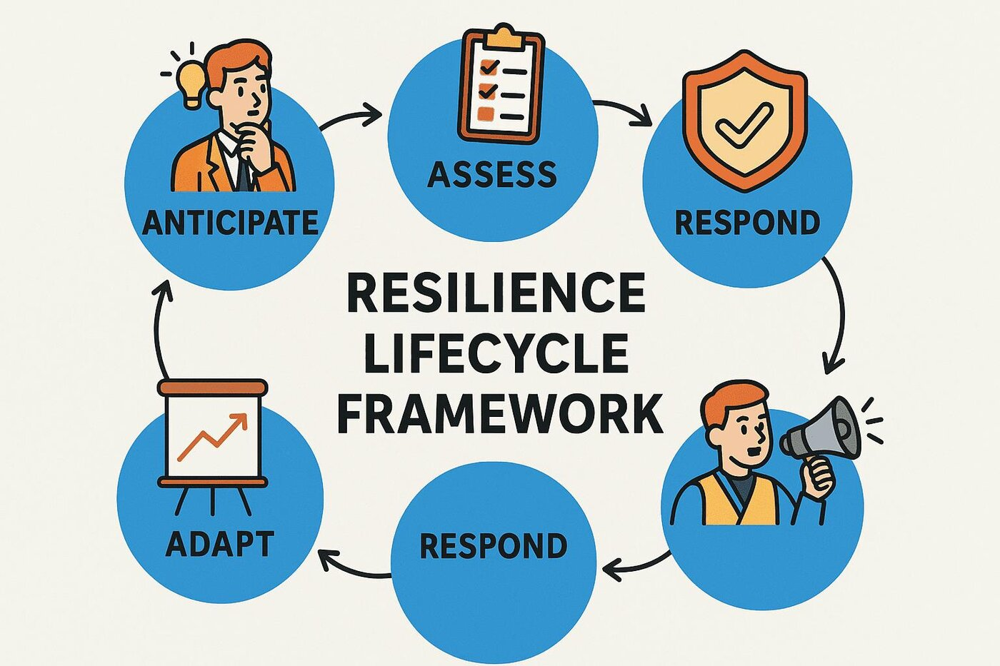
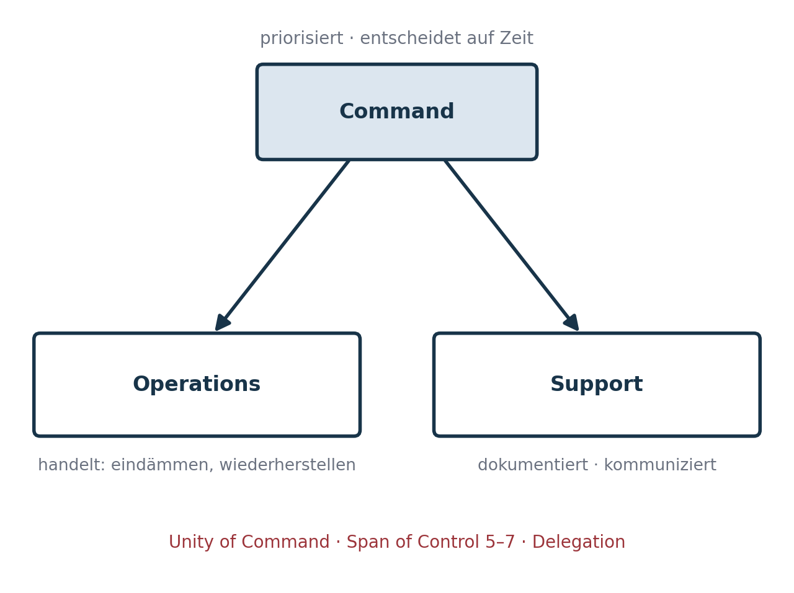
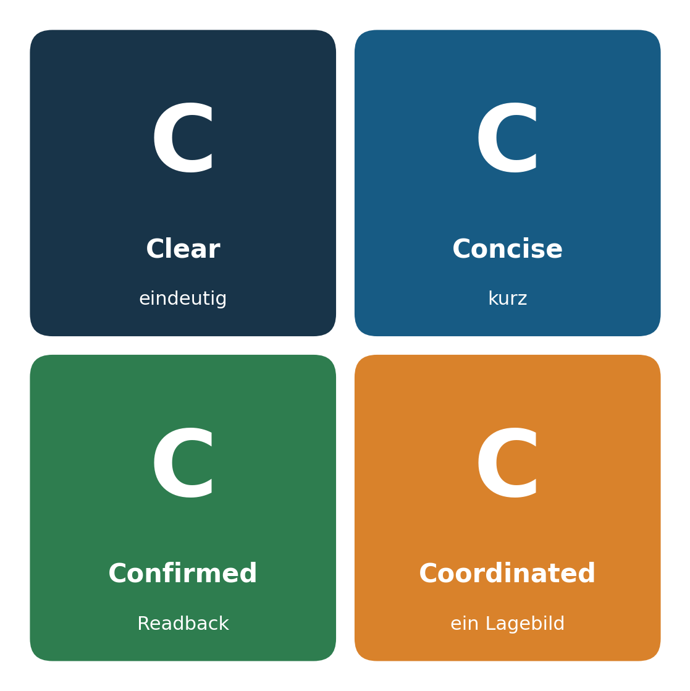
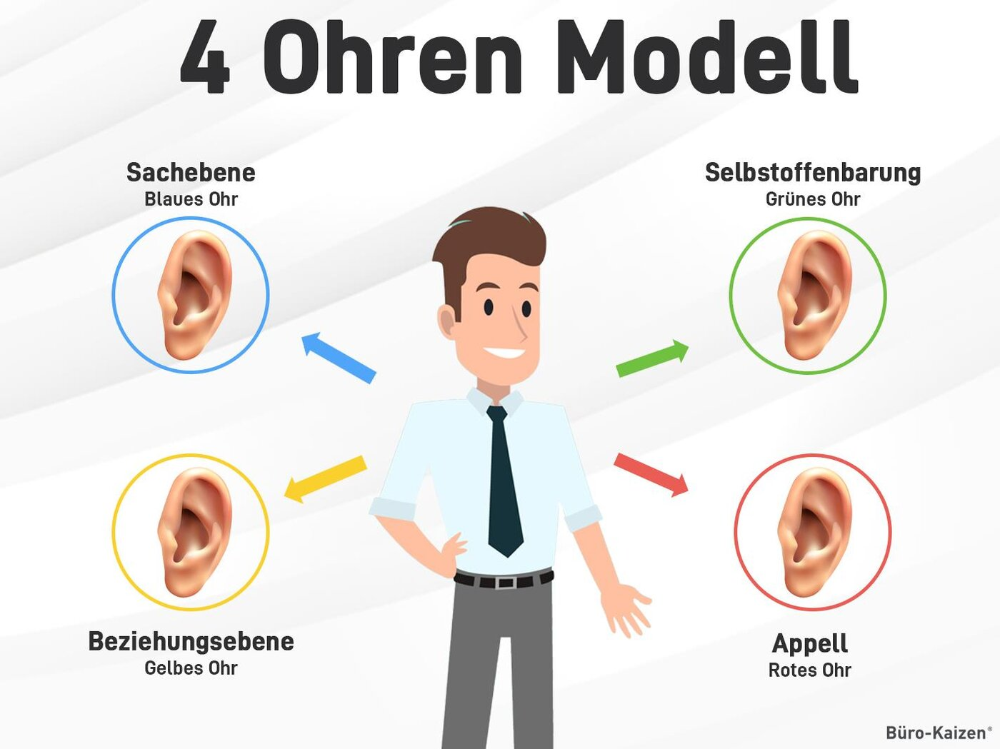

## Agenda

- Rückblick & Lernziele
- Einstieg: Norsk Hydro – die Organisation trägt
- Organisationale Resilienz und Resilienzzyklus
- Rollen, Krisenstab und Entscheidungslogik
- Kommunikation unter Stress · Schulz von Thun
- Incident-Response-Prozess
- Übungskultur und Governance
- Gruppenübung · Kultur & Lernen
- Kernpunkte & Ausblick

## Rückblick Sitzung 4

::: columns
::: {.column width="56%"}
- Resilienz ist **relational** – resilient gegen eine konkrete Bedrohung
- Sechs Bedrohungsklassen, unterschieden nach ihrem **Effekt**
- Dienstleister und Identität als **gemeinsame Fehlerpfade** (KDZ/KGRZ 2026, Azure AD 2021)
- Vorsorgliches Abschalten und Notkommunikation als **Resilienzentscheidungen**

**Jede dieser Entscheidungen hat jemand getroffen. Heute geht es um diese Menschen und Strukturen.**
:::
::: {.column width="40%"}
{fig-alt="Ausgefallene Primärkanäle E-Mail, Website und Intranet; daneben Ersatzkanäle Ersatzdomain, App und soziale Medien, Presse und Telefon"}
:::
:::

::: notes
Hausaufgabe aufgreifen: Eure Organisation verliert E-Mail und Website – über welche Kanäle erfahren die Betroffenen davon, und wer entscheidet, was kommuniziert wird? Zwei bis drei Antworten sammeln. Meist ist die erste Frage leicht und die zweite schwer: Kanäle kann man aufzählen, die Entscheidungsrolle kennt kaum jemand. Genau diese Lücke ist das Thema von heute.
:::

## Lernziele

Nach dieser Sitzung können Sie …

- erklären, was **organisationale Resilienz** nach ISO 22316 ist und aus welchen Komponenten sie besteht,
- den **Resilienzzyklus** und den **Incident-Response-Prozess** organisatorisch beschreiben,
- begründen, warum Krisen **Rollen statt Personen** und Entscheidungskompetenz auf Zeit brauchen,
- Kommunikation unter Stress mit **CCCC** und dem **Vier-Seiten-Modell** analysieren,
- an realen Fällen zeigen, wie **Übung, Governance und Lernkultur** Resilienz verankern.

::: notes
Die ersten drei Lernziele stammen aus dem Skript. Die Fälle sind neu: Norsk Hydro 2019, Anhalt-Bitterfeld 2021, Atlassian 2022, Rhein-Pfalz-Kreis 2022, LÜKEX 23 und Cloudflare 2019. Jeder Fall steht für eine Komponente – am Ende fügen wir sie zusammen.
:::

## Einstieg: Norsk Hydro 2019

::: columns
::: {.column width="56%"}
- **19. März 2019:** Ransomware LockerGoga trifft den Aluminiumkonzern – rund 35.000 Beschäftigte in 40 Ländern
- Anlagen werden **isoliert**, wo möglich wird **manuell** weitergearbeitet
- Noch am selben Tag: **Pressekonferenz** mit Webübertragung, danach laufende Updates
- **Kein Lösegeld** – Wiederaufbau aus Backups; Gesamtkosten nach Hydro rund 800 Mio. NOK

**Frage:** Warum gilt ein Unternehmen mit lahmgelegter IT als Vorbild für Resilienz?
:::
::: {.column width="40%"}
{fig-alt="Gegenüberstellung: Ausgefallen waren Rechner, Server, Verbindungen zu Produktionssystemen und Teile der Fertigung; getragen haben Isolation und Handarbeit, die Pressekonferenz am ersten Tag und der Verzicht auf Lösegeld"}
:::
:::

::: notes
Pointe: Die Technik ist gefallen – die Organisation nicht. Hydro hat entschieden (isolieren, manuell weiter, nicht zahlen), Rollen besetzt (der Finanzvorstand führte die Pressekonferenz, weil das Unternehmen gerade zwischen zwei CEOs stand) und offen kommuniziert. Die Bereiche Energie und Bauxit liefen nahezu normal, die Strangpresswerke hatten die größten Einbußen. Wochen später lief manches noch mit erhöhtem Handaufwand. Frage an die Studierenden: Welche dieser Entscheidungen hätte man vorher üben können? Antwort: alle.
:::

## Technik schafft Potenzial

Technische Resilienz sichert **Systeme**, organisationale Resilienz sichert **Entscheidungen**. **Im Ernstfall entscheidet nicht Technologie, sondern Verhalten.**

| Aspekt | Technische Resilienz | Organisationale Resilienz |
|---|---|---|
| Steuerungslogik | deterministisch, automatisiert | adaptiv, situativ |
| Fokus | Systeme und Prozesse | Menschen, Rollen, Kommunikation |
| Nachweis | Monitoring, Failover-Tests | Übungen, Entscheidungswege, Lernfähigkeit |
| Zielgröße | System bleibt funktionsfähig | Organisation bleibt handlungsfähig |

::: notes
Brücke zu Sitzung 3: Die vier technischen Prinzipien sind die Basis. Sie nützen nichts, wenn niemand weiß, wer den Failover auslöst, wer den Restore freigibt und wer die Kunden informiert. Das Skript nennt Organisation deshalb ein „soziales Redundanzsystem“.
:::

## Was ist organisationale Resilienz?

::: columns
::: {.column width="56%"}
ISO 22316:2017: die Fähigkeit einer Organisation, **in einem sich wandelnden Umfeld Störungen aufzufangen und sich anzupassen**, um ihre Ziele zu erreichen, zu überleben und zu gedeihen.

- **Strukturen** → klare Rollen und Verantwortlichkeiten
- **Prozesse** → Detection, Reaktion, Wiederanlauf
- **Menschen** → Ausbildung, Training, Entscheidungsfähigkeit
- **Kultur** → Fehleroffenheit und Lernfähigkeit
:::
::: {.column width="40%"}
{fig-alt="Vier Kacheln Strukturen, Prozesse, Menschen und Kultur über einer Basis Technik schafft Potenzial mit Redundanz, Diversität, Wiederherstellbarkeit und Adaptivität"}
:::
:::

::: notes
Ergänzung zur Vorlesung: Die Archivunterlagen nennen als Definition „Störungen vorhersehen, sich vorbereiten, reagieren und sich anpassen“. Diese Formulierung stammt aus der britischen Norm BS 65000:2014. ISO 22316 formuliert knapper: absorb and adapt. Inhaltlich passt beides zusammen – vorhersehen und vorbereiten sind die Voraussetzung, um Störungen auffangen zu können. Für die Klausur zählt der Kern: Resilienz ist eine Fähigkeit der ganzen Organisation, nicht der IT. Siehe Quellen, Hinweise zur Aktualität.
:::

## Der Resilienzzyklus

::: columns
::: {.column width="52%"}
- **Detection:** Früherkennung – technisch (SIEM) und organisatorisch (Meldekultur)
- **Response:** Sofortmaßnahmen und Schadensbegrenzung entlang einer gemeinsamen Lage
- **Recovery:** Wiederanlauf nach Business Impact, nicht nach Zufall
- **Adapt:** Lernen und Optimieren nach jedem Ereignis

Bezug: ISO 22316 · ISO/IEC 27035 · BSI-Standard 200-4
:::
::: {.column width="44%"}
{fig-alt="Kreislauf Anticipate, Assess, Respond, Adapt mit Figuren"}
:::
:::

::: notes
Norsk Hydro auf den Zyklus legen: Detection in der Nacht, Response durch Isolation, Recovery aus Backups mit Priorisierung, Adapt durch Umbau der Security-Organisation (Hydro hat sein Security-Team danach neu aufgestellt). Unterschied zu PDCA: PDCA verbessert den Normalbetrieb, der Resilienzzyklus die Fähigkeit im Krisenfall. Eine Organisation, die nach jedem Vorfall besser wird, ist per Definition resilient.
:::

## Rollen statt Personen

Kernprinzip: **Wer entscheidet was, wann und warum?**

| Rolle | Hauptaufgabe |
|---|---|
| CISO | Strategische Leitung, Entscheidung über Eskalationsstufen |
| Incident Commander | Operative Gesamtkoordination im Ereignisfall |
| IT Operations / Technical Lead | Analyse, technische Eindämmung und Wiederherstellung |
| BCM-Manager | Koordination mit Fachbereichen, kritische Prozesse zuerst |
| Kommunikation / PR | Interne und externe Information |
| Legal / Datenschutz | Meldepflichten, etwa Art. 33 DSGVO |
| Management Board | Ressourcen, Business-Priorisierung, Risikoakzeptanz |

::: notes
Rollen statt Personen heißt: Die Organisation bleibt handlungsfähig, wenn Einzelne fehlen – im Urlaub, krank oder selbst vom Vorfall betroffen. Norsk Hydro ist das Beispiel: Der Finanzvorstand führte die Kommunikation, weil die Rolle besetzt werden musste, nicht weil er dafür vorgesehen war. Vertiefung der Rollen CISO, SOC und CERT in Sitzung 6.
:::

## Entscheidungslogik in Krisen

::: columns
::: {.column width="56%"}
- Der Linienweg ist zu langsam: **Entscheidungskompetenz auf Zeit** (Incident Command System)
- Command priorisiert · Operations handelt · Support dokumentiert und kommuniziert
- **Unity of Command** · **Span of Control** (5–7) · Delegation · Nachvollziehbarkeit · Training
- Unter Stress greifen Menschen auf erlernte Muster zurück – **Playbooks und Entscheidungsbäume bereiten Entscheidungen vor**
:::
::: {.column width="40%"}
{fig-alt="Incident Command: Command über Operations und Support"}
:::
:::

::: notes
Das Incident Command System stammt aus dem Katastrophenschutz. In Deutschland entspricht dem die Stabsarbeit der Verwaltung und der Feuerwehr – genau dieses Modell kam im nächsten Fall zum Einsatz. Wichtig: Entscheidungsgewalt nach Lage, nicht nach Rang. Die Leitung eines Krisenstabs ist eine Rolle, die geübt sein muss.
:::

## Fallbeispiel: Anhalt-Bitterfeld 2021

::: columns
::: {.column width="56%"}
- **6. Juli 2021:** Ransomware verschlüsselt die IT der Kreisverwaltung, nur die Telefonanlage läuft
- **9. Juli:** Der Landkreis ruft den **Katastrophenfall** aus – der erste nach einem Cyberangriff in Deutschland
- **Krisenstab** mit Bundeswehr, BSI, LKA, CERT Nord und Landesverwaltung
- Sozialhilfe, Eltern- und Kindergeld zeitweise nicht auszahlbar; im März 2022 liefen erst **40 von 159** Fachanwendungen

**Kein Lösegeld – aber über ein halbes Jahr Katastrophenfall.**
:::
::: {.column width="40%"}
{fig-alt="Ablauf: 6.7.2021 Verschlüsselung, 9.7.2021 Katastrophenfall, Krisenstab mit Bundeswehr, BSI, LKA, CERT Nord und Land, Folgen für Sozialleistungen, März 2022 40 von 159 Fachanwendungen; Muster: Entscheidungskompetenz auf Zeit"}
:::
:::

::: notes
In Sitzung 1 nur als Stichpunkt, hier ausführlich. Warum Katastrophenfall? Er schafft eine Führungsstruktur mit klaren Befugnissen und erlaubt, Hilfe von Bund und Land formal anzufordern – die Organisationsform folgt der Lage, nicht dem Organigramm. Die Lösegeldforderung lag bei umgerechnet rund 500.000 Euro in Monero, der Landrat zahlte nicht; Daten wurden teilweise veröffentlicht. Schaden nach Schätzung des Landrats 1,7 bis 2 Millionen Euro. Lehren des Landkreises: Offline-Backups, Notfallkonzepte für den Betrieb ohne IT, verbindlicher Wiederanlaufplan mit Prioritäten.
:::

## Kommunikation unter Stress

::: columns
::: {.column width="56%"}
**Krisenkommunikation ist Teil der Resilienzarchitektur.**

- Viele Vorfallsbehandlungen scheitern an **Informationsfehlern**, nicht an Technik.
- Prinzipien: **Clear · Concise · Confirmed · Coordinated**
- „Eine Info ist nur so gut wie ihre Bestätigung.“
- Kanäle **und Kontaktlisten** müssen vorher definiert, getestet und außerhalb der betroffenen Systeme verfügbar sein.
:::
::: {.column width="40%"}
{fig-alt="Vier Kacheln: Clear, Concise, Confirmed, Coordinated"}
:::
:::

::: notes
Confirmed heißt Readback wie im Funkverkehr der Luftfahrt: Der Empfänger wiederholt die Kernaussage. Coordinated heißt: alle sprechen auf Basis derselben Lage – sonst widersprechen sich Pressestelle und IT öffentlich. Der letzte Punkt ist eine Ergänzung, die direkt aus dem nächsten Fall folgt.
:::

## Fallbeispiel: Atlassian 2022

::: columns
::: {.column width="56%"}
- **5. April 2022:** Ein Wartungsskript löscht **883 Sites von 775 Kunden** – es erhielt Site-IDs statt App-IDs
- Mit den Sites verschwinden die **Kontaktdaten** der Kunden-Admins
- Statusseite nach knapp anderthalb Stunden, eine breite öffentliche Stellungnahme erst **am dritten Tag**
- Wiederherstellung bis **18. April** – RPO eingehalten, RTO verfehlt

**Atlassian selbst: Wir hätten viel früher breiter kommunizieren müssen.**
:::
::: {.column width="40%"}
{fig-alt="Zeitleiste: 5.4. 07:38 Skript löscht Sites, 5.4. 09:03 erste Meldung auf der Statusseite, 7.4. erste breite Stellungnahme, 8.4. erste Kunden wiederhergestellt, 18.4. alle Kunden wiederhergestellt"}
:::
:::

::: notes
Kein Angriff, sondern ein Kommunikationsfehler am Anfang: Das anfragende Team übergab die falsche Art von IDs. Und ein Kommunikationsfehler am Ende: Die Kontaktdaten lagen in genau den Instanzen, die gelöscht waren, viele Kunden konnten nicht einmal ein Ticket eröffnen. Mehr als 99,6 Prozent der Kunden waren nicht betroffen – für die Betroffenen fühlte es sich trotzdem wie Funkstille an. CCCC durchgehen: Was war nicht clear, nicht confirmed, nicht coordinated? Lehren aus Atlassians eigenem Bericht: Kontaktdaten außerhalb des Produkts sichern, Kommunikations-Playbook für Großvorfälle, Soft Delete statt sofortigem Löschen.
:::

## Exkurs: Kommunikation nach Schulz von Thun

Jede Botschaft hat vier Ebenen. Beispiel im IT-Incident – Admin sagt: „Der Server ist schon wieder down.“

| Ebene | Frage | Botschaft |
|---|---|---|
| Sachinhalt | Worüber informiere ich? | Der Server ist nicht erreichbar. |
| Selbstoffenbarung | Was zeige ich von mir? | Ich bin genervt und gestresst. |
| Beziehung | Was halte ich vom anderen? | Ihr hättet das früher merken müssen. |
| Appell | Was will ich erreichen? | Bitte tut endlich etwas! |

::: notes
In Stresssituationen hören Menschen häufig auf der falschen Ebene – etwa den Vorwurf statt der technischen Meldung. Merksatz aus dem Skript: Resilienz in Kommunikation heißt, auf allen vier Ohren bewusst zu sprechen und zu hören.
:::

## Kommunikationsübung: Vier Seiten einer Nachricht

::: columns
::: {.column width="56%"}
3er-Gruppen, 10 Minuten. Analysiert die Aussage aus einer Incident-Situation:

**„Warum habt ihr das Backup noch nicht eingespielt?“**

- Welche Botschaften stecken in den vier Ebenen?
- Wie könnte dieselbe Aussage resilienter formuliert werden?
- Welche Missverständnisse entstehen, wenn nur eine Ebene gehört wird?
- Welche Kommunikationsregeln helfen, in Stresslagen klar zu bleiben?
:::
::: {.column width="40%"}
{fig-alt="Vier-Ohren-Modell nach Schulz von Thun"}
:::
:::

::: notes
Beispielauflösung aus dem Skript: Sachinhalt – das Backup ist noch nicht eingespielt; Selbstoffenbarung – ich stehe unter Druck; Beziehung – ich zweifle an eurer Kompetenz; Appell – handelt sofort. Resilientere Formulierung: „Wie ist der Stand beim Restore? Können wir gemeinsam priorisieren?“
:::

## Incident-Response-Prozess

::: columns
::: {.column width="56%"}
ISO/IEC 27035-1:2023 gliedert in fünf Phasen:

1. **Planen und vorbereiten**
2. **Erkennen und melden**
3. **Bewerten und entscheiden** – Triage, Kritikalität
4. **Reagieren** – eindämmen, beseitigen, wiederherstellen
5. **Lehren ziehen** – zurück in die Vorbereitung

Jede Phase braucht definierte Owner, Playbooks und Kommunikationskanäle.
:::
::: {.column width="40%"}
{fig-alt="Fünf Phasen nach ISO/IEC 27035-1:2023 mit Rückfluss der Lessons Learned; darunter die operative Feingliederung der Reaktion in Eindämmen, Beseitigen und Wiederherstellen"}
:::
:::

::: notes
Ergänzung zur Vorlesung: Die Archivfolie nannte sechs Phasen nach ISO/IEC 27035 (Detection & Reporting, Triage, Containment, Eradication, Recovery, Lessons Learned). Diese Feingliederung entspricht eher NIST SP 800-61 Rev. 2. Die Norm selbst gliedert gröber; Containment, Eradication und Recovery stecken in der Phase „Reagieren“. NIST SP 800-61 wurde im April 2025 durch Revision 3 ersetzt, die Incident Response an den sechs Funktionen des CSF 2.0 ausrichtet. Für die Praxis gilt beides: grobe Phasen für die Governance, feine Schritte für das Playbook.
:::

## Fallbeispiel: Rhein-Pfalz-Kreis 2022

::: columns
::: {.column width="56%"}
- **Ende Oktober 2022:** Ransomware in der Kreisverwaltung in Ludwigshafen – ein Beschäftigter zieht nachts den Stecker
- Rechner offline, **weder E-Mail noch Durchwahlen** erreichbar; Notbetrieb mit Laptop, Drucker und Excel-Listen
- Lösegeld nicht gezahlt – ab 11. November rund **20.000 Dateien im Darknet**, Warnung an rund 2.550 Betroffene
- Ersatzkanäle: **zentrale Rufnummer, Kontaktformular**, Personal vor Ort in den Gemeinden

**Erkennen, entscheiden, reagieren, informieren – jede Phase braucht eine Rolle.**
:::
::: {.column width="40%"}
{fig-alt="Ablauf beim Rhein-Pfalz-Kreis: Ransomware Ende Oktober 2022 und gezogener Stecker, Rechner offline, Lösegeld nicht gezahlt und Daten im Darknet, Warnung an Betroffene, Notbetrieb mit Ersatzkanälen; Muster: jede Phase hat eine Rolle, Landeshilfe in drei Stufen"}
:::
:::

::: notes
Ein regionaler Fall, der den Prozess vollständig zeigt. Erkennen und melden: Ein Beschäftigter handelte sofort – der Landrat sagt, das habe weiteren Datenverlust verhindert. Bewerten und entscheiden: kein Lösegeld, mit der bekannten Folge der Veröffentlichung. Reagieren: Notbetrieb, Ermittlungen durch die Landeszentralstelle Cybercrime und das LKA. Kommunikation: Warnbriefe an Betroffene mit konkreten Verhaltenshinweisen. Das Land Rheinland-Pfalz bot Unterstützung in drei Stufen an – Beratung, Hilfe im Vorfall, Krisenmanagement danach – und plante ein mobiles Reaktionsteam. Unter den veröffentlichten Daten waren auch Daten von Geflüchteten: Meldepflichten nach Art. 33 DSGVO sind hier nicht theoretisch.
:::

## Übungs- und Trainingskultur

::: columns
::: {.column width="56%"}
**Resilienz ist keine Theorie – sie entsteht durch Übung.**

- **Tabletop-Übungen:** Planspiel, Fokus auf Kommunikation und Entscheidungswege
- **Live-Simulationen:** technische Reaktionsfähigkeit unter Realbedingungen
- **After-Action Reviews:** strukturiertes Feedback, keine Schuldzuweisung
- **Metriken:** Time to Detect · Time to Decision · Time to Recover · Übungshäufigkeit
:::
::: {.column width="40%"}
{fig-alt="Drei Übungsformen mit steigendem Aufwand und Realitätsnähe: Tabletop, Funktionstest, Live-Simulation; darunter das After-Action Review nach jeder Übung"}
:::
:::

::: notes
Verankerung laut Skript: mindestens zwei Tabletop-Übungen pro Jahr, Teilnahme des Managements, strukturierte Lessons-Learned-Protokolle. Der Funktionstest in der Mitte ist eine Ergänzung: Einzelne Abläufe wie ein Restore oder die Alarmierung über den Notfallkanal lassen sich günstig real prüfen. Ein Team, das regelmäßig übt, erlebt weniger Panik im Ernstfall.
:::

## Fallbeispiel: LÜKEX 23

::: columns
::: {.column width="56%"}
- **27.–28. September 2023:** Krisenmanagementübung von Bund und Ländern unter Federführung des BBK
- Szenario: **Cyberangriff auf das Regierungshandeln**
- Mehr als **50 Behörden** und **1.000 Mitwirkende**, acht Länder voll beteiligt; monatelange Vorbereitung
- Geübt: **Melde- und Kommunikationswege**, Zusammenspiel von Krisen- und IT-Notfallmanagement, Krisenkommunikation

**Übung im großen Maßstab – ohne einen einzigen Server abzuschalten.**
:::
::: {.column width="40%"}
{fig-alt="LÜKEX 23 am 27. und 28. September 2023 mit dem Szenario Cyberangriff auf das Regierungshandeln: mehr als 50 Behörden, mehr als 1.000 Mitwirkende, acht Länder voll beteiligt; geübt wurden Meldewege, Krisen- und IT-Notfallmanagement und Krisenkommunikation"}
:::
:::

::: notes
LÜKEX ist eine Tabletop-Übung im Großformat: keine Einsatzkräfte, keine Beteiligung der Bevölkerung, kein Probealarm. Das Szenario wird vorab nicht veröffentlicht, damit die Übung nicht entwertet wird. Baden-Württemberg berichtete in der Auswertung, die Krisenstrukturen hätten sich bewährt, an verschiedenen Stellen gebe es aber noch Verbesserungspotenzial – genau das ist der Zweck einer Übung. Vergleich zu Anhalt-Bitterfeld: Dort musste der Krisenstab im Ernstfall entstehen.
:::

## Resilienz-Governance

„Resilienz ist keine Projektaufgabe, sondern Führungsverhalten.“

| Managementsystem | Bezug zur Resilienz |
|---|---|
| ISMS (ISO/IEC 27001) | Struktur für Informationssicherheit und Incident Management |
| BCMS (ISO 22301) | Kontinuität kritischer Geschäftsprozesse |
| Risk Management (ISO 31000) | Identifikation und Bewertung von Bedrohungen |
| Crisis Management (ISO 22320) | Entscheidungs- und Kommunikationsstrukturen im Ereignisfall |
| Resilience Management (ISO 22316) | verbindet die Systeme zu einer adaptiven Gesamtstruktur |

::: notes
Kennzahlen: RTO-Erreichung, Übungshäufigkeit, Umsetzungsgrad der Lessons Learned, Reaktionszeit von Managemententscheidungen. Nachweise: Übungs- und Incident-Protokolle, Management Reviews. Reifegrad: Die finale Fassung des BSI-Standards 200-4 kennt drei Stufen (Reaktiv-, Aufbau-, Standard-BCMS); fünfstufige Skalen sind allgemeine Reifegradmodelle. Berichtspflicht an Management und Aufsicht – unter NIS-2 auch persönliche Verantwortung der Leitung.
:::

## Gruppenübung: Ransomware am Montagmorgen

**Szenario:** Montag, 08:15 Uhr. Mehrere File-Server sind verschlüsselt, eine Lösegeldforderung erscheint. Cloud-Sync ist betroffen, VPN und Mail laufen noch.

Gruppen, 15–20 Minuten:

1. Wer übernimmt die Incident-Leitung?
2. Welche Systeme oder Personen müssen sofort informiert werden?
3. Welche Entscheidungen sind in den ersten 30 Minuten kritisch?
4. Wie läuft die interne und externe Kommunikation?
5. Welche Priorität hat Recovery gegenüber Forensik?
6. Wann erfolgt die Meldung an Aufsichtsbehörden (DSGVO Art. 33 / NIS-2)?

::: notes
Hinweis an die Gruppen: Nutzt die heutigen Fälle als Spickzettel. Wer zieht den Stecker (Rhein-Pfalz-Kreis)? Wer spricht mit der Presse (Norsk Hydro)? Wo liegen eure Kontaktlisten, wenn Mail und Fileserver weg sind (Atlassian)? Ab wann braucht es einen Krisenstab (Anhalt-Bitterfeld)?
:::

## Typischer Verlauf und häufige Fehler

| Phase | Beschreibung | Häufige Fehler |
|---|---|---|
| Detection | erste Hinweise, z. B. unzugängliche Daten | Unterschätzung der Lage, verspätete Eskalation |
| Response | Eindämmung, z. B. Netzwerksegmentierung | fehlende Koordination, doppelte Maßnahmen |
| Communication | interne und externe Information | Intransparenz, widersprüchliche Aussagen |
| Recovery | Wiederherstellung aus Backups | keine Priorisierung, ungetestete Backups |
| Adapt | Ursachenanalyse, Lessons Learned | keine systematische Nachbereitung |

::: notes
Matrix aus dem Skript für die Reflexion im Plenum. Zwei bis drei Gruppen vorstellen lassen und die Fehlerspalte gegen ihre Antworten legen. Typische Lessons Learned: Playbooks sind Gold wert, wenn sie aktuell und trainiert sind; ein Backup ist nur so gut wie der letzte Restore; Forensik und Wiederanlauf müssen abgestimmt sein.
:::

## Kultur & Lernen

::: columns
::: {.column width="56%"}
**Resilienz ist ein soziales Phänomen.**

- **Blame-free Post-Mortems:** Statt „Wer war schuld?“ die Frage „Was verbessern wir?“
- **Psychologische Sicherheit** (Edmondson): Fehler und Unsicherheiten dürfen gemeldet werden
- **Transparente Kommunikation:** Fehler werden geteilt, nicht versteckt
- **Institutionelles Lernen:** Lessons Learned → Prozesse, Playbooks, Leitplanken
:::
::: {.column width="40%"}
{fig-alt="Gegenüberstellung: Die Frage Wer war schuld führt zu versteckten Fehlern, späten Meldungen und Wiederholung; die Frage Was verbessern wir führt zu gemeldeten Fehlern, systemischen Ursachen und Leitplanken"}
:::
:::

::: notes
Leitfragen eines Post-Mortems laut Skript: Was ist passiert? Warum? Wie haben wir reagiert? Was lernen wir und wie setzen wir es um? Rückbezug Sitzung 4 (AWS S3 2017): Leitplanke im Werkzeug statt Schuldzuweisung. Und Norsk Hydro: Offenheit nach außen setzt Offenheit nach innen voraus.
:::

## Fallbeispiel: Cloudflare 2019

::: columns
::: {.column width="56%"}
- **2. Juli 2019, 13:42 UTC:** Eine neue Firewall-Regel mit fehlerhaftem regulärem Ausdruck geht **weltweit auf einmal** live
- Die CPUs laufen voll, der Verkehr bricht um **bis zu 82 %** ein; nach **27 Minuten** ist die Regel global abgeschaltet
- Auch interne Werkzeuge hängen am Netz – das Team braucht einen selten genutzten **Notzugang**
- Zehn Tage später: öffentliches **Post-Mortem** mit Zeitleiste, Prozessfehlern und Maßnahmen

**Gefragt wird nach dem Prozess, nicht nach dem Schuldigen.**
:::
::: {.column width="40%"}
{fig-alt="Zeitleiste in UTC: 13:42 Regel weltweit ausgerollt, 13:45 erster Alarm, 14:00 WAF als Ursache erkannt, 14:07 WAF global abgeschaltet, 14:09 Verkehr wieder normal"}
:::
:::

::: notes
Das Post-Mortem nennt keine Person, sondern Lücken: Die Tests prüften, ob die Regel blockiert, nicht wie viel Rechenzeit sie braucht; Firewall-Regeln umgingen den gestuften Rollout; ein CPU-Schutz war versehentlich entfernt worden. Maßnahmen: gestufter Rollout mit Notfallpfad, Laufzeitprüfung im Test, Notzugang für Dashboard und API unabhängig vom eigenen Netz. Unterschied zu GitLab aus Sitzung 2: Dort ging es um Backups, hier um die Lernkultur. Frage: Würde euer Arbeitgeber so einen Bericht veröffentlichen – und intern?
:::

## Was die Fälle zeigen

| Fall | Komponente | Lehre |
|---|---|---|
| Norsk Hydro 2019 | Kultur, Kommunikation | Offenheit und Handarbeit tragen, wenn die IT fällt |
| Anhalt-Bitterfeld 2021 | Strukturen | Krisenstab: Entscheidungskompetenz auf Zeit |
| Atlassian 2022 | Kommunikation | Kontaktdaten gehören außerhalb des Systems |
| Rhein-Pfalz-Kreis 2022 | Prozesse | Jede Phase braucht eine Rolle, auch der Notbetrieb |
| LÜKEX 23 | Menschen | Krisenstrukturen werden geübt, bevor sie gebraucht werden |
| Cloudflare 2019 | Kultur | Post-Mortem ohne Schuldige, Leitplanken statt Appelle |

::: notes
Tabelle gemeinsam füllen: Spalte „Komponente“ abdecken und zuordnen lassen. Mehrere Zuordnungen sind vertretbar – Atlassian ist auch ein Prozessfall, Norsk Hydro auch ein Strukturfall. Gefragt ist die Begründung.
:::

## Kernpunkte

- Organisationale Resilienz ist die Fähigkeit zur **koordinierten Reaktion** – die Technik schafft nur das Potenzial (Norsk Hydro).
- **Rollen statt Personen** und Entscheidungskompetenz auf Zeit machen Krisen führbar (Anhalt-Bitterfeld).
- Kommunikation ist Teil der Resilienzarchitektur – samt **Kontaktlisten außerhalb des Systems** (Atlassian).
- Der Incident-Response-Prozess braucht in jeder Phase **Owner, Playbooks und Kanäle** (Rhein-Pfalz-Kreis).
- Resilienz entsteht durch **Übung** und **Lernen ohne Schuldzuweisung** (LÜKEX 23, Cloudflare).

::: notes
Kernpunkte aus der Zusammenfassung des Skripts, ergänzt um die Fälle. Merksatz zum Schluss: Technik stabilisiert Systeme – Organisation stabilisiert Verhalten – Kultur stabilisiert Vertrauen.
:::

## Ausblick & Hausaufgabe

**Nächste Sitzung:** Rollen und Verantwortlichkeiten in der Cyber-Organisation – CISO, SOC, CERT

**Hausaufgabe:** Erstellen Sie für Ihre Organisation (Hochschule, Arbeitgeber, Verein) eine **Rollenkarte für die ersten 60 Minuten** eines Ransomware-Vorfalls: Wer leitet? Wer darf Systeme abschalten? Wer informiert wen über welchen Kanal – und wo liegt die Kontaktliste, wenn E-Mail und Fileserver ausfallen?

[Kapitel zum Termin](../../../termine/05.html) · [Skript](../../../skripte/Skript-05.html) · [Glossar](../../../glossar.html) · [Quellen](../../../quellen.html)

::: notes
Teaser Sitzung 6: Heute ging es um Rollen im Allgemeinen. Nächstes Mal schauen wir auf die konkreten Funktionen – CISO, SOC und CERT – und auf ihre Konfliktlinien. Die Rollenkarten aus der Hausaufgabe nehmen wir als Einstieg.
:::
