## Agenda

- Rückblick & Lernziele
- Einstieg: Target 2013 – der Alarm kam an
- Vom Individuum zur Organisation
- CISO: Mandat und Haftung (Uber, SolarWinds)
- SOC und CERT · externe Rollen (Uniklinik Düsseldorf)
- Weitere Schlüsselrollen · Rollenaufbau (Hochschule Kaiserslautern)
- Eskalation, Meldepflichten, Management (MGM und Caesars)
- Konflikte, Governance-Matrix, Standards
- Übung · Kernpunkte & Ausblick

## Rückblick Sitzung 5

::: columns
::: {.column width="56%"}
- Organisationale Resilienz: **Technik schafft Potenzial, Organisation aktiviert es**
- **Rollen statt Personen**, Entscheidungskompetenz auf Zeit (Anhalt-Bitterfeld)
- Incident-Management nach ISO/IEC 27035-1 – **jede Phase braucht einen Owner**
- Übung und Lernen ohne Schuldzuweisung (LÜKEX 23, Cloudflare)

**Heute: Welche Rollen sind das konkret – und wo reiben sie sich?**
:::
::: {.column width="40%"}
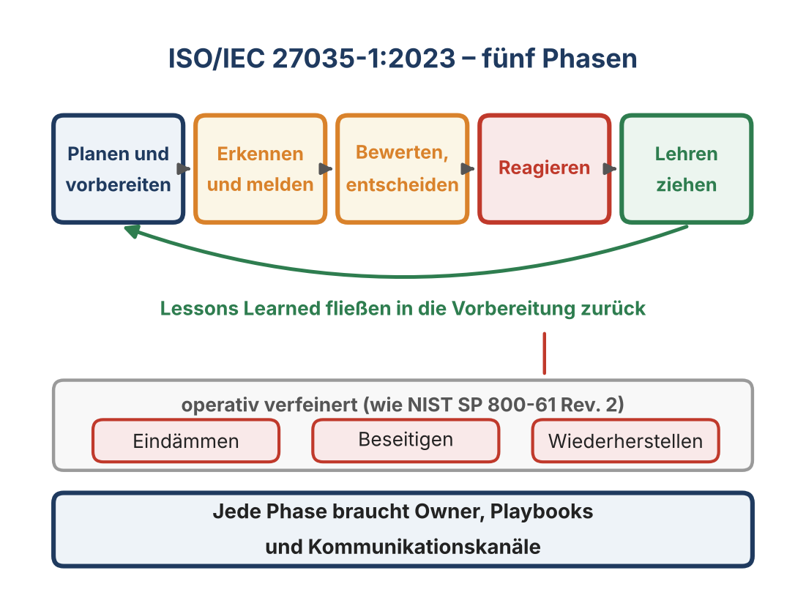{fig-alt="Fünf Phasen des Incident-Management-Prozesses nach ISO/IEC 27035-1:2023 mit Rückfluss der Lessons Learned"}
:::
:::

::: notes
Hausaufgabe aufgreifen: Rollenkarte für die ersten 60 Minuten eines Ransomware-Vorfalls. Zwei bis drei Karten zeigen lassen. Typisches Bild: Die Frage „Wer leitet?“ wird mit einem Namen beantwortet, nicht mit einer Rolle; „Wer darf abschalten?“ bleibt offen; die Kontaktliste liegt im Mailsystem. Genau diese Lücken füllen wir heute mit CISO, SOC, CERT und den weiteren Rollen.
:::

## Lernziele

Nach dieser Sitzung können Sie …

- die zentralen Rollen der Cyber-Resilienz unterscheiden: **CISO, SOC, CERT, DPO, BCM, IT Operations, Management**,
- erklären, warum ein CISO ein **Mandat** braucht – und was ohne Mandat oder bei Vertuschung passiert,
- Eskalationswege, **Meldepflichten** und externe Partner (BSI, CERTs, Polizei) einordnen,
- typische **Rollenkonflikte** erkennen und mit einer Governance-Matrix auflösen,
- die Rollen in einer **Übung** auf einen Vorfall anwenden.

::: notes
Lernziele aus dem Skript, ergänzt um Mandat, Haftung und externe Partner. Die Fälle sind neu: Target 2013, Uber 2016 mit SolarWinds als Gegenstück, Uniklinik Düsseldorf 2020, Hochschule Kaiserslautern 2023, MGM und Caesars 2023. Jeder Fall steht für eine Rolle – am Ende fügen wir sie zusammen.
:::

## Einstieg: Target 2013

::: columns
::: {.column width="56%"}
- Ab **27. November 2013:** Kassen-Malware in den US-Filialen, Zugang über Zugangsdaten eines Dienstleisters
- **30. November:** Das Überwachungsteam in Bangalore meldet einen Alarm an das SOC in Minneapolis – weitere am **2. Dezember**
- Keine Reaktion; am **12. Dezember** informiert das **US-Justizministerium** Target
- **40 Mio. Kartendaten**, bis zu **70 Mio.** weitere Kundendatensätze

**Frage:** Die Erkennung hat funktioniert. Woran ist Target gescheitert?
:::
::: {.column width="40%"}
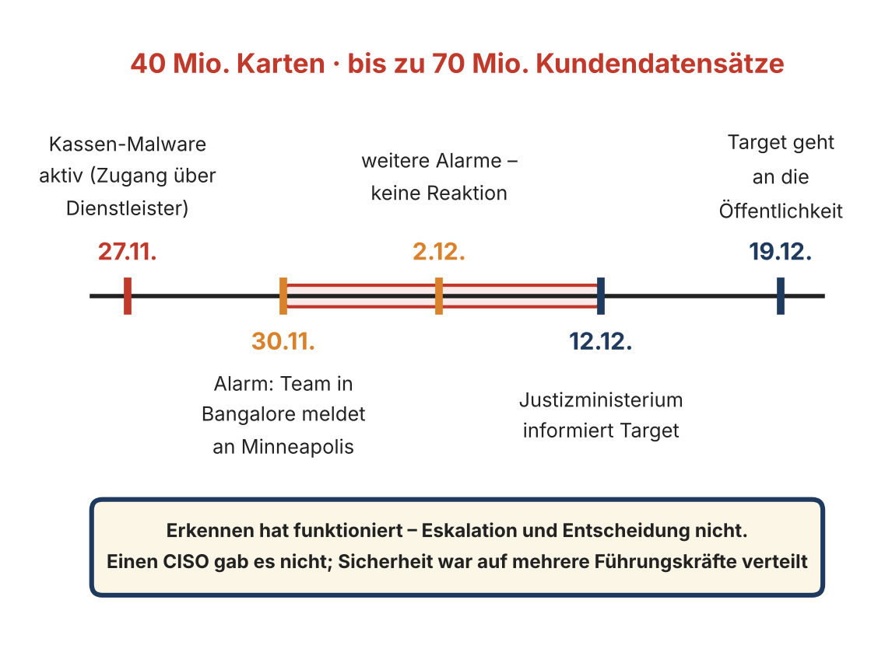{fig-alt="Zeitleiste Target 2013: 27.11. Malware aktiv, 30.11. Alarm aus Bangalore an Minneapolis, 2.12. weitere Alarme ohne Reaktion, 12.12. Justizministerium informiert Target, 19.12. Veröffentlichung"}
:::
:::

::: notes
Antwort: nicht an der Technik, sondern an Rollen und Eskalation. Der Senatsbericht (Kill-Chain-Analyse, März 2014) zählt mehrere verpasste Gelegenheiten auf; die automatische Löschfunktion des Erkennungswerkzeugs war abgeschaltet. Target hatte keinen CISO – Sicherheitsaufgaben waren auf mehrere Führungskräfte verteilt. Folgen 2014: Der CIO ging im März, der CEO im Mai; im Juni wurde erstmals ein CISO eingestellt. Fragen an das Plenum: Wer hätte am 30. November entscheiden müssen? Wer durfte das Kassennetz isolieren? Wir kommen am Ende darauf zurück.
:::

## Vom Individuum zur Organisation

::: columns
::: {.column width="56%"}
**Warum Rollen das Rückgrat der Resilienz sind**

- Technik kann reagieren – **Menschen entscheiden**.
- Eine Rolle beschreibt **Verantwortung, Befugnis und Schnittstellen**.
- Klare Rollen verhindern Chaos und Doppelarbeit – **Verantwortung ersetzt Schuld**.
- Ohne Struktur keine Geschwindigkeit.

**Beispiele:** Wer schaltet Systeme ab, wenn Malware erkannt wird? Wer informiert Behörden oder Kunden? Wer genehmigt öffentliche Kommunikation?
:::
::: {.column width="40%"}
{fig-alt="Motiv: Es ist nicht deine Schuld. Es ist deine Verantwortung."}
:::
:::

::: notes
Skript Kapitel 2: Rollen als Strukturprinzip, Verantwortung statt Schuld, Geschwindigkeit durch Struktur. Rückbezug Target: Der Alarm hatte keinen Eigentümer. Wer ihn gesehen hat, wusste nicht, ob er handeln durfte. Ein Incident-Response-Team mit trainierter Rollenlogik handelt in Minuten, wo andere erst diskutieren, wer die Freigabe erteilt.
:::

## Die Rolle des CISO

::: columns
::: {.column width="56%"}
- Strategische Verantwortung für **Informationssicherheit und Cyber-Resilienz**
- Steuert das **ISMS** (ISO/IEC 27001), koordiniert SOC und CERT
- Übersetzt Risiken in **Entscheidungsvorlagen** für die Geschäftsleitung
- Berichtet idealerweise **direkt an die Geschäftsleitung** – getrennt vom IT-Betrieb

**Mandatsdilemma:** Verantwortung ohne Befugnis und Ressourcen – *Accountability without Authority*
:::
::: {.column width="40%"}
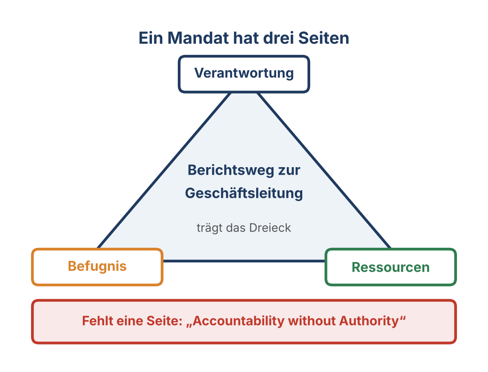{fig-alt="Dreieck mit den Ecken Verantwortung, Befugnis und Ressourcen, getragen vom Berichtsweg zur Geschäftsleitung; fehlt eine Seite, entsteht Accountability without Authority"}
:::
:::

::: notes
Skript Kapitel 3. Zitat aus dem Skript: „Ein CISO ohne Mandat ist wie ein Pilot ohne Steuerknüppel.“ Lösung laut Skript: strategische Verankerung, festes Budget und Reporting-Mandat, dokumentierte Eskalationsrechte. Target ist das Gegenbeispiel: Erst nach dem Vorfall wurde die Rolle geschaffen. Die heutige Erwartung an die Leitung kommt aus der Regulierung: Seit dem 6. Dezember 2025 verpflichtet § 38 BSIG die Geschäftsleitung wichtiger und besonders wichtiger Einrichtungen, Risikomanagementmaßnahmen zu billigen, ihre Umsetzung zu überwachen und an Schulungen teilzunehmen.
:::

## Fallbeispiel: Uber 2016

::: columns
::: {.column width="56%"}
- **November 2016:** Angreifer melden dem Sicherheitschef (CSO) einen Datendiebstahl – **57 Mio.** Nutzerdatensätze, **600.000** Führerscheinnummern
- Zahlung von **100.000 USD**, verbucht als **„Bug Bounty“**, gegen Schweigeerklärungen
- Gleichzeitig lief eine **FTC-Untersuchung** zu einem früheren Vorfall – keine Meldung
- **November 2017:** Die neue Unternehmensleitung deckt den Vorfall auf

**Oktober 2022:** Der CSO wird verurteilt – seit Juni 2026 rechtskräftig.
:::
::: {.column width="40%"}
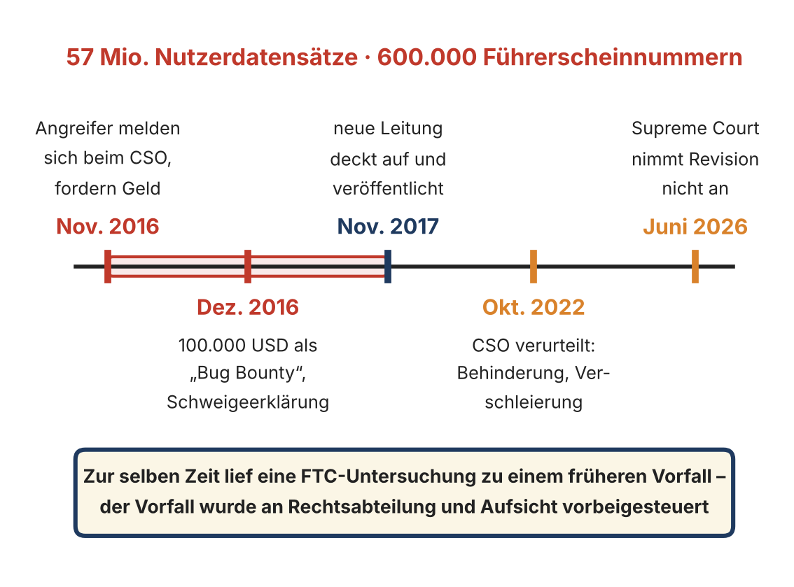{fig-alt="Zeitleiste Uber: November 2016 Angreifer melden sich, Dezember 2016 Zahlung als Bug Bounty, November 2017 Aufdeckung, Oktober 2022 Verurteilung, Juni 2026 Supreme Court nimmt Revision nicht an"}
:::
:::

::: notes
Verurteilung wegen Behinderung eines FTC-Verfahrens und Verschleierung einer Straftat (misprision of felony); Strafmaß im Mai 2023: drei Jahre Bewährung, 50.000 USD Geldstrafe, 200 Stunden gemeinnützige Arbeit. Die Staatsanwaltschaft hatte 15 Monate Haft gefordert. Bestätigt vom Ninth Circuit im März 2025; im Juni 2026 hat der Supreme Court die Revision nicht angenommen. Kernproblem für die Rollenlehre: Der Vorfall wurde innerhalb der Sicherheitsabteilung gehalten und an Rechtsabteilung, Datenschutz und Aufsicht vorbeigesteuert. Der Richter sah den damaligen CEO als mitverantwortlich; angeklagt wurde nur der CSO. Diskussion: Wer hätte in eurer Rollenkarte die Meldeentscheidung getroffen?
:::

## Fallbeispiel: SolarWinds und die SEC

::: columns
::: {.column width="56%"}
- **Oktober 2023:** Die US-Börsenaufsicht verklagt SolarWinds **und den CISO persönlich** – erstmals einen Sicherheitsverantwortlichen
- Vorwurf: öffentliche Sicherheitsaussagen passten nicht zu **internen Kenntnissen**
- **Juli 2024:** Gericht weist die meisten Vorwürfe ab
- **November 2025:** Verfahren eingestellt – ohne Schuldeingeständnis

**Gegenstück zu Uber: kein Vertuschen – aber die Frage, wer was intern wusste und weitergab.**
:::
::: {.column width="40%"}
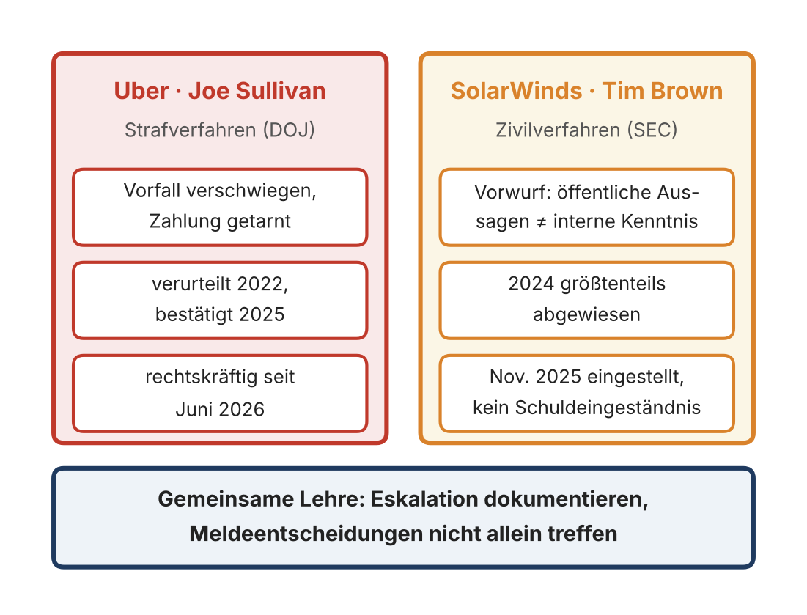{fig-alt="Vergleich: Uber, Strafverfahren gegen Joe Sullivan, verurteilt und rechtskräftig; SolarWinds, Zivilverfahren der SEC gegen Tim Brown, größtenteils abgewiesen und 2025 eingestellt; gemeinsame Lehre: Eskalation dokumentieren"}
:::
:::

::: notes
SolarWinds selbst kennen die Studierenden aus Sitzung 3 und 4 als Supply-Chain-Fall (Sunburst, 2020). Hier geht es um die Rolle: Die SEC warf dem CISO vor, Risiken gekannt, aber nicht ausreichend nach oben eskaliert zu haben. Das Gericht sah die meisten Vorwürfe als Rückschau-Argumentation. Lehre für die Praxis: Der CISO braucht einen dokumentierten Eskalationsweg; was er weiß, muss die Leitung erreichen, und was nach außen gesagt wird, muss zur internen Lage passen. Zum Vergleich: Börsennotierte US-Unternehmen müssen seit Ende 2023 wesentliche Cybervorfälle binnen vier Geschäftstagen melden.
:::

## Das Security Operations Center (SOC)

::: columns
::: {.column width="56%"}
**Zentrale Aufgaben**

- 24/7-Überwachung von Systemen und Netzwerken
- Erkennung und Analyse von Sicherheitsereignissen (Monitoring & SIEM)
- Eskalation an Incident-Response-Team / CERT
- Dokumentation, Reporting, Threat-Intelligence-Einbindung

**Organisation:** Schnittstellen zu IT Operations, CISO-Office, Datenschutz, Management
:::
::: {.column width="40%"}
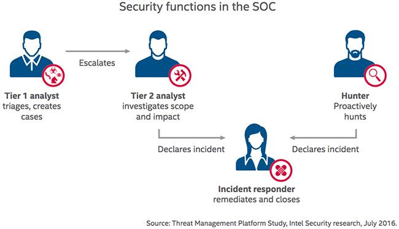{fig-alt="SOC-Funktionen: Tier-1- und Tier-2-Analyst, Hunter, Incident Responder"}
:::
:::

::: notes
Skript Kapitel 4: Das SOC als „sensorisches Nervensystem“. Rückbezug Target: Das Team in Bangalore hat genau diese Aufgaben erfüllt – erkannt, bewertet, eskaliert. Die Kette riss bei der Übergabe. Ein SOC ist nur so gut wie die Rolle, die seine Meldung annimmt.
:::

## SOC – Tier 1–3

Resilienz entsteht durch Funktionstrennung und Spezialisierung – nicht durch Mehrarbeit.

| Ebene | Bezeichnung | Aufgabe |
|---|---|---|
| Tier 1 | Monitoring / Analysis | erste Alarmbewertung, Triage, Eskalation |
| Tier 2 | Investigation | vertiefte Analyse, Kontext, Angriffsketten |
| Tier 3 | Response / Threat Hunting | Eindämmung, Forensik, proaktive Suche |

::: notes
Herausforderungen ansprechen: Alarm Fatigue, Personalmangel, Tool-Fragmentierung, unklare Übergaben. Antworten: SOAR, Playbooks, Risikopriorisierung, Training. Target-Bezug: Das Erkennungswerkzeug war neu, viele Alarme waren Rauschen – eine typische Erklärung für Alarm Fatigue. Sie entschuldigt aber nicht, dass ein Alarm höchster Stufe niemandem gehörte. Frage: Wer im Tier-Modell hätte bei Target eskalieren müssen – und an wen?
:::

## Das Computer Emergency Response Team (CERT)

::: columns
::: {.column width="56%"}
**Mandat:** Koordination der technischen Reaktion – Eindämmung, Forensik, Wiederanlauf, Lessons Learned

**SOC erkennt, CERT reagiert.**

- **Internal CERT:** eigene Organisation oder Konzern
- **National:** CERT-Bund beim BSI, mobile Einsatzteams
- **Land und Kommune:** z. B. kommunales CERT Rheinland-Pfalz
- **Sektoral und akademisch:** Branchen-CERTs, DFN-CERT
:::
::: {.column width="40%"}
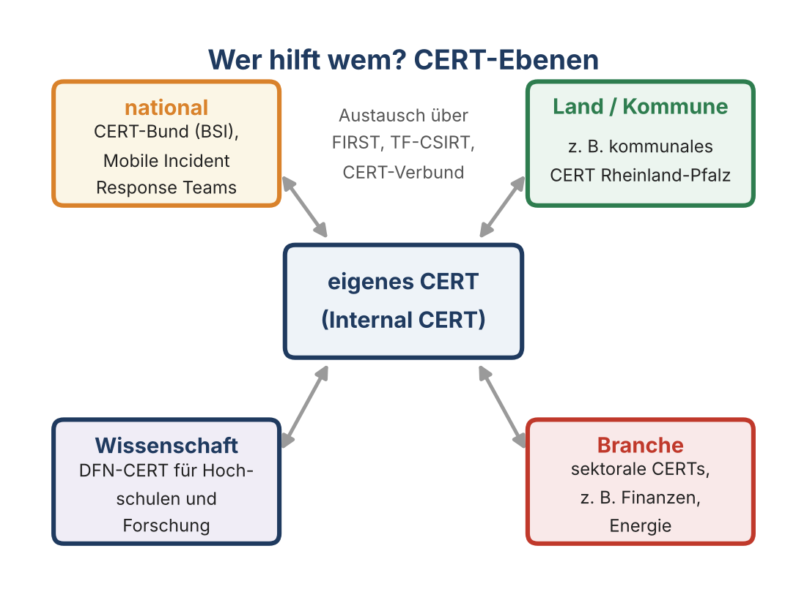{fig-alt="Eigenes CERT in der Mitte, verbunden mit nationaler Ebene (CERT-Bund, mobile Einsatzteams), Land und Kommune, Wissenschaft (DFN-CERT) und Branchen-CERTs; Austausch über FIRST, TF-CSIRT und CERT-Verbund"}
:::
:::

::: notes
Skript Kapitel 5. Die Begriffe CERT, CSIRT und Incident-Response-Team werden in der Praxis meist gleich verwendet. Wichtig ist die Vernetzung: Kein internes CERT bewältigt einen großen Vorfall allein. Das kommunale CERT Rheinland-Pfalz kennen wir aus dem Rhein-Pfalz-Kreis (Sitzung 5); das DFN-CERT war bei der Hochschule Kaiserslautern beteiligt – dazu gleich. Erst schauen wir, welche externen Rollen bei einem Krankenhaus zusammenkommen.
:::

## Fallbeispiel: Uniklinik Düsseldorf 2020

::: columns
::: {.column width="56%"}
- **10. September 2020:** Ransomware verschlüsselt **30 Server**; Einfallstor eine seit Januar bekannte **Citrix-Lücke**
- Das Klinikum meldet sich **13 Tage** von der Notfallversorgung ab
- **Meldung an das BSI** nach BSI-Gesetz, BSI unterstützt mit einem **mobilen Einsatzteam**
- Erpresserschreiben an die **Universität** gerichtet – nach Hinweis der **Polizei** geben die Täter den Schlüssel heraus

**Viele Rollen kommen von außen – sie müssen vorher bekannt sein.**
:::
::: {.column width="40%"}
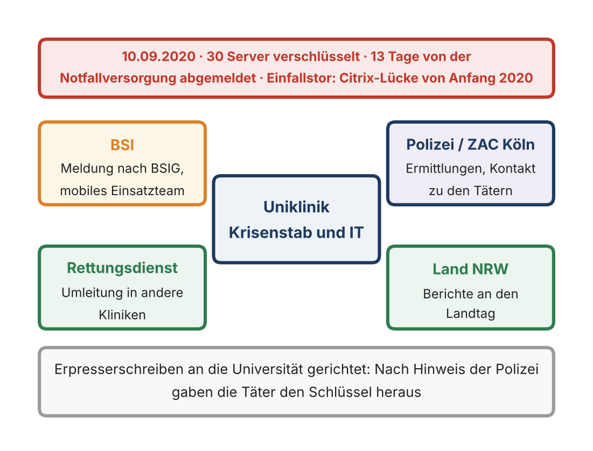{fig-alt="Uniklinik Düsseldorf in der Mitte, umgeben von BSI (Meldung, mobiles Einsatzteam), Polizei und Zentral- und Ansprechstelle Cybercrime Köln, Rettungsdienst und Land NRW"}
:::
:::

::: notes
Wichtige Richtigstellung: Eine Patientin, die nach Wuppertal umgeleitet wurde, starb. Die Staatsanwaltschaft ermittelte zunächst wegen fahrlässiger Tötung, stellte im November 2020 aber fest, dass die Verzögerung für den Tod nicht ursächlich war. Bitte nicht als „erster Todesfall durch Ransomware“ erzählen. Laut BSI wäre der Angriff verhinderbar gewesen. Nach Angaben der Ermittler war das Citrix-Update im Januar eingespielt – die Angreifer waren aber offenbar schon vorher eingedrungen. Ein Patch schließt die Tür, wirft aber niemanden hinaus. Rollen-Lehre: Wer meldet an das BSI? Wer spricht mit der Polizei? Wer meldet das Haus bei der Leitstelle ab? Alles Entscheidungen, die vorab einer Rolle zugeordnet sein müssen.
:::

## Zusammenspiel von CISO – SOC – CERT

::: columns
::: {.column width="56%"}
**Funktionale Trennung = Resilienz durch Arbeitsteilung**

- CISO → Richtlinien, Ressourcen, Reporting (strategisch)
- SOC → Erkennen, Bewerten, Eskalieren (operativ)
- CERT → Koordinieren, Reagieren, Lernen (taktisch)

**Zentrale Erfolgsfaktoren:** definierte Eskalationsschwellen · gemeinsames Lagebild (Single Source of Truth) · regelmäßige Lage- und Lessons-Learned-Meetings
:::
::: {.column width="40%"}
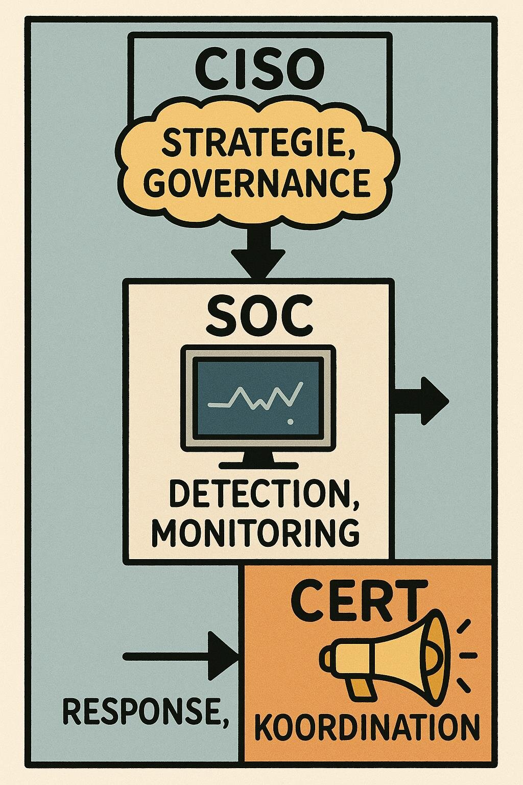{fig-alt="Pyramide: CISO Strategie, SOC Detection, CERT Response"}
:::
:::

::: notes
Skript Kapitel 6: „Trennung der Funktionen – Integration der Wirkung“. Die drei Fälle bis hierher passen auf die Pyramide: Target – Bruch zwischen SOC und Entscheidung; Uber – CISO-Ebene hält Wissen zurück; Düsseldorf – das CERT braucht externe Partner. Frage: An welcher Kante der Pyramide riss die Kette jeweils?
:::

## Weitere Schlüsselrollen in der Cyber-Organisation

Resilienz ist kein Produkt einzelner Spezialisten, sondern kollektive Verantwortlichkeit.

| Rolle | Kernaufgaben | Bezug zur Resilienz |
|---|---|---|
| DPO | Datenschutz, Prüfung der DSGVO-Meldung, Schnittstelle zur Aufsicht | schützt Vertrauen & Reputation |
| BCM Manager | Aufrechterhaltung kritischer Geschäftsprozesse | Recovery & Priorisierung |
| IT Operations Lead | Betrieb, Infrastruktur, Wiederherstellung | technische Umsetzung |
| Risk Manager | Risikoanalyse, Bewertung, Register | Früherkennung & Priorisierung |
| Management Board | Governance, Ressourcen, Risikoakzeptanz | strategische Steuerung |

::: notes
Skript Kapitel 7. Merksatz aus dem Skript: „Das CERT schützt Systeme – das BCM schützt den Zweck.“ Zum DPO: Er berät und prüft; die Meldung nach Art. 33 DSGVO ist Pflicht des Verantwortlichen, also der Organisation. Uber-Bezug: Hätte der Datenschutz von dem Vorfall gewusst, wäre die Meldefrage auf den Tisch gekommen.
:::

## Fallbeispiel: Hochschule Kaiserslautern 2023

::: columns
::: {.column width="56%"}
- **8. Juni 2023:** Angriff auf die gesamte IT – die Hochschule **schaltet früh ab**, bildet einen **Krisenstab** und informiert das LKA
- Austausch mit **BSI, DFN-CERT**, VCRP, ZIT und den Rechenzentren in Mainz und Kaiserslautern
- Juli: erbeutete Daten im Darknet veröffentlicht
- **Januar 2025:** Landesstrategie aller **12 Hochschulen** mit dem Wissenschaftsministerium – **Informationssicherheitsbeauftragte** an jeder Hochschule, direkt beim Präsidium

**Aus dem Vorfall wird eine Rolle.**
:::
::: {.column width="40%"}
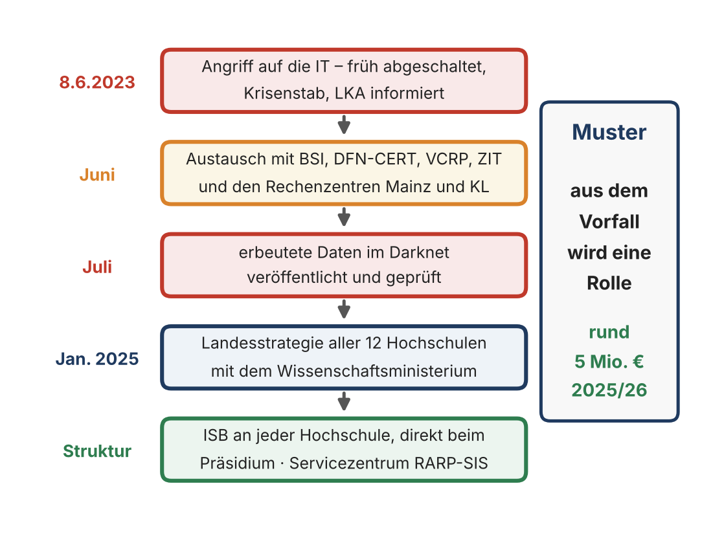{fig-alt="Ablauf Hochschule Kaiserslautern: Angriff am 8.6.2023 und frühe Abschaltung, Austausch mit BSI und DFN-CERT, Daten im Darknet, Landesstrategie Januar 2025, Informationssicherheitsbeauftragte und Servicezentrum RARP-SIS"}
:::
:::

::: notes
Regionaler Fall. Präsident Schmidt im Rückblick: früh abgeschaltet, den Stecker gezogen; bis zum Normalbetrieb dauerte es einige Wochen. Die Landesstrategie sieht außerdem ein Servicezentrum Informationssicherheit (RARP-SIS) an der RPTU vor; das Land stellt dafür dauerhaft vier Stellen bereit und im Doppelhaushalt 2025/26 insgesamt rund fünf Millionen Euro. Bemerkenswert: Hochschulen fallen nicht unter NIS-2 und sind keine KRITIS – die Rollen entstehen hier aus Einsicht, nicht aus Pflicht. Die Verantwortung bleibt bei der jeweiligen Hochschule. Zur Hochschule Mainz nur Bekanntes aus Sitzung 4, keine weiteren Details.
:::

## Kommunikations- und Eskalationsmodell

::: columns
::: {.column width="50%"}
- **Single Source of Truth:** ein gemeinsames Lagebild
- **Time to Inform:** Informationspflicht in definierten Fristen
- **Bidirektionalität:** Rückmeldungen fließen ins Lagebild
- **Vorab definierte Kanäle** (z. B. Teams-Crisis-Channel) und **Offline-Fallback**
- **Eskalationsschwellen** schriftlich: ab wann CISO, ab wann Geschäftsleitung
:::
::: {.column width="46%"}
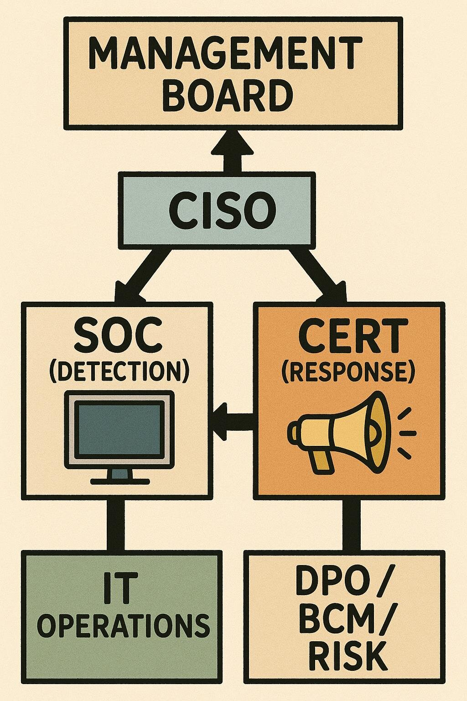{fig-alt="Eskalationsmodell: Management Board, CISO, SOC, CERT, IT Operations, DPO/BCM/Risk"}
:::
:::

::: notes
Skript Kapitel 8. „Cyber-Resilienz ohne Kommunikationsresilienz bleibt Illusion.“ Target zeigt fehlende Eskalationsschwellen, Uber eine Eskalation, die bewusst gestoppt wurde. Rückbezug Atlassian (Sitzung 5): Kontaktlisten außerhalb der betroffenen Systeme.
:::

## Meldepflichten

::: columns
::: {.column width="52%"}
- **§ 32 BSIG** (seit 6.12.2025): erhebliche Sicherheitsvorfälle – Frühwarnung **24 h**, Meldung **72 h**, Abschlussbericht nach **einem Monat**
- **Art. 33 DSGVO:** Datenschutzverletzung binnen **72 h** an die Aufsichtsbehörde
- **Technischer Vorfall ohne Meldepflicht:** trotzdem dokumentieren
- **Betriebsunterbrechung:** BCM-relevant, Eskalation nach BIA

**Nicht jeder Incident ist meldepflichtig – aber jeder muss dokumentiert werden.**
:::
::: {.column width="44%"}
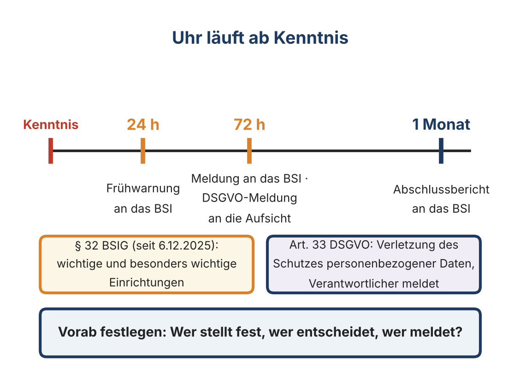{fig-alt="Zeitstrahl ab Kenntnis: nach 24 Stunden Frühwarnung an das BSI, nach 72 Stunden Meldung an das BSI und DSGVO-Meldung an die Aufsicht, nach einem Monat Abschlussbericht; vorab festlegen, wer feststellt, entscheidet und meldet"}
:::
:::

::: notes
Die Archivfolie nannte § 8b BSIG (alt). Seit dem Inkrafttreten des NIS-2-Umsetzungsgesetzes am 6. Dezember 2025 ist das BSIG neu gefasst; die Meldepflichten stehen in § 32 und gelten für wichtige und besonders wichtige Einrichtungen. Zuständigkeiten aus dem Skript: technischer Vorfall – CERT und CISO; Datenschutzvorfall – DPO berät, Verantwortlicher meldet; NIS-2-Vorfall – CISO und Management; Betriebsunterbrechung – BCM-Manager. Düsseldorf-Bezug: Die Meldung an das BSI erfolgte nach altem Recht als KRITIS-Betreiber. Frage: Wer zählt bei euch die 24 Stunden – und ab welchem Zeitpunkt?
:::

## Fallbeispiel: MGM und Caesars 2023

::: columns
::: {.column width="56%"}
- **September 2023:** dieselbe Angreifergruppe trifft zwei Casino-Konzerne in Las Vegas – Einstieg über **Social Engineering beim IT-Support**
- **Caesars:** Kundendatenbank kopiert, Betrieb ungestört; laut Medien rund **15 Mio. USD** gezahlt, damit die Daten gelöscht werden
- **MGM:** zahlt nicht, schaltet Systeme ab – rund **10 Tage** Störung, rund **100 Mio. USD** weniger Ergebnis

**Zahlen oder nicht ist keine Technikfrage, sondern eine Entscheidung der Leitung.**
:::
::: {.column width="40%"}
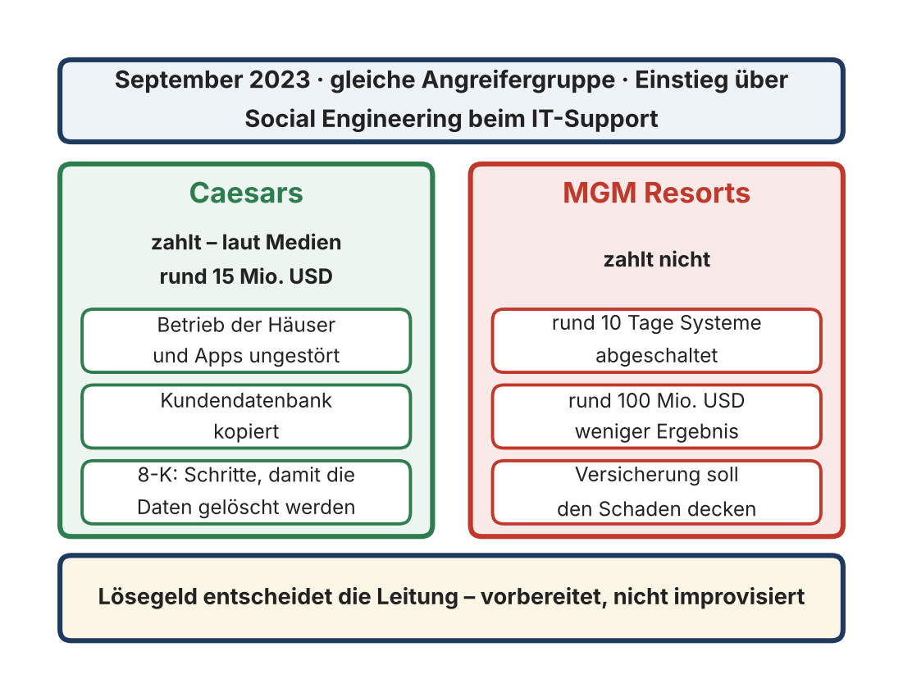{fig-alt="Gegenüberstellung: Caesars zahlt laut Medien rund 15 Millionen US-Dollar, Betrieb ungestört, Datenbank kopiert; MGM zahlt nicht, rund zehn Tage Systeme abgeschaltet, rund 100 Millionen US-Dollar weniger Ergebnis, Versicherung soll den Schaden decken"}
:::
:::

::: notes
Quellen: Pflichtmitteilungen an die SEC (Form 8-K). Caesars nennt einen Social-Engineering-Angriff auf einen ausgelagerten IT-Support-Dienstleister und schreibt, man habe Schritte unternommen, damit die Daten gelöscht werden; die Summe von rund 15 Mio. USD stammt aus WSJ und Bloomberg. MGM beziffert die Auswirkung auf rund 100 Mio. USD bereinigtes EBITDAR plus unter 10 Mio. USD Einmalkosten. Diskussion ohne Wertung „richtig oder falsch“: Wer hat bei euch das Mandat für diese Entscheidung, welche Informationen braucht es (Backups, Versicherung, Recht, Sanktionslisten), und wer bereitet sie vor? Helpdesk-Bezug: Der IT-Support ist eine Sicherheitsrolle – Identitätsprüfung bei Passwort- und MFA-Resets.
:::

## Kooperation und Grenzen der Rollen

Typische Konfliktlinien und Lösungsprinzipien:

| Konflikt | Ursache | Resiliente Lösung |
|---|---|---|
| CISO vs. CIO | Security vs. Verfügbarkeit | klare Zieltrennung, gemeinsame KPIs |
| SOC vs. IT Ops | „Wer darf eingreifen?“ | Runbooks & Eskalationskriterien |
| CERT vs. PR | Kommunikationsfreigabe | vorab definierte Kommunikationsmatrix |
| BCM vs. Security | Prioritätenunterschiede | Business-Impact-Analysen abstimmen |
| DPO vs. Incident Team | Datenschutzmeldungen | Abstimmung mit Legal-Team & CISO |

::: notes
Skript Kapitel 9: Konflikte sind unvermeidlich – entscheidend ist, dass sie vorher geklärt sind. Fallbezug: SOC vs. IT Ops – Hochschule Kaiserslautern hat früh abgeschaltet, weil das Mandat klar war; MGM ebenso. CERT vs. PR – Uber hat Kommunikation unterdrückt. Frage: Welche dieser Konfliktlinien kennt ihr aus eurem Arbeitsumfeld?
:::

## Governance-Matrix (Beispiel)

Verantwortung ersetzt Diskussion.

| Entscheidungsfeld | Primär | Stellvertretend | Information |
|---|---|---|---|
| Isolierung eines Systems | CERT | IT Ops | CISO |
| Externe Kommunikation | Management | PR | CISO, DPO |
| Behördenmeldung | DPO / CISO | CISO / DPO | Management |
| Lösegeldfrage | Management | – | CISO, Legal |
| Wiederanlaufentscheidung | BCM | CERT | Management |
| Lessons Learned | CISO | CERT | alle Bereiche |

::: notes
Matrix aus dem Skript, ergänzt um die Lösegeldfrage (MGM und Caesars). Behördenmeldung: Datenschutzmeldung liegt beim DPO als Berater des Verantwortlichen, die BSI-Meldung beim CISO – beide informieren die Geschäftsleitung, die nach § 38 BSIG die Überwachung verantwortet. Die Matrix ist eine vereinfachte RACI-Logik. Wichtig ist die Spalte „Stellvertretend“: Rollen statt Personen.
:::

## Best Practices & Standards

Rahmenwerke und Leitlinien für Rollenmodelle in der Cyber-Organisation:

| Standard / Leitlinie | Relevanz |
|---|---|
| ISO/IEC 27001 | Rollen und Verantwortlichkeiten im ISMS |
| ISO/IEC 27035 | Incident-Management-Prozess und Eskalationspfade |
| ISO 22320 | Krisenmanagement und Führungsstrukturen in Notlagen |
| ISO 22316 | Grundprinzipien organisationaler Resilienz |
| BSI-Standard 200-4 | Business Continuity Management |
| NIS-2-Richtlinie (EU) 2022/2555 | Verantwortung der Leitung, Meldepflichten |
| BSIG (Fassung NIS2UmsuCG) | § 32 Meldepflichten, § 38 Pflichten der Geschäftsleitung |

::: notes
Die Archivfolie nannte außerdem einen „ENISA Good Practice Guide“ zur SOC/CERT-Zusammenarbeit; Titel und Jahr sind ungeprüft (Quellen, Hinweis 10), daher hier nicht aufgeführt. NIST SP 800-61 Rev. 3 (2025) ist die US-Referenz für Incident Response und Rollen.
:::

## Übung: Wer macht was im Incident?

**Szenario:** Phishing führt zu kompromittierten Admin-Zugangsdaten; das SOC sieht verdächtige Logins. Gruppen zu 4–5 Personen, 20 Minuten.

1. Wer wird zuerst informiert?
2. Wer entscheidet über die Systemtrennung?
3. Wer kommuniziert intern / extern?
4. Wer bewertet rechtliche Meldepflichten – und wer zählt die Stunden?
5. Wer dokumentiert und berichtet an das Management?

**Ziel:** Rollen abgrenzen → Kollisionspunkte erkennen → gemeinsame Eskalationslogik entwickeln.

::: notes
Skript-Variante: Montag 08:47 Uhr, E-Mail „Überweisungserlaubnis“ im Finanzbereich, Management will Bericht, DPO fragt nach Meldepflicht, Presse hat Gerüchte. 20 Minuten Gruppenarbeit, 10–15 Minuten Plenum. Ergebnis: Kommunikationsmodell mit Pfeilen und Eskalationszeitplan. Spickzettel aus den Fällen: Wem gehört der Alarm (Target)? Wer darf den Vorfall nicht verschweigen (Uber)? Welche externen Partner ruft ihr an (Düsseldorf)? Merksatz: Klarheit schafft Geschwindigkeit – und Geschwindigkeit schafft Resilienz.
:::

## Was die Fälle zeigen

| Fall | Rolle | Lehre |
|---|---|---|
| Target 2013 | SOC → Entscheidung | Ein Alarm braucht einen Eigentümer und eine Eskalationsschwelle |
| Uber 2016 | CISO | Meldeentscheidungen gehören nicht in eine Hand |
| SolarWinds 2023–2025 | CISO | Eskalation dokumentieren, außen sagen, was innen gilt |
| Uniklinik Düsseldorf 2020 | CERT, externe Partner | BSI, Polizei, Leitstelle – vorher bekannt |
| HS Kaiserslautern 2023 | Rollenaufbau | Aus dem Vorfall wird eine Rolle (ISB beim Präsidium) |
| MGM / Caesars 2023 | Management Board | Lösegeld ist Leitungsentscheidung – vorbereitet |

::: notes
Tabelle gemeinsam füllen: Spalte „Rolle“ abdecken und zuordnen lassen. Mehrere Zuordnungen sind vertretbar – Target ist auch ein CISO-Fall (die Rolle fehlte), MGM auch ein Helpdesk-Fall. Gefragt ist die Begründung.
:::

## Kernpunkte

- Rollen sind das **organisatorische Immunsystem** – Erkennen allein reicht nicht (Target).
- Der CISO braucht ein **Mandat und einen Berichtsweg**; Vertuschen endet persönlich (Uber, SolarWinds).
- **SOC erkennt, CERT reagiert** – mit externen Partnern, die vorher bekannt sind (Uniklinik Düsseldorf).
- Rollen entstehen oft erst nach dem Vorfall – **besser vorher** (Hochschule Kaiserslautern).
- Meldepflichten laufen ab Kenntnis; **Leitungsentscheidungen** gehören vorbereitet (MGM, Caesars).

::: notes
Kernpunkte aus der Zusammenfassung des Skripts, ergänzt um die Fälle. Merksatz: „Rollen sind das organisatorische Immunsystem der Cyber-Resilienz.“
:::

## Ausblick & Hausaufgabe

**Nächste Sitzung:** Technische Resilienz I – Backup, Disaster Recovery, Notfalltests

**Hausaufgabe:** Ergänzen Sie Ihre Rollenkarte aus Sitzung 5 um zwei Zeilen: **Wer darf einen Restore aus dem Backup freigeben** – und **wann wurde zuletzt ein Restore getestet**? Finden Sie für Ihre Organisation heraus, ob es darauf eine Antwort gibt.

[Kapitel zum Termin](../../../termine/06.html) · [Skript](../../../skripte/Skript-06.html) · [Glossar](../../../glossar.html) · [Quellen](../../../quellen.html)

::: notes
Teaser Sitzung 7: Heute ging es darum, wer entscheidet. Nächstes Mal geht es um das, worüber entschieden wird – Backups, Wiederanlauf und Tests. Rückbezug Maersk aus Sitzung 1: Eine einzige saubere Kopie hat den Neustart ermöglicht. Ob es sie gibt, ist eine technische Frage; wer sie freigibt, eine Rollenfrage.
:::
