## Agenda

- Rückblick & Lernziele
- Einstieg: CloudNordic 2023 – alle Backups verschlüsselt
- Warum Backups · Backup vs. Archiv vs. Redundanz (Universität Kyoto)
- 3-2-1-1-0 · Backup-Typen · Architekturen (UniSuper)
- Air-Gap, Immutable, Zero-Trust-Backup
- Disaster Recovery · RPO und RTO (British Library)
- DR-Strategien · Wiederanlaufreihenfolge (Universität Gießen)
- Notfalltests & Chaos Engineering (Delta Air Lines)
- Übung · Kernpunkte & Ausblick

## Rückblick Sitzung 6

::: columns
::: {.column width="56%"}
- Rollen: **CISO, SOC, CERT, DPO, BCM, IT Operations, Management**
- Ein Alarm braucht einen **Eigentümer** (Target), ein CISO ein **Mandat** (Uber, SolarWinds)
- **Meldefristen** laufen ab Kenntnis – 24 h, 72 h, ein Monat
- Leitungsentscheidungen wie die **Lösegeldfrage** gehören vorbereitet (MGM, Caesars)

**Heute: Worüber wird entschieden – gibt es eine saubere Kopie, und funktioniert der Weg zurück?**
:::
::: {.column width="40%"}
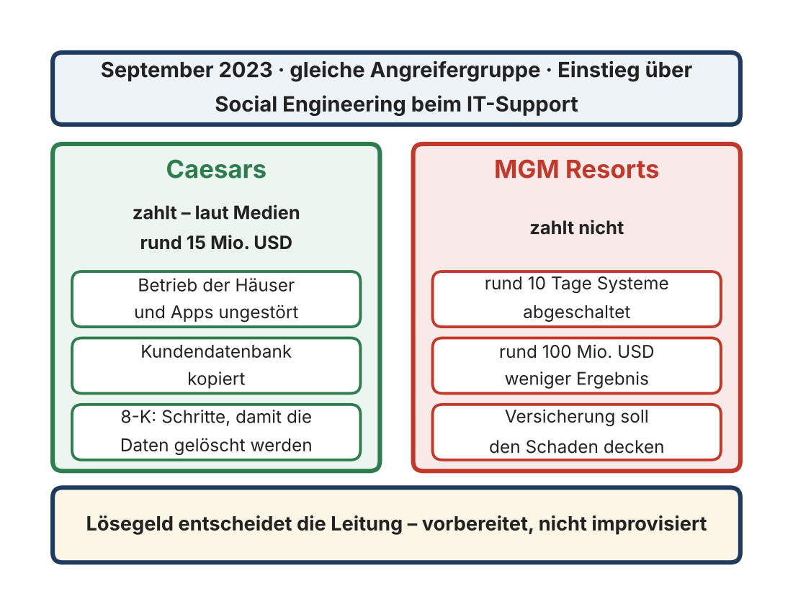{fig-alt="Gegenüberstellung Caesars und MGM 2023: zwei Leitungsentscheidungen zur Lösegeldfrage"}
:::
:::

::: notes
Hausaufgabe aufgreifen: zwei Zeilen in der Rollenkarte – wer darf einen Restore freigeben, wann wurde zuletzt ein Restore getestet? Zwei bis drei Antworten hören. Typisches Bild: „Ein Backup gibt es“ kommt schnell; wer die Rückspielung freigibt und ob sie je geprobt wurde, bleibt offen. Brücke: Bei MGM und Caesars hing die Lösegeldentscheidung am Zustand der Backups. Genau diesen Zustand untersuchen wir heute.
:::

## Lernziele

::: columns
::: {.column width="56%"}
Nach dieser Sitzung können Sie …

- erklären, warum technische Resilienz mehr ist als **„ein Backup haben“**,
- **Backup, Archiv und Redundanz** unterscheiden,
- die **3-2-1-1-0-Regel** anwenden und Backups gegen Angreifer isolieren,
- **RPO und RTO** festlegen und DR-Strategien vergleichen,
- eine **Wiederanlaufreihenfolge** aus Abhängigkeiten ableiten,
- **Notfalltests** planen und bewerten.
:::
::: {.column width="40%"}
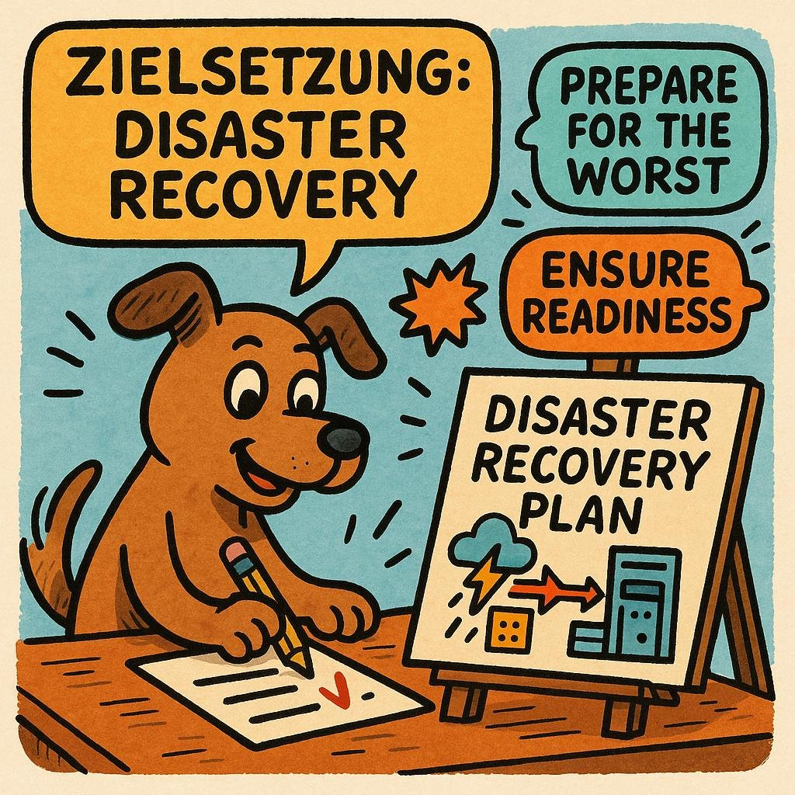{fig-alt="Comic-Hund plant Disaster Recovery: Prepare for the worst"}
:::
:::

::: notes
Lernziele aus dem Skript, ergänzt um Isolation und Wiederanlaufreihenfolge. Leitfrage der Sitzung: Wie stellen wir sicher, dass wir Systeme und Daten auch unter Worst-Case-Bedingungen zuverlässig wiederherstellen können? Die Fälle sind neu: CloudNordic 2023, Universität Kyoto 2021, UniSuper 2024, British Library 2023, Universität Gießen 2019, Delta Air Lines 2016. Drei Säulen: Backup, Disaster Recovery, Tests – zu jeder Säule zwei Fälle.
:::

## Einstieg: CloudNordic 2023

::: columns
::: {.column width="56%"}
- **18. August 2023, 4 Uhr:** Ransomware legt die dänischen Hoster **CloudNordic und AzeroCloud** vollständig lahm
- Verschlüsselt: alle Serverplatten – **und das primäre und das sekundäre Backup**
- Der Anbieter zahlt **kein Lösegeld** und kann kaum etwas wiederherstellen
- Die **meisten Kunden verlieren alle Daten**, die dort lagen

**Frage:** Es gab zwei Backup-Ebenen. Warum hat keine geholfen?
:::
::: {.column width="40%"}
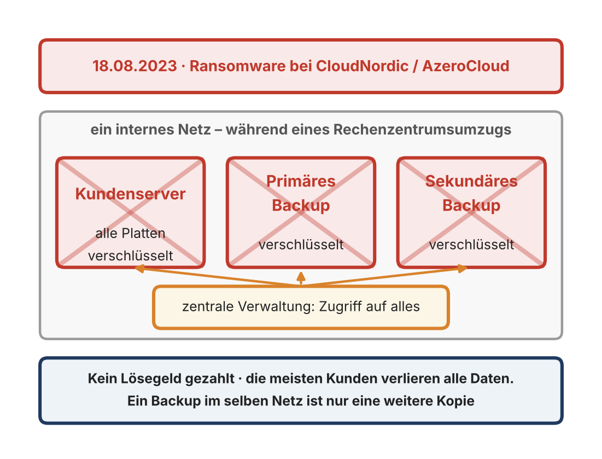{fig-alt="CloudNordic 2023: Kundenserver, primäres und sekundäres Backup liegen in einem internen Netz und werden über die zentrale Verwaltung alle verschlüsselt"}
:::
:::

::: notes
Antwort: Alle drei Ebenen waren aus demselben Netz und über dieselbe Verwaltung erreichbar. Nach Darstellung des Anbieters geschah der Angriff während eines Umzugs in ein anderes Rechenzentrum: Bereits infizierte Server wurden dabei an das interne Netz angeschlossen, über das auch die zentrale Verwaltung und die Backup-Systeme liefen. Hinweise auf einen Datenabfluss gab es laut Anbieter nicht. Dänische Medien berichteten von mehreren hundert betroffenen Unternehmen. Fragen an das Plenum: Welche Ziffer der 3-2-1-1-0-Regel fehlte? Was hätte ein Kunde selbst tun können? Wir kommen bei „Shared Responsibility“ darauf zurück.
:::

## Warum Backups unverzichtbar sind

::: columns
::: {.column width="56%"}
- **Ransomware** – greift gezielt Backup-Repositories, Snapshots und Backup-Admins an
- **Insider-Angriffe**
- **Hardware-Ausfälle**
- **Menschliche Fehler** und Softwarefehler

Backups sind die letzte Verteidigungslinie – sie müssen **manipulationssicher, isoliert und wiederherstellbar** sein.
:::
::: {.column width="40%"}
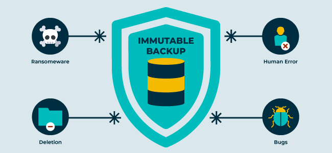{fig-alt="Schild Immutable Backup gegen Ransomware, Löschung, Fehler und Bugs"}
:::
:::

::: notes
Skript Kapitel 2. Die drei Eigenschaften sind der rote Faden: manipulationssicher (Immutable), isoliert (Air-Gap, eigene Konten), wiederherstellbar (getestet). CloudNordic verfehlte die zweite. Die Liste der Ursachen ist bewusst breiter als Ransomware: Der nächste Fall kommt ganz ohne Angreifer aus.
:::

## Backup vs. Archiv vs. Redundanz

::: columns
::: {.column width="56%"}
- **Backup = Wiederherstellung** vergangener Zustände
- **Archiv = Langzeit**-Aufbewahrung und Compliance (WORM)
- **Redundanz = Hochverfügbarkeit** im laufenden Betrieb

Redundanz löst keine logischen Probleme – sie spiegelt Fehler oft nur schneller.

„Wir haben RAID, also haben wir Backups.“ · „Snapshots sind doch Backups.“ – beides falsch.
:::
::: {.column width="40%"}
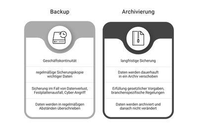{fig-alt="Gegenüberstellung Backup und Archivierung"}
:::
:::

::: notes
Skript Kapitel 3. Merksatz: Backups sichern Daten, Archive sichern Dokumentation, Redundanz sichert Verfügbarkeit. Weitere Missverständnisse aus dem Skript: „Wir archivieren alles, das reicht.“ – „Unsere Cloud repliziert automatisch alles.“ Der letzte Satz ist die Überleitung zu UniSuper weiter hinten. Kontrollfrage: Jemand löscht versehentlich eine Tabelle. Welche der drei Maßnahmen hilft? Nur das Backup – die Redundanz hat die Löschung längst gespiegelt.
:::

## Fallbeispiel: Universität Kyoto 2021

::: columns
::: {.column width="56%"}
- **14.–16. Dezember 2021:** Das **Backup-Programm** des Supercomputers löscht Dateien im Speichersystem /LARGE0
- Auslöser: Der Hersteller ändert ein Skript, **während es läuft**
- Rund **77 TB**, rund 34 Mio. Dateien von **14 Forschungsgruppen**
- **Vier Gruppen** haben kein weiteres Backup – ihre Daten sind endgültig verloren

**Kein Angreifer – das Backup-System selbst war die Ursache.**
:::
::: {.column width="40%"}
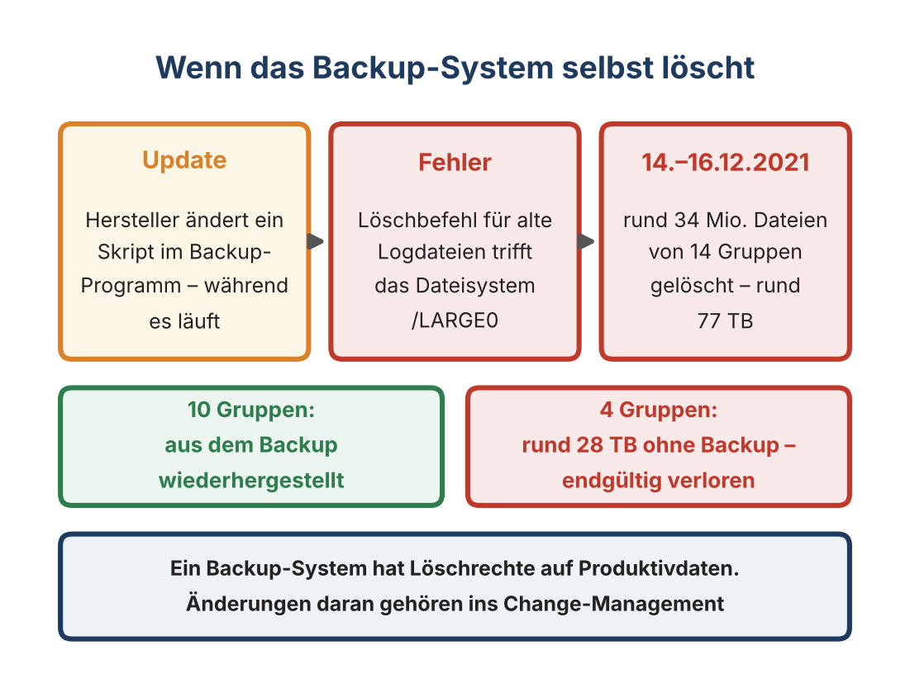{fig-alt="Universität Kyoto 2021: Update des Backup-Skripts, fehlerhafter Löschbefehl, 34 Millionen Dateien von 14 Gruppen gelöscht; zehn Gruppen aus dem Backup wiederhergestellt, vier Gruppen mit 28 Terabyte ohne Backup"}
:::
:::

::: notes
Das Skript sollte Logdateien löschen, die älter als zehn Tage waren. Weil es während der Ausführung überschrieben wurde, lief der Löschbefehl fehlerhaft und traf Nutzdaten. Der Hersteller (HPE Japan) übernahm in einem von der Universität veröffentlichten Schreiben die volle Verantwortung. Zwei Lehren: Erstens hat ein Backup-System weitreichende Rechte auf Produktivdaten – Änderungen daran brauchen dasselbe Change-Management wie jede andere Änderung. Zweitens: Für rund 28 TB gab es nur diese eine Sicherungsebene; „3“ Kopien waren es nicht. Die Universität setzte den Backup-Lauf aus; er sollte nach Korrektur und mit Schutzmaßnahmen Ende Januar 2022 wieder anlaufen.
:::

## 3-2-1-1-0-Regel

::: columns
::: {.column width="56%"}
- **3** Kopien
- **2** Medientypen
- **1** Offsite
- **+1** Immutable / Air-Gap
- **+0** fehlerfreier Restore

Ein Backup ist nur dann ein Backup, wenn der Restore erfolgreich getestet wurde.
:::
::: {.column width="40%"}
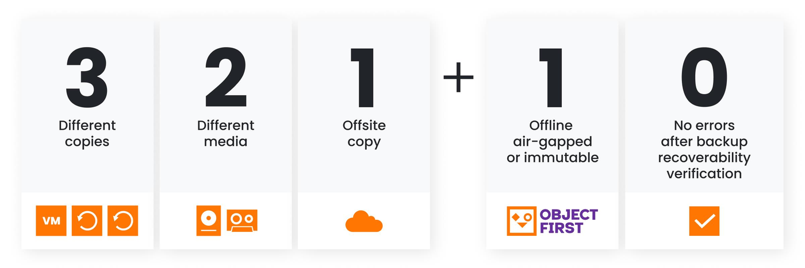{fig-alt="Grafik der 3-2-1-1-0-Regel"}
:::
:::

::: notes
Skript Kapitel 4. Die klassische 3-2-1-Regel schützt gegen lokale Katastrophen und Storage-Ausfälle. Die beiden Zusätze reagieren auf Angreifer, die Backups gezielt zerstören. Die Fälle zuordnen lassen: Kyoto – die „3“ fehlte für vier Gruppen. CloudNordic – formal drei Kopien, aber weder „1“ (Offsite im Sinne von getrennt) noch „+1“. Wichtig: „Offsite“ meint nicht nur einen anderen Ort, sondern eine andere Schadensdomäne.
:::

## Backup-Typen

::: columns
::: {.column width="56%"}
- **Vollbackup** – vollständig, schneller Restore, hoher Speicherbedarf
- **Inkrementell** – Änderungen seit dem letzten Backup; schnell, aber Restore braucht die ganze Kette
- **Differenziell** – Änderungen seit dem letzten Vollbackup; wächst mit der Zeit
- **Snapshots ≠ Backups** – hängen am Storage und sind bei dessen Schaden mitbetroffen

Robuste Strategien kombinieren risikobasiert.
:::
::: {.column width="40%"}
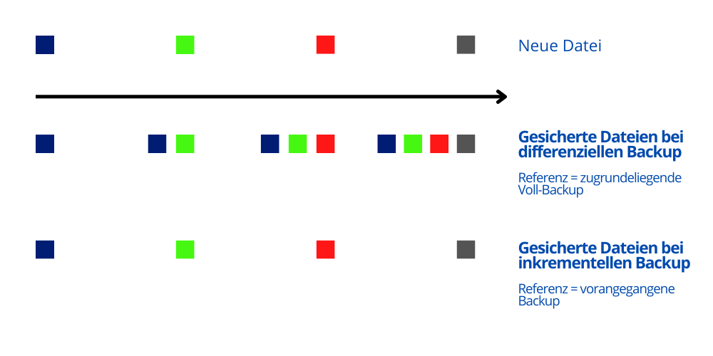{fig-alt="Zeitstrahl von Voll-, differenziellen und inkrementellen Backups"}
:::
:::

::: notes
Skript Kapitel 5. Beispielkombination aus dem Skript: wöchentliches Vollbackup, tägliches differenzielles Backup, inkrementelle Sicherungen alle zwei Stunden, Snapshots vor kritischen Updates, monatliche Archive, eine unveränderbare Offsite-Kopie. Der Backup-Typ bestimmt das erreichbare RPO (Abstand der Sicherungen) und beeinflusst die RTO (Länge der Kette). Darauf kommen wir bei RPO und RTO zurück.
:::

## Backup-Architekturen

::: columns
::: {.column width="56%"}
- **On-Prem** – volle Kontrolle, geringe Latenz; physische Risiken treffen alles zugleich
- **Cloud** – geografische Verteilung, einfache Offsite-Kopie; Anbieterabhängigkeit, Egress-Kosten, Shared Responsibility
- **Hybrid** – schneller lokaler Restore plus Cloud-Offsite; höhere Komplexität

Die Architektur passt zum Risiko – nicht umgekehrt.
:::
::: {.column width="40%"}
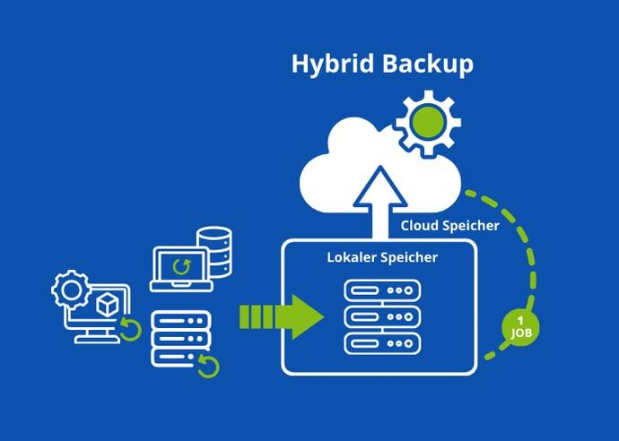{fig-alt="Hybrid-Backup: lokaler Speicher und Cloud-Speicher"}
:::
:::

::: notes
Skript Kapitel 6. Shared Responsibility: Der Cloud-Anbieter sichert die Infrastruktur; Daten, Konfigurationen und Zugänge sichert der Kunde. Rückbezug CloudNordic: Die Kunden hatten ihre Datensicherung dem Hoster überlassen. Wer eine eigene Kopie außerhalb hatte, konnte weiterarbeiten. Der nächste Fall zeigt die positive Seite.
:::

## Fallbeispiel: UniSuper 2024

::: columns
::: {.column width="56%"}
- **2. Mai 2024:** Google Cloud löscht versehentlich die **Private Cloud** des australischen Pensionsfonds UniSuper
- Ursache: ein **leer gelassener Parameter** bei der Einrichtung 2023 – Laufzeit ein Jahr, dann automatische Löschung
- Die Löschung trifft **beide Standorte** der georedundanten Umgebung
- UniSuper hatte **Backups bei einem weiteren Anbieter** – rund zwei Wochen bis zur vollen Wiederherstellung

**Georedundanz ist Redundanz, kein Backup.**
:::
::: {.column width="40%"}
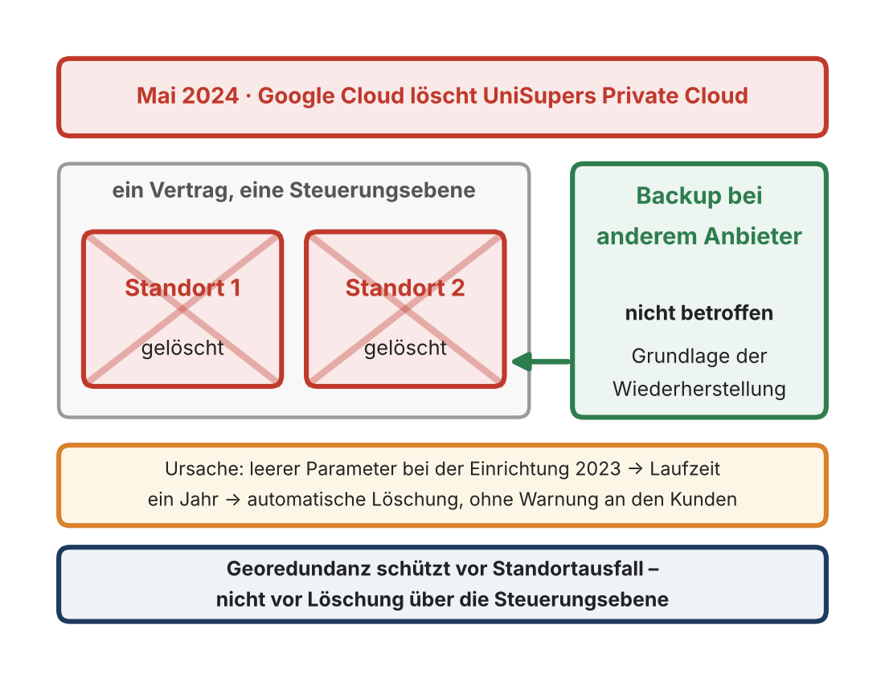{fig-alt="UniSuper 2024: zwei Standorte unter einem Vertrag und einer Steuerungsebene werden gelöscht; das Backup bei einem anderen Anbieter ist nicht betroffen und dient der Wiederherstellung"}
:::
:::

::: notes
Mehr als 600.000 Mitglieder konnten über eine Woche nicht auf ihre Konten zugreifen; ein Cyberangriff war es nicht. Gemeinsame Erklärung der beiden Unternehmenschefs vom 8. Mai 2024: Die Backups bei einem zusätzlichen Anbieter hätten den Datenverlust minimiert und die Wiederherstellung deutlich erleichtert. Google ergänzte am 24. Mai: Betroffen war eine von mehreren Private Clouds (VMware Engine) über zwei Zonen; es gab keine Warnung an den Kunden, weil die Löschung nicht vom Kunden ausging; Sicherungen in Google Cloud Storage waren nicht betroffen. Lehre: Die Kopie muss außerhalb der Steuerungsebene liegen, die sie löschen kann – technisch und vertraglich. Das ist die „1“ der Regel, modern gelesen.
:::

## Air-Gapped & Immutable Backups

::: columns
::: {.column width="56%"}
- **Air-Gap:** physisch (Tape) oder logisch (zeitgesteuerter, kontrollierter Zugang) getrennt
- **Immutable:** unveränderbar (WORM), auch für kompromittierte Administratoren

Schützt gegen Löschaktionen, Ransomware und kompromittierte Admin-Konten.
:::
::: {.column width="40%"}
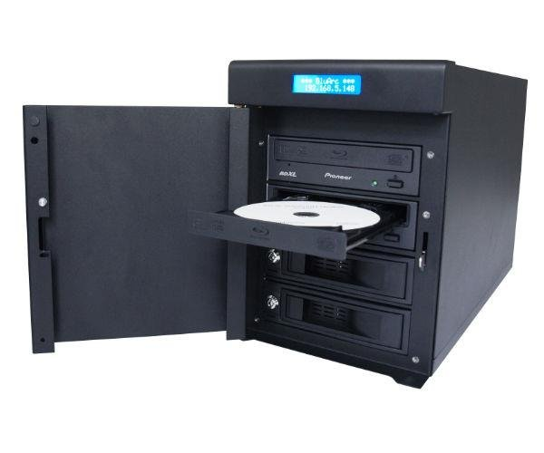{fig-alt="Bandlaufwerk als physisch getrenntes Backup-Medium"}
:::
:::

::: notes
Skript 4.3 und 4.4. Air-Gap ist sehr sicher, verlangt aber organisatorische Disziplin: Bänder müssen tatsächlich ausgelagert, logische Zugänge tatsächlich geschlossen werden. Immutable heißt: Innerhalb der Aufbewahrungsfrist kann niemand ändern oder löschen – auch nicht der Administrator. Rückbezug: Beides hätte bei CloudNordic die letzte Kopie erhalten; bei Kyoto hätte eine unveränderbare Kopie den Löschbefehl überstanden.
:::

## Zero-Trust-Backup

::: columns
::: {.column width="56%"}
- **MFA** für jeden Zugang zur Backup-Umgebung
- **Segmentierung** – eigenes Netz
- keine **God-Admins** – getrennte Administratorrollen, Least Privilege
- Backup-Server **nicht im selben AD** wie die Produktion

**Prüffrage:** Kann ein kompromittierter Domänen-Admin die Backups löschen?
:::
::: {.column width="40%"}
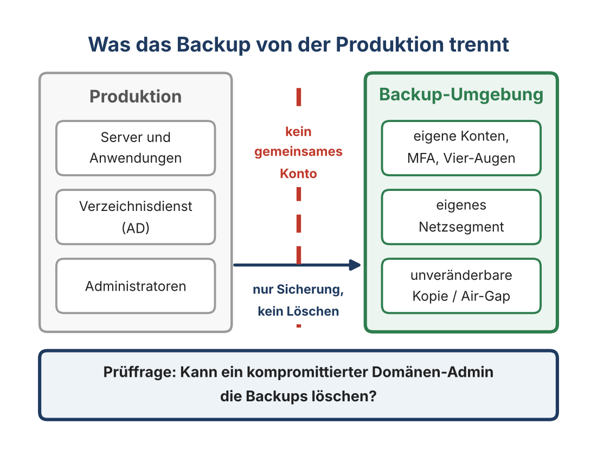{fig-alt="Produktion mit Servern, Verzeichnisdienst und Administratoren links, Backup-Umgebung mit eigenen Konten, eigenem Netzsegment und unveränderbarer Kopie rechts; kein gemeinsames Konto, Datenfluss nur zur Sicherung"}
:::
:::

::: notes
Skript 9.4. Die Prüffrage ist die wichtigste Frage der Sitzung für die Praxis. Lautet die Antwort „ja“, sind die Backups Teil der Angriffsfläche. Bei CloudNordic war die zentrale Verwaltung der gemeinsame Hebel. Zero Trust als Architekturprinzip folgt ausführlich in Sitzung 8; hier nur die Anwendung auf das Backup. Hinweis: Auch das Löschen einzelner Sicherungen sollte ein Vier-Augen-Verfahren verlangen.
:::

## Was ist DR?

::: columns
::: {.column width="56%"}
- **DR = Wiederherstellung** kompletter Systeme nach einem schweren Ereignis
- **BCM = Fortführung** der Geschäftsprozesse

DR ist der technische Motor von Business Continuity. Robustes BCM braucht funktionierendes DR.
:::
::: {.column width="40%"}
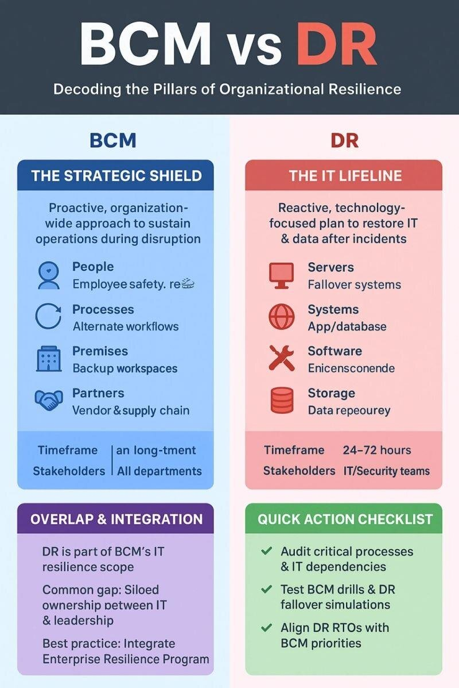{fig-alt="Gegenüberstellung BCM und DR"}
:::
:::

::: notes
Skript Kapitel 7. Auslöser laut Skript: Ransomware, Rechenzentrumsausfall, schwere Cloud-Fehlkonfiguration, Verlust zentraler Storage-Systeme, Strom- oder physische Schäden, Sabotage. Rückbezug Sitzung 5: Der Rhein-Pfalz-Kreis arbeitete im Notbetrieb weiter (BCM), während die IT neu aufgebaut wurde (DR). Übergang: Backup beantwortet „Haben wir die Daten?“, DR beantwortet „Wie schnell läuft der Dienst wieder?“.
:::

## RPO & RTO

::: columns
::: {.column width="56%"}
- **RPO: Datenverlust** – RPO 0 (keine Verluste), 15 min, 24 h
- **RTO: Wiederanlaufzeit** – RTO 0 (Active/Active), 4 h, 48 h

Beide bestimmen gemeinsam DR-Strategie, Kosten und Architekturkomplexität.
:::
::: {.column width="40%"}
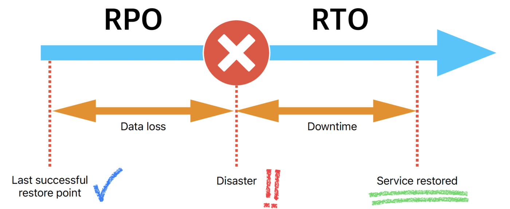{fig-alt="Zeitachse: RPO vor dem Ausfall, RTO bis zur Wiederherstellung"}
:::
:::

::: notes
Skript 7.3 und 7.4. RPO blickt zurück (wie alt darf der letzte gesicherte Stand sein?), RTO blickt nach vorn (wie lange darf der Dienst fehlen?). Beide Werte kommen aus der Business-Impact-Analyse, nicht aus der IT. Kontrollfrage aus dem Skript: RTO eine Stunde bei täglichem Backup und Cold Standby – passt das zusammen? Nein.
:::

## Die RTO ist mehr als die Restore-Zeit

::: columns
::: {.column width="56%"}
- **Erkennen** und **entscheiden**: Wer gibt den Restore frei?
- **Bereinigen**: Ist die Kopie sauber? Seit wann waren die Angreifer im Netz?
- **Infrastruktur**: Wohin wird zurückgespielt?
- **Daten zurückspielen** – nur das misst der übliche Restore-Test
- **Prüfen und freigeben**

**Eine RTO ist erst belegt, wenn die ganze Kette geübt und gemessen wurde.**
:::
::: {.column width="40%"}
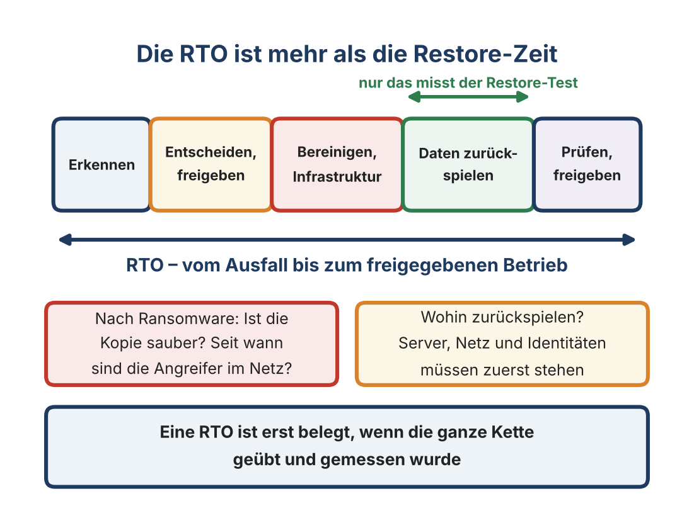{fig-alt="Die RTO setzt sich zusammen aus Erkennen, Entscheiden und Freigeben, Bereinigen und Infrastruktur, Daten zurückspielen sowie Prüfen und Freigeben; der Restore-Test misst nur das Zurückspielen"}
:::
:::

::: notes
Ergänzung zum Skript; schematische Darstellung, keine Normvorgabe. Sie verbindet die Hausaufgabe mit dem Thema: Die Freigabe eines Restores ist ein Zeitblock, der in keiner Backup-Statistik auftaucht. Nach Ransomware kommt die Frage nach dem sauberen Stand hinzu – ein Backup von gestern nützt wenig, wenn die Angreifer seit drei Wochen im Netz sind. Dann steigt faktisch das RPO. Der nächste Fall zeigt den dritten Block: Daten vorhanden, aber kein Ziel.
:::

## Fallbeispiel: British Library 2023

::: columns
::: {.column width="56%"}
- **28. Oktober 2023:** Ransomware verschlüsselt oder zerstört große Teile der Serverlandschaft; rund **600 GB** kopiert; kein Lösegeld
- Sicherungskopien der digitalen Sammlungen **existieren** – es fehlt die **Infrastruktur** zum Zurückspielen
- Viele **Altsysteme** lassen sich nicht wiederherstellen: veraltet, ohne Herstellersupport
- Katalog erst am **15. Januar 2024** wieder durchsuchbar; Neuaufbau auf **18 Monate** angelegt

**Ein Backup braucht ein Ziel.**
:::
::: {.column width="40%"}
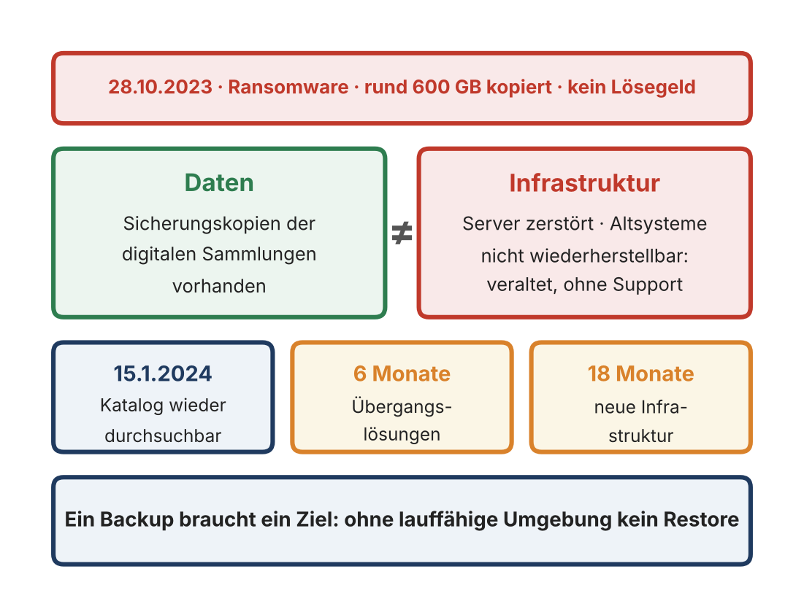{fig-alt="British Library 2023: Daten als Sicherungskopien vorhanden, Infrastruktur zerstört und Altsysteme nicht wiederherstellbar; Katalog am 15. Januar 2024 zurück, Übergangslösungen sechs Monate, neue Infrastruktur 18 Monate"}
:::
:::

::: notes
Quelle ist der eigene Bericht der Bibliothek vom 8. März 2024, „Learning Lessons from the Cyber-Attack“ – lesenswert, 18 Seiten, 16 Lehren. Die Angreifer waren mindestens drei Tage im Netz; der erste erkannte Zugriff lief über einen Terminalserver für externe Partner ohne Mehrfaktor-Authentifizierung. Cloud-Dienste wie E-Mail, Finanzen und Gehaltsabrechnung liefen weiter. Programm „Rebuild & Renew“ in drei Phasen: Respond, Adapt (sechs Monate), Renew (18 Monate). Lehre aus dem Bericht: Systemlebenszyklen aktiv steuern – Altsysteme sind schwerer zu schützen und schwerer wiederherzustellen. Für die Vorlesung: Die RTO scheiterte nicht am Backup, sondern an der DR-Fähigkeit.
:::

## DR-Strategien

::: columns
::: {.column width="56%"}
- Cold / Warm / Hot Standby
- Active/Passive
- Active/Active
- Multi-Cloud-DR

Je kürzer RTO und RPO, desto höher Kosten und Komplexität.
:::
::: {.column width="40%"}
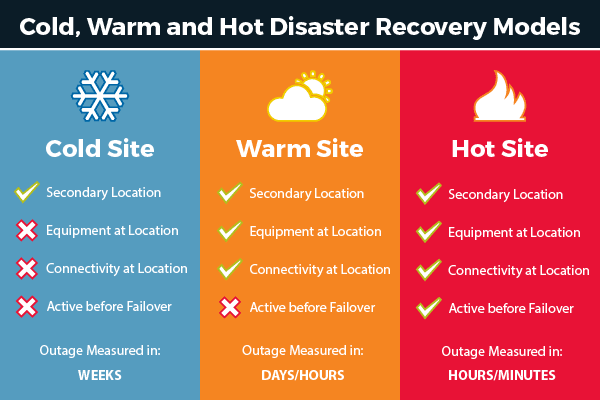{fig-alt="Cold, Warm und Hot Site im Vergleich"}
:::
:::

::: notes
Skript 7.5. Cold: Systeme aus, Daten regelmäßig kopiert – günstig, langsam. Warm: Systeme bereit, zeitversetzte Replikation. Hot: nahezu vollständige Kopie. Active/Active: beide Seiten produktiv, höchste Kosten. Multi-Cloud-DR schützt gegen den Ausfall eines Anbieters – UniSuper ist das Beispiel für den Nutzen, der Testaufwand ist hoch. Rückbezug British Library: Eine Standby-Umgebung zwingt dazu, Systeme lauffähig und aktuell zu halten.
:::

## Abhängigkeiten und Wiederanlaufreihenfolge

::: columns
::: {.column width="56%"}
- **Storage, Netz, Virtualisierung** vor allem anderen
- **Identität und Namensdienste** (AD, DNS, IAM) vor den Anwendungen
- **Datenbanken** vor den Diensten, die sie nutzen
- **Öffnung für Nutzer** zuletzt – mit neuen Zugangsdaten

**Eine fehlerhafte Reihenfolge macht DR oft wirkungslos.**
:::
::: {.column width="40%"}
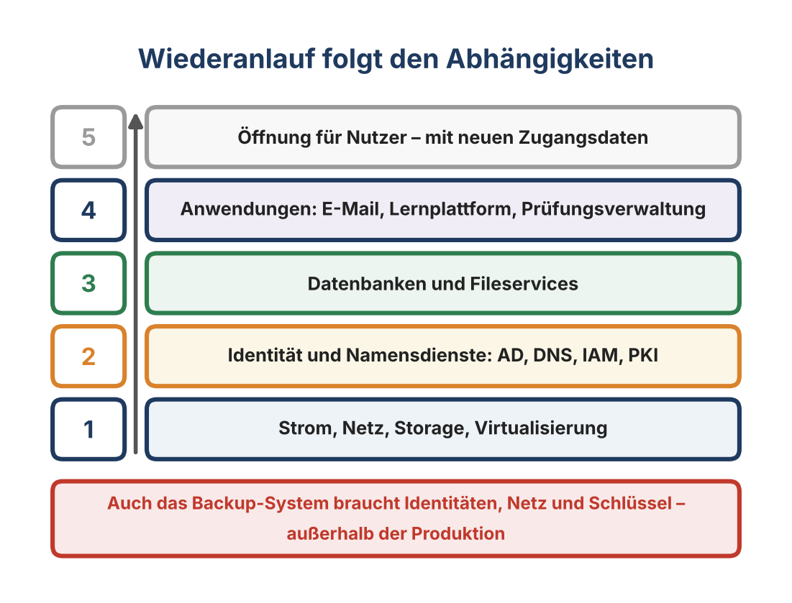{fig-alt="Fünf Schichten des Wiederanlaufs von unten nach oben: Strom, Netz, Storage und Virtualisierung; Identität und Namensdienste; Datenbanken und Fileservices; Anwendungen; Öffnung für Nutzer"}
:::
:::

::: notes
Skript 7.6 und 7.7. Der DR-Plan dokumentiert Schritte, Reihenfolgen, Rollen, Werkzeuge, Zugangsdaten, Netzpfade und Notfallkontakte – und liegt außerhalb der Systeme, die er wiederherstellen soll (Rückbezug Atlassian, Sitzung 5). Henne-Ei-Problem ansprechen: Das Backup-System braucht selbst Identitäten, Netz und Schlüssel. Wer sie nur im Produktiv-AD hat, kommt an sein Backup nicht heran. Diese Schichtung ist die Vorlage für Teil 2 der Übung.
:::

## Fallbeispiel: Universität Gießen 2019

::: columns
::: {.column width="56%"}
- **8. Dezember 2019:** Cyberangriff erkannt – die Universität fährt **alle Server herunter**, gegen 18 Uhr ist sie offline
- Daten bleiben erhalten; der **Wiederaufbau** kostet die Zeit
- **38.000 Passwörter** zurückgesetzt und **persönlich** ausgegeben
- E-Mail am 20. Dezember, Website und Lernplattform am 6. Januar, Verwaltungsnetz am 17. Februar, **alle großen Teilnetze am 6. März 2020**

**Identitäten zuerst – und ohne funktionierende IT.**
:::
::: {.column width="40%"}
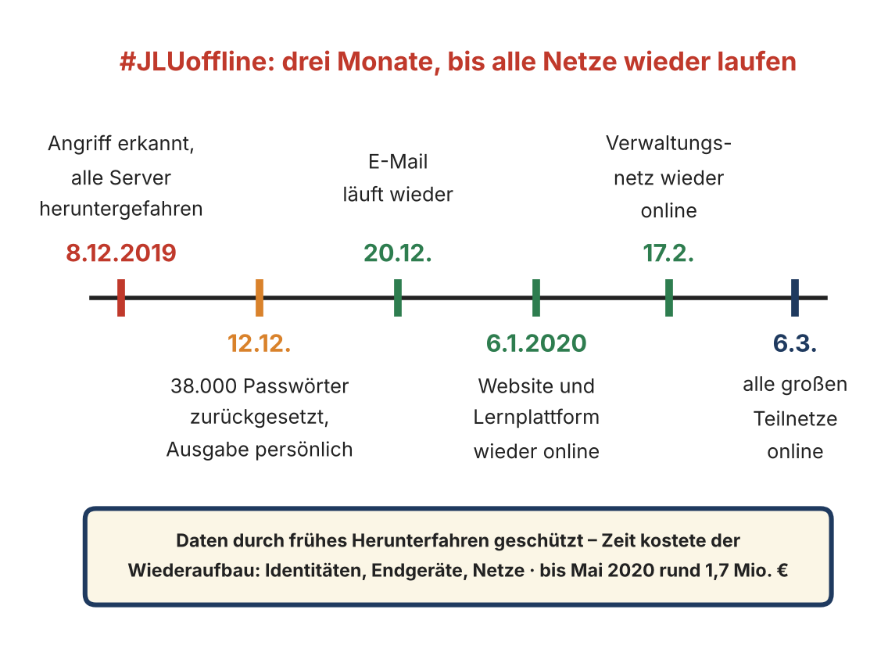{fig-alt="Zeitleiste Universität Gießen: 8.12.2019 Angriff erkannt und Server heruntergefahren, 12.12. Passwörter zurückgesetzt, 20.12. E-Mail, 6.1.2020 Website und Lernplattform, 17.2. Verwaltungsnetz, 6.3. alle großen Teilnetze online"}
:::
:::

::: notes
#JLUoffline, Justus-Liebig-Universität Gießen. Die Schadsoftware wurde als Ryuk benannt; eine ausdrückliche Lösegeldforderung gab es nach Angaben der Kanzlerin nicht. Die Passwortausgabe fand gegen Ausweis in der Sporthalle statt – ein elektronischer Weg schied aus. Mehrere tausend Windows-Rechner wurden einzeln von USB-Sticks geprüft. Kosten bis Mai 2020 laut Universität rund 1,7 Mio. Euro; Aufräumarbeiten bis Herbst 2020. Lehren der Universität: starke Führung, kurze Entscheidungswege, laufende offene Kommunikation; danach Neuaufstellung der IT-Governance mit einem Informationssicherheitsbeauftragten beim Präsidium (Parallele zur Hochschule Kaiserslautern, Sitzung 6). Für die Übung: Die Reihenfolge in Gießen entspricht der Schichtung der vorigen Folie – Identität, Kommunikation, Lehre, Verwaltung.
:::

## Typische DR-Fehler

::: columns
::: {.column width="56%"}
- Restore funktioniert nicht
- Dokumentation fehlt oder ist veraltet
- Abhängigkeiten unbekannt – AD, DNS und IAM vor Applikationen, Storage vor VMs
- Unrealistische RTO/RPO (RTO 1 h bei täglichem Backup?)
- DR-Umgebung weicht von der Produktion ab
:::
::: {.column width="40%"}
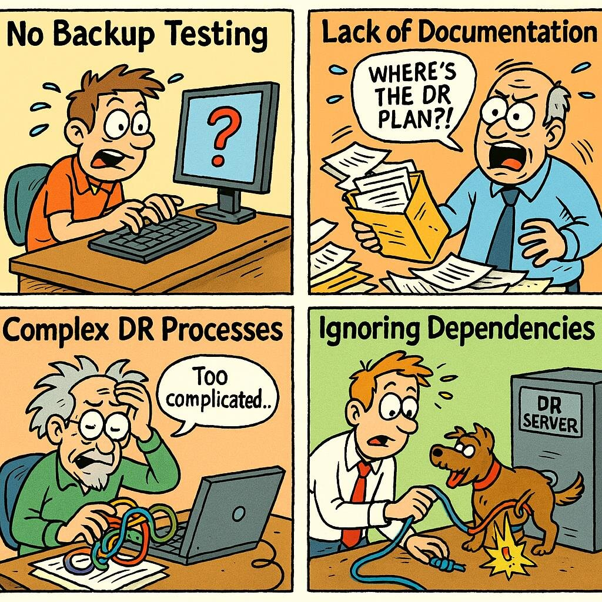{fig-alt="Comic-Panels: kein Backup-Test, fehlende Dokumentation, komplexe Prozesse, ignorierte Abhängigkeiten"}
:::
:::

::: notes
Skript 9.2. Die Fälle zuordnen lassen: Restore nicht möglich – British Library (kein Ziel). Abhängigkeiten – Gießen (Identitäten). DR-Umgebung weicht ab – gleich bei Delta. Abweichungen laut Skript: Versionen, IP-Räume, Zertifikate. Alle fünf Fehler haben eines gemeinsam: Man findet sie nur durch Tests.
:::

## Notfalltests

::: columns
::: {.column width="56%"}
- **Tabletop** – Szenarien diskutieren, keine Systeme verändern
- **Dry Run** – einzelne Schritte, Restore einzelner Datenbanken oder VMs
- **Full Failover** – reale Umschaltung, RTO und RPO messen

Mindesterwartung: monatlicher Restore-Test, vierteljährlicher Tabletop, jährlicher Full Failover.
:::
::: {.column width="40%"}
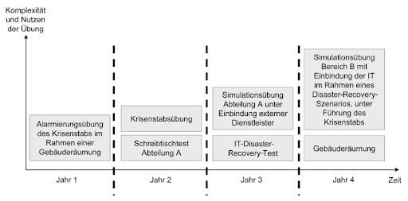{fig-alt="Mehrjahresplan: Übungen mit wachsender Komplexität"}
:::
:::

::: notes
Skript Kapitel 8. „Ein Backup, das nicht getestet wurde, ist kein Backup.“ Erfolgskriterien: vorab definierte Ziele, gemessene RTO und RPO, aktualisierte Dokumentation, umgesetzte Lessons Learned. Häufige Probleme: fehlende Verantwortliche, veraltete Pläne, keine Testumgebung, Angst vor Störung der Produktion. Die Mindesterwartung stammt aus dem Skript, nicht aus einer Norm. Rückbezug Sitzung 5: LÜKEX als Tabletop im Großen. Referenz: NIST SP 800-34, BSI-Standard 200-4.
:::

## Fallbeispiel: Delta Air Lines 2016

::: columns
::: {.column width="56%"}
- **8. August 2016:** Ein Stromschaltmodul im Rechenzentrum in Atlanta fällt aus und brennt
- Die Umschaltung auf den Reservestrom greift – aber **rund 300 von 7.000 Servern** hängen nicht daran
- Sie antworten nicht; das **Gesamtsystem** fällt aus
- Rund **2.300 Flüge** gestrichen, rund **100 Mio. USD** weniger Umsatz

**Die Lücke war unbekannt – ein realer Umschalttest hätte sie gezeigt.**
:::
::: {.column width="40%"}
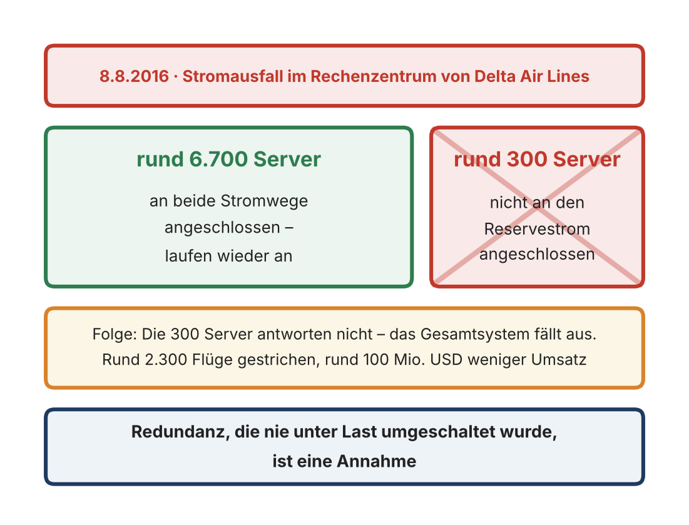{fig-alt="Delta Air Lines 2016: rund 6.700 Server an beide Stromwege angeschlossen laufen wieder an, rund 300 Server sind nicht an den Reservestrom angeschlossen; Folge: Gesamtsystem fällt aus, rund 2.300 Flüge gestrichen"}
:::
:::

::: notes
Der Vorstandschef nannte die Lücke öffentlich „unentdeckt“ und übernahm die Verantwortung; zunächst war ein Ausfall beim Stromversorger vermutet worden, das traf nicht zu. Der letzte Satz der Folie ist unsere Schlussfolgerung, keine Aussage von Delta: Ob und wie zuvor getestet wurde, ist nicht veröffentlicht. Wichtig für die Diskussion: Gut 4 % der Server genügten für den Gesamtausfall – wegen der Abhängigkeiten. Kein Cyberangriff; Resilienz umfasst auch den Stromausfall (Rückbezug OVHcloud, Sitzung 2). Frage: Welche Testform hätte die Lücke gefunden? Tabletop nicht, Dry Run kaum, Full Failover oder Controlled Outage ja.
:::

## Chaos Engineering

::: columns
::: {.column width="56%"}
- Fehler bewusst erzeugen: Systeme abschalten, Netzpfade unterbrechen, Storage-Ausfall simulieren
- Netflix Simian Army, Azure Chaos Studio, AWS Fault Injection Service
- Ziel: Schwachstellen unter realitätsnahen Bedingungen finden

Tests ohne Auswertung sind Übungen ohne Lerneffekt.
:::
::: {.column width="40%"}
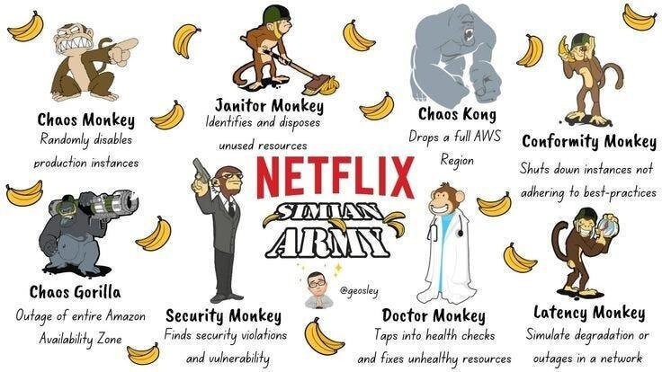{fig-alt="Netflix Simian Army: Chaos Monkey, Latency Monkey und weitere"}
:::
:::

::: notes
Skript 8.2, Controlled Outage. Netflix und den Chaos Monkey kennen die Studierenden aus Sitzung 3 – hier nur der Bezug zu Notfalltests: Chaos Engineering ist der Dauerbetrieb dessen, was der Full Failover einmal im Jahr prüft. Voraussetzung sind Beobachtbarkeit, ein begrenzter Wirkungsradius und ein Abbruchkriterium. Tests gehören in einen Zyklus: planen, testen, dokumentieren, bewerten, anpassen, wiederholen.
:::

## Übung: „Plan the Worst Day“

Resilienzteam des Hochschul-Rechenzentrums nach simuliertem Ransomware- und Datenbankkorruptionsvorfall. Systeme: Lernplattform, Identity/AD, E-Mail & Collaboration, Prüfungsdatenbank, Fileservices, Webseite/CMS.

1. **Backup-Konzept (30 min):** Daten, Frequenz, Typ, 3-2-1-1-0, Offsite, Ransomware-Schutz, Retention
2. **DR-Plan (30 min):** RTO/RPO, Strategie, Abhängigkeiten, Wiederherstellungsreihenfolge
3. **Notfalltest-Konzept (30 min):** Testarten, Häufigkeit, Metriken, Dokumentation, Lessons Learned

::: notes
Übungsanleitung im Skript, 90 Minuten in drei Teilen. Ergebnisse: Tabelle je System, DR-Plan als Diagramm mit Priorisierung, Jahres-Testplan mit Erfolgsindikatoren. Spickzettel aus den Fällen: Kann euer Domänen-Admin die Backups löschen (CloudNordic)? Liegt eine Kopie außerhalb der Steuerungsebene (UniSuper)? Wohin spielt ihr zurück (British Library)? Was kommt zuerst (Gießen)? Welcher Test findet die unbekannte Lücke (Delta)? Bei wenig Zeit: Teil 2 für drei Systeme, Teil 1 und 3 als Hausaufgabe.
:::

## Was die Fälle zeigen

| Fall | Säule | Lehre |
|---|---|---|
| CloudNordic 2023 | Backup | Kopien im selben Netz schützen nicht |
| Universität Kyoto 2021 | Backup | Auch das Backup-System ist ein Risiko |
| UniSuper 2024 | Backup / DR | Eine Kopie außerhalb der Steuerungsebene |
| British Library 2023 | DR | Ein Backup braucht ein lauffähiges Ziel |
| Universität Gießen 2019 | DR | Abhängigkeiten beachten – Identitäten zuerst |
| Delta Air Lines 2016 | Tests | Ungetestete Redundanz ist eine Annahme |

::: notes
Tabelle gemeinsam füllen: Spalte „Lehre“ abdecken und formulieren lassen. Zusatzfrage: Welcher Fall wäre mit der 3-2-1-1-0-Regel allein verhindert worden? CloudNordic und Kyoto ja, UniSuper wurde durch sie gerettet; British Library, Gießen und Delta nicht – dort fehlten DR-Fähigkeit und Tests. Das ist die Begründung für die drei Säulen.
:::

## Kernpunkte

- Backups sind die letzte Verteidigungslinie – nur wenn sie **isoliert und unveränderbar** sind (CloudNordic).
- **Redundanz ist kein Backup**: Sie spiegelt Löschungen und Fehler (Kyoto, UniSuper).
- **RPO und RTO** kommen aus dem Geschäft; die RTO umfasst die ganze Kette (British Library).
- Wiederanlauf folgt den **Abhängigkeiten** – Identitäten zuerst (Gießen).
- **Tests verifizieren**: Was nie umgeschaltet wurde, ist eine Annahme (Delta).

::: notes
Merksatz aus dem Skript: Backups retten Daten. Disaster Recovery rettet Systeme. Tests retten den Betrieb.
:::

## Ausblick & Hausaufgabe

**Nächste Sitzung:** Technische Resilienz II – Zero Trust, Microsegmentation, Cloud Resilience, Network Design

**Hausaufgabe:** Beantworten Sie für eine Organisation Ihrer Wahl die Prüffrage: **Kann ein kompromittierter Administrator die Backups löschen?** Skizzieren Sie, welche Konten und welche Netzgrenzen zwischen Produktion und Backup liegen.

[Kapitel zum Termin](../../../termine/07.html) · [Skript](../../../skripte/Skript-07.html) · [Glossar](../../../glossar.html) · [Quellen](../../../quellen.html)

::: notes
Teaser Sitzung 8: Heute haben wir das Backup vom Rest getrennt. Nächstes Mal wenden wir dasselbe Prinzip auf das ganze Netz an – niemandem wird vertraut, weil er „drin“ ist. Die Skizze der Hausaufgabe ist der Einstieg in Microsegmentation.
:::
