## Agenda

- Rückblick & Lernziele
- Einstieg: Colonial Pipeline 2021 – ein Passwort genügt
- Zero Trust: Prinzipien, Entscheidung je Zugriff (Twilio und Cloudflare)
- Microsegmentation: laterale Bewegung begrenzen (Südwestfalen-IT)
- Cloud Resilience: Shared Responsibility (Capital One), Zonen und Regionen (Google Paris)
- Network Design: Single Points of Failure (Rogers) · Redundanz braucht Unabhängigkeit
- Integration · Übung GameNova
- Kernpunkte & Ausblick

## Rückblick Sitzung 7

::: columns
::: {.column width="56%"}
- **3-2-1-1-0:** Eine Kopie isoliert und unveränderbar (CloudNordic)
- **Redundanz ist kein Backup** (Kyoto, UniSuper)
- Die **RTO** umfasst die ganze Kette; Wiederanlauf folgt den **Abhängigkeiten** (British Library, Gießen)
- **Tests** zeigen, ob Redundanz trägt (Delta)

**Heute: Wir trennen nicht nur das Backup, sondern das ganze Netz – niemand ist vertrauenswürdig, nur weil er „drin“ ist.**
:::
::: {.column width="40%"}
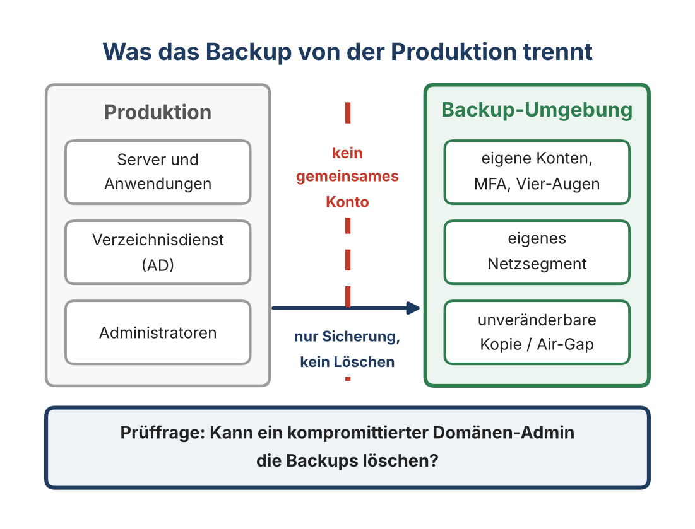{fig-alt="Produktion und Backup-Umgebung mit eigenen Konten und eigenem Netzsegment, kein gemeinsames Konto"}
:::
:::

::: notes
Hausaufgabe aufgreifen: Kann ein kompromittierter Administrator die Backups löschen? Zwei bis drei Skizzen zeigen lassen. Typisches Bild: ein flaches Netz, ein Verzeichnisdienst für alles, ein Administratorkonto, das überall hinkommt. Genau dieses Bild ist das Thema heute. Brücke: Sitzung 7 hat das Backup isoliert. Heute wenden wir dasselbe Prinzip auf Zugänge (Zero Trust), auf das interne Netz (Microsegmentation), auf die Cloud und auf das Netzdesign an.
:::

## Lernziele

::: columns
::: {.column width="56%"}
Nach dieser Sitzung können Sie …

- **Zero Trust** erklären und von Perimeter-Sicherheit abgrenzen,
- begründen, warum **phishingresistente MFA** ein Kern von Zero Trust ist,
- **laterale Bewegung** durch Microsegmentation begrenzen,
- das **Shared Responsibility Model** auf Cloud-Fälle anwenden,
- **Redundanz auf Unabhängigkeit** prüfen,
- die vier Ansätze **priorisieren**.
:::
::: {.column width="40%"}
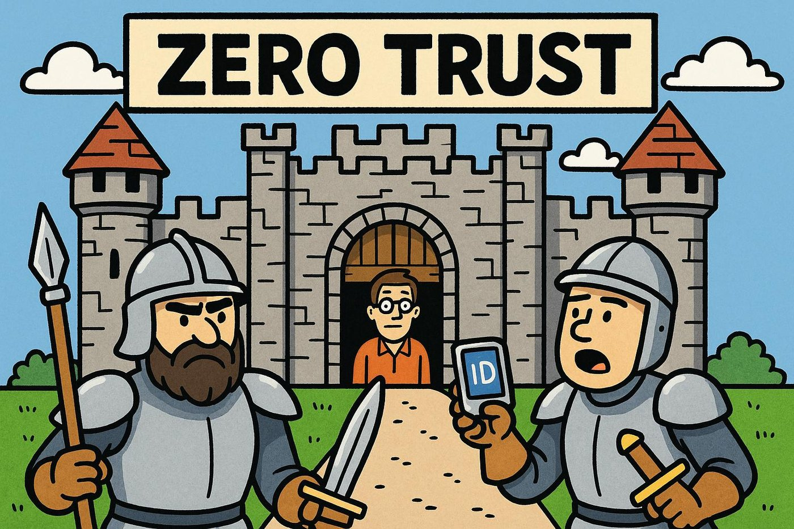{fig-alt="Comic: Ritter vor der Burg prüft die Identität am Tor"}
:::
:::

::: notes
Leitfrage der Sitzung: Wie begrenzt Architektur den Schaden, wenn Prävention versagt? Vier Säulen mit je einem oder zwei Fällen: Zero Trust (Colonial Pipeline, Twilio und Cloudflare), Microsegmentation (Südwestfalen-IT), Cloud Resilience (Capital One, Google Paris), Network Design (Rogers). Kein Fall wiederholt sich aus früheren Sitzungen; Colonial Pipeline und Südwestfalen-IT standen in Sitzung 1 nur als Stichpunkt, heute geht es um den Einstiegsweg.
:::

## Einstieg: Colonial Pipeline 2021

::: columns
::: {.column width="56%"}
- **7. Mai 2021:** Ransomware im IT-Netz von Colonial Pipeline; die Pipeline wird **vorsorglich abgeschaltet**
- Einstieg laut Vorstandschef vor dem US-Senat: ein **altes VPN-Profil**, nicht mehr in Gebrauch, mit **nur einem Faktor**
- Ein **gültiges Passwort** reichte – „kein Colonial123“
- Neustart erst am **12. Mai**; Lösegeld rund 4,4 Mio. US-Dollar

**Frage:** Was hat das VPN geprüft – und was nicht?
:::
::: {.column width="40%"}
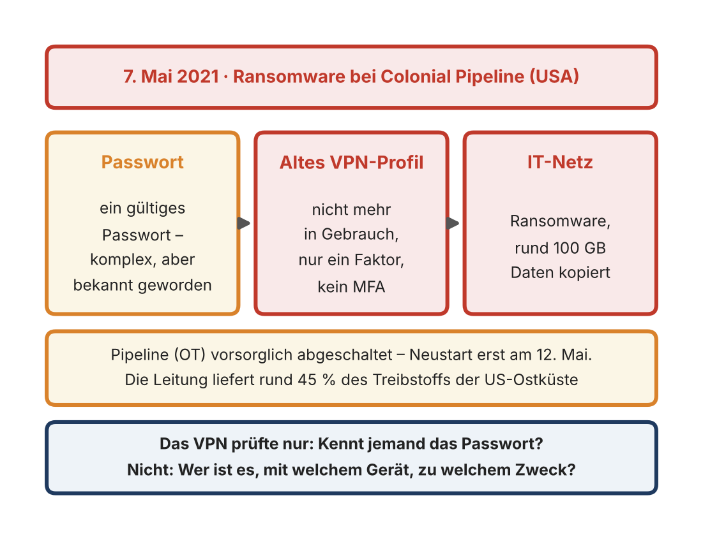{fig-alt="Colonial Pipeline 2021: gültiges Passwort, altes VPN-Profil ohne MFA, Ransomware im IT-Netz; Pipeline vorsorglich abgeschaltet"}
:::
:::

::: notes
Antwort: Das VPN prüfte nur, ob jemand das Passwort kennt. Nicht geprüft wurden: wer es ist (zweiter Faktor), mit welchem Gerät, ob das Konto überhaupt noch gebraucht wird. Quelle ist die Anhörung von Joseph Blount vor dem Senatsausschuss für Heimatschutz am 8. Juni 2021. Wie das Passwort bekannt wurde, war laut Blount noch ungeklärt. Wichtig: Die Pipeline selbst (OT) war nach Unternehmensangaben nicht verschlüsselt; sie wurde abgeschaltet, weil man die Ausbreitung nicht ausschließen konnte – Rückbezug Sitzung 4 „Abschalten als Resilienzentscheidung“. Die Leitung liefert rund 45 % des Treibstoffs der US-Ostküste; Panikkäufe folgten. Das Justizministerium stellte später rund 2,3 Mio. US-Dollar des Lösegelds sicher. Überleitung: Im Perimeter-Modell ist ein VPN-Login das Eintrittsticket für das ganze Netz. Zero Trust dreht das um.
:::

## Was ist Zero Trust?

::: columns
::: {.column width="44%"}
- „Never trust – always verify“
- **Identität** statt Netzwerkstandort
- **Assume Breach**

Der Perimeter existiert nicht mehr – Cloud, Homeoffice, SaaS und gestohlene Zugangsdaten haben ihn aufgelöst. Jeder Zugriff wird **explizit, kontextabhängig und fortlaufend** autorisiert.
:::
::: {.column width="54%"}
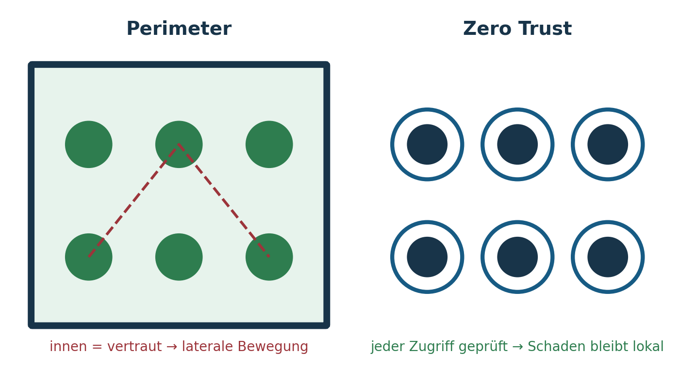{fig-alt="Perimeter mit vertrautem Innenraum gegenüber Zero Trust mit Prüfpunkt je Ressource"}
:::
:::

::: notes
Skript 2.1 und 2.2, Definition nach NIST SP 800-207. Burgmodell: innen Vertrauen, außen Misstrauen. Bei Colonial war das VPN die Zugbrücke – wer drüber war, war „innen“. Zero Trust entsteht nicht aus Misstrauen gegenüber Menschen, sondern aus einer realistischen Einschätzung: Jeder Benutzer, jedes Gerät und jeder Datenfluss kann kompromittiert sein. Der Begriff geht auf John Kindervag (Forrester, 2010) zurück; Google setzte das Prinzip nach den Angriffen von 2009 als BeyondCorp um.
:::

## Säulen des Zero Trust

::: columns
::: {.column width="56%"}
- **Least Privilege** – minimal, granular, zeitlich begrenzt
- **Starke Identitäten** – MFA, möglichst phishingresistent
- **Continuous Authorization** – neu prüfen bei Risikosignalen
- **Geräte- und Workload-Vertrauen** – Patchstand, Integrität, Zertifikate
- **Telemetrie** – ohne Daten keine Entscheidung
:::
::: {.column width="40%"}
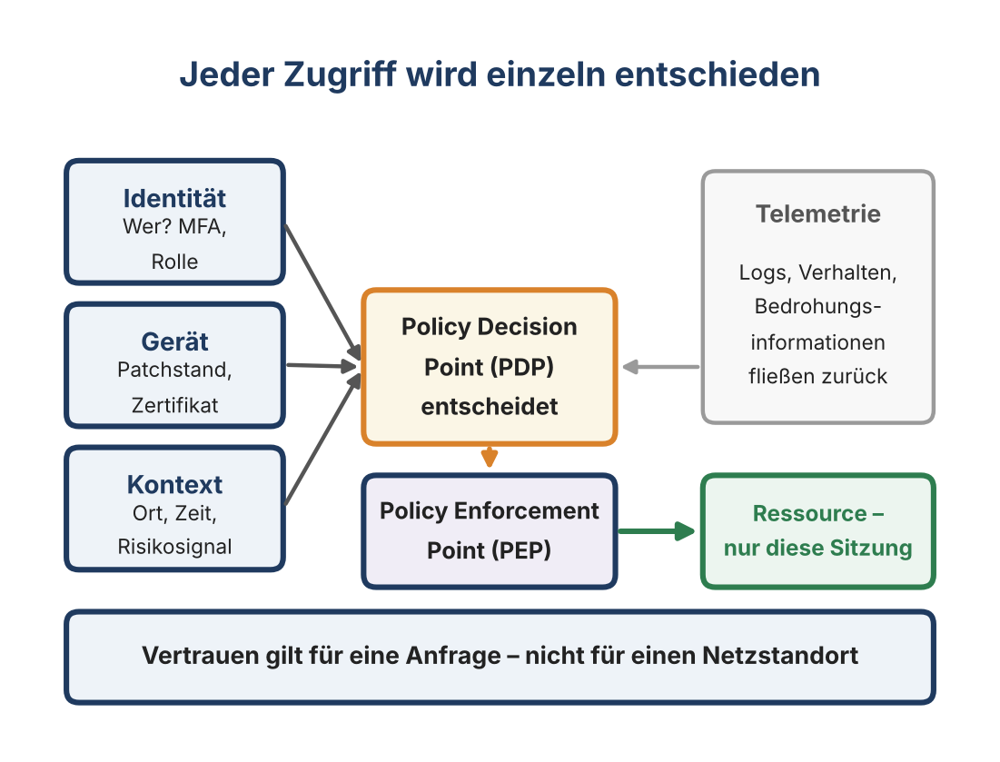{fig-alt="Identität, Gerät und Kontext fließen in den Policy Decision Point; der Policy Enforcement Point gibt nur diese Sitzung zur Ressource frei; Telemetrie fließt zurück"}
:::
:::

::: notes
Skript 2.2, sechs Leitprinzipien. Die Grafik zeigt die logischen Bausteine nach NIST SP 800-207: Policy Decision Point (entscheidet) und Policy Enforcement Point (setzt durch). Wichtig ist das Wort „Sitzung“: Vertrauen gilt für eine Anfrage, nicht für einen Netzstandort und nicht für immer. Auf Colonial angewandt: Ein ungenutztes Profil hätte bei Least Privilege nicht mehr existiert; ein zweiter Faktor hätte das Passwort allein entwertet; ein unbekanntes Gerät wäre aufgefallen. Der nächste Fall zeigt, dass „MFA“ nicht gleich „MFA“ ist.
:::

## Fallbeispiel: Twilio und Cloudflare 2022

::: columns
::: {.column width="56%"}
- **Juli/August 2022:** SMS an Beschäftigte mit Link auf eine **täuschend echte Login-Seite**
- **Twilio:** Zugangsdaten abgegriffen, Angreifer erreichen interne Werkzeuge – **209 Kunden** und **93 Authy-Nutzer** betroffen
- **Cloudflare:** **3 Beschäftigte** geben ihr Passwort ein – trotzdem **kein Zugriff**
- Grund: **FIDO2-Hardwareschlüssel**, an die echte Domain gebunden

**Phishingresistente MFA entwertet gestohlene Passwörter.**
:::
::: {.column width="40%"}
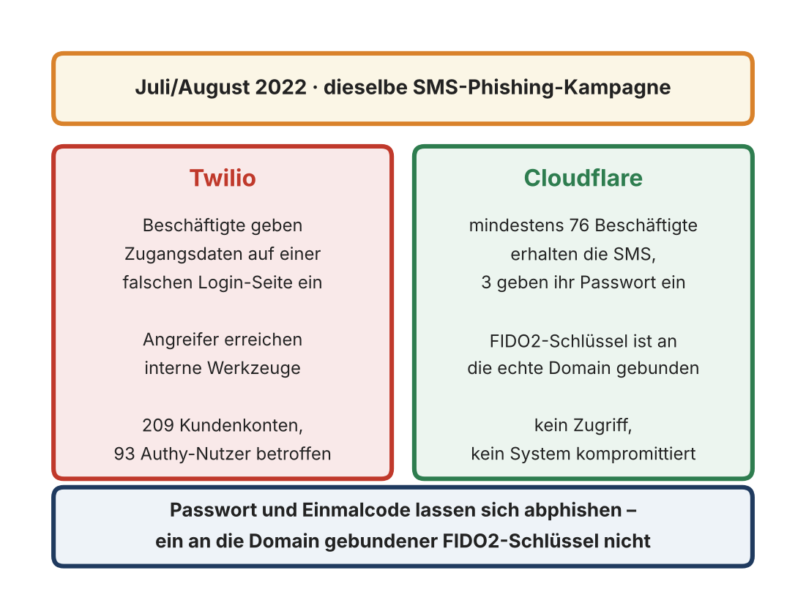{fig-alt="Twilio und Cloudflare 2022: dieselbe Kampagne; Twilio mit 209 Kunden und 93 Authy-Nutzern betroffen; bei Cloudflare geben drei Beschäftigte ihr Passwort ein, der FIDO2-Schlüssel verhindert den Zugriff"}
:::
:::

::: notes
Quellen: Incident Report von Twilio (fortlaufend aktualisiert bis Oktober 2022) und Blogbeitrag von Cloudflare vom 9. August 2022. Die Angreifer leiteten Passwort und Einmalcode in Echtzeit weiter; das umgeht SMS- und App-Codes. Ein FIDO2-Schlüssel signiert nur für die Domain, bei der er registriert ist – auf der falschen Seite liefert er nichts. Cloudflare: mindestens 76 Beschäftigte erhielten die SMS innerhalb einer Minute, teils auch Familienangehörige; die Domain war weniger als 40 Minuten vor der Kampagne registriert. Die drei Beschäftigten wurden ausdrücklich nicht gemaßregelt – Rückbezug Blameless Culture, Sitzung 5. Twilio nennt nicht, welchen zweiten Faktor die Beschäftigten hatten; als Maßnahme verteilte Twilio danach FIDO2-Token an alle. Achtung: Das ist ein Lehrbeispiel für Identität, kein Werbeblock – Cloudflare verkauft selbst Zero-Trust-Produkte.
:::

## Warum Zero Trust resilient macht

- begrenzt die **Angriffsfläche**
- verhindert **Eskalation** von einem Konto auf alles
- reduziert die **Folgen** einer Kompromittierung
- unterstützt schnelle **Recovery** – man weiß, wer worauf zugreift

**Zero Trust senkt nicht die Wahrscheinlichkeit eines Angriffs, sondern die maximale Schadenswirkung.**

Typische Fehler: als Produkt kaufen · alles auf einmal · ohne Erfolgsmessung · Legacy- und OT-Systeme vergessen

::: notes
Skript 2.3, Missverständnisse und Implementierungsfehler. „Zero Trust ist kein Produkt, sondern ein Architekturprinzip.“ Messgrößen aus dem Skript: Anteil überprivilegierter Konten, Anteil der Zugriffe mit starker Authentisierung, Dauer bis zur Eindämmung. Legacy- und OT-Systeme ohne moderne Authentisierung sind der häufigste Bremsklotz – dafür braucht es Segmentierung. Das ist die Überleitung.
:::

## Microsegmentation

::: columns
::: {.column width="56%"}
**Definition**

- Sicherheitszonen bis auf **Workload-Ebene**
- nicht nur VLANs oder Firewall-Zonen
- **Software-defined** statt physisch

Umsetzung netzwerk-, host- oder identitätsbasiert. **Je größer die interne Bewegungsfreiheit, desto größer der Gesamtschaden.**
:::
::: {.column width="40%"}
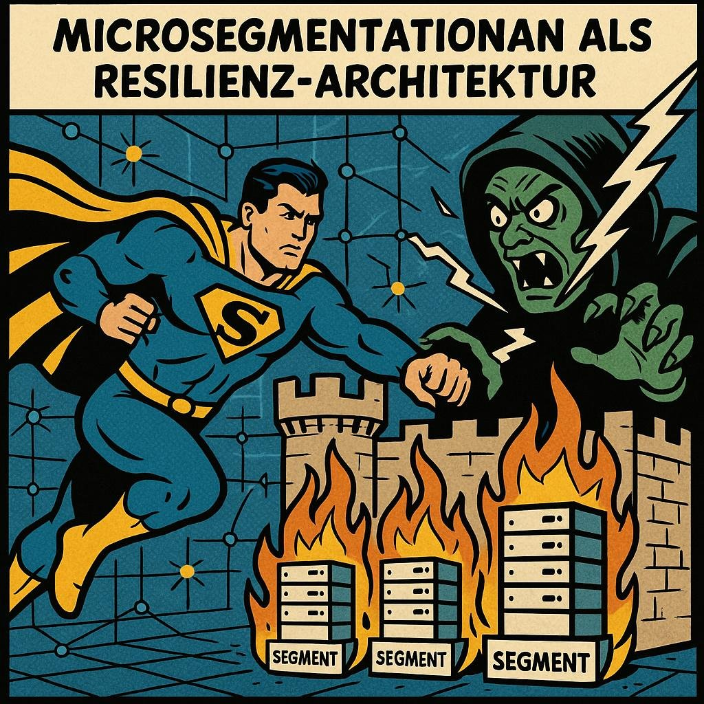{fig-alt="Comic: Held hält Angreifer in abgeschotteten Segmenten fest"}
:::
:::

::: notes
Skript 3.1. Zero Trust fragt: Darf dieser Zugriff sein? Microsegmentation fragt: Wohin kommt jemand, der schon drin ist? Laterale Bewegung bedeutet: vom ersten kompromittierten System zum nächsten, bis zum Domänencontroller oder zum Backup. Klassische Segmentierung trennt grob (Büro, Server, DMZ); Microsegmentation trennt bis auf einzelne Anwendungen. Der folgende Fall zeigt beides: eine grobe Grenze, die gehalten hat, und das Fehlen jeder Grenze dahinter.
:::

## Fallbeispiel: Südwestfalen-IT 2023

::: columns
::: {.column width="56%"}
- **18. Oktober 2023:** erste Angreifersitzung über das **VPN – ohne MFA**
- **29./30. Oktober:** Ransomware in der Domäne **intra.lan** – zentrale Systeme und Fachverfahren **aller Kunden**
- **72 Verbandskommunen** betroffen, Bürgerdienste über Wochen eingeschränkt
- **Andere Domänen und die DMZ: nicht betroffen**; Backups intakt

**Eine Grenze hat gehalten – dahinter gab es keine.**
:::
::: {.column width="40%"}
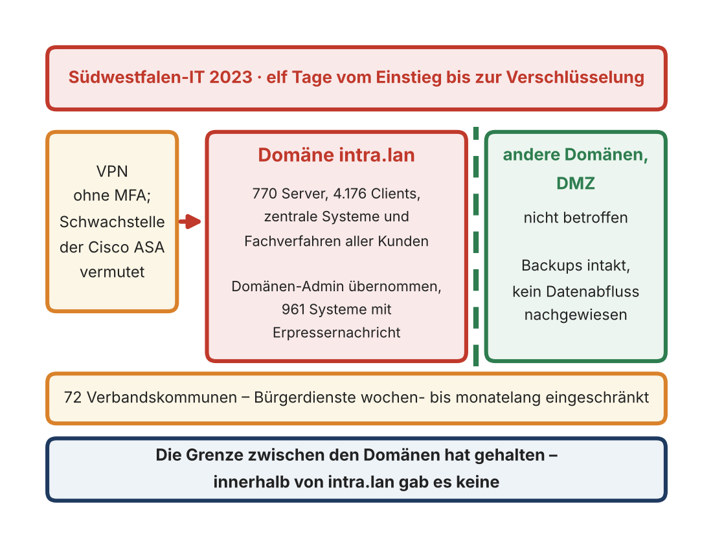{fig-alt="Südwestfalen-IT 2023: VPN ohne MFA, Domäne intra.lan mit 770 Servern und 4.176 Clients übernommen, andere Domänen und DMZ hinter einer gestrichelten Grenze nicht betroffen"}
:::
:::

::: notes
Quelle ist der veröffentlichte Forensikbericht (r-tec, Version 1.1) und die Pressemitteilung der Südwestfalen-IT vom 25. Januar 2024. Die Angreifer waren mindestens elf Tage im Netz. Als wahrscheinlichster Einstieg gilt eine Schwachstelle der Cisco ASA; wie sie an gültige Zugangsdaten kamen, ist nicht geklärt. Domänen-Admin wurden sie wahrscheinlich über ein seit 2014 in einer Gruppenrichtlinie hinterlegtes Administratorkennwort. In intra.lan: 770 Server und 4.176 Clients; 961 Systeme trugen die Erpressernachricht. Kein Lösegeld, kein nachgewiesener Datenabfluss. Der Bericht empfiehlt kurzfristig Segmentierung und MFA, mittelfristig Mikrosegmentierung, langfristig ein Tiering-Modell für Administratorkonten. Frage ans Plenum: Was wäre passiert, wenn auch die anderen Domänen am selben Admin-Konto gehangen hätten? Dann wären alle Kunden betroffen gewesen. Rückbezug Sitzung 1: Konzentrationsrisiko.
:::

## Warum Microsegmentation?

::: columns
::: {.column width="44%"}
- stoppt **laterale Bewegung**
- klare **Kommunikationspfade**
- Angriffe bleiben **lokal**
- **Forensik** und Wiederanlauf werden einfacher

„Technologie segmentiert Systeme – aber nur Organisationen segmentieren Risiko.“
:::
::: {.column width="54%"}
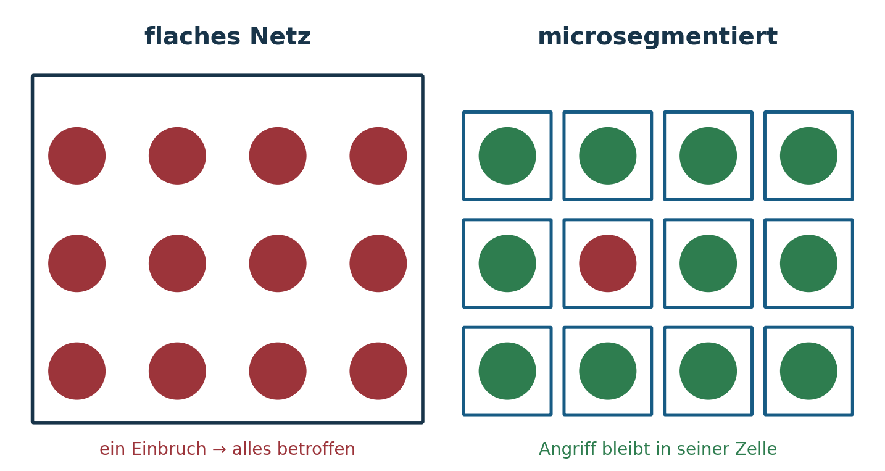{fig-alt="Flaches Netz komplett betroffen gegenüber segmentiertem Netz mit nur einer betroffenen Zelle"}
:::
:::

::: notes
Skript 3.3, Nutzen: Eindämmung lateraler Bewegung, geringere Wiederherstellungskosten, Transparenz, regulatorische Anforderungen. Rückbezug Südwestfalen-IT: Weil nur intra.lan betroffen war, konnte der Notbetrieb auf den anderen Bereichen aufsetzen; der Bericht empfahl ein Drei-Zonen-Konzept (rot: betroffen, gelb: Notbetrieb, grün: Neuaufbau). Segmentierung beschleunigt also auch den Wiederanlauf – Brücke zu Sitzung 7.
:::

## Microsegmentation einführen

::: columns
::: {.column width="56%"}
- **netzwerkbasiert** – Firewalls, SDN, ACLs
- **host-/workloadbasiert** – Agenten, Host-Firewalls, Cloud-Controls
- **identitätsbasiert** – Service-Konten, Workload-Zertifikate

**Allow-List statt Block-List**, Datenflussanalyse vor Enforcement, schrittweise Einführung.
:::
::: {.column width="40%"}
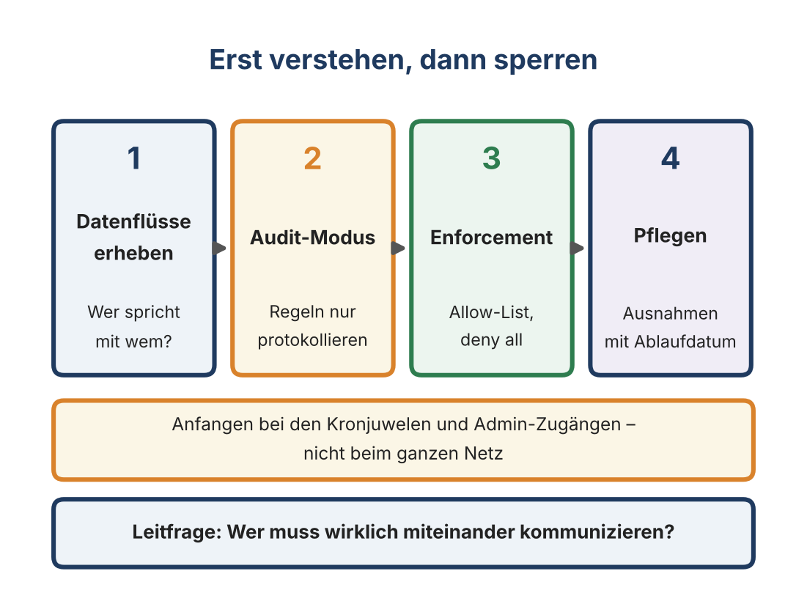{fig-alt="Vier Schritte: Datenflüsse erheben, Audit-Modus, Enforcement mit Allow-List, Pflegen mit Ausnahmen mit Ablaufdatum"}
:::
:::

::: notes
Skript 3.2. Die wichtigste Frage ist nicht „Wer darf rein?“, sondern „Wer muss wirklich miteinander kommunizieren?“. Typische Fehler: alles auf einmal segmentieren, ohne Datenflussanalyse starten, keine Verantwortlichen für Ausnahmen. Ausnahmen bekommen ein Ablaufdatum, sonst erodiert die Segmentierung („temporär“ hält ewig). Praxistipp: mit den Kronjuwelen und den Administrationszugängen beginnen. Administrationsnetze und Backup-Netze sind die ersten Kandidaten – genau die Hausaufgabe aus Sitzung 7.
:::

## Cloud Resilience: Shared Responsibility

::: columns
::: {.column width="56%"}
- Der Anbieter sichert **Infrastruktur, Hardware, Rechenzentren**
- Der Kunde verantwortet **IAM, Konfiguration, Daten und Backups**
- Cloud-Anbieter ≠ Datensicherung

**Die Cloud ist nicht automatisch resilient – sie ermöglicht Resilienz, wenn man sie bewusst gestaltet.**
:::
::: {.column width="40%"}
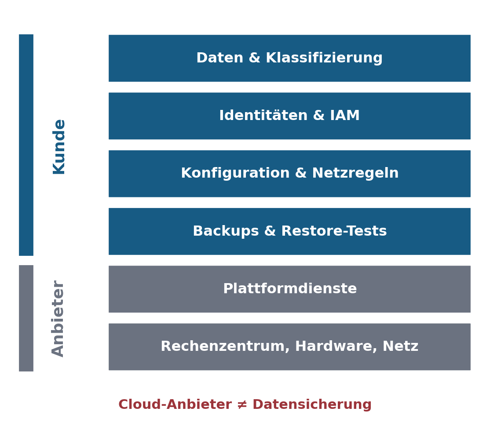{fig-alt="Shared Responsibility: Daten, IAM, Konfiguration und Backups beim Kunden, Infrastruktur beim Anbieter"}
:::
:::

::: notes
Skript 4.1 und 4.3. Die genaue Grenze hängt vom Servicemodell ab: Bei IaaS trägt der Kunde mehr als bei SaaS. Rückbezug Sitzung 7: CloudNordic (Kunden ohne eigene Kopie) und UniSuper (Kunde mit eigener Kopie). Heute zwei weitere Seiten: Was passiert, wenn der Kunde falsch konfiguriert – und was, wenn der Anbieter selbst eine versteckte Abhängigkeit hat?
:::

## Fallbeispiel: Capital One 2019

::: columns
::: {.column width="56%"}
- **März 2019:** Eine **falsch konfigurierte Web Application Firewall** in AWS leitet Anfragen weiter (SSRF)
- Darüber erhält die Angreiferin **temporäre Zugangsdaten** einer IAM-Rolle mit **zu weiten Rechten**
- Daten zu rund **106 Mio. Personen** aus S3 kopiert; entdeckt erst im **Juli** über einen externen Hinweis
- Aufsicht 2020: **80 Mio. US-Dollar** Strafe – Risikobewertung vor dem Cloud-Umzug unzureichend

**Least Privilege gilt auch für Maschinenidentitäten.**
:::
::: {.column width="40%"}
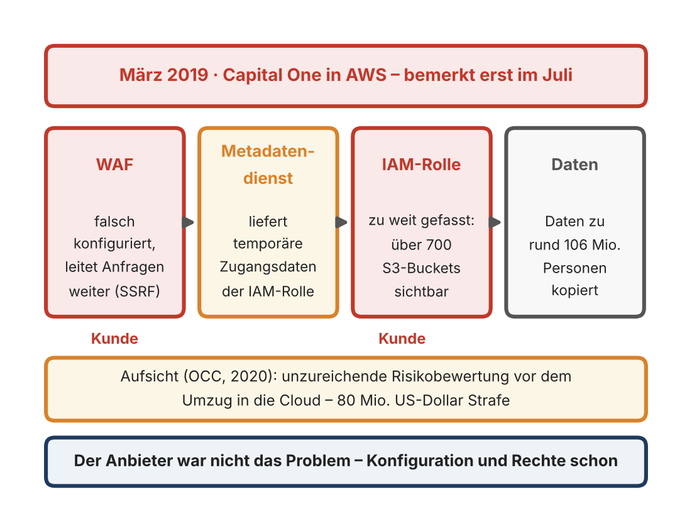{fig-alt="Capital One 2019: falsch konfigurierte WAF, Metadatendienst liefert Zugangsdaten, zu weit gefasste IAM-Rolle, Daten zu rund 106 Millionen Personen kopiert"}
:::
:::

::: notes
Quellen: Mitteilung von Capital One vom 29. Juli 2019, Pressemitteilungen des US-Justizministeriums zum Urteil (Juni 2022) und Berichte zur Anordnung der Bankenaufsicht OCC vom August 2020. Rund 100 Mio. Betroffene in den USA, 6 Mio. in Kanada; darunter rund 140.000 Sozialversicherungsnummern und 80.000 Kontonummern. Die Täterin, eine frühere AWS-Beschäftigte, prahlte online; ein Dritter meldete das am 17. Juli über das Responsible-Disclosure-Programm. Verurteilt im Juni 2022. Zusätzlich 190 Mio. US-Dollar Vergleich mit Kunden. Lehre: Die IAM-Rolle der WAF brauchte keinen Lesezugriff auf hunderte Buckets – Least Privilege und Microsegmentation gelten für Workloads genauso wie für Menschen. Begriff SSRF nur kurz erklären: Ein Server wird dazu gebracht, in eigenem Namen eine Anfrage an ein internes Ziel zu stellen.
:::

## Cloud-Resilienzmaßnahmen

::: columns
::: {.column width="56%"}
- **Multi-AZ / Multi-Region**
- **zustandslose** Services, Auto-Scaling, Load Balancing
- **Immutable Infrastructure** (IaC, Golden Images)
- **Backups trotz Cloud**, Observability, Chaos Engineering
- **Resilientes IAM** – phishingresistente MFA, Just-in-Time-Rechte

„Cloud-Resilienz kommt aus Design – nicht aus einem Anbieterlogo.“
:::
::: {.column width="40%"}
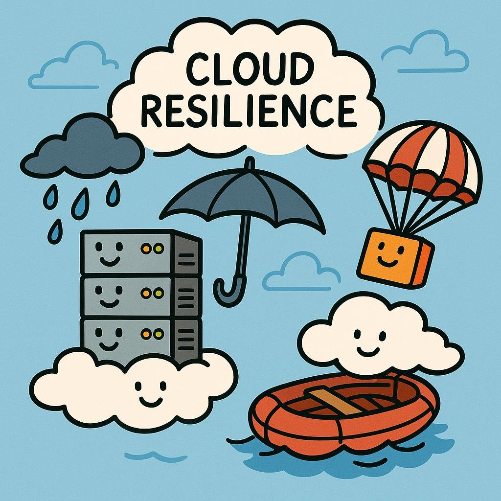{fig-alt="Comic: Wolken mit Schirm und Rettungsboot"}
:::
:::

::: notes
Skript 4.2, acht Architekturprinzipien. Begriffe Availability Zone und Region kennen die Studierenden aus Sitzung 3 (Glossar). Rückbezug Sitzung 3: Multi-AZ schützt gegen den Ausfall eines Standorts, nicht gegen die Störung einer Region. Der nächste Fall zeigt, dass selbst Multi-AZ nur so gut ist wie die gemeinsamen Abhängigkeiten der Zonen.
:::

## Fallbeispiel: Google Cloud Paris 2023

::: columns
::: {.column width="56%"}
- **25. April 2023:** Wasserleck in einem Rechenzentrum der Region **europe-west9**, danach Brand im Batterieraum
- Ein **Gebäude** wird abgeschaltet – gestört ist die **ganze Region** mit drei Zonen
- Ursache laut Google: Replikate der **regionalen Steuerungsdatenbank** nicht über die Gebäude verteilt
- Auch die **Cloud-Konsole weltweit** ist gestört; Zone a bleibt tagelang aus

**Mehrere Zonen sind nur so unabhängig wie ihre Steuerungsebene.**
:::
::: {.column width="40%"}
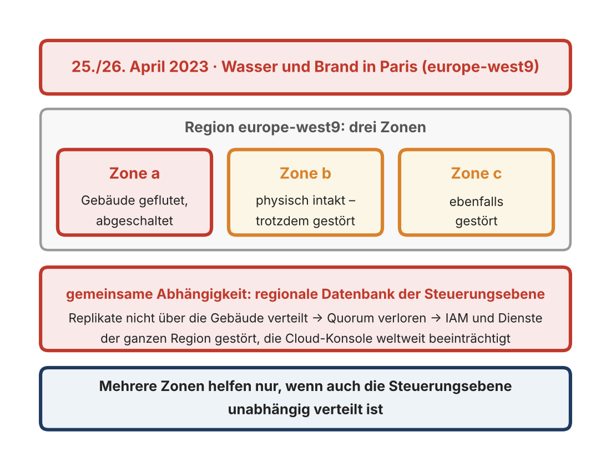{fig-alt="Google Cloud Paris 2023: Zone a geflutet und abgeschaltet, Zonen b und c gestört, weil die regionale Datenbank der Steuerungsebene nicht über die Gebäude verteilt war"}
:::
:::

::: notes
Quelle ist der Incident Report von Google zum Vorfall vom 25./26. April 2023. Die Datenbank ist Spanner; sie trägt die Steuerungsebene der meisten Dienste. Mit dem Abschalten eines Gebäudes verlor sie das Quorum, damit fiel auch IAM aus. Google schreibt selbst, es hätte in jedem der drei Gebäude ein Replikat geben müssen, und prüft das nun in allen Regionen. Die Konsole fiel weltweit aus, weil Abfragen über alle Regionen fehlschlugen statt Teilergebnisse zu liefern – ein Lehrbeispiel für fehlende Graceful Degradation (Sitzung 3). Laut Google kein Datenverlust. Empfehlung von Google an Kunden: auf Zonen oder Regionen außerhalb ausweichen. Frage: Was hätte ein Kunde mit Multi-AZ in europe-west9 gehabt? Wenig. Mit Multi-Region: einen Ausweg. Rückbezug UniSuper: gemeinsame Steuerungsebene als gemeinsamer Ausfallpunkt.
:::

## Network Design & Resilience

::: columns
::: {.column width="56%"}
**Netzwerke als Resilienzfaktor**

- **Single Points of Failure** vermeiden – Gerät, Leitung, Rechenzentrum, Konfiguration
- **DNS, Routing, IAM** sind kritisch
- **Management-Zugang** getrennt vom Datennetz
- Telemetrie und Monitoring als Pflicht

„Stabilität ohne Störung beweist nur Glück, nicht Resilienz.“
:::
::: {.column width="40%"}
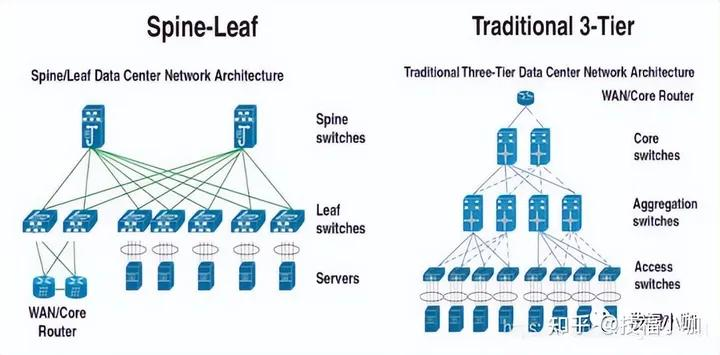{fig-alt="Vergleich Leaf-Spine-Architektur und klassische Drei-Schichten-Architektur"}
:::
:::

::: notes
Skript 5.1 und 5.2. Ohne Netz sind Backups nicht abrufbar, kann Zero Trust keine Identitäten prüfen und sind Cloud-Workloads nicht erreichbar. Leaf-Spine: symmetrische Pfade, jeder Leaf-Switch an jedem Spine – fällt ein Spine aus, bleiben alle Pfade erhalten, nur mit weniger Kapazität. SD-WAN: dynamische Pfadwahl über mehrere Carrier. In der Praxis scheitern Netze häufiger an Konfiguration, DNS und Routing als an Hardware – wie im nächsten Fall.
:::

## Fallbeispiel: Rogers 2022

::: columns
::: {.column width="56%"}
- **8. Juli 2022:** Eine Änderung im Rahmen eines Netz-Upgrades **löscht einen Routingfilter**
- Routinginformationen **überfluten die Kernrouter**, sie stürzen ab – **kein Überlastschutz**
- **Mobilfunk, Festnetz, Internet und Notruf** für mehr als **12 Mio. Kunden**, rund 26 Stunden
- Das **Management-Netz** hing am selben Kern: Techniker mussten **zu den Routern fahren**

**Wer sein Netz nur über das Netz erreicht, verliert im Ausfall den Zugang.**
:::
::: {.column width="40%"}
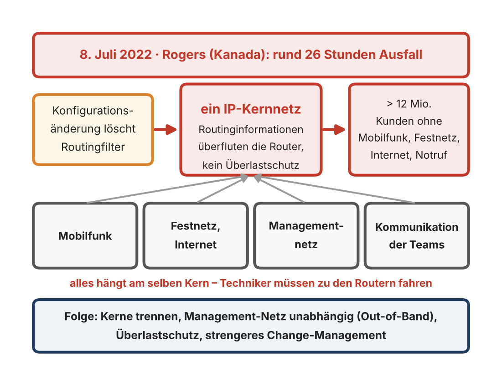{fig-alt="Rogers 2022: Konfigurationsänderung löscht Routingfilter, ein IP-Kernnetz fällt aus; Mobilfunk, Festnetz, Management-Netz und Kommunikation der Teams hängen alle daran"}
:::
:::

::: notes
Quelle ist der Bericht von Xona Partners für die kanadische Regulierungsbehörde CRTC (Zusammenfassung Juli 2024, Volltext November 2024). Der Bericht hält das gemeinsame Kernnetz nicht für einen Designfehler an sich, aber für den Grund, warum der Ausfall so umfassend war. Weitere Befunde: Die Änderung war nach erfolgreichen früheren Phasen als „geringes Risiko“ eingestuft und deshalb nicht im Labor getestet worden; die Ursachensuche dauerte rund 14 Stunden. Die Teams nutzten eigene Handys im eigenen Netz – Rogers musste SIM-Karten anderer Anbieter besorgen (Rückbezug Notkommunikation, Sitzung 4). Maßnahmen: Kerne für Mobilfunk und Festnetz trennen, eigenes Management-Netz (Out-of-Band) mit Leitungen anderer Anbieter, Überlastschutz, strengeres Change-Management. Rückbezug Sitzung 3: Facebook 2021 – ebenfalls kein Zugang mehr zu den eigenen Systemen.
:::

## Redundanz braucht Unabhängigkeit

::: columns
::: {.column width="56%"}
- Redundanz zählt nur über **Schadensdomänen** hinweg
- Gemeinsame Punkte stecken oft in **Steuerung, Identität und Management** – nicht in der Hardware
- Zwei Leitungen vom selben Provider, zwei Firewalls im selben Rack, zwei Zonen an einer Datenbank

**Prüffrage: Was teilen die beiden Hälften noch?**
:::
::: {.column width="40%"}
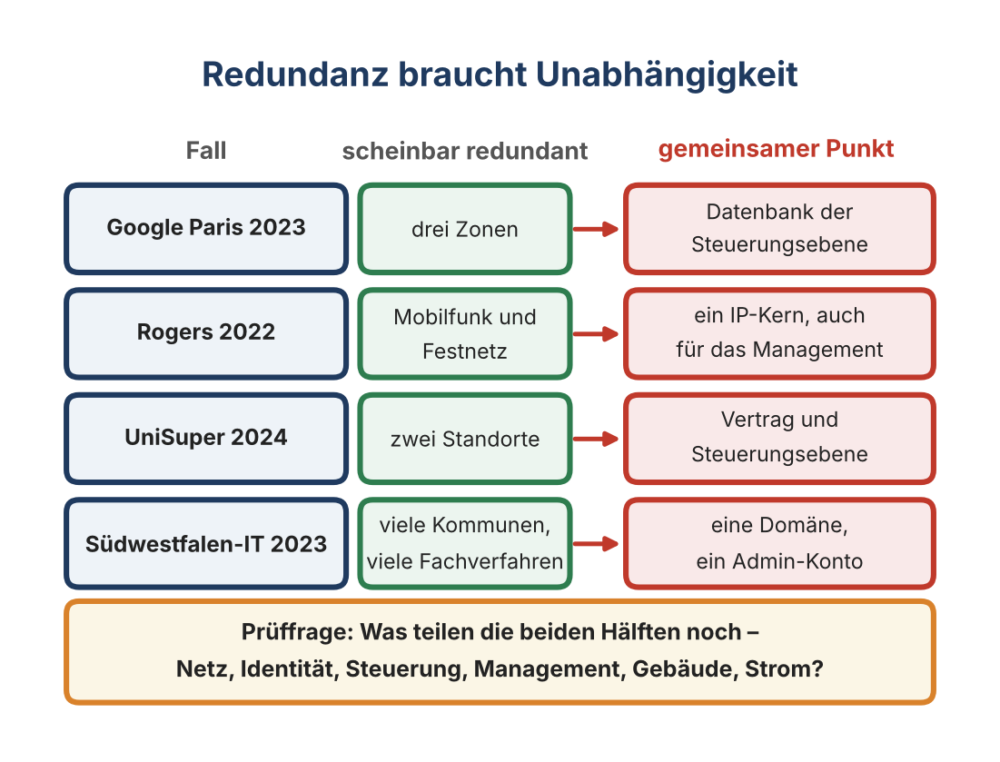{fig-alt="Vier Fälle mit scheinbarer Redundanz und gemeinsamem Punkt: Google Paris, Rogers, UniSuper, Südwestfalen-IT"}
:::
:::

::: notes
Ergänzung zum Skript (5.3, „Redundanz ohne Unabhängigkeit“). Die Tabelle verbindet die heutigen Fälle mit UniSuper aus Sitzung 7. Gemeinsames Muster: Die sichtbare Infrastruktur ist doppelt, die unsichtbare Steuerung nicht. Die Prüffrage ist das Gegenstück zur Backup-Prüffrage aus Sitzung 7 und gehört in jede Architekturprüfung. Kurzübung: Studierende nennen für ihr eigenes Umfeld (Hochschule, Arbeitgeber) einen gemeinsamen Punkt – häufige Antworten: ein Verzeichnisdienst, ein DNS-Anbieter, ein Internetzugang, ein Rechenzentrum.
:::

## Integration

::: columns
::: {.column width="56%"}
**Zusammenspiel der Maßnahmen**

- Zero Trust = **Schadensbegrenzung** am Zugang
- Microsegmentation = **Bewegungskontrolle** im Inneren
- Cloud Resilience = skalierbare **Wiederherstellung**
- Network Design = stabile **Grundlage**

Reihenfolge: Netzwerkstabilität → Identität → Microsegmentation → Cloud-Resilienz → Zero Trust operationalisieren.
:::
::: {.column width="40%"}
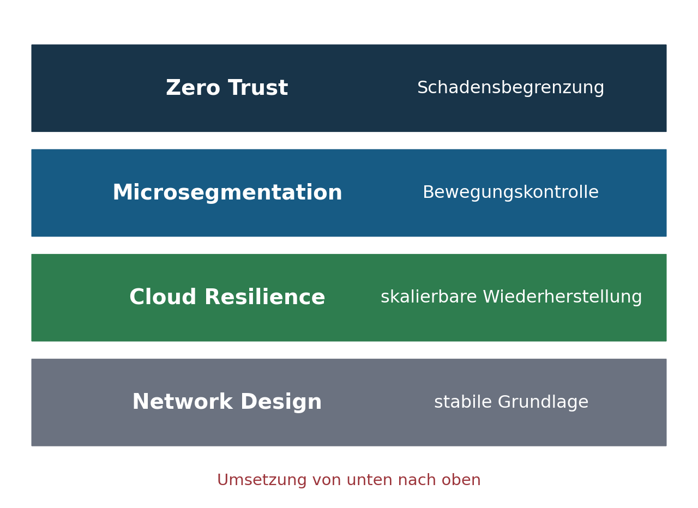{fig-alt="Vier Schichten: Zero Trust, Microsegmentation, Cloud Resilience, Network Design"}
:::
:::

::: notes
Skript Kapitel 6. Die Ansätze kompensieren gegenseitig blinde Flecken: Zero Trust begrenzt das Risiko gestohlener Zugangsdaten (Colonial, Twilio), Microsegmentation begrenzt deren Folgen (Südwestfalen-IT); Cloud Resilience erleichtert den Wiederanlauf, Network Resilience stellt die Pfade bereit (Rogers). „Resilienz entsteht nicht aus Technologie, sondern aus Interoperabilität.“ Die Reihenfolge aus dem Skript ist eine Empfehlung, keine Norm: Ohne stabiles Netz und sauberes Identitätsmanagement scheitern die oberen Schichten.
:::

## Übung: GameNova GmbH

::: columns
::: {.column width="56%"}
Hybride Multiplayer-Plattform: Login in AWS, Matchmaking im eigenen RZ, Managed-SQL-Datenbank, CDN-Frontend, Adminzugriff per VPN.

- **1** Zero Trust (20 P.) · **2** Microsegmentation (20 P.)
- **3** Cloud Resilience (25 P.) · **4** Network Resilience (20 P.)
- **5** Integration & Priorisierung (15 P.)

60–90 Minuten, Hilfsmittel erlaubt. Übungsblatt im Terminkapitel.
:::
::: {.column width="40%"}
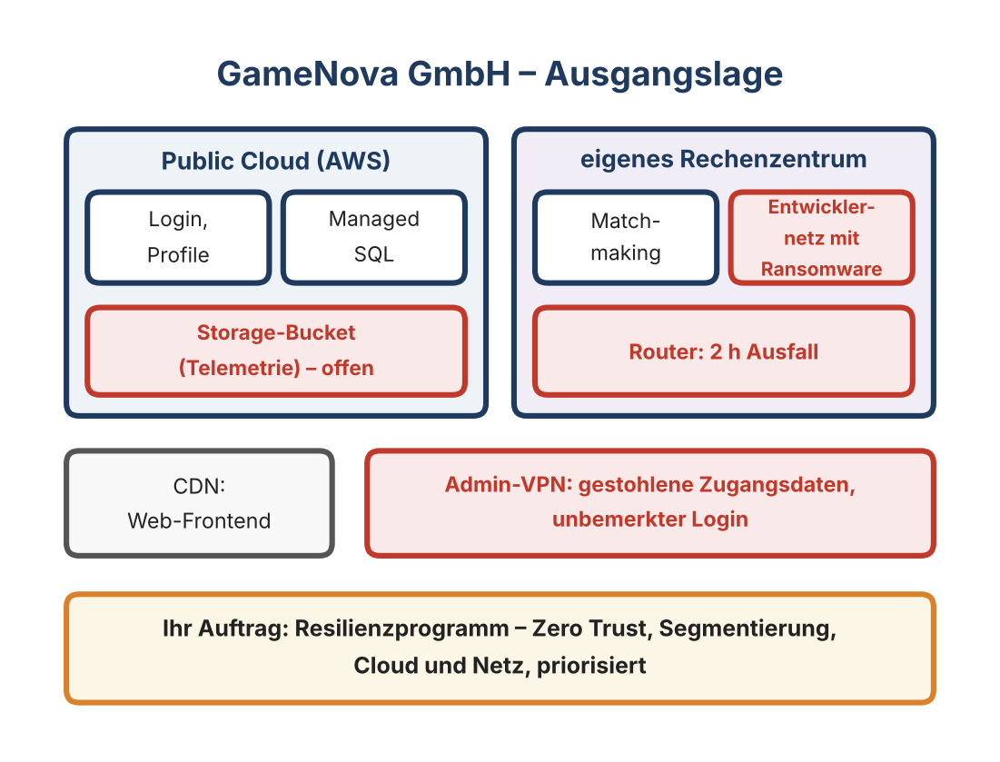{fig-alt="GameNova GmbH: Public Cloud mit Login, Managed SQL und offenem Storage-Bucket; eigenes Rechenzentrum mit Matchmaking, Entwicklernetz mit Ransomware und Router-Ausfall; CDN und Admin-VPN mit gestohlenen Zugangsdaten"}
:::
:::

::: notes
Übungsblatt aus dem Archiv, unverändert. Die vier Vorfälle passen auf die vier Säulen und auf die heutigen Fälle: gestohlene Admin-Zugangsdaten über VPN (Colonial), Ransomware im Entwicklernetz (Südwestfalen-IT), Routerdefekt mit zwei Stunden Ausfall (Rogers), offener Storage-Bucket (Capital One, Shared Responsibility). Spickzettel für die Gruppen: Welcher zweite Faktor (Twilio vs. Cloudflare)? Wer muss mit wem sprechen? Was ist Kundenpflicht in der Cloud? Was teilen die redundanten Teile noch? Bei wenig Zeit: Aufgaben 1 und 5 in Gruppen, Rest als Nachbereitung.
:::

## Was die Fälle zeigen

| Fall | Säule | Lehre |
|---|---|---|
| Colonial Pipeline 2021 | Zero Trust | Ein Passwort darf kein Zugang zum Netz sein |
| Twilio / Cloudflare 2022 | Zero Trust | Phishingresistente MFA entwertet gestohlene Passwörter |
| Südwestfalen-IT 2023 | Microsegmentation | Grenzen halten – wo es sie gibt |
| Capital One 2019 | Cloud | Konfiguration und Rechte sind Kundenpflicht |
| Google Paris 2023 | Cloud | Zonen teilen eine Steuerungsebene |
| Rogers 2022 | Netz | Management braucht einen eigenen Weg |

::: notes
Spalte „Lehre“ abdecken und formulieren lassen. Zusatzfrage: Welche der sechs Lehren betrifft den Anbieter, welche den Kunden? Colonial, Twilio, Südwestfalen-IT, Capital One: eigene Organisation. Google Paris und Rogers: der Anbieter – für Kunden bleibt nur, über Schadensdomänen hinweg zu planen (zweite Region, zweiter Carrier, Notkommunikation außerhalb des eigenen Netzes).
:::

## Kernpunkte

- **Identität statt Standort:** Ein VPN-Login ist kein Vertrauensbeweis (Colonial).
- **MFA ist nicht gleich MFA:** Nur phishingresistente Verfahren halten Echtzeit-Phishing stand (Cloudflare).
- **Segmentierung begrenzt den Schaden** – und beschleunigt den Wiederanlauf (Südwestfalen-IT).
- **In der Cloud** verantwortet der Kunde Konfiguration und Rechte (Capital One).
- **Redundanz braucht Unabhängigkeit** – auch in Steuerung und Management (Google Paris, Rogers).

::: notes
Merksatz aus dem Skript: Resilienz ist Architektur, nicht Backup. Vertrauen wird nicht vorausgesetzt. Angriffswege werden begrenzt. Architektur entscheidet über Krisenfähigkeit.
:::

## Ausblick & Hausaufgabe

**Nächste Sitzung:** Sonderthemen – OT-Resilienz mit Gastvortrag aus der Praxis, KI-Resilienz, Übung Gandalf AI

**Hausaufgabe:** Suchen Sie in Ihrem Umfeld ein Gerät oder System, das sich **nicht** mit MFA oder einem Agenten schützen lässt (Drucker, Kamera, Gebäudesteuerung, Maschine). Mit wem muss es wirklich kommunizieren – und wie würden Sie es abschotten?

[Kapitel zum Termin](../../../termine/08.html) · [Skript](../../../skripte/Skript-08.html) · [Glossar](../../../glossar.html) · [Quellen](../../../quellen.html)

::: notes
Teaser Sitzung 9: Zero Trust setzt Identitäten und moderne Authentisierung voraus. In der Produktion (OT) gibt es Anlagen, die zwanzig Jahre laufen und keinen zweiten Faktor kennen. Dort bleibt vor allem die Segmentierung – Zonen und Conduits nach IEC 62443. Die Hausaufgabe ist der Einstieg.
:::
