::: {.content-visible when-format="html"}
[Semesterübersicht](../index.html) · [Folien](../Präsentationen/Termin-05/_output/main.html) · [Skript](../skripte/Skript-05.html) ([PDF](../skripte/Skript-05.pdf), [Word](../skripte/Skript-05.docx)) · [Glossar](../glossar.html) · [Quellen](../quellen.html)
:::

# Leitfrage

> Wie überlebt die Organisation – und bleibt dabei handlungsfähig?

Technik schafft Potenzial – Organisation aktiviert es. Im Ernstfall entscheidet nicht Technologie, sondern Verhalten.

# Lernziele

Nach diesem Termin können Studierende

- erklären, was organisationale Resilienz nach ISO 22316 ist,
- erkennen, welche Rollen, Prozesse und Kommunikationsmuster Resilienz fördern oder behindern,
- beschreiben, wie Training, Governance und Lernkultur Widerstandsfähigkeit institutionalisieren,
- an realen Fällen begründen, warum Krisen Rollen statt Personen, Entscheidungskompetenz auf Zeit und Kommunikationswege außerhalb der betroffenen Systeme brauchen.

# Einstieg: Norsk Hydro 2019

Am 19. März 2019 traf die Ransomware LockerGoga den norwegischen Aluminiumkonzern Norsk Hydro – rund 35.000 Beschäftigte in 40 Ländern. Hydro isolierte alle Anlagen und arbeitete, wo möglich, manuell weiter. Noch am selben Tag gab das Unternehmen eine Pressekonferenz mit Webübertragung und informierte danach laufend. Lösegeld zahlte Hydro nicht; die Systeme wurden bereinigt oder aus Backups neu aufgebaut. Die Gesamtkosten lagen nach Angaben von Hydro bei rund 800 Millionen Kronen.

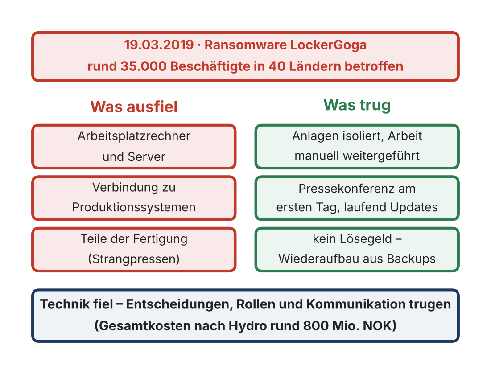{fig-alt="Gegenüberstellung: Ausgefallen waren Rechner, Server, Verbindungen zu Produktionssystemen und Teile der Fertigung; getragen haben Isolation und Handarbeit, die Pressekonferenz am ersten Tag und der Verzicht auf Lösegeld" width="65%"}

Warum gilt ein Unternehmen mit lahmgelegter IT als Vorbild? Weil die Technik gefallen ist, die Organisation aber nicht: Entscheidungen, Rollen und Kommunikation haben getragen. Genau darum geht es in dieser Sitzung.

# Fachinhalte

## Von der technischen zur organisationalen Resilienz

Technische Resilienz sichert Systeme, organisationale Resilienz sichert Entscheidungen. Organisationale Resilienz ist die Fähigkeit, das technische Potenzial unter Stress, Zeitdruck und Informationsunsicherheit gezielt zu aktivieren: Wer erkennt den Vorfall? Wer informiert wen? Wer entscheidet, was in welcher Reihenfolge getan wird?

| Aspekt | Technische Resilienz | Organisationale Resilienz |
|---|---|---|
| Steuerungslogik | deterministisch, automatisiert | adaptiv, situativ |
| Fokus | Systeme und Prozesse | Menschen, Rollen, Kommunikation |
| Nachweis | Monitoring, Failover-Tests | Übungen, Entscheidungswege, Lernfähigkeit |
| Zielgröße | System bleibt funktionsfähig | Organisation bleibt handlungsfähig |

Leitfäden zum Incident Handling (NIST SP 800-61, ENISA) betonen, dass die Wirksamkeit maßgeblich von klaren Zuständigkeiten, Kommunikationswegen und geübten Prozessen abhängt [@nist80061r2]. Organisationale Resilienz wirkt wie ein „soziales Redundanzsystem“.

## Definition nach ISO 22316

ISO 22316:2017 versteht unter organisationaler Resilienz die Fähigkeit einer Organisation, in einem sich wandelnden Umfeld Störungen aufzufangen und sich anzupassen („absorb and adapt“), um ihre Ziele zu erreichen, zu überleben und zu gedeihen [@iso22316]. Die Archivunterlagen nennen die Formulierung „Störungen vorhersehen, sich vorbereiten, reagieren und sich anpassen“; sie stammt aus der britischen Norm BS 65000:2014 (siehe [Hinweise zur Aktualität](../quellen.html#hinweise-zur-aktualität)). Inhaltlich passen beide zusammen: Vorhersehen und Vorbereiten sind die Voraussetzung, um Störungen auffangen zu können.

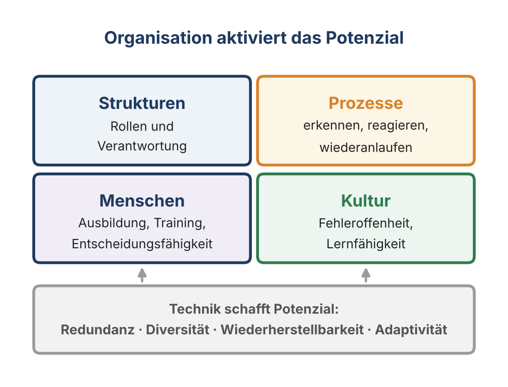{fig-alt="Vier Kacheln Strukturen, Prozesse, Menschen und Kultur über einer Basis Technik schafft Potenzial mit Redundanz, Diversität, Wiederherstellbarkeit und Adaptivität" width="55%"}

Kernkomponenten:

- **Strukturen** → klare Rollen und Verantwortlichkeiten
- **Prozesse** → Detection, Reaktion, Wiederanlauf
- **Menschen** → Ausbildung, Training, Entscheidungsfähigkeit
- **Kultur** → Fehleroffenheit und Lernfähigkeit

Resilienz wird damit zu einer Verhaltensdisziplin: Sie entsteht nicht in der Dokumentation, sondern in der Übung.

## Der Resilienzzyklus

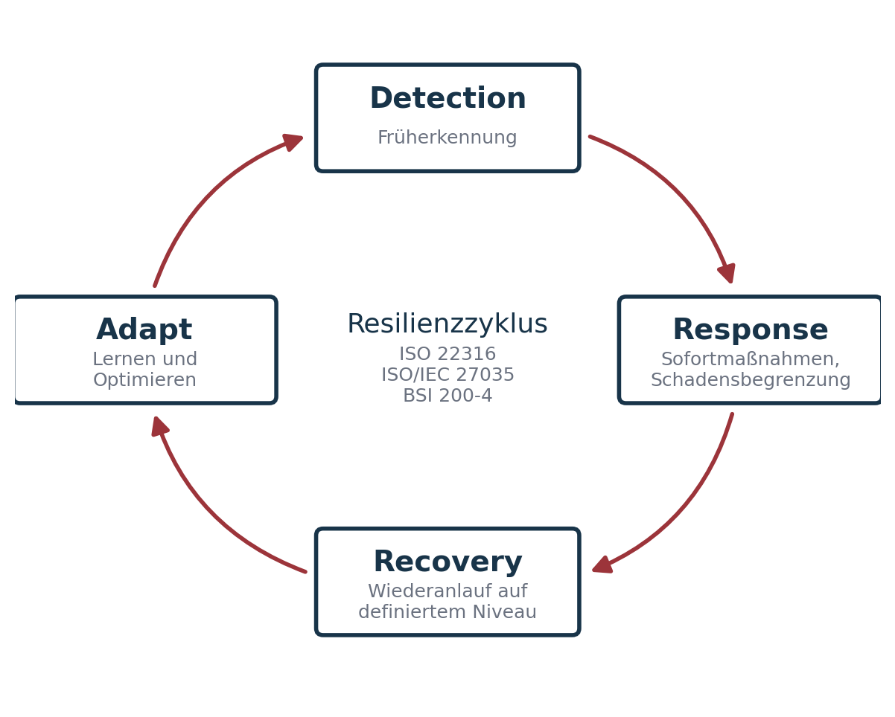{fig-alt="Kreislauf mit vier Kästen: Detection (Früherkennung), Response (Sofortmaßnahmen und Schadensbegrenzung), Recovery (Wiederanlauf auf definiertem Niveau), Adapt (Lernen und Optimieren), verbunden durch Pfeile im Uhrzeigersinn." width=70%}

- **Detection** – Wahrnehmungsfähigkeit: technische Sensorik (SIEM, Anomalieerkennung) und organisatorische Meldekultur. Ziel ist zielgerichtete Wahrnehmung, nicht absolute Überwachung.
- **Response** – koordinierte Reaktion unter Unsicherheit. Ein Incident darf nicht an individuellen Grenzen hängen bleiben; alle handeln entlang einer gemeinsamen Lageeinschätzung.
- **Recovery** – Wiederherstellung der Handlungsfähigkeit, priorisiert nach Business Impact, mit gesicherter Stakeholder-Kommunikation und Blick auf die Belastung des Teams.
- **Adapt** – Lernen über After-Action Reviews und Post-Mortems. Eine Organisation, die nach jedem Vorfall besser wird, ist per Definition resilient.

Während PDCA auf Qualitätsmanagement zielt, fokussiert der Resilienzzyklus reaktive und adaptive Fähigkeiten im Krisenfall.

## Rollen und Entscheidungslogik

Effektive Krisenorganisationen definieren **Rollen statt Personen**. Das verhindert Abhängigkeit von Einzelnen und skaliert in 24/7-Betrieben.

| Rolle | Hauptverantwortung |
|---|---|
| CISO | Strategische Leitung, Entscheidung über Eskalationsstufen, Kommunikation mit der Geschäftsleitung |
| Incident Commander | Operative Gesamtkoordination im Ereignisfall, Priorisierung |
| IT Operations / Technical Lead | Analyse, technische Eindämmung und Wiederherstellung |
| BCM-Manager | Koordination mit Fachbereichen, Priorisierung kritischer Prozesse |
| Kommunikation / PR | Interne und externe Information |
| Legal / Datenschutz | Bewertung von Meldepflichten (z. B. Art. 33 DSGVO) |
| Management Board | Ressourcenfreigabe, Business-Priorisierung, Risikoakzeptanz |

Kernprinzip: **Wer entscheidet was, wann und warum?** Der normale Linienweg ist in Krisen zu langsam. Das Incident Command System aus dem Katastrophenschutz liefert Entscheidungskompetenz auf Zeit: Command priorisiert, Operations handelt, Support dokumentiert und kommuniziert. Prinzipien wirksamer Führungsstrukturen: Unity of Command, Span of Control (5–7 Personen), Delegation of Authority, Documentation & Traceability, Role Rotation & Training.

Unter Stress greifen Menschen auf erlernte Muster zurück. Playbooks, Priorisierungslisten und Entscheidungsbäume bereiten Entscheidungen vor.

**Fall Anhalt-Bitterfeld (2021):** In der Nacht auf den 6. Juli 2021 verschlüsselte Ransomware die IT der Kreisverwaltung, nur die Telefonanlage lief noch. Am 9. Juli rief der Landkreis den Katastrophenfall aus – der erste nach einem Cyberangriff in Deutschland. Ein Krisenstab mit Bundeswehr, BSI, LKA, CERT Nord und Landesverwaltung übernahm die Führung. Lösegeld wurde nicht gezahlt. Sozialhilfe, Eltern- und Kindergeld konnten zeitweise nicht ausgezahlt werden; im März 2022 liefen erst 40 von 159 Fachanwendungen wieder, der Katastrophenfall dauerte über ein halbes Jahr. Der Krisenstab ist die Entscheidungskompetenz auf Zeit, die dieses Kapitel beschreibt.

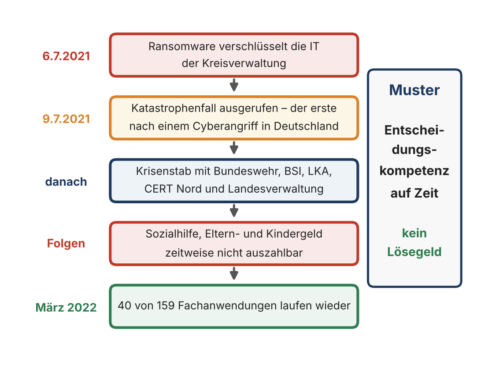{fig-alt="Ablauf: 6.7.2021 Verschlüsselung, 9.7.2021 Katastrophenfall, Krisenstab mit Bundeswehr, BSI, LKA, CERT Nord und Land, Folgen für Sozialleistungen, März 2022 40 von 159 Fachanwendungen; Muster: Entscheidungskompetenz auf Zeit" width="65%"}

## Kommunikation unter Stress

Krisenkommunikation ist Teil der Resilienzarchitektur. Viele Vorfallsbehandlungen scheitern an Informationsfehlern, nicht an Technik. Leitprinzipien (CCCC):

1. **Clear** – eindeutig, frei von Mehrdeutigkeit
2. **Concise** – kurz statt detailüberladen
3. **Confirmed** – der Empfänger bestätigt („Readback“)
4. **Coordinated** – alle sprechen auf Basis derselben Lage

„Eine Info ist nur so gut wie ihre Bestätigung.“ Kommunikationskanäle müssen vorher definiert und getestet sein – und Kontaktlisten müssen außerhalb der Systeme liegen, die ausfallen können.

**Fall Atlassian (2022):** Am 5. April 2022 löschte ein Wartungsskript 883 Cloud-Sites von 775 Kunden, weil es Site-IDs statt App-IDs erhalten hatte. Mit den Sites verschwanden die Kontaktdaten der Kunden-Administratoren; viele Betroffene konnten nicht einmal ein Ticket eröffnen. Die Statusseite meldete den Vorfall nach knapp anderthalb Stunden, eine breite öffentliche Stellungnahme kam erst am dritten Tag. Bis zum 18. April waren alle Kunden wiederhergestellt. Atlassian räumte selbst ein, viel früher breiter kommunizieren zu müssen.

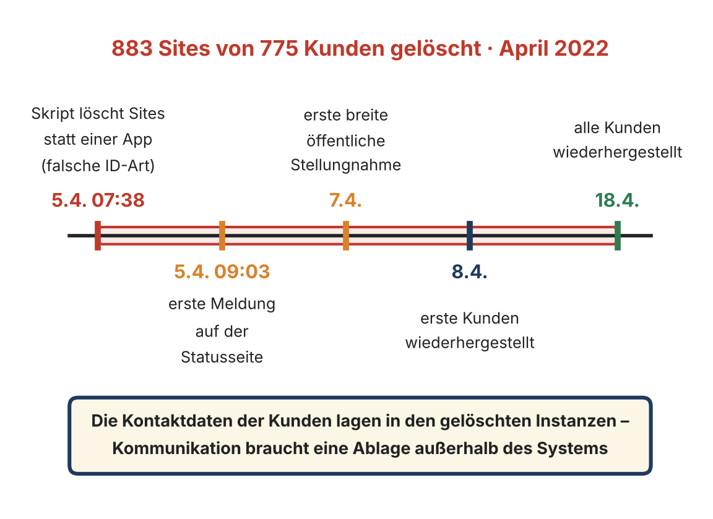{fig-alt="Zeitleiste: 5.4. 07:38 Skript löscht Sites, 5.4. 09:03 erste Meldung auf der Statusseite, 7.4. erste breite Stellungnahme, 8.4. erste Kunden wiederhergestellt, 18.4. alle Kunden wiederhergestellt" width="65%"}

### Exkurs: Vier Seiten einer Nachricht

Nach Schulz von Thun hat jede Botschaft vier Ebenen [@schulzvonthun1981]: Sachinhalt, Selbstoffenbarung, Beziehung, Appell. Beispiel im Incident: „Der Server ist schon wieder down.“

| Ebene | Botschaft |
|---|---|
| Sachinhalt | Der Server ist nicht erreichbar. |
| Selbstoffenbarung | Ich bin genervt und gestresst. |
| Beziehung | Ihr hättet das früher merken müssen. |
| Appell | Bitte tut endlich etwas! |

In Stresssituationen hören Menschen häufig auf der falschen Ebene. „Resilienz in Kommunikation heißt: auf allen vier Ohren bewusst sprechen und hören.“

## Incident-Response-Prozess

ISO/IEC 27035-1:2023 gliedert den Incident-Management-Prozess in fünf Phasen [@iso27035]:

1. Planen und vorbereiten
2. Erkennen und melden
3. Bewerten und entscheiden – Triage, Kritikalität bestimmen
4. Reagieren – eindämmen, beseitigen, wiederherstellen
5. Lehren ziehen – Erkenntnisse in die Vorbereitung zurückführen

Die Archivunterlagen nennen sechs Phasen (Detection & Reporting, Triage & Classification, Containment, Eradication, Recovery, Lessons Learned). Diese feinere Gliederung entspricht eher NIST SP 800-61 Rev. 2; Revision 3 (2025) richtet Incident Response am NIST CSF 2.0 aus [@nist80061r3]. Jede Phase braucht definierte Owner, Playbooks und Kommunikationskanäle.

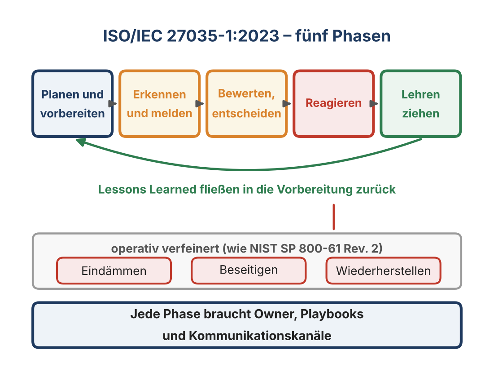{fig-alt="Fünf Phasen nach ISO/IEC 27035-1:2023 mit Rückfluss der Lessons Learned; darunter die operative Feingliederung der Reaktion in Eindämmen, Beseitigen und Wiederherstellen" width="60%"}

**Fall Rhein-Pfalz-Kreis (2022):** Ende Oktober 2022 traf Ransomware die Kreisverwaltung in Ludwigshafen. Ein Beschäftigter zog nachts den Stecker und begrenzte so den Schaden. Die Verwaltung war weder per E-Mail noch über die Durchwahlen erreichbar und arbeitete im Notbetrieb mit Laptop, Drucker und Excel-Listen; eine zentrale Rufnummer, ein Kontaktformular und Personal vor Ort in den Gemeinden ersetzten die üblichen Kanäle. Der Kreis zahlte kein Lösegeld, ab dem 11. November tauchten rund 20.000 Dateien im Darknet auf; rund 2.550 Betroffene erhielten Warnschreiben. Das Land bot Unterstützung in drei Stufen an. Jede Phase – erkennen, entscheiden, reagieren, informieren – brauchte eine Rolle.

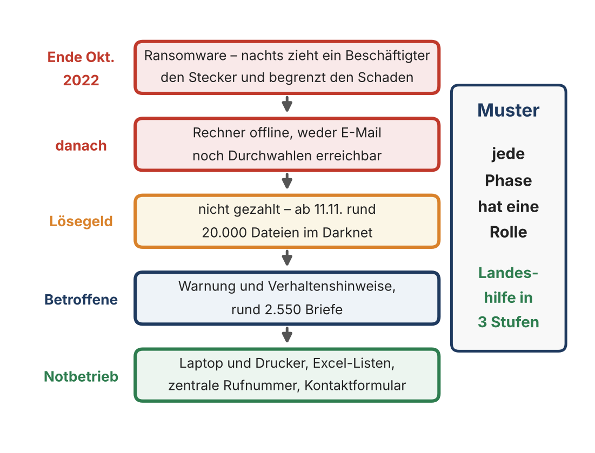{fig-alt="Ablauf beim Rhein-Pfalz-Kreis: Ransomware Ende Oktober 2022 und gezogener Stecker, Rechner offline, Lösegeld nicht gezahlt und Daten im Darknet, Warnung an Betroffene, Notbetrieb mit Ersatzkanälen" width="65%"}

## Übungs- und Trainingskultur

Resilienz ist keine Theorie – sie entsteht durch Übung.

- **Tabletop-Übungen:** szenariobasierte Planspiele zu Kommunikation und Entscheidungswegen, ohne technischen Aufwand.
- **Live-Simulationen:** technische Reaktionsfähigkeit unter Realbedingungen (Red Team, „Ransomware-Day“, Provider-Ausfall).
- **After-Action Reviews:** strukturiertes Feedback, keine Schuldzuweisung.

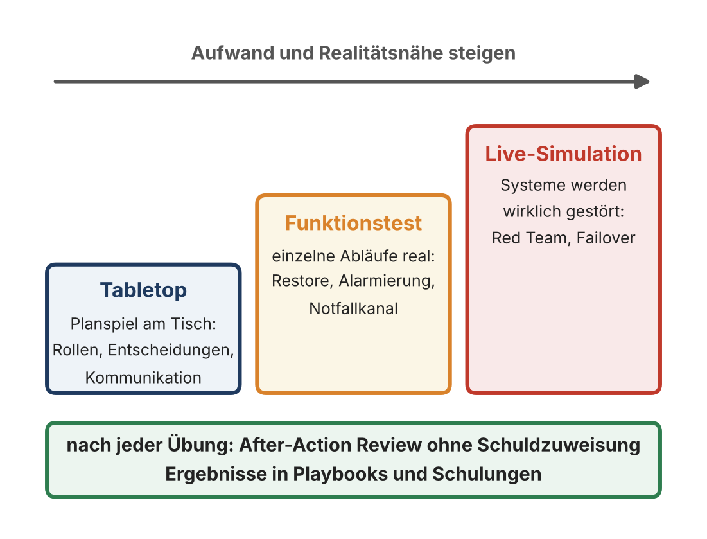{fig-alt="Drei Übungsformen mit steigendem Aufwand und Realitätsnähe: Tabletop, Funktionstest, Live-Simulation; darunter das After-Action Review nach jeder Übung" width="55%"}

| Metrik | Aussage |
|---|---|
| Time to Detect (TTD) | Wie schnell wird ein Incident erkannt? |
| Time to Decision | Wie schnell fällt eine handlungsleitende Entscheidung? |
| Time to Recover (TTR) | Wann sind kritische Systeme wieder lauffähig? |
| Communication Efficiency | Verhältnis bestätigter zu gesendeten Meldungen |
| Exercise Frequency | Anzahl der Übungen pro Jahr |

Verankerung: mindestens zwei Tabletop-Übungen pro Jahr, strukturierte Lessons-Learned-Protokolle, Teilnahme des Managements, standardisierte Bewertung. Ein Team, das regelmäßig übt, erlebt weniger Panik im Ernstfall.

**Fall LÜKEX 23:** Am 27. und 28. September 2023 übten Bund und Länder unter Federführung des BBK einen massiven Cyberangriff auf das Regierungshandeln – mit mehr als 50 Behörden und über 1.000 Mitwirkenden, acht Länder im vollen Übungsablauf. Geübt wurden Melde- und Kommunikationswege, das Zusammenspiel von Krisen- und IT-Notfallmanagement und die Krisenkommunikation. Kein Server wurde abgeschaltet: LÜKEX ist eine Tabletop-Übung im Großformat.

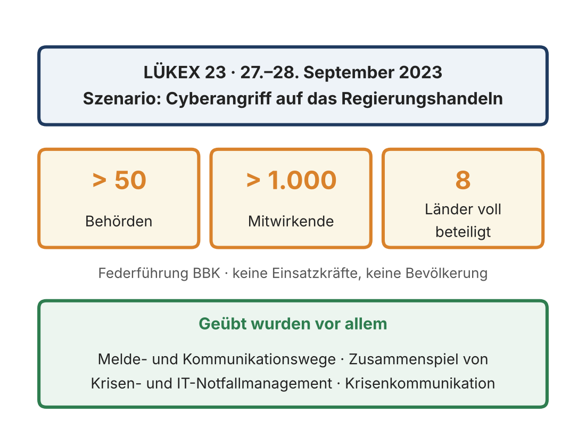{fig-alt="LÜKEX 23 am 27. und 28. September 2023 mit dem Szenario Cyberangriff auf das Regierungshandeln: mehr als 50 Behörden, mehr als 1.000 Mitwirkende, acht Länder voll beteiligt" width="60%"}

## Resilienz-Governance

| Managementsystem | Bezug zur Resilienz |
|---|---|
| ISMS (ISO/IEC 27001) | Struktur für Informationssicherheit und Incident Management |
| BCMS (ISO 22301) | Kontinuität kritischer Geschäftsprozesse |
| Risk Management (ISO 31000) | Identifikation und Bewertung von Bedrohungen |
| Crisis Management (ISO 22320) | Entscheidungs- und Kommunikationsstrukturen im Ereignisfall |
| Resilience Management (ISO 22316) | verbindet die Systeme zu einer adaptiven Gesamtstruktur |

Governance-Prinzipien: Verantwortung, Transparenz, Partizipation, Kontinuität, Lernfähigkeit. Kennzahlen: RTO-Erreichung, Übungshäufigkeit, Umsetzungsgrad der Lessons Learned, Reaktionszeit von Managemententscheidungen, Kommunikationslatenz. Nachweise: Übungs- und Incident-Protokolle, Nachverfolgung von Lessons Learned, Management Reviews, Schulungsnachweise. Berichtspflicht an Management und Aufsicht.

„Resilienz ist keine Projektaufgabe, sondern Führungsverhalten.“

## Kultur und Lernen

- **Blame-free Post-Mortems:** Statt „Who caused it?“ lautet die Frage „What can we improve?“ Leitfragen: Was ist passiert? Warum? Wie haben wir reagiert? Was lernen wir und wie setzen wir es um?
- **Psychologische Sicherheit** [@edmondson1999]: Teams dürfen Fehler zugeben und Unsicherheiten melden, ohne Angst vor persönlichen Konsequenzen.
- **Transparente Kommunikation:** Fehler werden geteilt, nicht versteckt.
- **Institutionelles Lernen:** Lessons Learned fließen in Prozesse; Organisationen entwickeln sich zur lernenden Organisation [@senge1990].

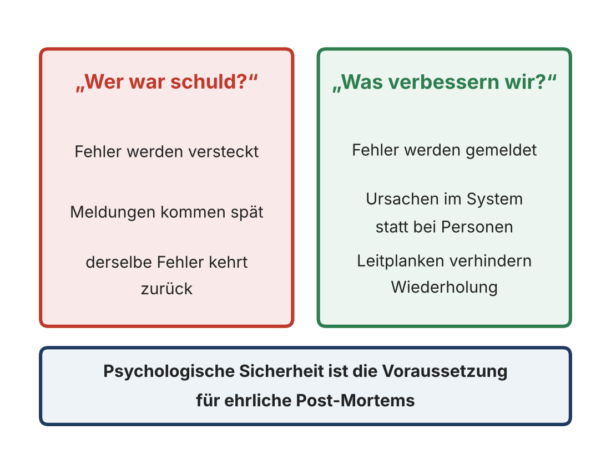{fig-alt="Gegenüberstellung: Die Frage Wer war schuld führt zu versteckten Fehlern, späten Meldungen und Wiederholung; die Frage Was verbessern wir führt zu gemeldeten Fehlern, systemischen Ursachen und Leitplanken" width="55%"}

**Fall Cloudflare (2019):** Am 2. Juli 2019 ging eine neue Firewall-Regel mit fehlerhaftem regulärem Ausdruck weltweit auf einmal live. Die Prozessoren liefen voll, der Verkehr brach um bis zu 82 Prozent ein; weil auch interne Werkzeuge am eigenen Netz hingen, brauchte das Team einen selten genutzten Notzugang. Nach 27 Minuten war der Verkehr wieder normal. Das zehn Tage später veröffentlichte Post-Mortem benennt keine Person, sondern Prozesslücken – Tests ohne Laufzeitprüfung, Umgehung des gestuften Rollouts – und setzt dort mit Leitplanken an.

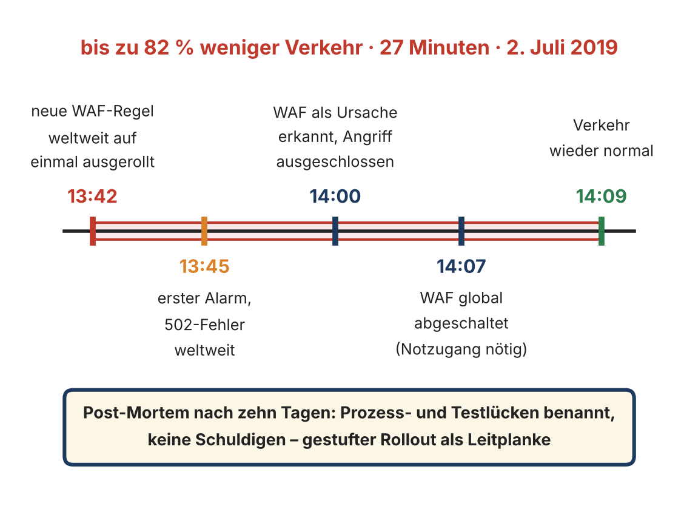{fig-alt="Zeitleiste in UTC: 13:42 Regel weltweit ausgerollt, 13:45 erster Alarm, 14:00 WAF als Ursache erkannt, 14:07 WAF global abgeschaltet, 14:09 Verkehr wieder normal" width="65%"}

„Technik stabilisiert Systeme – Organisation stabilisiert Verhalten – Kultur stabilisiert Vertrauen.“

## Was die Fälle zeigen

| Fall | Komponente | Lehre |
|---|---|---|
| Norsk Hydro 2019 | Kultur, Kommunikation | Offenheit und Handarbeit tragen, wenn die IT fällt |
| Anhalt-Bitterfeld 2021 | Strukturen | Krisenstab: Entscheidungskompetenz auf Zeit |
| Atlassian 2022 | Kommunikation | Kontaktdaten gehören außerhalb des Systems |
| Rhein-Pfalz-Kreis 2022 | Prozesse | Jede Phase braucht eine Rolle, auch der Notbetrieb |
| LÜKEX 23 | Menschen | Krisenstrukturen werden geübt, bevor sie gebraucht werden |
| Cloudflare 2019 | Kultur | Post-Mortem ohne Schuldige, Leitplanken statt Appelle |

## Häufige Irrtümer

| Irrtum | Gegenbeispiel |
|---|---|
| „Resilienz ist Sache der IT.“ | Norsk Hydro 2019: Die IT fiel, die Organisation trug |
| „Im Ernstfall entscheidet die Linie wie immer.“ | Anhalt-Bitterfeld 2021: Krisenstab mit Entscheidungskompetenz auf Zeit |
| „Unsere Kontaktliste liegt im System.“ | Atlassian 2022: Kontaktdaten wurden mit gelöscht |
| „Abschalten darf nur die Geschäftsführung.“ | Rhein-Pfalz-Kreis 2022: Ein Beschäftigter zog nachts den Stecker |
| „Üben kostet zu viel.“ | LÜKEX 23: Tabletop ohne einen abgeschalteten Server |
| „Nach dem Vorfall suchen wir den Schuldigen.“ | Cloudflare 2019: Prozesslücken statt Personen |

# Normativer Bezug

- **ISO 22316:** organisationale Resilienz als Fähigkeit, Störungen aufzufangen und sich anzupassen; Prinzipien und Attribute [@iso22316].
- **ISO/IEC 27035-1:2023:** fünfphasiger Incident-Management-Prozess [@iso27035].
- **NIST SP 800-61 Rev. 3:** Incident Response als Teil des Cybersecurity-Risikomanagements nach CSF 2.0 [@nist80061r3].
- **ISO 22301, ISO 22320:** BCMS sowie Entscheidungs- und Kommunikationsstrukturen im Krisenmanagement [@iso22301; @iso22320].
- **BSI-Standard 200-4:** Übungen und Tests als Nachweis der Wirksamkeit im BCM [@bsi2004].

# Übungen

## Kommunikationsübung: Vier Seiten einer Nachricht

3er-Gruppen, 10 Minuten. Analysieren Sie die Aussage aus einer Incident-Situation: **„Warum habt ihr das Backup noch nicht eingespielt?“**

- Welche Botschaften stecken in den vier Ebenen?
- Wie könnte dieselbe Aussage resilienter formuliert werden?
- Welche Missverständnisse entstehen, wenn nur eine Ebene gehört wird?
- Welche Kommunikationsregeln helfen, in Stresslagen klar zu bleiben?

## Gruppenübung: Ransomware am Montagmorgen

Montag, 08:15 Uhr: Mitarbeitende melden, dass Dateien auf Netzlaufwerken nicht mehr geöffnet werden können. Mehrere File-Server sind verschlüsselt, eine Lösegeldforderung erscheint. Cloud-Sync ist betroffen, VPN und Mail laufen noch.

Gruppen, 15–20 Minuten:

1. Wer übernimmt die Incident-Leitung?
2. Welche Systeme oder Personen müssen sofort informiert werden?
3. Welche Entscheidungen sind in den ersten 30 Minuten kritisch?
4. Wie läuft die interne und externe Kommunikation?
5. Welche Priorität hat Recovery gegenüber Forensik?
6. Wann erfolgt die Meldung an Aufsichtsbehörden (DSGVO Art. 33 / NIS-2)?

Nutzen Sie die Fälle der Sitzung als Orientierung: Wer zieht den Stecker? Wer spricht mit der Presse? Wo liegen die Kontaktlisten? Ab wann braucht es einen Krisenstab?

Typischer Verlauf und häufige Fehler zur Reflexion im Plenum:

| Phase | Beschreibung | Häufige Fehler |
|---|---|---|
| Detection | erste Hinweise, z. B. unzugängliche Daten | Unterschätzung der Lage, verspätete Eskalation |
| Response | Eindämmung, z. B. Netzwerksegmentierung | fehlende Koordination, doppelte Maßnahmen |
| Communication | interne und externe Information | Intransparenz, widersprüchliche Aussagen |
| Recovery | Wiederherstellung aus Backups | keine Priorisierung, ungetestete Backups |
| Adapt | Ursachenanalyse, Lessons Learned | keine systematische Nachbereitung |

Typische Lessons Learned: Playbooks sind Gold wert, wenn sie aktuell und trainiert sind. Ein Backup ist nur so gut wie der letzte Restore. Kommunikation entscheidet über Vertrauen. Forensik und Wiederanlauf müssen abgestimmt sein. Reviews sind Lerngelegenheiten.

# Prüfungsrelevante Leitfragen

- Was versteht ISO 22316 unter organisationaler Resilienz, und welche Kernkomponenten gehören dazu?
- Beschreiben Sie die vier Phasen des Resilienzzyklus und ihre organisatorische Umsetzung.
- Warum scheitern viele Cyber-Resilienzmaßnahmen nicht an Technik, sondern an Organisation?
- Welche Rolle spielt Kommunikation in Krisen- und Notfallsituationen? Erläutern Sie die CCCC-Prinzipien.
- Wenden Sie das Modell von Schulz von Thun auf eine Aussage aus einem Incident an.
- Welche Formen von Resilienztraining gibt es, und welche Kennzahlen machen ihren Erfolg sichtbar?
- Wie wird Resilienz in bestehende Managementsysteme integriert?
- Nennen Sie die fünf Phasen des Incident-Management-Prozesses nach ISO/IEC 27035-1:2023 und ordnen Sie den Fall Rhein-Pfalz-Kreis 2022 zu.
- Erläutern Sie an einem der Fälle der Sitzung, warum Kommunikationswege und Kontaktlisten außerhalb der betroffenen Systeme liegen müssen.

**Merksätze:** Organisationale Resilienz ist die Fähigkeit zur koordinierten Reaktion. Rollen, Kommunikation und Übung sind entscheidend. Recovery muss technisch und organisatorisch funktionieren. Lernen ist Teil des Zyklus, nicht dessen Nachbereitung.

# Vor- und Nachbereitung

**Hausaufgabe:** Erstellen Sie für Ihre Organisation (Hochschule, Arbeitgeber, Verein) eine Rollenkarte für die ersten 60 Minuten eines Ransomware-Vorfalls: Wer leitet? Wer darf Systeme abschalten? Wer informiert wen über welchen Kanal – und wo liegt die Kontaktliste, wenn E-Mail und Fileserver ausfallen?

**Ausblick Termin 6:** Rollen und Verantwortlichkeiten in der Cyber-Organisation – CISO, SOC, CERT und weitere Schlüsselrollen.

# Material aus dem Archiv

Das vollständige Vorlesungsskript zu dieser Sitzung steht unter [Skript 5](../skripte/Skript-05.html), auch als [PDF](../skripte/Skript-05.pdf) und [Word-Datei](../skripte/Skript-05.docx).

`05 Resilienz als Organisationsfähigkeit/05_Resilienz als Organisationsfahigkeit.pdf` und `Skript Sitzung 5 Resiliente Organisationsentwicklung.pdf`.
