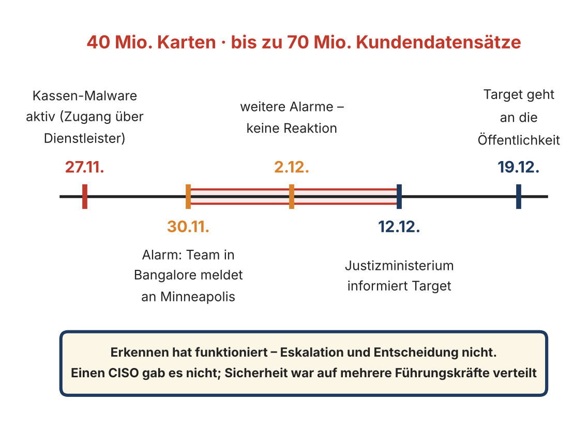
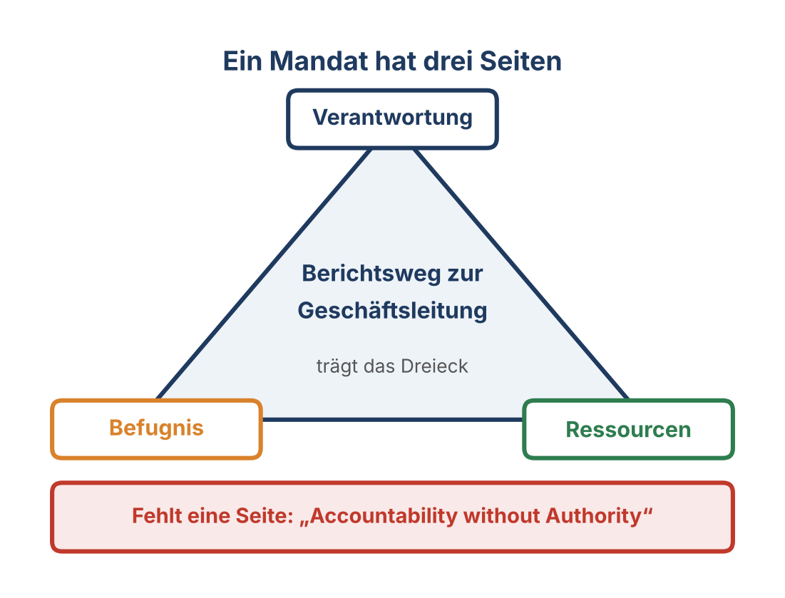
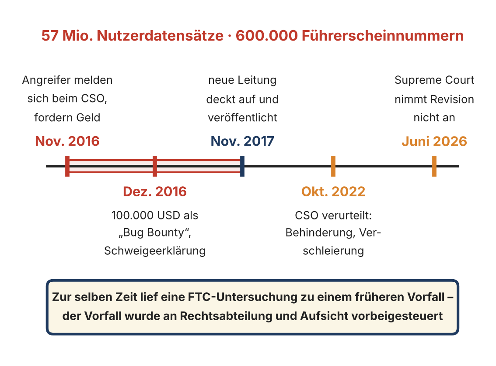
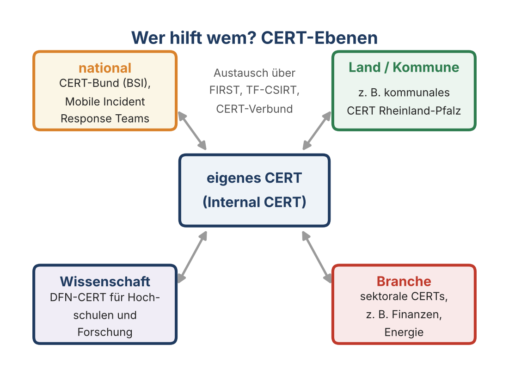
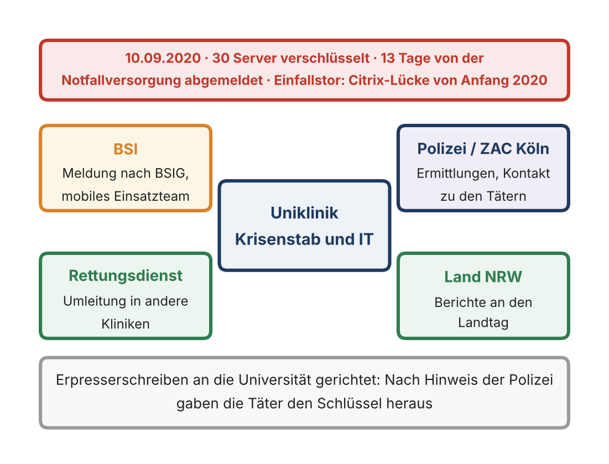
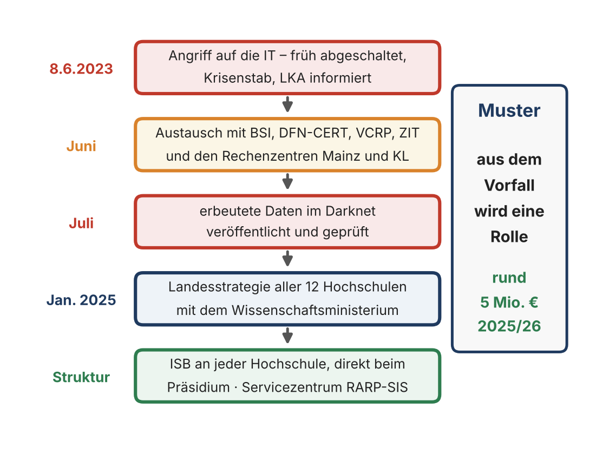
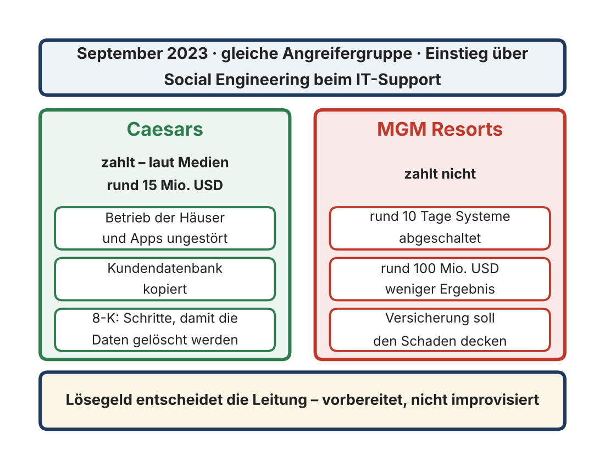
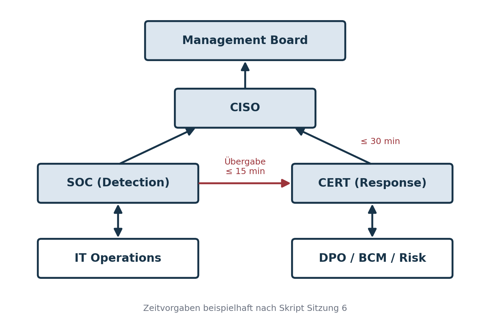
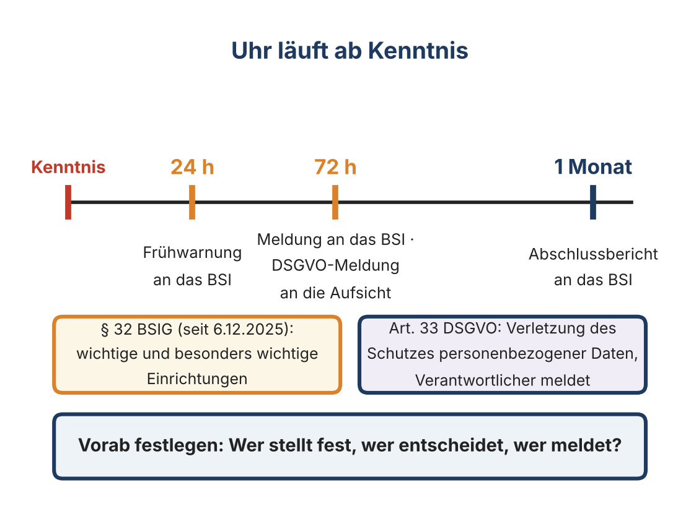

::: {.content-visible when-format="html"}
[Semesterübersicht](../index.html) · [Folien](../Präsentationen/Termin-06/_output/main.html) · [Skript](../skripte/Skript-06.html) ([PDF](../skripte/Skript-06.pdf), [Word](../skripte/Skript-06.docx)) · [Glossar](../glossar.html) · [Quellen](../quellen.html)
:::

# Leitfrage

> Wie wird aus Verantwortlichkeit Organisation – und aus Organisation Resilienz?

Resilienz bedeutet nicht, dass jeder alles kann, sondern dass jeder weiß, wann er in welcher Rolle handeln muss.

# Lernziele

Nach diesem Termin können Studierende

- die zentralen Rollen der Cyber-Resilienz (CISO, SOC, CERT, DPO, BCM, IT Operations, Management) und ihr Zusammenspiel erklären,
- Aufgaben, Befugnisse und Grenzen dieser Rollen analysieren,
- typische Konflikte und Governance-Lösungen erkennen,
- Rollenverantwortung und Eskalationslogik in einer Übung anwenden,
- an realen Fällen begründen, warum ein Alarm einen Eigentümer, ein CISO ein Mandat und eine Organisation vorab bekannte externe Partner braucht.

# Einstieg: Target 2013

Ab dem 27. November 2013 lief in den US-Filialen von Target Schadsoftware auf den Kassensystemen; die Angreifer waren mit Zugangsdaten eines Dienstleisters eingedrungen. Am 30. November meldete das Überwachungsteam in Bangalore einen Alarm an das Sicherheitsteam in Minneapolis, am 2. Dezember folgten weitere – ohne Reaktion. Erst am 12. Dezember wies das US-Justizministerium Target auf den Vorfall hin. Rund 40 Millionen Kartendaten und bis zu 70 Millionen weitere Kundendatensätze waren betroffen.

{fig-alt="Zeitleiste Target 2013: 27.11. Malware aktiv, 30.11. Alarm aus Bangalore an Minneapolis, 2.12. weitere Alarme ohne Reaktion, 12.12. Justizministerium informiert Target, 19.12. Veröffentlichung" width="65%"}

Die Erkennung hat funktioniert, Eskalation und Entscheidung nicht. Einen CISO gab es nicht; die Rolle wurde erst im Juni 2014 geschaffen. Genau darum geht es in dieser Sitzung: Wem gehört der Alarm?

# Fachinhalte

## Rückblick

Sitzung 5 hat organisationale Resilienz als Fähigkeit zur koordinierten Reaktion beschrieben: Rollen statt Personen, Entscheidungskompetenz auf Zeit, ein Incident-Management-Prozess mit Ownern in jeder Phase. Diese Sitzung macht die Rollen konkret. „Resilienz ist Teamarbeit – aber nur, wenn das Team dieselbe Sprache spricht.“

## Rollen als Strukturprinzip

Rollen definieren Zuständigkeiten unabhängig von Personen und Hierarchie. Eine Rolle beschreibt **Verantwortung** (wofür bin ich zuständig?), **Befugnis** (was darf ich entscheiden?) und **Schnittstellen** (mit wem interagiere ich?).

- Technik kann reagieren – Menschen entscheiden.
- Klare Rollen verhindern Chaos und Doppelarbeit.
- Verantwortung ersetzt Schuld: Fehler werden als Prozessprobleme verstanden.
- Ohne Struktur keine Geschwindigkeit.

Typische Fragen, die vorab beantwortet sein müssen: Wer schaltet Systeme ab, wenn Malware erkannt wird? Wer informiert Behörden oder Kunden? Wer genehmigt öffentliche Kommunikation?

## CISO – Mandat und strategische Steuerung

Das Mandat ergibt sich in der Regel aus dem ISMS nach ISO/IEC 27001 [@iso27001]. Der CISO berichtet idealerweise direkt an Geschäftsführung oder Vorstand.

**Kernverantwortlichkeiten:** Sicherheitsstrategie entwickeln und pflegen; ISMS steuern und auditieren; Incident-Management-Prozess leiten und mit SOC/CERT koordinieren; Risiken an Management und Aufsicht kommunizieren; regulatorische Compliance (NIS-2, DSGVO, KRITIS) sicherstellen; Sicherheitskultur fördern.

**Mandatsdilemma:** Verantwortung ohne formale Entscheidungsgewalt oder Ressourcen („Accountability without Authority“). Lösung: strategische Verankerung, festes Budget und Reporting-Mandat, dokumentierte Eskalationsrechte. Eine zu tiefe Einbettung in die IT-Linie birgt Zielkonflikte zwischen Verfügbarkeit und Sicherheit.

Der CISO ist kein „Security-Polizist“, sondern Business-Partner: Er übersetzt technische Risiken in betriebswirtschaftliche Entscheidungsgrundlagen. „Ein CISO ohne Mandat ist wie ein Pilot ohne Steuerknüppel.“

{fig-alt="Dreieck mit den Ecken Verantwortung, Befugnis und Ressourcen, getragen vom Berichtsweg zur Geschäftsleitung" width="50%"}

**Fall Uber (2016):** Im November 2016 meldeten sich Angreifer beim Sicherheitschef von Uber: Sie hatten Daten von rund 57 Millionen Nutzern und 600.000 Führerscheinnummern kopiert. Uber zahlte 100.000 US-Dollar, verbucht als Bug-Bounty-Prämie, gegen Schweigeerklärungen – während die US-Handelsaufsicht FTC einen früheren Vorfall untersuchte. Die neue Unternehmensleitung deckte den Vorfall im November 2017 auf. Der Sicherheitschef wurde 2022 wegen Behinderung eines Verfahrens und Verschleierung einer Straftat verurteilt; seit Juni 2026 ist das Urteil rechtskräftig.

{fig-alt="Zeitleiste Uber: November 2016 Angreifer melden sich, Dezember 2016 Zahlung als Bug Bounty, November 2017 Aufdeckung, Oktober 2022 Verurteilung, Juni 2026 Revision nicht angenommen" width="65%"}

**Gegenstück SolarWinds (2023–2025):** Die US-Börsenaufsicht SEC verklagte 2023 erstmals einen CISO persönlich: Öffentliche Sicherheitsaussagen hätten nicht zum internen Kenntnisstand gepasst. Das Gericht wies 2024 die meisten Vorwürfe ab, 2025 wurde das Verfahren ohne Schuldeingeständnis eingestellt. Gemeinsame Lehre beider Fälle: Eskalation dokumentieren, Meldeentscheidungen nicht allein treffen, nach außen sagen, was innen gilt.

## SOC – das sensorische Nervensystem

Das Security Operations Center überwacht Systeme, Netze und Anwendungen rund um die Uhr. Herzstück ist das SIEM, das Logdaten aggregiert und gegen Use Cases abgleicht.

**Aufgaben:** Monitoring & Detection, Analysis & Classification, Eskalation bestätigter Vorfälle an das CERT, Threat Intelligence, Reporting und Lagebilder.

| Ebene | Bezeichnung | Aufgabe |
|---|---|---|
| Tier 1 | Monitoring / Analysis | erste Alarmbewertung, Triage, Eskalation |
| Tier 2 | Investigation | vertiefte Analyse, Kontext, Angriffsketten |
| Tier 3 | Response / Forensics / Threat Hunting | technische Eindämmung, Spezialanalyse, proaktive Suche |

**Herausforderungen:** Alarm Fatigue, Personalmangel, fragmentierte Tool-Landschaft, unklare Übergaben, fehlende Priorisierung nach Business Impact. Antworten: Automatisierung (SOAR), klare Playbooks, Risikopriorisierung, kontinuierliches Training. „Resilienz beginnt mit Wahrnehmung – und Wahrnehmung beginnt im SOC.“

## CERT – die operative Reaktionseinheit

**Mandat:** Koordination der technischen Incident Response; Forensik und Ursachenanalyse; Containment und Eradication; Unterstützung des Wiederanlaufs; Kommunikation mit internen Stellen und externen Partnern (BSI, ENISA, Branchen-CERTs); Lessons-Learned-Dokumentation.

| Typ | Beschreibung | Beispiel |
|---|---|---|
| Internal CERT | eigenes Unternehmen oder Konzern | Corporate CERT |
| National CERT | staatliche Koordination | CERT-Bund |
| Sectoral CERT | branchenbezogene Zusammenarbeit | Finanz-, Energie-CERTs |
| Academic CERT | Forschung und Bildung | DFN-CERT |

Erfolgskriterien: klare Governance, trainierte Teams, standardisierte Playbooks, forensische Kompetenz, transparente Kommunikation, Nachbereitungskultur. „Das CERT ist das Immunsystem der Organisation – es reagiert, bekämpft, heilt und erinnert.“

{fig-alt="Eigenes CERT in der Mitte, verbunden mit nationaler Ebene, Land und Kommune, Wissenschaft und Branchen-CERTs" width="55%"}

**Fall Uniklinik Düsseldorf (2020):** In der Nacht zum 10. September 2020 verschlüsselte Ransomware 30 Server des Universitätsklinikums; Einfallstor war eine seit Januar bekannte Citrix-Schwachstelle. Das Klinikum meldete sich 13 Tage von der Notfallversorgung ab, meldete den Vorfall dem BSI und erhielt Unterstützung durch ein mobiles Einsatzteam. Das Erpresserschreiben war an die Universität gerichtet; nach einem Hinweis der Polizei gaben die Täter einen Schlüssel heraus. Den Tod einer umgeleiteten Patientin sah die Staatsanwaltschaft nicht als Folge des Angriffs. Der Fall zeigt, wie viele Rollen von außen hinzukommen – und dass ihre Ansprechpartner vorher bekannt sein müssen.

{fig-alt="Uniklinik Düsseldorf in der Mitte, umgeben von BSI, Polizei und ZAC Köln, Rettungsdienst und Land NRW" width="65%"}

## Zusammenspiel von CISO, SOC und CERT

| Funktion | Ebene | Hauptaufgabe | Zeithorizont |
|---|---|---|---|
| CISO | strategisch | Richtlinien, Ressourcen, Governance, Reporting | langfristig |
| SOC | operativ | Erkennen, Bewerten, Eskalieren | kurzfristig |
| CERT | taktisch | Koordinieren, Reagieren, Lernen | mittelfristig |

Prinzip: **Trennung der Funktionen – Integration der Wirkung.** Erfolgsfaktoren sind definierte Eskalationsschwellen, ein gemeinsames Lagebild (Single Source of Truth, etwa SIEM/SOAR, Lageberichte, Dashboards) und regelmäßige Lage- und Lessons-Learned-Meetings. „Was das SOC sieht, muss das CERT wissen – und was das CERT lernt, muss der CISO verstehen.“

## Weitere Schlüsselrollen

| Rolle | Kernaufgaben | Bezug zur Resilienz |
|---|---|---|
| DPO (Datenschutzbeauftragte Person) | DSGVO-Compliance, Bewertung von Datenschutzvorfällen, Schnittstelle zur Aufsicht | schützt Vertrauen und Reputation; bewertet Meldepflicht nach Art. 33 DSGVO |
| BCM-Manager | Business Impact Analysis, Notfallpläne, Wiederanlaufkoordination, Übungen | Recovery und Priorisierung: „Das CERT schützt Systeme – das BCM schützt den Zweck.“ |
| IT Operations Lead | Betrieb, Infrastruktur, Wiederherstellung nach CERT-Anweisung | technische Umsetzung; im Incident Betroffener und Akteur zugleich |
| Risk Manager | Risikoanalyse, Bewertung, Register | Früherkennung und Priorisierung |
| Management Board | Strategie genehmigen, Ressourcen, Risikoakzeptanz, externe Kommunikation | Gesamtverantwortung: Resilienz ist Chefsache |

Nach NIS-2-Richtlinie [@nis2] und ISO/IEC 27001 muss die Leitung nachweislich Verantwortung für Sicherheits- und Resilienzmaßnahmen übernehmen. In Deutschland verpflichtet § 38 BSIG (seit 6. Dezember 2025) die Geschäftsleitung wichtiger und besonders wichtiger Einrichtungen, Risikomanagementmaßnahmen zu billigen, ihre Umsetzung zu überwachen und an Schulungen teilzunehmen.

**Fall Hochschule Kaiserslautern (2023):** Am 8. Juni 2023 wurde die IT der Hochschule angegriffen. Sie schaltete früh ab, bildete einen Krisenstab, informierte das LKA und tauschte sich mit BSI, DFN-CERT und den Hochschulrechenzentren in Mainz und Kaiserslautern aus; im Juli tauchten erbeutete Daten im Darknet auf. Im Januar 2025 vereinbarten die zwölf Hochschulen des Landes mit dem Wissenschaftsministerium eine Landesstrategie: Informationssicherheitsbeauftragte an jeder Hochschule mit direkter Anbindung an das Präsidium und ein gemeinsames Servicezentrum an der RPTU. Hochschulen fallen nicht unter NIS-2 – aus dem Vorfall wurde eine Rolle.

{fig-alt="Ablauf: Angriff am 8.6.2023, Austausch mit BSI und DFN-CERT, Daten im Darknet, Landesstrategie Januar 2025, Informationssicherheitsbeauftragte und Servicezentrum" width="65%"}

**Fall MGM und Caesars (2023):** Dieselbe Angreifergruppe traf im September 2023 zwei Casino-Konzerne in Las Vegas, jeweils über Social Engineering beim IT-Support. Caesars zahlte nach Medienberichten rund 15 Millionen US-Dollar, damit kopierte Kundendaten gelöscht werden; der Betrieb lief weiter. MGM zahlte nicht, schaltete Systeme ab und bezifferte die Auswirkung auf rund 100 Millionen US-Dollar Ergebnis. Ob gezahlt wird, ist eine Entscheidung der Leitung – sie braucht vorbereitete Grundlagen.

{fig-alt="Gegenüberstellung: Caesars zahlt laut Medien rund 15 Millionen US-Dollar, Betrieb ungestört; MGM zahlt nicht, rund zehn Tage Systeme abgeschaltet, rund 100 Millionen US-Dollar weniger Ergebnis" width="65%"}

## Kommunikations- und Eskalationsmodell

Grundprinzipien resilienter Kommunikation: **Klarheit** (wer informiert wen, über welchen Kanal, mit welchem Ziel?), **Redundanz** (mehr als ein Pfad), **Priorisierung** nach Schweregrad, **Vertraulichkeit** (Need-to-know), **Bidirektionalität** (jede Information erzeugt eine Rückmeldung). Weitere Leitsätze: Single Source of Truth, Time to Inform innerhalb definierter Fristen, vorab definierte und getestete Kanäle.

{fig-alt="Organigramm: Das Management Board steht oben, darunter der CISO. SOC (Detection) und CERT (Response) berichten an den CISO; das SOC übergibt an das CERT innerhalb von 15 Minuten, das CERT eskaliert an den CISO innerhalb von 30 Minuten. Darunter IT Operations sowie DPO, BCM und Risk." width=80%}

Ebenen: operativ (SOC, IT Ops – technische Meldungen), taktisch (CERT, DPO, BCM – Koordination und Priorisierung), strategisch (CISO, Management – Entscheidungen, Ressourcen, externe Kommunikation). Die Eskalationszeiten sind Beispielwerte aus dem Skript.

**Kanäle:** Krisenkanäle (z. B. Teams-„Crisis Room“), Hotlines und War Rooms, automatisierte Alarmierung aus SIEM/SOAR, Incident-Management-Tools und **Offline-Fallbacks** bei Netzausfall (Mobiltelefone, SMS). Cyber-Resilienz ohne Kommunikationsresilienz bleibt Illusion.

## Meldepflichten

| Kategorie | Meldepflicht | Ansprechpartner |
|---|---|---|
| technischer Sicherheitsvorfall | nein | CERT, CISO |
| datenschutzrelevanter Vorfall | ja – binnen 72 Stunden (Art. 33 DSGVO) | DPO |
| wichtige oder besonders wichtige Einrichtung (NIS-2) | ja – 24 h Frühwarnung, 72 h Meldung, Abschlussbericht nach einem Monat (§ 32 BSIG) | CISO, Management |
| Betriebsunterbrechung über definierte Dauer | BCM-relevant | BCM-Manager |

„Nicht jeder Incident ist meldepflichtig – aber jeder muss dokumentiert werden.“

{fig-alt="Zeitstrahl ab Kenntnis: 24 Stunden Frühwarnung, 72 Stunden Meldung an das BSI und DSGVO-Meldung, ein Monat Abschlussbericht" width="55%"}

::: {.callout-note title="Hinweis zur Aktualität"}
Das Skript verweist auf § 8b BSIG. Mit dem NIS-2-Umsetzungsgesetz ist das BSIG seit 6. Dezember 2025 neu gefasst; die Meldepflichten stehen jetzt in § 32 BSIG, die Pflichten der Geschäftsleitung in § 38 BSIG. Die NIS-2-Richtlinie ist die Richtlinie (EU) 2022/2555. Siehe [Hinweise zur Aktualität](../quellen.html#hinweise-zur-aktualität).
:::

## Konfliktlinien und Lösungsprinzipien

Jede Rolle optimiert ein anderes Kriterium: der CISO Risiko, das SOC Detektionsgeschwindigkeit, das CERT Eindämmung, IT Ops Verfügbarkeit, der DPO Rechtssicherheit, das Management Geschäftskontinuität und Kosten.

| Konflikt | Ursache | Resiliente Lösung |
|---|---|---|
| CISO vs. CIO | Sicherheit vs. Verfügbarkeit | klare Zieltrennung, gemeinsame KPIs |
| SOC vs. IT Ops | „Wer darf eingreifen?“ | Runbooks und Eskalationskriterien |
| CERT vs. PR | Kommunikationsfreigabe | vorab definierte Kommunikationsmatrix |
| BCM vs. Security | Wiederanlauf vs. Beweissicherung | Business-Impact-Analysen abstimmen |
| DPO vs. Incident Team | Datenschutzmeldungen, Datenweitergabe | Abstimmung mit Legal und CISO |

Lösungsprinzipien: Governance durch Klarheit, Kommunikation durch Standardisierung, Entscheidung durch Vorbereitung (Tabletop), Priorisierung durch Business Impact, Vertrauen durch Kultur. Beispielhafte Governance-Matrix:

| Entscheidungsfeld | Primär verantwortlich | Stellvertretend | Informationspflicht |
|---|---|---|---|
| Isolierung eines Systems | CERT | IT Ops | CISO |
| Externe Kommunikation | Management | PR | CISO, DPO |
| Behördenmeldung | DPO (Datenschutz) / CISO (BSI) | CISO / DPO | Management |
| Lösegeldfrage | Management | – | CISO, Legal |
| Wiederanlaufentscheidung | BCM | CERT | Management |
| Lessons Learned | CISO | CERT | alle betroffenen Bereiche |

„Reibungslosigkeit ist kein Zeichen von Stabilität, sondern von Stillstand.“ Cross-Role-Trainings machen Reibung vorhersehbar.

## Was die Fälle zeigen

| Fall | Rolle | Lehre |
|---|---|---|
| Target 2013 | SOC → Entscheidung | Ein Alarm braucht einen Eigentümer und eine Eskalationsschwelle |
| Uber 2016 | CISO | Meldeentscheidungen gehören nicht in eine Hand |
| SolarWinds 2023–2025 | CISO | Eskalation dokumentieren, außen sagen, was innen gilt |
| Uniklinik Düsseldorf 2020 | CERT, externe Partner | BSI, Polizei, Leitstelle – vorher bekannt |
| HS Kaiserslautern 2023 | Rollenaufbau | Aus dem Vorfall wird eine Rolle |
| MGM / Caesars 2023 | Management Board | Lösegeld ist Leitungsentscheidung – vorbereitet |

## Häufige Irrtümer

| Irrtum | Gegenbeispiel |
|---|---|
| „Wenn das SOC alarmiert, reagiert schon jemand.“ | Target 2013: Alarme kamen an, niemand entschied |
| „Der CISO regelt das intern.“ | Uber 2016: Vertuschung endete mit einer Verurteilung |
| „Den CISO trifft persönlich nichts.“ | SolarWinds: erstes Verfahren gegen einen CISO persönlich (2025 eingestellt) |
| „Ein Vorfall ist Sache der eigenen IT.“ | Uniklinik Düsseldorf 2020: BSI, Polizei und Rettungsdienst wurden Teil der Lage |
| „Ohne gesetzliche Pflicht brauchen wir keine Sicherheitsrolle.“ | Hochschule Kaiserslautern: Landesstrategie ohne NIS-2-Pflicht |
| „Über Lösegeld entscheidet die IT.“ | MGM und Caesars 2023: zwei Leitungsentscheidungen |

# Normativer Bezug

| Standard / Leitlinie | Relevanz |
|---|---|
| ISO/IEC 27001 | Rollen und Verantwortlichkeiten im ISMS |
| ISO/IEC 27035 | Incident-Response-Prozesse und Eskalationspfade |
| ISO 22320 | Krisenmanagement und Führungsstrukturen |
| ISO 22316 | Grundprinzipien organisationaler Resilienz |
| BSI-Standard 200-4 | Business Continuity Management |
| ENISA Good Practice | SOC/CERT-Zusammenarbeit (Titel und Jahr ungeprüft, siehe Quellen, Hinweis 10) |
| NIS-2-Richtlinie (EU) 2022/2555 | Verantwortung der Leitung, Meldepflichten |
| BSIG in der Fassung des NIS2UmsuCG | § 32 Meldepflichten, § 38 Pflichten der Geschäftsleitung |

# Übung: Wer macht was im Incident?

Montag, 08:47 Uhr: Eine Person im Finanzbereich öffnet eine E-Mail mit dem Betreff „Überweisungserlaubnis“. Minuten später meldet das SOC verdächtige Logins aus dem Ausland mit kompromittierten Admin-Credentials. Das CERT wird informiert; ob Daten abgeflossen sind, ist unklar. Das Management fordert einen Bericht, der DPO fragt nach der Meldepflicht, und die Presseabteilung hat Gerüchte über einen Cyberangriff gehört.

Gruppen mit 4–5 Personen, 20 Minuten, danach 15 Minuten Plenum:

1. Identifizieren Sie alle relevanten Rollen.
2. Ordnen Sie zu: Wer wird zuerst informiert? Wer entscheidet über Systemtrennung? Wer kommuniziert intern und extern? Wer bewertet rechtliche Meldepflichten? Wer dokumentiert und berichtet an das Management?
3. Skizzieren Sie ein Kommunikationsmodell mit Pfeilen zwischen den Rollen.
4. Definieren Sie einen Eskalationszeitplan (SOC → CERT → CISO innerhalb von x Minuten).
5. Benennen Sie Konfliktpunkte und schlagen Sie Governance- oder Prozessverbesserungen vor.

Merksatz: **Klarheit schafft Geschwindigkeit – und Geschwindigkeit schafft Resilienz.**

Reflexion im Plenum: Wo entstanden Unklarheiten? Welche Wege waren zu lang? Welche Rolle hätte stärker eingebunden werden müssen? Wie hätte psychologische Sicherheit geholfen?

# Prüfungsrelevante Leitfragen

Die Leitfragen 1–30 des Skripts bilden die Klausurbasis, 31–40 dienen der Vertiefung. Eine Auswahl:

1. Warum sind klar definierte Rollen eine zentrale Voraussetzung organisationaler Resilienz?
2. Wie unterscheidet sich Verantwortung von Schuld im Kontext der Cyber-Resilienz?
3. Welche Kernaufgaben und Befugnisse hat der CISO? Was bedeutet das Mandatsdilemma?
4. Warum sollte der CISO unabhängig von der IT-Linie positioniert sein?
5. Wie ist ein SOC nach dem Tier-Modell aufgebaut? Was ist Alarm Fatigue?
6. Welche Unterschiede bestehen zwischen Internal, Sectoral und National CERTs?
7. Was bedeutet „Trennung der Funktionen – Integration der Wirkung“?
8. Warum ist ein gemeinsames Lagebild essenziell?
9. Welche Rolle spielt der DPO im Incident-Fall? Wie ergänzen sich CERT und BCM im Wiederanlauf?
10. Warum trägt das Management Board die Gesamtverantwortung?
11. Nennen Sie die fünf Grundprinzipien resilienter Kommunikation.
12. Welche Meldepflichten ergeben sich aus DSGVO und NIS-2?
13. Nennen Sie drei typische Konfliktlinien und wie eine Governance-Matrix hilft.
14. Transfer: Was unterscheidet eine resiliente von einer robusten Organisation aus Sicht der Verantwortlichkeitsstruktur?
15. Erläutern Sie am Fall Target 2013, warum funktionierende Erkennung allein keine Resilienz schafft.
16. Welche Rollen und Meldewege hätten im Fall Uber 2016 die Vertuschung verhindert?
17. Ordnen Sie die externen Akteure im Fall Uniklinik Düsseldorf 2020 den CERT-Ebenen zu.

**Zusammenfassung:** Rollen sind das organisatorische Immunsystem der Cyber-Resilienz. CISO, SOC und CERT bilden das Kern-Trio, unterstützt von DPO, BCM, IT Ops und Management. Klare Zuständigkeiten, getestete Eskalationswege und abgestimmte Kommunikation sind Resilienz in Aktion. „Struktur ist das Skelett der Resilienz – Kommunikation ist ihr Nervensystem.“

# Vor- und Nachbereitung

**Hausaufgabe:** Ergänzen Sie Ihre Rollenkarte aus Termin 5 um zwei Zeilen: Wer darf einen Restore aus dem Backup freigeben – und wann wurde zuletzt ein Restore getestet? Finden Sie für Ihre Organisation heraus, ob es darauf eine Antwort gibt.

**Ausblick Termin 7:** Technische Resilienzmaßnahmen I – Backup, Disaster Recovery und Notfalltests.

# Material aus dem Archiv

Das vollständige Vorlesungsskript zu dieser Sitzung steht unter [Skript 6](../skripte/Skript-06.html), auch als [PDF](../skripte/Skript-06.pdf) und [Word-Datei](../skripte/Skript-06.docx).

`06 Org. Resilienz II - Rollen und Verantwortlichkeiten/06_Resilienz II Rollen und Verantwortlichkeiten.pdf` und `Skript Sitzung 6 Organisatorische Resilienz Rollen und Verantwortlichkeiten.pdf`.
