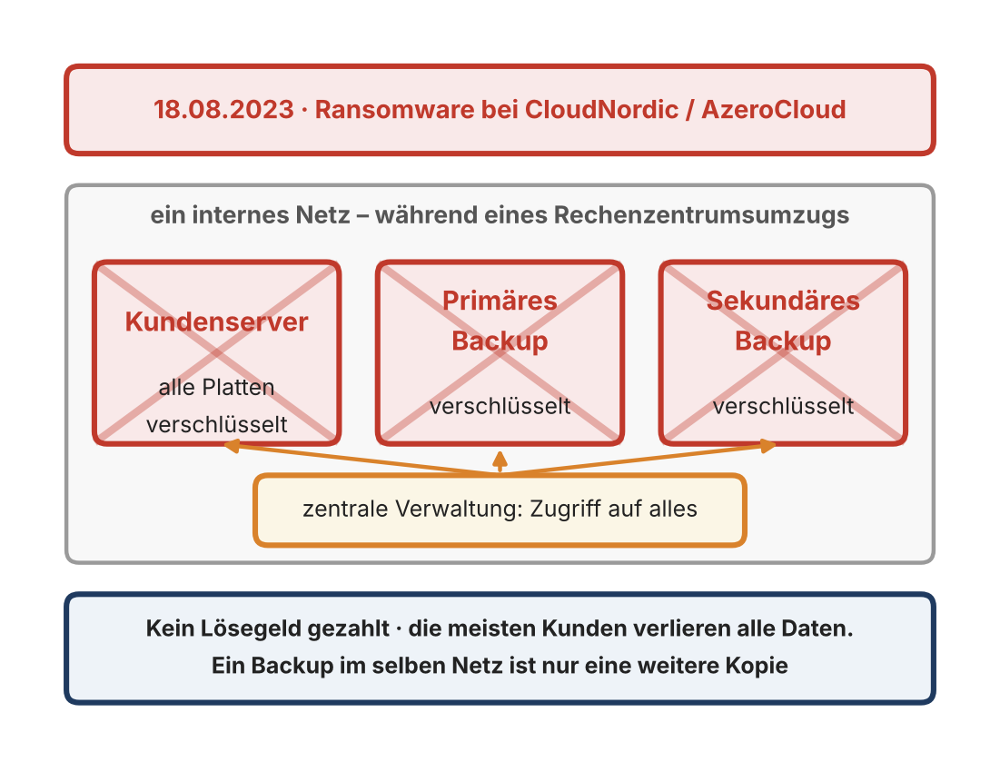
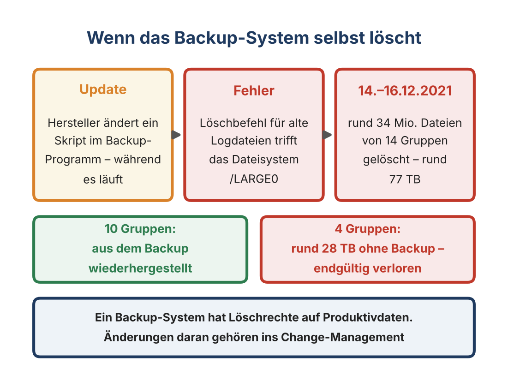
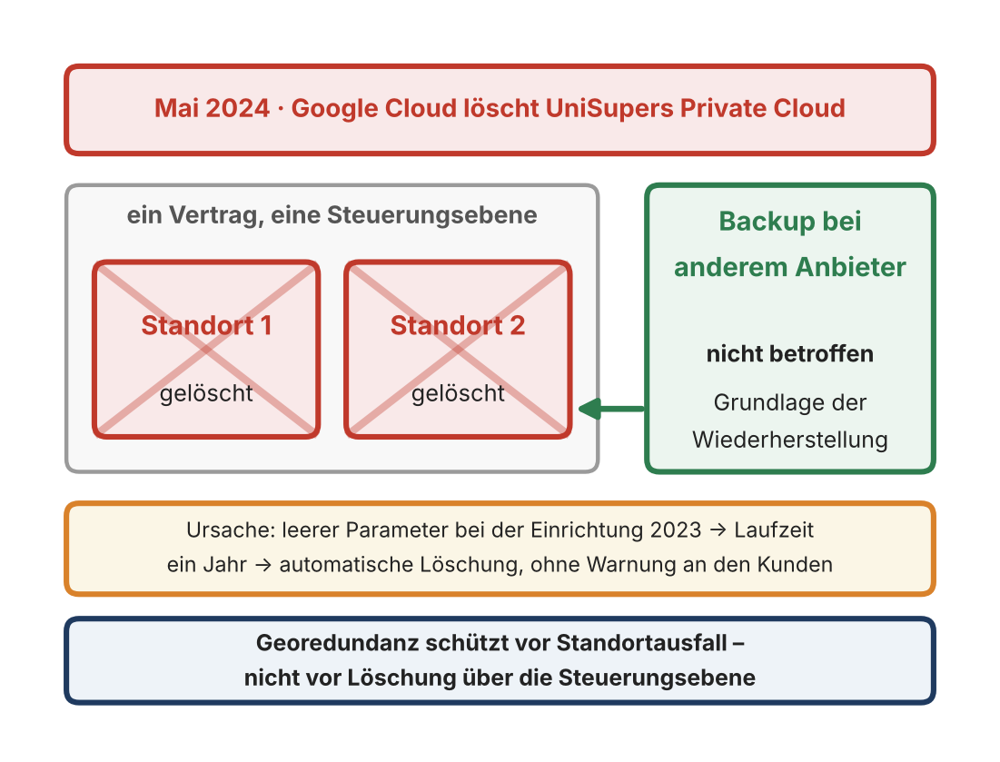
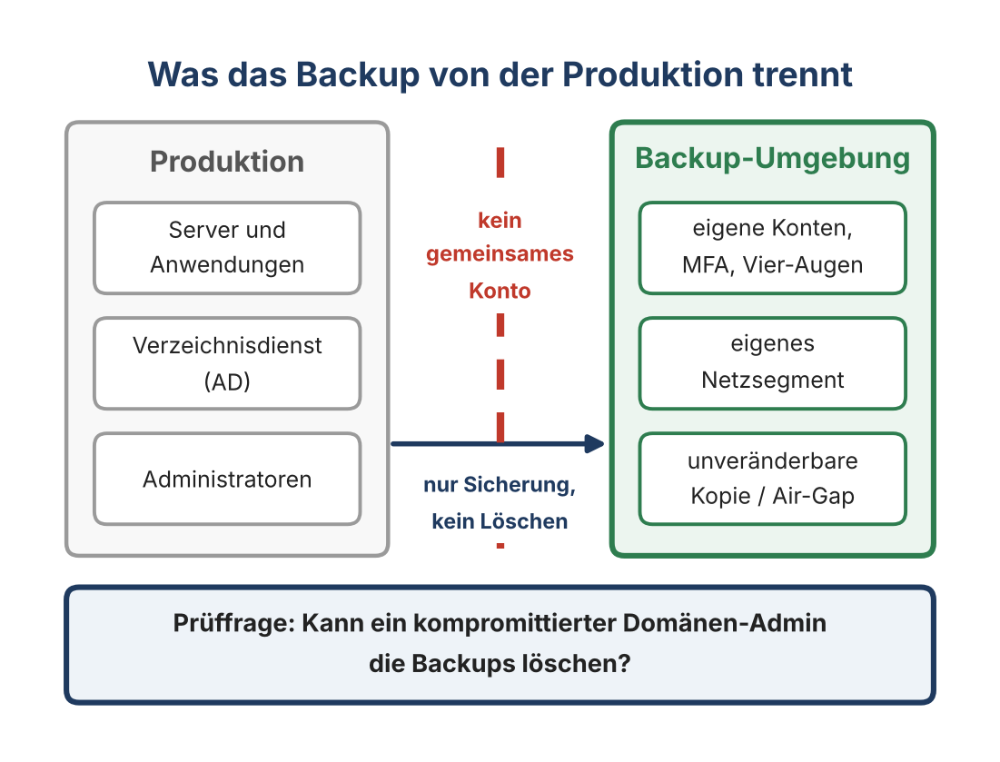
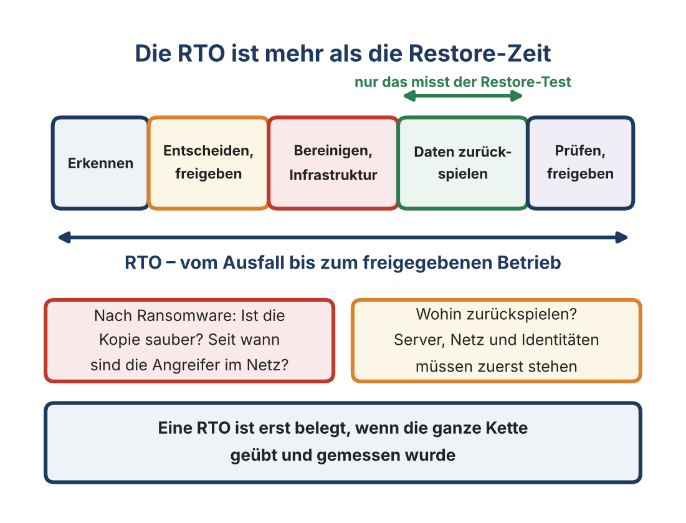
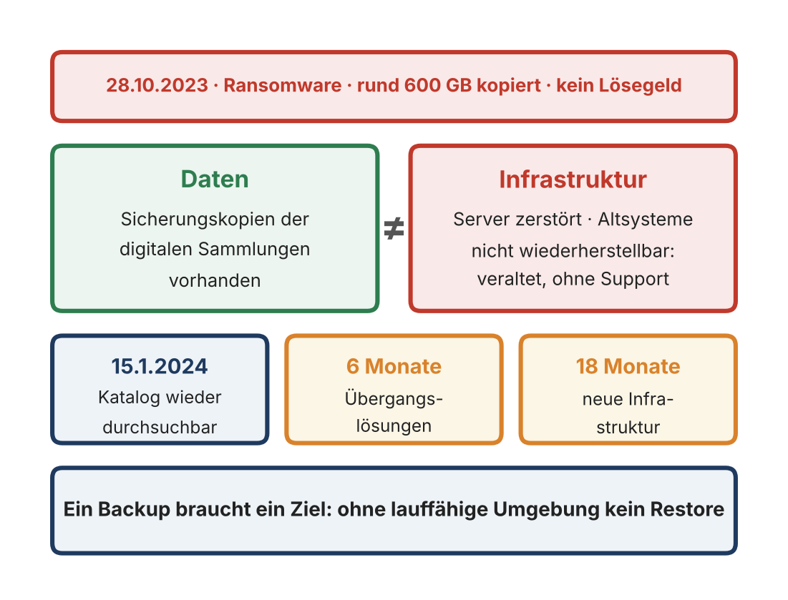
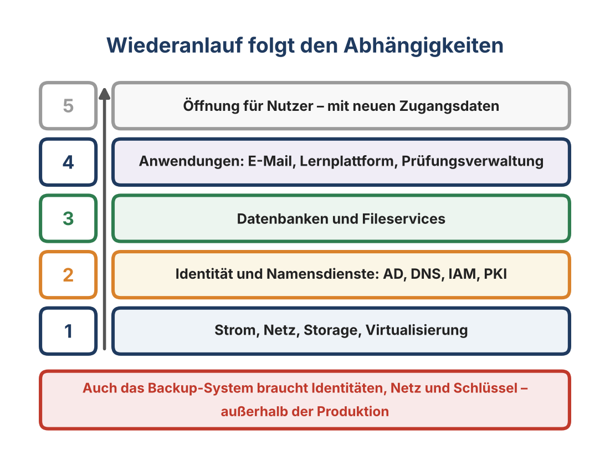
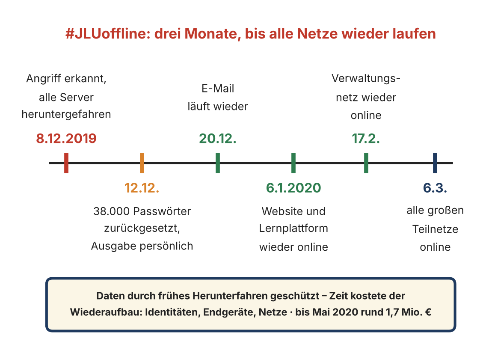
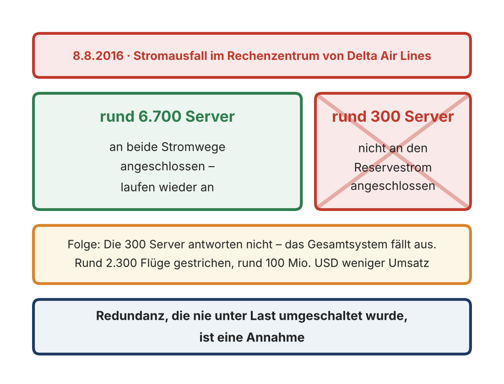

::: {.content-visible when-format="html"}
[Semesterübersicht](../index.html) · [Folien](../Präsentationen/Termin-07/_output/main.html) · [Skript](../skripte/Skript-07.html) ([PDF](../skripte/Skript-07.pdf), [Word](../skripte/Skript-07.docx)) · [Glossar](../glossar.html) · [Quellen](../quellen.html)
:::

# Leitfrage

> Wie stellen wir sicher, dass wir Systeme und Daten auch unter Worst-Case-Bedingungen zuverlässig wiederherstellen können?

# Lernziele

Nach diesem Termin können Studierende

- Bedeutung und Funktionsweise von Backups, Disaster Recovery und Notfalltests erklären – und warum technische Resilienz mehr ist als „ein Backup haben“,
- Backup, Archiv und Redundanz unterscheiden,
- Backup- und DR-Strategien vergleichen und Risiken in der Praxis identifizieren,
- die Rolle von Tests für die tatsächliche Wiederherstellbarkeit beurteilen,
- an realen Fällen begründen, warum ein Backup isoliert sein, außerhalb der Steuerungsebene liegen und ein lauffähiges Ziel haben muss.

# Einstieg: CloudNordic 2023

Am 18. August 2023 gegen 4 Uhr legte Ransomware die dänischen Hosting-Anbieter CloudNordic und AzeroCloud vollständig lahm. Nach Darstellung des Unternehmens verschlüsselten die Angreifer die Platten aller Server sowie das primäre und das sekundäre Backup-System. Der Angriff fiel in einen Umzug in ein anderes Rechenzentrum: Bereits infizierte Server wurden dabei an das interne Netz angeschlossen, über das auch die zentrale Verwaltung und die Backup-Systeme erreichbar waren. Der Anbieter zahlte kein Lösegeld; Hinweise auf einen Datenabfluss gab es nach seinen Angaben nicht. Wiederherstellen ließ sich kaum etwas – die meisten Kunden verloren alle Daten, die dort lagen.

{fig-alt="Kundenserver, primäres und sekundäres Backup in einem internen Netz, über die zentrale Verwaltung alle verschlüsselt" width="65%"}

Es gab zwei Backup-Ebenen, und keine hat geholfen. Darum geht es in dieser Sitzung: Wann ist eine Kopie ein Backup – und wann funktioniert der Weg zurück?

# Fachinhalte

## Rückblick

Rollenstruktur (CISO, SOC, CERT, DPO, BCM, IT Ops, Management), Kommunikation und Eskalationslogik, Konfliktzonen und Governance-Lösungen. Resilienz entsteht durch Klarheit, Vertrauen und Informationsfluss. Sitzung 6 fragte, wer entscheidet – etwa über Restore-Freigabe und Lösegeld. Jetzt folgen die technischen Mechanismen, über die entschieden wird.

## Warum Backups unverzichtbar sind

Backups sind die letzte Verteidigungslinie. Sie greifen, wenn alle vorgelagerten Schutzmechanismen versagt haben, und stellen einen historischen Zustand wieder her. Fehlerquellen: **Ransomware**, **Insider-Angriffe**, **Hardware-Ausfälle**, **menschliche Fehler** und Softwarefehler.

Moderne Ransomware-Kampagnen versuchen gezielt, Backup-Repositories zu kompromittieren, Snapshots und Shadow Copies zu löschen, Backup-Server zu übernehmen und Zugangsdaten von Backup-Administratoren zu stehlen. Backups sind deshalb ein zentrales Security-Control: Sie müssen **manipulationssicher, isoliert und wiederherstellbar** sein. Ohne funktionierende Backups drohen Wiederaufbaukosten, Haftungs- und Reputationsschäden, wochenlange Unterbrechungen und kompletter Datenverlust.

## Backup vs. Archiv vs. Redundanz

| | Backup | Archiv | Redundanz |
|---|---|---|---|
| Zweck | Wiederherstellung vergangener Zustände | Langzeitaufbewahrung, Compliance | kontinuierliche Verfügbarkeit (Hochverfügbarkeit) |
| Merkmale | zeitpunktbezogen, getrennt vom Produktivsystem | unveränderbar (WORM), stabile Formate, seltener Zugriff | parallele Komponenten (RAID, Cluster, Failover-Paare) |
| Grenze | kein Langzeitarchiv | kein Ersatz für Systemwiederherstellung | löst keine logischen Probleme – spiegelt Fehler oft nur schneller |

Typische Missverständnisse: „Wir haben RAID, also haben wir Backups.“ – „Wir archivieren alles, das reicht.“ – „Unsere Cloud repliziert automatisch alles.“ – „Snapshots sind doch Backups.“

**Backups sichern Daten. Archive sichern Dokumentation. Redundanz sichert Verfügbarkeit.** Keine dieser Maßnahmen ersetzt die anderen.

**Fall Universität Kyoto (2021):** Zwischen dem 14. und 16. Dezember 2021 löschte das Backup-Programm des Supercomputers der Universität Kyoto Dateien im Speichersystem /LARGE0. Der Hersteller hatte ein Skript geändert, das Logdateien löschen sollte, die älter als zehn Tage waren; weil es während der Ausführung überschrieben wurde, traf der Löschbefehl Nutzdaten. Betroffen waren rund 77 Terabyte, rund 34 Millionen Dateien von 14 Forschungsgruppen. Zehn Gruppen erhielten ihre Daten aus einer Sicherung zurück; für vier Gruppen gab es keine weitere Kopie, ihre Daten waren endgültig verloren. Der Hersteller übernahm in einem von der Universität veröffentlichten Schreiben die volle Verantwortung. Ein Angreifer war nicht beteiligt: Das Backup-System selbst hat weitreichende Rechte auf Produktivdaten, und eine einzige Sicherungsebene ist keine „3“.

{fig-alt="Update des Backup-Skripts, fehlerhafter Löschbefehl, 34 Millionen Dateien von 14 Gruppen gelöscht; zehn Gruppen wiederhergestellt, vier Gruppen ohne Backup" width="65%"}

## Die 3-2-1-1-0-Regel

| Ziffer | Bedeutung |
|---|---|
| 3 | drei Kopien der Daten (Primärkopie plus zwei unabhängige Backups) |
| 2 | zwei unterschiedliche Speichermedien (z. B. Disk und Tape, lokal und Cloud) |
| 1 | eine Kopie außerhalb des Standorts (Offsite) |
| +1 | eine Kopie immutable oder air-gapped |
| +0 | null Fehler beim Restore-Test |

Die klassische 3-2-1-Regel schützt gegen lokale Katastrophen und Storage-Ausfälle. Die Erweiterung reagiert darauf, dass Angreifer Backup-Infrastrukturen gezielt angreifen: Eine Kopie muss unveränderbar sein – auch für kompromittierte Administratoren –, und **ein Backup ist nur dann ein Backup, wenn der Restore erfolgreich getestet wurde.**

- **Air-Gap:** physisch (Tape wird nur zur Sicherung verbunden) oder logisch (zeitgesteuerte, kontrollierte Zugänge, One-Way-Links). Sehr sicher, verlangt organisatorische Disziplin.
- **Immutable:** WORM-Technologien, unveränderbare Cloud-Objektspeicher, Dateisysteme mit unveränderbaren Snapshots.
- **Medienvielfalt:** Identische Medien schützen kaum gegen Firmwarefehler, Seriendefekte, Brand, Überspannung oder Angriffe auf das Storage-System.
- **Retention:** tägliche, wöchentliche, monatliche und jährliche Aufbewahrung sowie gesetzliche Fristen; häufiger Fehler sind über Jahre gewachsene, inkonsistente Policies.

## Backup-Typen

| Typ | Sichert | Vorteil | Nachteil |
|---|---|---|---|
| Vollbackup | alle ausgewählten Daten | vollständig, schneller Restore | lange Dauer, hoher Speicherbedarf |
| Inkrementell | Änderungen seit dem letzten Backup beliebigen Typs | sehr schnell, wenig Speicher, häufig möglich | Restore braucht die ganze Kette; anfällig bei beschädigtem Glied |
| Differenziell | Änderungen seit dem letzten Vollbackup | Restore aus Voll- plus letztem Differenzbackup | wächst mit der Zeit |
| Snapshot | Zeitpunktabbild auf Storage- oder Hypervisor-Ebene | sehr schnell, ideal für kurzfristige Rollbacks | hängt am Storage, bei dessen Schaden oft mitbetroffen |

**Snapshots ≠ Backups.** Sie sind Teil einer Verfügbarkeitsstrategie. Cloud-native Backups (Versionierung, Datenbank-Snapshots, regionenübergreifende Replikation) unterliegen dem Shared-Responsibility-Modell. Robuste Strategien kombinieren risikobasiert: wöchentliches Vollbackup, tägliches differenzielles Backup, inkrementelle Sicherungen alle zwei Stunden, Snapshots vor kritischen Updates, monatliche Archive und eine immutable Offsite-Kopie.

## Backup-Architekturen

| | On-Prem | Cloud | Hybrid |
|---|---|---|---|
| Stärken | volle Kontrolle, geringe Latenz, keine externen Abhängigkeiten | geografische Verteilung, Skalierung, einfache Offsite-Sicherung | schneller lokaler Restore plus Cloud-Offsite-Kopie, Kosten steuerbar |
| Risiken | Investitionskosten, physische Risiken, Katastrophen treffen alles zugleich | Anbieterabhängigkeit, Egress-Kosten, Fehlkonfiguration, Shared Responsibility | höhere Komplexität, Governance bei Identitäten, Datenklassifizierung nötig |

Air-Gap- und Immutable-Technologien lassen sich in jede Architektur integrieren. **Shared Responsibility:** Der Cloud-Anbieter sichert die Infrastruktur; Daten, Konfigurationen und Zugänge sichert der Kunde. Architekturfragen: Welche Systeme sind geschäftskritisch? Welche RTO/RPO gelten? Wie hoch ist die Änderungsrate? Welche Angriffsvektoren müssen ausgeschlossen werden? Die Architektur passt zum Risiko – nicht umgekehrt.

**Fall UniSuper (2024):** Am 2. Mai 2024 verlor der australische Pensionsfonds UniSuper den Zugriff auf seine Private Cloud bei Google Cloud. Ursache war nach Angaben von Google ein Parameter, der bei der Einrichtung Anfang 2023 leer geblieben war: Das System setzte dadurch eine feste Laufzeit von einem Jahr und löschte die Umgebung an deren Ende automatisch – ohne Warnung an den Kunden, weil die Löschung nicht von ihm ausging. UniSuper hatte die Umgebung über zwei Standorte gespiegelt; die Löschung traf beide. Mehr als 600.000 Mitglieder konnten über eine Woche nicht auf ihre Konten zugreifen, die volle Wiederherstellung dauerte rund zwei Wochen. In einer gemeinsamen Erklärung der beiden Unternehmenschefs heißt es, die Backups bei einem zusätzlichen Anbieter hätten den Datenverlust minimiert und die Wiederherstellung deutlich erleichtert. Der Fall ist das positive Gegenstück zu CloudNordic. Georedundanz ist Redundanz: Sie schützt vor dem Ausfall eines Standorts, nicht vor einer Löschung über die gemeinsame Steuerungsebene. Die „1“ der 3-2-1-1-0-Regel bedeutet heute: eine Kopie außerhalb der Schadensdomäne – technisch und vertraglich.

{fig-alt="Zwei Standorte unter einem Vertrag gelöscht, Backup bei einem anderen Anbieter nicht betroffen" width="65%"}

## Zero-Trust-Backup

- Multi-Faktor-Authentifizierung
- Netzwerksegmentierung
- keine „God-Admins“: getrennte Administratorrollen, Least Privilege
- Backup-Server nicht im selben AD wie die Produktivsysteme

**Prüffrage:** Kann ein kompromittierter Domänen-Administrator die Backups löschen? Lautet die Antwort „ja“, sind die Backups Teil der Angriffsfläche.

{fig-alt="Produktion links, Backup-Umgebung mit eigenen Konten, eigenem Netzsegment und unveränderbarer Kopie rechts; kein gemeinsames Konto" width="55%"}

## Disaster Recovery

Disaster Recovery (DR) ist die Fähigkeit, komplette Systeme und Dienste nach einem schweren Ereignis in definierter Zeit und mit definiertem Datenverlust wieder bereitzustellen. Auslöser: Ransomware, RZ-Ausfall, schwere Cloud-Fehlkonfiguration, Verlust zentraler Storage-Systeme, Strom- oder physische Schäden, Sabotage.

| Disaster Recovery | Business Continuity Management |
|---|---|
| technische Wiederherstellung | organisatorische Betriebsfortführung |
| Fokus IT-Systeme | Fokus Geschäftsprozesse |
| RTO/RPO | Business Impact Analysis |
| Recovery-Pläne | Notfallpläne und Ausweichprozesse |

**DR = Wiederherstellung, BCM = Fortführung.** Robustes BCM braucht funktionierendes DR.

**RTO und RPO:** RTO = Zeit, RPO = Datenverlust. RTO 4 h verlangt schnelle Verfügbarkeit, RTO 0 redundante Architekturen (Active/Active). RPO 0 erlaubt keinen Datenverlust, RPO 24 h erlaubt tägliche Sicherungen. Beide bestimmen die DR-Strategie, Kosten und Komplexität.

**Die RTO ist mehr als die Restore-Zeit.** Die RTO umfasst mehr als die Zeit, in der Daten zurückgespielt werden. Dazu gehören das Erkennen, die Entscheidung und Freigabe des Restores, das Bereinigen und der Aufbau der Infrastruktur, das Zurückspielen selbst sowie die Prüfung und Freigabe des Betriebs. Der übliche Restore-Test misst nur den vierten Schritt. Nach einem Ransomware-Angriff kommt die Frage hinzu, welcher Sicherungsstand sauber ist; sind die Angreifer seit Wochen im Netz, steigt faktisch auch das RPO.

{fig-alt="Erkennen, Entscheiden und Freigeben, Bereinigen und Infrastruktur, Daten zurückspielen, Prüfen und Freigeben" width="65%"}

**Fall British Library (2023):** Am 28. Oktober 2023 wurde ein Ransomware-Angriff sichtbar, bei dem große Teile der Serverlandschaft verschlüsselt oder zerstört und rund 600 Gigabyte kopiert wurden; die Bibliothek zahlte kein Lösegeld. Nach ihrem eigenen Bericht vom 8. März 2024 existieren Sicherungskopien der digitalen Sammlungen. Es fehlte die Infrastruktur, um sie zurückzuspielen: Viele Altsysteme ließen sich nicht wiederherstellen, weil sie technisch veraltet waren, keinen Herstellersupport mehr hatten oder in einer sicheren Umgebung nicht lauffähig sind. Der Online-Katalog war erst am 15. Januar 2024 wieder durchsuchbar; der Neuaufbau ist in Phasen von sechs und 18 Monaten angelegt. Der Bericht zieht 16 Lehren, darunter: Systemlebenszyklen aktiv steuern und Notfallpläne für den Totalausfall üben.

{fig-alt="Sicherungskopien vorhanden, Server zerstört und Altsysteme nicht wiederherstellbar; Katalog am 15. Januar 2024 zurück, Neuaufbau 18 Monate" width="65%"}

## DR-Strategien

| Strategie | Merkmale | RTO/RPO und Kosten |
|---|---|---|
| Cold Standby | Systeme ausgeschaltet, Daten regelmäßig kopiert | längste Wiederherstellung, günstigste Variante |
| Warm Standby | Systeme bereit, aber nicht aktiv; zeitversetzte Replikation | mittlere RTO/RPO |
| Hot Standby | nahezu vollständige, vorinstallierte Kopie | kurze Recovery, kostenintensiv |
| Active/Passive | aktives System plus Ersatzsystem, Umschalten im Fehlerfall | abhängig von Umschaltautomatik |
| Active/Active | beide Systeme gleichzeitig produktiv | maximale Verfügbarkeit, höchste Kosten und Komplexität |
| Multi-Cloud DR | zwei unabhängige Cloud-Umgebungen | schützt gegen Anbieterausfall, hoher Testaufwand |

**Abhängigkeiten und Reihenfolge:** Identitätsdienste (AD) vor Applikationen, DNS und IAM vor allem Weiteren, Storage vor VMs, Middleware vor Anwendungen. Eine falsche Reihenfolge macht DR wirkungslos. Der DR-Plan dokumentiert Schritte, Reihenfolgen, Rollen, Tools, Zugangsdaten, Netzwerkpfade und Notfallkontakte.

{fig-alt="Fünf Schichten von unten nach oben: Strom, Netz, Storage und Virtualisierung; Identität und Namensdienste; Datenbanken und Fileservices; Anwendungen; Öffnung für Nutzer" width="60%"}

**Fall Universität Gießen (2019):** Am 8. Dezember 2019 erkannte die Justus-Liebig-Universität Gießen einen Cyberangriff und fuhr alle Server herunter; gegen 18 Uhr war sie vollständig offline (#JLUoffline). Nach Angaben der Universität blieben die wissenschaftlichen Daten und die Datenbestände der Verwaltung durch das frühe Herunterfahren geschützt. Die Zeit kostete der Wiederaufbau: Rund 38.000 Passwörter wurden zurückgesetzt und gegen Ausweis persönlich ausgegeben, mehrere tausend Windows-Rechner einzeln geprüft. Die E-Mail lief am 20. Dezember wieder, Website und Lernplattform am 6. Januar 2020, das Verwaltungsnetz am 17. Februar, alle großen Teilnetze am 6. März. Die Universität beziffert die Kosten bis Mai 2020 auf rund 1,7 Millionen Euro. Die Reihenfolge folgt den Abhängigkeiten: erst Identitäten, dann Kommunikation, dann Lehre, dann Verwaltung. Sie zeigt auch, dass der erste Schritt – neue Zugangsdaten für alle – ohne funktionierende IT organisiert werden muss.

{fig-alt="Zeitleiste vom 8. Dezember 2019 bis 6. März 2020" width="65%"}

**Typische DR-Fehler:** Restore funktioniert nicht; Dokumentation fehlt oder ist veraltet; Abhängigkeiten sind unbekannt; unrealistische RTO/RPO (RTO 1 h bei täglichem Backup?); DR-Umgebung weicht von der Produktion ab (Versionen, IP-Räume, Zertifikate).

## Notfalltests

„Ein Backup, das nicht getestet wurde, ist kein Backup.“ Notfalltests simulieren den Ernstfall, bevor er eintritt, decken Schwachstellen auf, üben Rollen und Abläufe, verbessern die Dokumentation und machen Reaktionszeiten realistisch einschätzbar [@nist80034r1].

| Testform | Beschreibung | Geeignet für |
|---|---|---|
| Tabletop | Szenarien werden diskutiert, keine Systeme verändert | erste Tests, Sensibilisierung, Eskalationspfade |
| Technical Dry Run | einzelne Schritte, Restore einzelner Datenbanken oder VMs | Routine, schrittweise Verbesserung |
| Full Failover | reale Umschaltung, Messung von RTO und RPO | höchster Erkenntnisgewinn, hoher Aufwand und Risiko |
| Controlled Outage / Chaos Engineering | gezieltes Abschalten, Unterbrechen von Pfaden (z. B. Netflix Simian Army) | Schwachstellen unter realitätsnahen Bedingungen |

**Erfolgskriterien:** vorab definierte Ziele, aktualisierte Dokumentation, gemessene RTO/RPO, umgesetzte Lessons Learned, reproduzierbare Tests. **Häufige Probleme:** fehlende Verantwortlichkeiten, veraltete Pläne, mangelnde Testtiefe, fehlende Testumgebung, beschädigte Backup-Ketten, kein Rollback-Plan, Angst vor Störung des Produktivsystems. Notfalltests gehören in einen Zyklus aus Planen, Testen, Dokumentieren, Bewerten, Anpassen und Wiederholen (PDCA, OODA).

**Mindesterwartung laut Skript:** monatlicher Restore-Test, vierteljährlicher Tabletop-Test, jährlicher Full-Failover-Test.

**Fall Delta Air Lines (2016):** Am 8. August 2016 fiel im Rechenzentrum von Delta Air Lines in Atlanta ein Stromschaltmodul aus und geriet in Brand. Die Umschaltung auf den Reservestrom griff, doch rund 300 der etwa 7.000 Server waren nicht daran angeschlossen. Sie antworteten nicht mehr, und wegen der Abhängigkeiten fiel das Gesamtsystem aus. Delta strich rund 2.300 Flüge und bezifferte den Umsatzausfall auf rund 100 Millionen US-Dollar. Der Vorstandschef nannte die Lücke öffentlich unentdeckt und übernahm die Verantwortung. Ob und wie die Umschaltung zuvor getestet wurde, ist nicht veröffentlicht. Der Fall zeigt aber, welche Testform solche Lücken findet: Ein Tabletop nicht, ein Dry Run kaum – eine reale Umschaltung unter Last oder ein kontrollierter Ausfall schon. Gut vier Prozent der Server genügten für den Gesamtausfall.

{fig-alt="Rund 6.700 Server an beiden Stromwegen laufen wieder an, rund 300 Server ohne Reservestrom; Gesamtsystem fällt aus" width="65%"}

## Was die Fälle zeigen

| Fall | Säule | Lehre |
|---|---|---|
| CloudNordic 2023 | Backup | Kopien im selben Netz und unter derselben Verwaltung schützen nicht |
| Universität Kyoto 2021 | Backup | Auch das Backup-System ist ein Risiko; eine Sicherungsebene ist zu wenig |
| UniSuper 2024 | Backup / DR | Eine Kopie außerhalb der Steuerungsebene des Anbieters |
| British Library 2023 | DR | Ein Backup braucht ein lauffähiges Ziel |
| Universität Gießen 2019 | DR | Wiederanlauf folgt den Abhängigkeiten – Identitäten zuerst |
| Delta Air Lines 2016 | Tests | Ungetestete Redundanz ist eine Annahme |

Die 3-2-1-1-0-Regel hätte CloudNordic und Kyoto verhindert und hat UniSuper gerettet. British Library, Gießen und Delta zeigen, dass sie nicht genügt: Dort fehlten DR-Fähigkeit und Tests.

## Häufige Irrtümer

| Irrtum | Gegenbeispiel |
|---|---|
| „Wir haben zwei Backups, das reicht.“ | CloudNordic 2023: beide Ebenen im selben Netz verschlüsselt |
| „Datenverlust kommt von Angreifern.“ | Universität Kyoto 2021: Das Backup-Programm löschte 77 TB |
| „Unsere Cloud repliziert automatisch alles.“ | UniSuper 2024: Die Löschung traf beide Standorte |
| „Wenn die Daten gesichert sind, sind wir schnell zurück.“ | British Library 2023: Daten vorhanden, Altsysteme nicht wiederherstellbar |
| „Der Restore beginnt mit den Daten.“ | Universität Gießen 2019: zuerst 38.000 neue Passwörter |
| „Wir haben Redundanz, also brauchen wir keinen Test.“ | Delta 2016: 300 Server ohne Reservestrom, unentdeckt |

# Normativer Bezug

| Standard / Leitlinie | Relevanz |
|---|---|
| NIST SP 800-34 Rev. 1 [@nist80034r1] | Notfallplanung für IT-Systeme, Tests und Übungen |
| BSI-Standard 200-4 [@bsi2004] | Business Continuity Management, Wiederanlauf, Übungen |
| ISO/IEC 27031 [@iso27031] | IKT-Bereitschaft für Business Continuity |
| ISO 22301 [@iso22301] | BCMS, Business-Impact-Analyse als Quelle von RTO und RPO |

# Übung: „Plan the Worst Day“

Sie sind das neu zusammengestellte Resilienzteam des Rechenzentrums der Hochschule Mainz. Am Wochenende wurde das Hochschulnetz – glücklicherweise nur simuliert – durch einen kombinierten Ransomware- und Datenbankkorruptionsvorfall gestört. Entwickeln Sie in 90 Minuten ein technisches Resilienzkonzept für: (1) Lernplattform (Moodle), (2) Identity Management / Active Directory, (3) E-Mail & Collaboration, (4) Prüfungsdatenbank, (5) Fileservices, (6) Hochschul-Webseite mit CMS.

**Teil 1 – Backup-Konzept (ca. 30 Minuten):** Welche Daten, wie oft, welcher Backup-Typ? Wie wird 3-2-1-1-0 umgesetzt, wo liegt die Offsite-Kopie, wie wird das Backup gegen Ransomware geschützt, welche Retention gilt? Ergebnis: Tabelle pro System.

**Teil 2 – DR-Plan (ca. 30 Minuten):** RTO und RPO je System, DR-Strategie, Abhängigkeiten (AD vor E-Mail, DNS vor allem), Wiederherstellungsreihenfolge, zuerst benötigte Infrastruktur (Storage, Netzwerk, IAM). Ergebnis: diagrammatischer DR-Plan mit tabellarischer Priorisierung.

**Teil 3 – Notfalltest-Konzept (ca. 30 Minuten):** Testarten und Häufigkeit für zwölf Monate, Metriken (RTO-Abweichung, RPO-Erreichung, Datenintegrität, gefundene Schwachstellen), Dokumentation und Umsetzung der Lessons Learned. Ergebnis: Jahres-Testplan mit Erfolgsindikatoren.

# Prüfungsrelevante Leitfragen

1. Warum sind Backups eine zentrale Säule der technischen Resilienz, und warum gelten sie als letzte Verteidigungslinie?
2. Worin unterscheiden sich Backup, Archiv und Redundanz, und warum können sie einander nicht ersetzen?
3. Was beschreibt die 3-2-1-1-0-Regel? Was bedeutet die „0“?
4. Erklären Sie Voll-, inkrementelle und differenzielle Backups. Warum sind Snapshots keine Backups?
5. Welche Vor- und Nachteile haben On-Prem-, Cloud- und Hybrid-Backup-Architekturen? Was bedeutet Shared Responsibility?
6. Was ist Disaster Recovery, und wie unterscheidet es sich vom BCM?
7. Definieren Sie RTO und RPO und erklären Sie ihren Einfluss auf die DR-Strategie.
8. Welche DR-Strategien gibt es, und wie hängt ihre Kostenstruktur mit RTO/RPO zusammen?
9. Welche Testarten gibt es, und warum gilt: „Ein ungetestetes Backup ist kein Backup“?
10. Welche typischen Fehler gefährden technische Resilienz, und wie lassen sie sich vermeiden?
11. Erläutern Sie am Fall CloudNordic 2023, warum mehrere Backup-Ebenen allein nicht genügen.
12. Warum ist Georedundanz kein Backup? Begründen Sie am Fall UniSuper 2024.
13. Aus welchen Schritten setzt sich die RTO zusammen, und welchen misst ein üblicher Restore-Test?

**Merksatz:** Backups retten Daten. Disaster Recovery rettet Systeme. Tests retten den Betrieb.

# Vor- und Nachbereitung

**Hausaufgabe:** Beantworten Sie für eine Organisation Ihrer Wahl die Prüffrage: Kann ein kompromittierter Administrator die Backups löschen? Skizzieren Sie, welche Konten und welche Netzgrenzen zwischen Produktion und Backup liegen.

**Ausblick Termin 8:** Zero Trust, Microsegmentation, Cloud Resilience und Network Design.

# Material aus dem Archiv

Das vollständige Vorlesungsskript zu dieser Sitzung steht unter [Skript 7](../skripte/Skript-07.html), auch als [PDF](../skripte/Skript-07.pdf) und [Word-Datei](../skripte/Skript-07.docx).

`07 Technische Resilienz I/07_Technische Resilienz I.pdf` und `Skript Sitzung 7 Technische Resilienz I.pdf` (mit Übungsanleitung).
