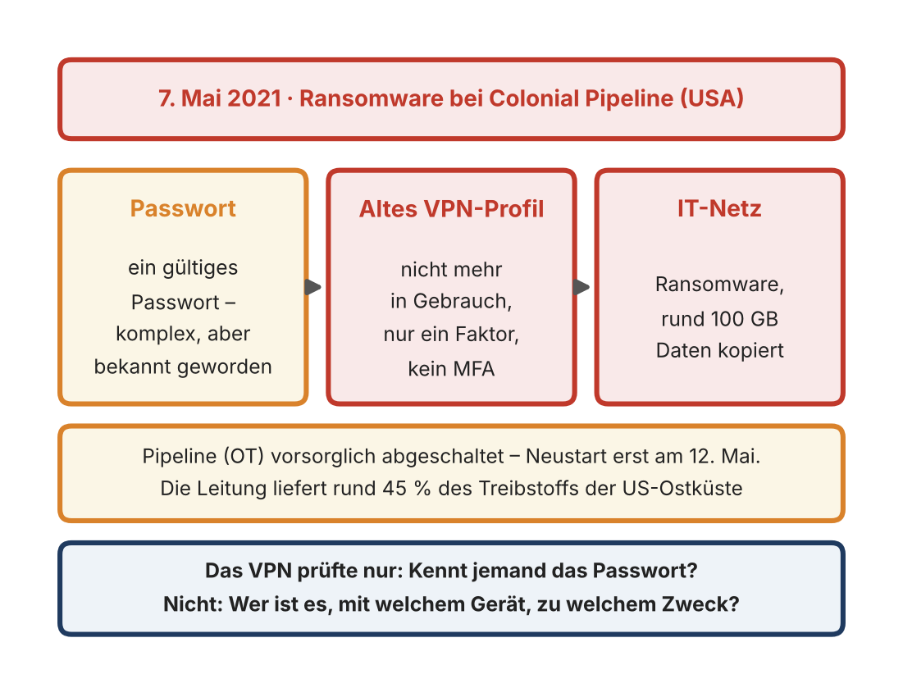
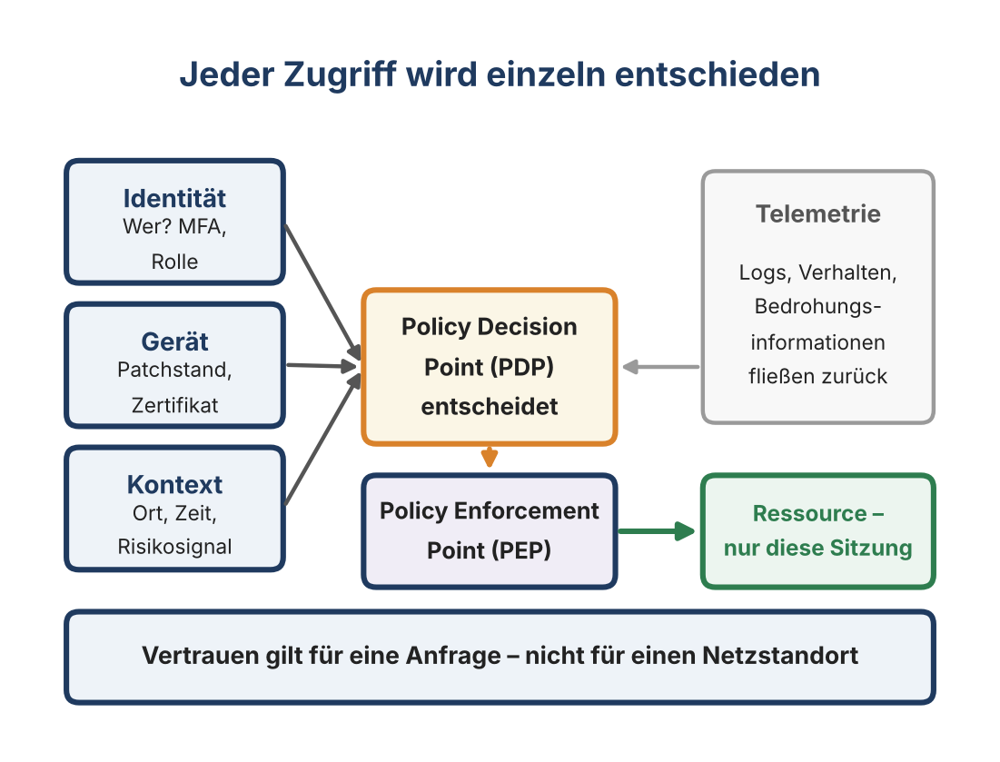
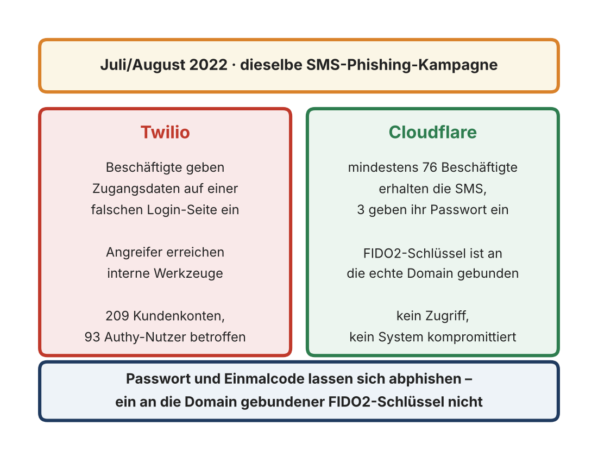
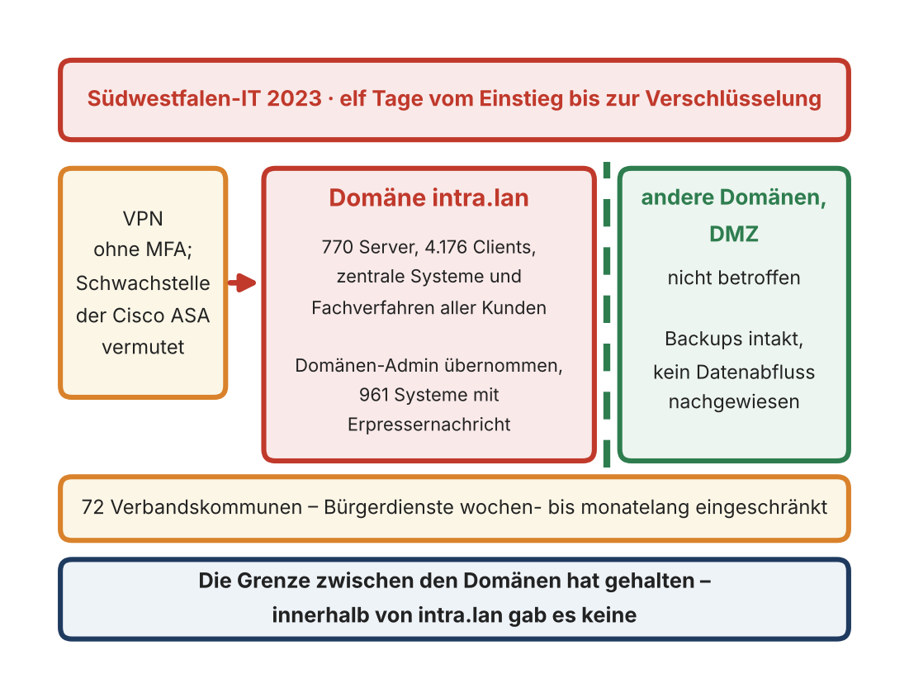
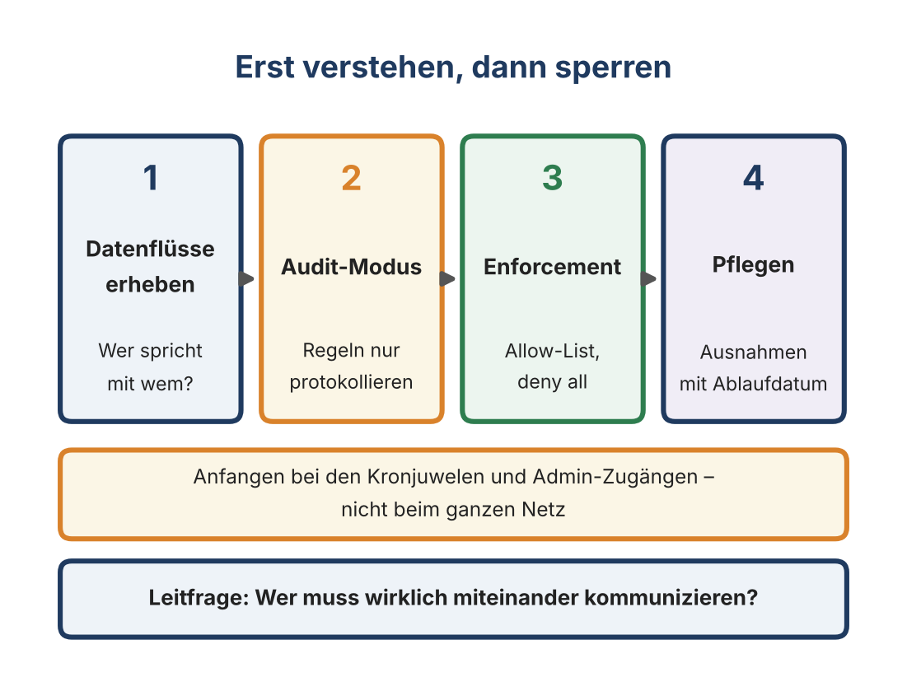
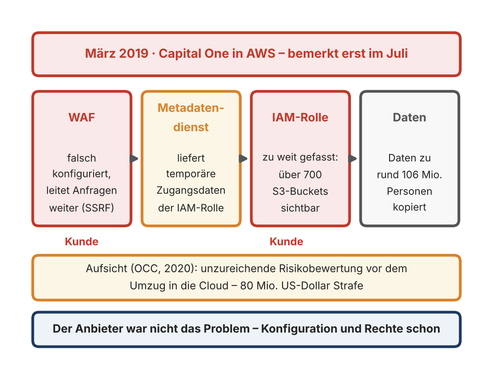
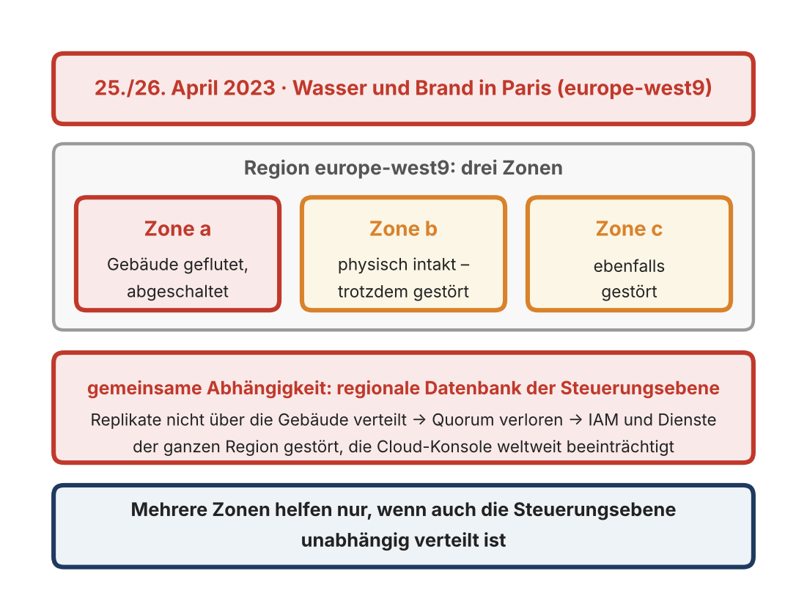
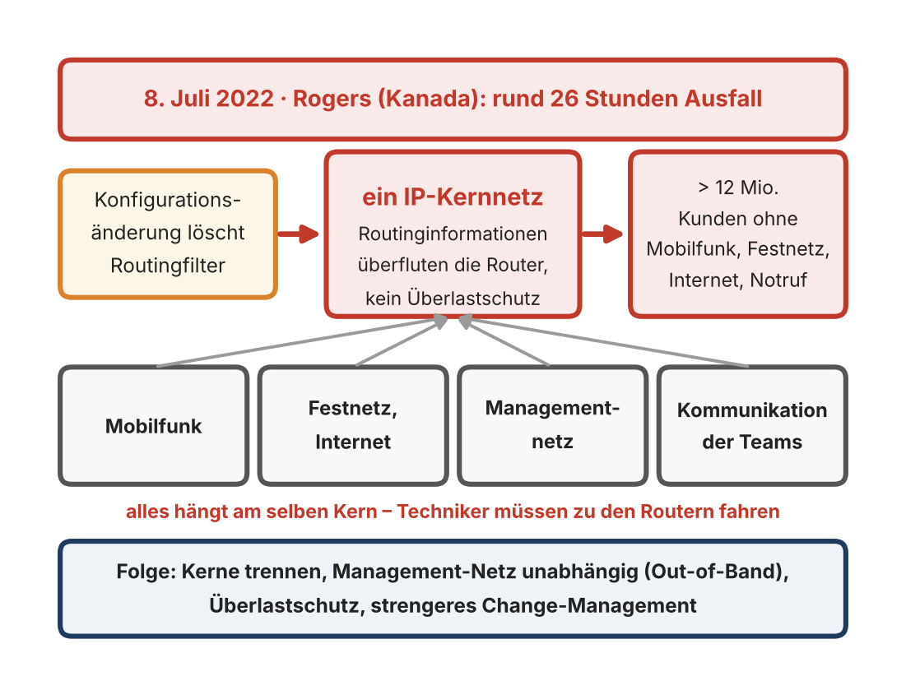
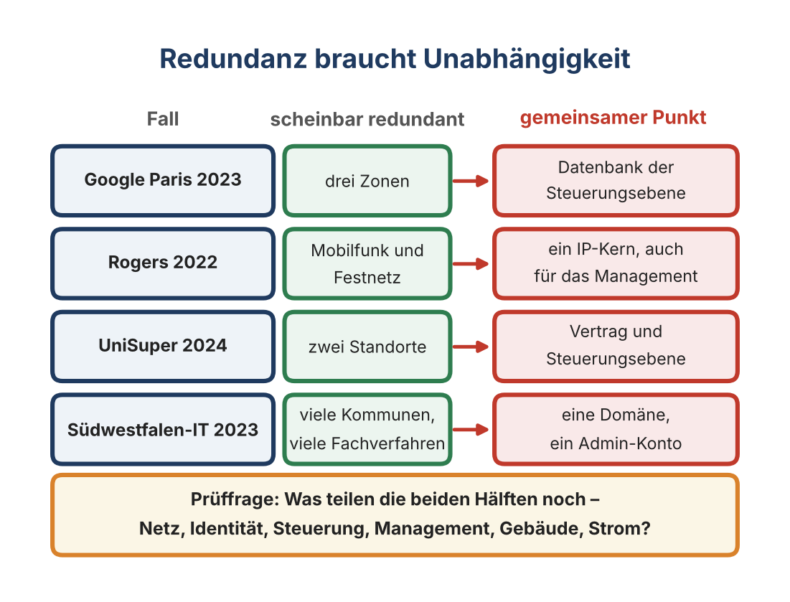
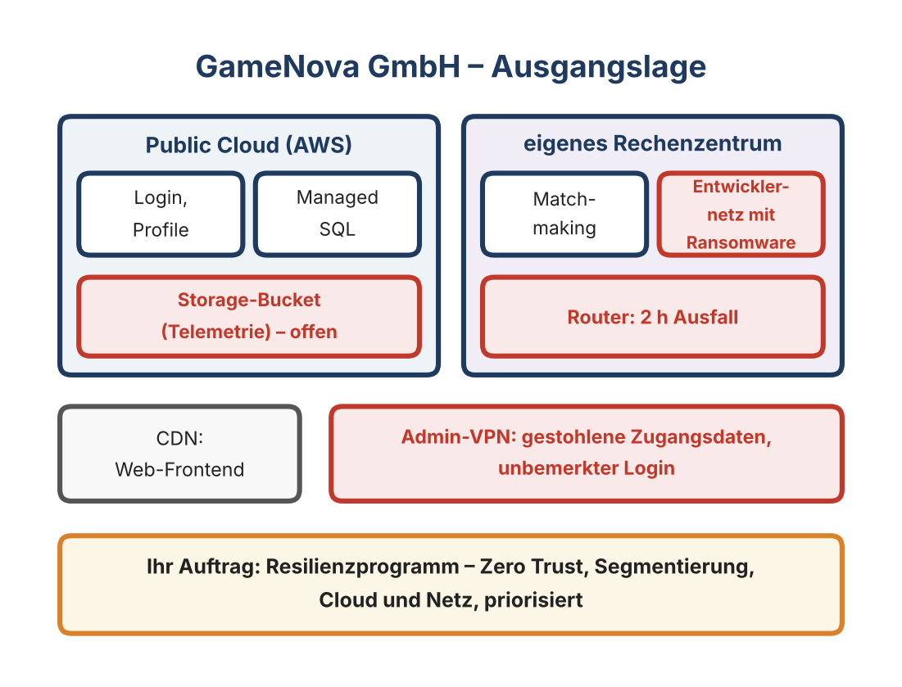

::: {.content-visible when-format="html"}
[Semesterübersicht](../index.html) · [Folien](../Präsentationen/Termin-08/_output/main.html) · [Skript](../skripte/Skript-08.html) ([PDF](../skripte/Skript-08.pdf), [Word](../skripte/Skript-08.docx)) · [Glossar](../glossar.html) · [Quellen](../quellen.html)
:::

# Leitfrage

> Wie begrenzt Architektur den Schaden, wenn Prävention versagt?

Von Wiederherstellung zu Widerstandsfähigkeit: Resilienz ist mehr als Backups.

# Lernziele

Nach diesem Termin können Studierende

- Zero Trust verstehen und anwenden,
- erklären, wie laterale Bewegung verhindert wird,
- Cloud-Strukturen resilient gestalten,
- Netzarchitektur als Resilienzinstrument nutzen,
- das Zusammenspiel der vier Ansätze begründen und priorisieren,
- an realen Fällen begründen, warum ein Passwort kein Zugang zum Netz sein darf, warum phishingresistente MFA zählt und warum Redundanz Unabhängigkeit braucht.

# Einstieg: Colonial Pipeline 2021

Am 7. Mai 2021 legte Ransomware das IT-Netz von Colonial Pipeline lahm, dem Betreiber der größten Treibstoffleitung der USA. Das Unternehmen schaltete die Pipeline vorsorglich ab, weil es eine Ausbreitung auf die Betriebstechnik nicht ausschließen konnte; der Neustart begann am 12. Mai. Die Leitung liefert rund 45 Prozent des Treibstoffs der US-Ostküste. Vor dem US-Senat erklärte der Vorstandschef im Juni 2021, die Angreifer hätten ein altes VPN-Profil genutzt, das nicht mehr in Gebrauch sein sollte – geschützt nur durch ein Passwort, ohne zweiten Faktor.

{fig-alt="Gültiges Passwort, altes VPN-Profil ohne MFA, Ransomware im IT-Netz; Pipeline vorsorglich abgeschaltet" width="65%"}

Das VPN fragte nur, ob jemand das Passwort kennt – nicht, wer es ist, mit welchem Gerät und ob das Konto noch gebraucht wird. Darum geht es in dieser Sitzung: Wie begrenzt Architektur den Schaden, wenn ein Zugang in falsche Hände gerät?

# Fachinhalte

## Rückblick

Sitzung 7 hat das Backup von der Produktion getrennt: eine isolierte, unveränderbare Kopie, eigene Konten, ein eigenes Netzsegment. Die Prüffrage lautete: Kann ein kompromittierter Administrator die Backups löschen? Jetzt wird dasselbe Prinzip auf Zugänge, das interne Netz, die Cloud und das Netzdesign übertragen.

## Kontext: kontrollierte Verwundbarkeit

Cloud, mobile Arbeit, vernetzte Lieferketten, IoT-Produktion und Software-defined Infrastructure vergrößern Angriffs- und Fehlerflächen. Das Ziel verschiebt sich von „Schutz um jeden Preis“ zu **kontrollierter Verwundbarkeit**: Systeme bleiben trotz erfolgreicher Kompromittierung widerstandsfähig. Vier Architekturbausteine prägen moderne Resilienzstrategien:

- **Zero Trust** – Vertrauen wird nicht vorausgesetzt, sondern dynamisch überprüft.
- **Microsegmentation** – logische Aufteilung in isolierte Sicherheitszonen.
- **Cloud Resilience** – hochverfügbare, ausfallsichere Architekturen in skalierbaren Umgebungen.
- **Network Design** – Kommunikationswege ohne Single Points of Failure.

## Zero Trust

**Vom Perimeter zum Kontext.** Das klassische Burgmodell setzt implizites Vertrauen innerhalb des Perimeters voraus. Cloud, Homeoffice, BYOD, VPN-Zugänge, SaaS- und API-Ökosysteme lösen diesen Perimeter auf. Angreifer scheitern nicht mehr an der Firewall, sondern bewegen sich mit gestohlenen Zugangsdaten unbemerkt lateral. Nicht der Angriff selbst, sondern seine unbemerkte Ausbreitung wird zum größten Risiko.

**Definition:** Zero Trust verweigert implizites Vertrauen und verlangt für jeden Zugriff – unabhängig von Herkunft, Identität oder Standort – eine explizite, kontextabhängige und kontinuierliche Autorisierung [@nist800207]. Leitsätze: „Never trust – always verify“, Identität statt Netzwerkstandort, Assume Breach.

**Leitprinzipien:**

1. **Assume Breach** – Angreifer sind bereits im System oder morgen darin; Fokus auf Schadensbegrenzung.
2. **Least Privilege Access** – minimal, granular, zeitlich begrenzt (Admin-Zugriff nur für die Dauer einer Wartung).
3. **Strong Identity & Authentication** – MFA, Hardware-Token, passwortlose Verfahren.
4. **Continuous Authorization** – Zugriffe werden bei Risikosignalen, Standort- oder Gerätewechsel neu geprüft.
5. **Device & Workload Trust** – auch Endgeräte, Server, IoT und Container werden bewertet (Patchstand, Integrität, Zertifikate).
6. **Visibility, Telemetry & Policy Enforcement** – ohne Daten keine Resilienz.

Bausteine: IAM, PAM, Network Access Control, Endpoint Security und Device Posture, Policy Decision und Enforcement Points, Microsegmentation, Telemetrie/SIEM.

{fig-alt="Identität, Gerät und Kontext fließen in den Policy Decision Point; der Policy Enforcement Point gibt nur diese Sitzung frei" width="60%"}

**Fall Twilio und Cloudflare (2022):** Im Juli und August 2022 erhielten Beschäftigte mehrerer Unternehmen SMS mit Links auf täuschend echte Login-Seiten. Bei Twilio gaben Beschäftigte dort ihre Zugangsdaten ein; die Angreifer erreichten interne Werkzeuge, betroffen waren 209 Kundenkonten und 93 Nutzer der App Authy. Bei Cloudflare gaben drei von mindestens 76 angeschriebenen Beschäftigten ihr Passwort ein – ein Zugriff gelang trotzdem nicht. Cloudflare verlangt für alle Anwendungen einen FIDO2-Hardwareschlüssel, der an die echte Domain gebunden ist. Die Seite der Angreifer leitete Passwort und Einmalcode in Echtzeit weiter; gegen den Schlüssel half das nicht. Twilio verteilte danach FIDO2-Token an alle Beschäftigten. **Starke Identität heißt phishingresistente Authentisierung.**

{fig-alt="Dieselbe Kampagne: Twilio mit 209 betroffenen Kunden, bei Cloudflare verhindert der FIDO2-Schlüssel den Zugriff" width="65%"}

**Warum Zero Trust resilient macht:** begrenzt die Angriffsfläche, verhindert Eskalation, reduziert Kompromittierungsfolgen, unterstützt schnelle Recovery. **Zero Trust reduziert nicht die Wahrscheinlichkeit eines Angriffs, sondern die maximale Schadenswirkung.**

**Typische Fehler:** „Zero Trust ist ein Produkt“; organisatorische Widerstände (Admins verlieren Vollzugriffe, Fachbereiche müssen Zugriffe begründen); Legacy- und OT-Systeme ohne moderne Authentisierung; Über-Optimismus („verhindert Angriffe“); zu großer Projektscope; fehlende Erfolgsmessung (etwa Reduktion überprivilegierter Konten, kürzere Incident-Response-Dauer). Zero Trust ist ein Weg, kein Zielzustand.

## Microsegmentation

**Definition:** feingranulare, softwarebasierte Unterteilung in isolierte Sicherheitsbereiche bis auf Workload-, Endpunkt- oder Datenflussebene – nicht nur VLANs oder Firewall-Zonen, sondern Software-defined statt physisch. **Je größer die interne Bewegungsfreiheit, desto größer der potenzielle Gesamtschaden.**

**Warum Microsegmentation?** Sie stoppt laterale Bewegung, schafft klare Kommunikationspfade, hält Angriffe lokal, vereinfacht Forensik und operationalisiert Need-to-Know für ISO 27001, DSGVO, KRITIS und PCI-DSS.

**Fall Südwestfalen-IT (2023):** Der kommunale IT-Dienstleister betreibt die IT von 72 Verbandskommunen. Nach dem veröffentlichten Forensikbericht meldeten sich Angreifer ab dem 18. Oktober 2023 über das VPN an, das keine Multi-Faktor-Authentifizierung verlangte. Elf Tage später hatten sie Rechte des Domänenadministrators und verschlüsselten Systeme in der Domäne intra.lan (770 Server, 4.176 Clients), in der zentrale Systeme und Fachverfahren aller Kunden lagen. Bürgerdienste waren über Wochen eingeschränkt. Auf andere Domänen und die DMZ griff der Angriff nicht über; die Backups blieben intakt, ein Datenabfluss wurde nicht nachgewiesen. Der Bericht empfiehlt kurzfristig Segmentierung und MFA, mittelfristig Mikrosegmentierung, langfristig ein Tiering-Modell für Administratorkonten. **Die Grenze zwischen den Domänen hat gehalten – innerhalb von intra.lan gab es keine.**

{fig-alt="VPN ohne MFA, Domäne intra.lan übernommen, andere Domänen und DMZ nicht betroffen" width="65%"}

| Ansatz | Umsetzung | Stärken | Schwächen |
|---|---|---|---|
| netzwerkbasiert | L3/L4-Firewalls, SDN, virtuelle Switches, ACLs | etablierte Technik, klare Zuständigkeit | IP/Port-Regeln unflexibel, hoher Pflegeaufwand |
| host-/workloadbasiert | Host-Firewalls, Agenten, eBPF, Cloud-native Controls | unabhängig von der Topologie, sehr feingranular | Agent-Management, Performance-Risiken |
| identitäts-/applikationsbasiert | Service Accounts, Workload-Zertifikate, OIDC, SPIFFE/SPIRE | dynamisch, cloud- und containerfreundlich | braucht ausgereiftes IAM |

{fig-alt="Datenflüsse erheben, Audit-Modus, Enforcement mit Allow-List, Pflegen mit Ausnahmen mit Ablaufdatum" width="60%"}

**Policy-Design:** Die wichtigste Frage ist nicht „Wer darf rein?“, sondern „Wer muss wirklich miteinander kommunizieren?“ – Allow-List statt Block-List („deny all“), Application Dependency Mapping, kontextbasierte Regeln, zuerst Audit-Modus, dann Enforcement.

**Typische Fehler:** alles auf einmal segmentieren; Start ohne Datenflussanalyse; Segmentierung ohne Verantwortliche für Ausnahmen, Pflege und Überwachung; Verständnis als reine Security- statt Resilienzmaßnahme. „Technologie segmentiert Systeme – aber nur Organisationen segmentieren Risiko.“

## Cloud Resilience

Cloud Resilience ist die Fähigkeit cloudbasierter Systeme, trotz Störungen, Angriffen und Fehlkonfigurationen funktionsfähig zu bleiben oder sich schnell zu erholen. **Die Cloud ist nicht automatisch resilient – sie ermöglicht Resilienz, wenn man sie bewusst gestaltet.**

**Shared Responsibility Model:** Der Anbieter sichert physische Infrastruktur, Hardware, Rechenzentren und Netz. Beim Kunden bleiben Datenintegrität, IAM-Konfiguration, Backup-Strategie, Zugriffskontrollen, Logging, Segmentierung, Compliance und Datenklassifizierung. Cloud-Anbieter ≠ Datensicherung.

**Fall Capital One (2019):** Im März 2019 verschaffte sich eine frühere AWS-Beschäftigte Zugriff auf Daten der US-Bank Capital One in deren AWS-Umgebung. Eine falsch konfigurierte Web Application Firewall leitete Anfragen an interne Ziele weiter (Server-Side Request Forgery). So erhielt die Angreiferin temporäre Zugangsdaten der IAM-Rolle der Firewall – und diese Rolle durfte weit mehr als nötig, unter anderem Speicherbereiche auflisten und lesen. Betroffen waren Daten zu rund 106 Millionen Personen; Capital One erfuhr davon erst im Juli über einen externen Hinweis. Die Bankenaufsicht verhängte 2020 eine Strafe von 80 Millionen US-Dollar wegen unzureichender Risikobewertung vor dem Cloud-Umzug. Die Infrastruktur des Anbieters funktionierte wie vorgesehen; Konfiguration und Rechte lagen beim Kunden. **Least Privilege gilt auch für Maschinenidentitäten.**

{fig-alt="Falsch konfigurierte WAF, Zugangsdaten der IAM-Rolle, zu weit gefasste Rechte, Daten kopiert" width="65%"}

**Architekturprinzipien:**

1. Multi-AZ- und Multi-Region-Design
2. zustandslose, entkoppelte Anwendungen (Container, Serverless)
3. Load Balancing und Auto-Scaling
4. Immutable Infrastructure: ersetzen statt reparieren (IaC, Golden Images, GitOps)
5. Backups trotz Cloud: Off-Cloud-Kopie, regionenübergreifende Sicherung, Restore-Tests
6. resilientes IAM: phishing-resistente MFA, Just-in-Time-Privilegien, Schlüsselrotation
7. Observability und Chaos Engineering
8. optional Multi-Cloud oder Souveränitätsstrategien

„Cloud-Resilienz kommt aus Design – nicht aus einem Anbieterlogo.“

**Fall Google Cloud Paris (2023):** Am 25. April 2023 lief in einem Rechenzentrum der Region europe-west9 Kühlwasser aus und erreichte einen Batterieraum, der in Brand geriet; eines von drei Gebäuden wurde abgeschaltet. Gestört war danach die ganze Region: Nach dem Incident Report von Google waren die Replikate der regionalen Datenbank, auf der die Steuerungsebene der meisten Dienste beruht, nicht korrekt über die drei Gebäude verteilt. Mit dem Gebäude verlor sie das Quorum; damit fiel auch das regionale Rechtemanagement aus, zeitweise war die Cloud-Konsole weltweit gestört. Die direkt betroffene Zone blieb mehrere Tage ausgefallen; Datenverlust gab es laut Google nicht. **Mehrere Zonen sind nur so unabhängig wie ihre Steuerungsebene.**

{fig-alt="Zone a geflutet, Zonen b und c gestört wegen der gemeinsamen Datenbank der Steuerungsebene" width="65%"}

**Fehlannahmen:** „Der Anbieter kümmert sich um alles“; blindes Vertrauen in eingebaute Redundanz (oft nur innerhalb einer Zone); fehlende Exit-Strategie und Vendor Lock-in; Automatisierung verbreitet Fehler schneller; fehlende eigene Telemetrie; überdimensionierte Multi-Cloud-Strategien; mangelnde IAM-Hygiene. **Cloud-Resilienz ohne Test ist hypothetische Resilienz.**

## Network Resilience

Netzwerke sind die Grundlage aller anderen Resilienzmaßnahmen: Ohne Netz sind Backups nicht abrufbar, kann Zero Trust keine Identitäten prüfen und sind Cloud-Workloads nicht erreichbar. Risiken: BGP-Manipulation, DDoS, fehlerhafte Firmware- oder Konfigurationsupdates, Glasfaserschäden, Switch-Ausfälle, SPOFs in WAN- und MPLS-Verbindungen.

**Architekturprinzipien:** Redundanz statt Zentralisierung – und zwar diversifiziert (zwei Carrier, zwei Stromphasen); Eliminierung von SPOFs; resiliente Topologien; getrennte Management-, Produktions- und Benutzerzonen; DNS-, Routing- und Identity-Resilienz; Telemetrie; Automatisierung gegen Konfigurationsdrift.

**Resiliente Design Patterns:** Leaf-Spine statt klassischer Stern (symmetrische Pfade, vorhersehbare Latenz); SD-WAN zur Dezentralisierung mit dynamischem Failover; redundante Pfade und Carrier-Unabhängigkeit. DNS, Routing und IAM sind kritisch – in der Praxis scheitern Systeme häufiger an DNS oder IAM als an Hardware.

**Fall Rogers (2022):** Am 8. Juli 2022 fielen beim kanadischen Netzbetreiber Rogers Mobilfunk, Festnetz, Internet und Notruf für mehr als 12 Millionen Kunden aus, rund 26 Stunden lang. Nach dem Bericht für die Regulierungsbehörde CRTC löschte eine Konfigurationsänderung während eines Netz-Upgrades einen Routingfilter; die Kernrouter wurden mit Routinginformationen überflutet und stürzten ab, weil sie keinen Überlastschutz hatten. Mobilfunk und Festnetz liefen über denselben IP-Kern – und auch das Management-Netz. Die Techniker erreichten die Router nicht mehr aus der Ferne und mussten vor Ort fahren. Rogers trennt seitdem die Kerne, betreibt ein eigenes Management-Netz mit Leitungen Dritter (Out-of-Band) und hat das Change-Management verschärft. **Wer sein Netz nur über das Netz erreicht, verliert im Ausfall den Zugang.**

{fig-alt="Konfigurationsänderung löscht Routingfilter, ein IP-Kernnetz fällt aus; Mobilfunk, Festnetz, Management-Netz und Kommunikation der Teams hängen daran" width="65%"}

**Redundanz braucht Unabhängigkeit.** Redundanz zählt nur über Schadensdomänen hinweg. Die gemeinsamen Punkte stecken oft nicht in der sichtbaren Hardware, sondern in Steuerung, Identität und Management. Prüffrage: Was teilen die beiden Hälften noch – Netz, Identität, Steuerung, Management, Gebäude, Strom?

{fig-alt="Google Paris, Rogers, UniSuper und Südwestfalen-IT: scheinbar redundant und gemeinsamer Punkt" width="60%"}

**Fehlannahmen:** „Es läuft seit Jahren, also ist es stabil“ – Stabilität ohne Störung beweist nur Glück. Redundanz ohne Unabhängigkeit (zwei Leitungen vom selben Provider, zwei Firewalls im selben Rack). Veraltete Netzdokumentation. Keine DDoS-Strategie. Zu starke Abhängigkeit von MPLS oder VPN. „Ein Netzwerk ist nicht resilient, weil es funktioniert – sondern weil es auch dann funktioniert, wenn etwas ausfällt.“

## Zusammenspiel

| Ansatz | Primärer Fokus | Resilienzbeitrag |
|---|---|---|
| Zero Trust | Identitäten und Zugriffsentscheidungen | Schadensbegrenzung, kein implizites Vertrauen |
| Microsegmentation | interne Bewegungsfreiheit | Bewegungskontrolle, begrenzt Ausbreitung |
| Cloud Resilience | Workload- und Datenverfügbarkeit | skalierbare Wiederherstellung |
| Network Resilience | Transport und Kommunikation | stabile Grundlage, Erreichbarkeit |

Die Ansätze kompensieren gegenseitig blinde Flecken: Zero Trust begrenzt das Risiko kompromittierter Credentials, Microsegmentation begrenzt deren Folgen; Cloud Resilience erleichtert den Wiederanlauf, Network Resilience stellt die Pfade bereit. **Resilienz entsteht nicht aus Technologie, sondern aus Interoperabilität.**

Empfohlene Reihenfolge: (1) Netzwerkstabilität schaffen, (2) Identitätssysteme stärken, (3) Microsegmentation vorbereiten, (4) Cloud-Resilienz gestalten, (5) Zero Trust operationalisieren. So wird Resilienz aufgebaut, nicht eingekauft.

## Was die Fälle zeigen

| Fall | Säule | Lehre |
|---|---|---|
| Colonial Pipeline 2021 | Zero Trust | Ein Passwort darf kein Zugang zum Netz sein |
| Twilio / Cloudflare 2022 | Zero Trust | Phishingresistente MFA entwertet gestohlene Passwörter |
| Südwestfalen-IT 2023 | Microsegmentation | Grenzen halten – wo es sie gibt |
| Capital One 2019 | Cloud Resilience | Konfiguration und Rechte sind Kundenpflicht |
| Google Cloud Paris 2023 | Cloud Resilience | Zonen teilen eine Steuerungsebene |
| Rogers 2022 | Network Design | Management braucht einen eigenen Weg |

## Häufige Irrtümer

| Irrtum | Gegenbeispiel |
|---|---|
| „Wer im VPN ist, ist einer von uns.“ | Colonial Pipeline 2021: ein altes Profil, ein Passwort |
| „Wir haben MFA, Phishing ist erledigt.“ | Twilio 2022: Zugangsdaten in Echtzeit abgegriffen; Cloudflare hielt nur dank FIDO2 |
| „Die Firewall am Rand reicht.“ | Südwestfalen-IT 2023: innerhalb der Domäne keine Grenze |
| „Die Cloud ist sicher, der Anbieter kümmert sich.“ | Capital One 2019: Konfiguration und Rollenrechte des Kunden |
| „Drei Zonen sind drei unabhängige Standorte.“ | Google Paris 2023: gemeinsame Steuerungsdatenbank |
| „Zwei Dienste, also redundant.“ | Rogers 2022: ein Kern, auch für das Management |

# Normativer Bezug

| Standard / Leitlinie | Relevanz |
|---|---|
| NIST SP 800-207 [@nist800207] | Zero Trust Architecture: Grundsätze, logische Bausteine (PDP, PEP) |
| NIST SP 1800-35 [@nist180035] | Umsetzung: 19 Beispielarchitekturen mit marktüblichen Produkten |
| CISA Zero Trust Maturity Model 2.0 [@cisaztmm2] | Reifegrad in fünf Säulen: Identität, Geräte, Netze, Anwendungen, Daten |
| BSI IT-Grundschutz, NET.1.1 und NET.1.2 [@bsinet] | Netzarchitektur, Segmentierung, Netzmanagement |

# Übungsblatt: GameNova GmbH

{fig-alt="Public Cloud mit Login, Managed SQL und offenem Storage-Bucket; eigenes Rechenzentrum mit Matchmaking, Entwicklernetz mit Ransomware und Router-Ausfall; CDN und Admin-VPN mit gestohlenen Zugangsdaten" width="60%"}

Die GameNova GmbH betreibt eine Multiplayer-Gaming-Plattform hybrid: Authentifizierung und Nutzerprofile in der Public Cloud (AWS), Matchmaking-Server im eigenen Rechenzentrum, Spieldatenbank als Managed-SQL-Cloud-Service, Web-Frontend über ein globales CDN, Adminzugriff über klassisches VPN.

Vergangene Vorfälle: gestohlene Admin-Credentials mit unbemerktem Login; Ransomware in einem Entwicklernetzsegment; zweistündiger Plattformausfall durch einen Routerdefekt; offen konfigurierter Storage-Bucket mit Telemetriedaten. Die Geschäftsführung fordert ein „Resilienzprogramm“.

| Aufgabe | Punkte |
|---|---|
| **1 Zero Trust** – a) drei konkrete Prinzipien für das Szenario; b) welche Strukturen sich ändern müssen; c) realistischer erster Implementierungsschritt | 20 |
| **2 Microsegmentation** – a) zwei zwingend zu trennende Bereiche mit Begründung; b) Risiken ohne Trennung; c) benötigte Informationen vor der Regeldefinition | 20 |
| **3 Cloud Resilience** – a) drei Architekturmaßnahmen; b) warum Cloud-Datenreplikation kein Backup ersetzt; c) Backup-Strategie mit Standort, Häufigkeit und Testverfahren | 25 |
| **4 Network Resilience** – a) wahrscheinlichster SPOF; b) zwei Netzwerkdesignmaßnahmen; c) wie die Wirksamkeit geprüft wird | 20 |
| **5 Integration & Priorisierung** – a) Umsetzungsreihenfolge der vier Maßnahmen; b) Begründung nach Risiko, Aufwand und Wirkung | 15 |

Bearbeitungszeit 60–90 Minuten; Folien, Skript und Online-Recherche erlaubt; Stichpunkte genügen, müssen aber begründet sein; keine technischen Detailkonfigurationen erforderlich.

# Prüfungsrelevante Leitfragen

**Zero Trust:** Unterschied zwischen Perimeter-Sicherheit und Zero Trust? Warum ist „Assume Breach“ zentral? Welche Rolle spielt IAM? Drei Mechanismen kontinuierlicher Autorisierung? Warum ist Zero Trust keine Produktentscheidung?

**Microsegmentation:** Definition und Abgrenzung zur klassischen Segmentierung? Sicherheitsgewinn gegen laterale Bewegung? Netzwerk-, host- und identitätsbasierte Umsetzung? Warum ist eine Datenflussanalyse zwingend? Warum scheitert Microsegmentation ohne Governance?

**Cloud Resilience:** Was ist das Shared Responsibility Model, und welche Missverständnisse entstehen? Drei Architekturprinzipien? Warum ersetzt Cloud-Datenredundanz kein Backup? Risiken hoher Automatisierung? Rolle der Observability?

**Network Resilience:** Warum ist Network Resilience die Grundlage aller anderen Maßnahmen? Drei typische SPOFs? Was unterscheidet Redundanz von echter Resilienz? Vorteile von Leaf-Spine? Warum sind DNS und Routing häufiger Ausfallursache als Hardware?

**Integration und Transfer:** Wie ergänzen sich Zero Trust und Microsegmentation im Angriffsszenario? Warum kann eine Organisation mit guter Cloud-Resilienz operativ ausfallen? Welche Implementierungsreihenfolge ist sinnvoll? „Multi-Cloud erhöht automatisch Resilienz“ – stimmen Sie zu?

**Fälle:** Warum genügte bei Colonial Pipeline ein Passwort? Warum hielt Cloudflare dem Phishing stand und Twilio nicht? Was zeigt die Südwestfalen-IT über Segmentierung – im Guten wie im Schlechten? Warum fiel bei Google Paris eine ganze Region aus, obwohl nur ein Gebäude betroffen war?

**Zusammenfassung:** Resilienz ist Architektur, nicht Backup. Vertrauen wird nicht vorausgesetzt. Angriffswege werden begrenzt. Architektur entscheidet über Krisenfähigkeit.

# Vor- und Nachbereitung

**Hausaufgabe:** Suchen Sie in Ihrem Umfeld ein Gerät oder System, das sich nicht mit MFA oder einem Agenten schützen lässt (Drucker, Kamera, Gebäudesteuerung, Maschine). Mit wem muss es wirklich kommunizieren – und wie würden Sie es abschotten?

**Ausblick Termin 9:** Sonderthemen – OT-Resilienz mit Gastvortrag aus der Praxis und KI-Resilienz.

# Material aus dem Archiv

Das vollständige Vorlesungsskript zu dieser Sitzung steht unter [Skript 8](../skripte/Skript-08.html), auch als [PDF](../skripte/Skript-08.pdf) und [Word-Datei](../skripte/Skript-08.docx).

`08 Technische Resilienz II/08_Technische Resilienz II.pdf`, `08 Skript Technische Resilienz.pdf` und `08 Ubungsblatt.pdf`.
